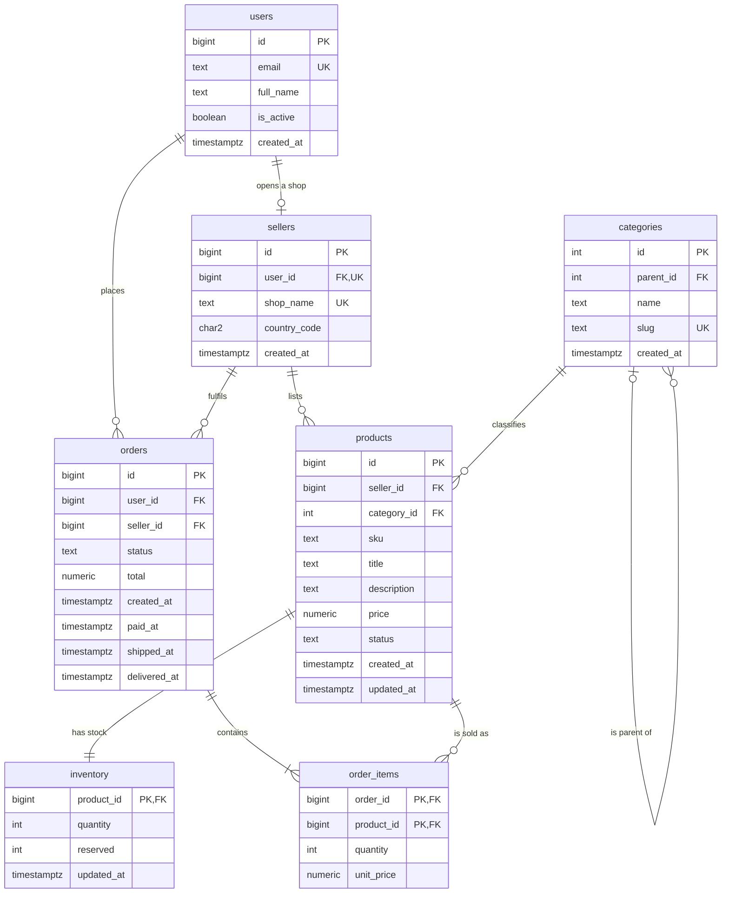

# Module 02: Data Types and Tables

<!-- nav:start -->
> **Theory** · [Exercises](exercises.md) · [Project](project.md) · [Solutions](solutions/README.md)  
> [← 01 psql and the Postgres Landscape](../01-psql/README.md) · [Course home](../../README.md) · [03 Reading and Writing Data →](../03-crud/README.md)
<!-- nav:end -->

The Bazaar database exists, but it's empty. Before the first shopper signs up, someone has to decide what a "user" is, what an "order" is, and which facts about them the database will store. Is a price `19.99` or `19.990000000001`? Is "2025-03-30 02:30 in Berlin" a real moment in time? Can two shops have the same name? Can an order point to a product that no longer exists? Every one of those questions is answered by a **data type** or a **constraint**, and it's answered once, in the table definition, for every program that will ever touch the data. In this module you learn the types PostgreSQL offers and why you'd choose one over another, the constraints that let the database defend its own data, and the DDL statements that create and change tables. You finish by building the Bazaar core schema: users, sellers, categories, products, inventory, orders and order items.

**What you'll learn**

- What a relational table is: relations, rows (tuples), columns (attributes), keys, and the idea of a schema that every row must fit. Why SQL is declarative, and the difference between DDL and DML.
- The core data types and the reasons behind each choice: `smallint`/`integer`/`bigint` and overflow; `numeric` versus `real`/`double precision` (and why money is `numeric(12,2)`, not `float` and not `money`); `text`/`varchar(n)`/`char(n)`; `boolean`; `date`, `timestamp`, `timestamptz` and `interval`, including how time zones really work; `uuid`; `bytea`.
- Identity columns versus `serial`, `GENERATED ALWAYS` versus `BY DEFAULT`, and the sequences underneath.
- Defaults, generated columns, and `NULL` as "unknown".
- Constraints: `NOT NULL`, `CHECK`, `UNIQUE` (and `NULLS NOT DISTINCT`), `PRIMARY KEY`, `FOREIGN KEY` with `ON DELETE`/`ON UPDATE` actions, and deferrable constraints.
- `CREATE TABLE`, `DROP TABLE`, `ALTER TABLE` (including type changes with `USING`, and which changes rewrite the table), `CREATE SCHEMA`, `COMMENT ON`, and inspecting it all with `\d+` and the catalogs.
- The Bazaar domain: its entities, an ER diagram, and the design decisions behind the core schema.

**Before you start**

```bash
./project/bin/reset.sh 02
./project/bin/psql.sh
```

At the start of this module the `bazaar` database contains an empty `bazaar` schema, and `search_path` is `bazaar, public` (you built exactly this in module 01). Experiments in this module go into a throwaway schema called `lab`, so they never get mixed up with the real Bazaar tables:

```sql
CREATE SCHEMA lab;
SET search_path = lab, bazaar, public;
```

`SET` only lasts for your session. If you reconnect, run the `SET` again. When you've finished the module, `DROP SCHEMA lab CASCADE;` removes every experiment in one go. Section 12 creates the real Bazaar tables in the `bazaar` schema. The examples show results from PostgreSQL 17 with the session time zone set to UTC, which is the course container's default.

You need to be comfortable with psql (module 01): `\d` and friends, `\x`, `\pset null`, and running files. You don't need to know any SQL yet. This module uses a minimal form of `INSERT` and `SELECT * FROM table` to try things out, and module 03 covers both properly.

---

<!-- toc:start -->
**Contents**

- [1. Tables and the relational model](#1-tables-and-the-relational-model)
  - [1.1 Relations, rows and columns](#11-relations-rows-and-columns)
  - [1.2 A schema for your data](#12-a-schema-for-your-data)
  - [1.3 SQL is declarative](#13-sql-is-declarative)
  - [1.4 DDL, DML, and the rest](#14-ddl-dml-and-the-rest)
  - [1.5 Your first table](#15-your-first-table)
- [2. Meet Bazaar](#2-meet-bazaar)
- [3. Numbers](#3-numbers)
  - [3.1 Integers: `smallint`, `integer`, `bigint`](#31-integers-smallint-integer-bigint)
  - [3.2 Why identifiers are `bigint`](#32-why-identifiers-are-bigint)
  - [3.3 Exact decimals: `numeric`](#33-exact-decimals-numeric)
  - [3.4 Floating point: `real` and `double precision`](#34-floating-point-real-and-double-precision)
  - [3.5 Money is `numeric(12,2)`](#35-money-is-numeric122)
- [4. Text](#4-text)
- [5. Boolean](#5-boolean)
- [6. Dates, times and time zones](#6-dates-times-and-time-zones)
  - [6.1 The types](#61-the-types)
  - [6.2 `timestamptz` is an instant, `timestamp` is a wall-clock reading](#62-timestamptz-is-an-instant-timestamp-is-a-wall-clock-reading)
  - [6.3 The session `TimeZone`](#63-the-session-timezone)
  - [6.4 `AT TIME ZONE`: converting between the two](#64-at-time-zone-converting-between-the-two)
  - [6.5 Intervals and daylight saving time](#65-intervals-and-daylight-saving-time)
  - [6.6 `now()` is the start of the transaction](#66-now-is-the-start-of-the-transaction)
- [7. `uuid`, `bytea`, and the rest](#7-uuid-bytea-and-the-rest)
  - [7.1 `uuid`](#71-uuid)
  - [7.2 `bytea`](#72-bytea)
  - [7.3 Types you'll meet later](#73-types-youll-meet-later)
- [8. Identity columns, sequences and `serial`](#8-identity-columns-sequences-and-serial)
  - [8.1 Sequences](#81-sequences)
  - [8.2 The old way: `serial`](#82-the-old-way-serial)
  - [8.3 The modern way: identity columns](#83-the-modern-way-identity-columns)
- [9. Defaults and generated columns](#9-defaults-and-generated-columns)
  - [9.1 Defaults](#91-defaults)
  - [9.2 Generated columns](#92-generated-columns)
- [10. `NULL`: the unknown value](#10-null-the-unknown-value)
- [11. Constraints: the database defends its data](#11-constraints-the-database-defends-its-data)
  - [11.1 `NOT NULL`](#111-not-null)
  - [11.2 `CHECK`](#112-check)
  - [11.3 `UNIQUE`](#113-unique)
  - [11.4 `PRIMARY KEY`](#114-primary-key)
  - [11.5 `FOREIGN KEY`](#115-foreign-key)
  - [11.6 Deferrable constraints](#116-deferrable-constraints)
  - [11.7 Reading constraint errors](#117-reading-constraint-errors)
- [12. Building the Bazaar core schema](#12-building-the-bazaar-core-schema)
  - [12.1 The schema (namespace) and a script header](#121-the-schema-namespace-and-a-script-header)
  - [12.2 `users`](#122-users)
  - [12.3 `sellers`](#123-sellers)
  - [12.4 `categories`: a table that references itself](#124-categories-a-table-that-references-itself)
  - [12.5 `products`](#125-products)
  - [12.6 `inventory`, `orders`, `order_items`: design notes](#126-inventory-orders-order_items-design-notes)
  - [12.7 Comments](#127-comments)
- [13. Changing tables: `ALTER TABLE`](#13-changing-tables-alter-table)
  - [13.1 Changing a column's type with `USING`](#131-changing-a-columns-type-with-using)
  - [13.2 The common operations](#132-the-common-operations)
  - [13.3 Locks and rewrites: why some `ALTER`s are dangerous](#133-locks-and-rewrites-why-some-alters-are-dangerous)
- [14. Inspecting what you built](#14-inspecting-what-you-built)
- [Summary](#summary)
- [What's next](#whats-next)

<!-- toc:end -->

## 1. Tables and the relational model

### 1.1 Relations, rows and columns

A relational database stores data in **tables**. The theory behind them, the *relational model* (E. F. Codd, 1970), calls a table a **relation**, a row a **tuple**, and a column an **attribute**. You'll hear both vocabularies, and they mean the same things:

| Everyday word | Relational theory | Example in Bazaar |
|---|---|---|
| table | relation | `products` |
| row | tuple | product 25, *The Lighthouse Keeper's Secret* |
| column | attribute | `price` |
| column type | domain | `numeric(12,2)` |
| table definition | relation schema (heading) | "a product has a seller, a category, a SKU, a title, ..." |

A relation is a *set of facts of the same shape*. Each row of `products` states one fact: "there is a product with id 25, sold by seller 2, titled *The Lighthouse Keeper's Secret*, costing 13.49". Every row has exactly the same columns, and each column holds one value of the column's type.

Three properties of the model matter in practice:

- **Rows have no inherent order.** A table isn't a list. When you read it, the rows come back in whatever order is cheapest for the server, which can change from one query to the next. If you need an order, you ask for it (`ORDER BY`, module 03).
- **Rows are identified by their values, not by their position.** There is no "row 3". To point at one particular row you need a column, or a combination of columns, whose value is unique: a **key**. In Bazaar every entity table has an `id` column for that purpose.
- **Each cell holds one value.** A product's `price` is a single number, not a list of prices. When you need a list (the items in an order), it becomes rows in another table (`order_items`), linked back by a key. Module 07 formalises this as *normalization*. PostgreSQL also has arrays and JSON for the cases where a list really belongs in one cell (module 08).

Strictly speaking, the theory says a relation is a *set*, so duplicate rows can't exist. SQL tables are looser: without a key, a table happily stores two identical rows. That's one of several reasons every Bazaar table gets a primary key (section 11.4).

### 1.2 A schema for your data

The word *schema* has two meanings in PostgreSQL. In module 01 you met the **namespace** meaning: `bazaar` is a schema, a folder that contains tables. The second, older meaning is the **shape of the data**: which tables exist, which columns they have, which types, and which rules every row must obey. When people say "the Bazaar schema", they usually mean the second, and it's what this module is about.

A relational database is **schema-on-write**. You declare the shape first, and then the database refuses any row that doesn't fit, at the moment it's written. Many document stores are **schema-on-read**: they accept anything, and every program that reads the data has to cope with whatever it finds. Schema-on-write costs a little up-front design work. In return:

- every program that reads `products.price` knows it's a non-negative number with two decimals, because no other value could ever have been stored;
- a bug in one service can't quietly corrupt data that ten other services rely on;
- the database knows the shape of the data, so it can store it compactly and plan queries well.

The schema is a contract. This module is about writing a good one.

### 1.3 SQL is declarative

SQL (Structured Query Language) is the language you use to talk to PostgreSQL. It is **declarative**: you describe *what* you want, not *how* to get it. Compare:

```python
# Imperative: you write the algorithm.
cheap = []
for p in products:
    if p.price < 20:
        cheap.append(p.title)
```

```sql
-- Declarative: you describe the result.
SELECT title FROM products WHERE price < 20;
```

The SQL version doesn't say whether to scan the table from the start, use an index, or split the work across CPU cores. A component of the server called the **planner** decides that, using statistics about the data (module 12). The same holds for table definitions: `price numeric(12,2) NOT NULL CHECK (price >= 0)` says *what* must be true, and the database works out when and how to check it.

### 1.4 DDL, DML, and the rest

SQL statements fall into a few families:

| Family | Purpose | Statements | Where in the course |
|---|---|---|---|
| **DDL**, Data Definition Language | define and change the *structure* | `CREATE`, `ALTER`, `DROP`, `COMMENT ON`, `TRUNCATE` | this module |
| **DML**, Data Manipulation Language | read and change the *data* | `SELECT`, `INSERT`, `UPDATE`, `DELETE`, `MERGE` | module 03 onwards |
| **DCL**, Data Control Language | permissions | `GRANT`, `REVOKE` | module 15 |
| **TCL**, Transaction Control | group statements into atomic units | `BEGIN`, `COMMIT`, `ROLLBACK`, `SAVEPOINT` | module 03 (first touch), module 10 |

One PostgreSQL feature makes this split less rigid than in many databases: **DDL is transactional**. A `CREATE TABLE` inside a transaction disappears if you roll the transaction back, just like an `INSERT`. Migration tools (module 26) rely on this. If one step of a schema change fails, the whole change can be undone.

### 1.5 Your first table

Here is the general shape of `CREATE TABLE`:

```sql
CREATE TABLE table_name (
    column_name  data_type  [column constraints...],
    ...
    [table constraints...]
);
```

Before Bazaar opens, the team collects a waiting list. Create it in the `lab` schema:

```sql
CREATE TABLE waitlist (
    email       text,
    first_name  text,
    signed_up   date
);
```

Put two rows in it and read them back. `INSERT` and `SELECT` get a full treatment in module 03. For now, read them as "add these rows" and "show me everything":

```sql
INSERT INTO waitlist (email, first_name, signed_up)
VALUES ('ana@example.com', 'Ana', '2025-01-15'),
       ('ben@example.com', 'Ben', '2025-01-16');

SELECT * FROM waitlist;
```

```text
      email      | first_name | signed_up  
-----------------+------------+------------
 ana@example.com | Ana        | 2025-01-15
 ben@example.com | Ben        | 2025-01-16
(2 rows)
```

Even this bare table already enforces something: the types.

```sql
INSERT INTO waitlist (email, first_name, signed_up)
VALUES ('ana@example.com', NULL, 'yesterday-ish');
```

```text
ERROR:  invalid input syntax for type date: "yesterday-ish"
LINE 2: VALUES ('ana@example.com', NULL, 'yesterday-ish');
                                         ^
```

But it enforces nothing else. Without a date the same row goes in, and now Ana is on the list twice, once without a name or a date:

```sql
INSERT INTO waitlist (email, first_name, signed_up)
VALUES ('ana@example.com', NULL, NULL);

SELECT * FROM waitlist;
```

```text
      email      | first_name | signed_up  
-----------------+------------+------------
 ana@example.com | Ana        | 2025-01-15
 ben@example.com | Ben        | 2025-01-16
 ana@example.com |            | 
(3 rows)
```

Fixing that (no duplicate emails, a date is required) is the job of constraints, section 11. First, some rules about names.

**Identifiers.** Table and column names are *identifiers*. PostgreSQL folds unquoted identifiers to **lower case**, so `CREATE TABLE Wish_List (ID int)` creates a table called `wish_list` with a column `id`. Putting a name in double quotes keeps its case and allows spaces and other characters: `"Display Name"`. A quoted name must then be quoted, with exactly that spelling, every time:

```sql
CREATE TABLE Wish_List (ID int, "Display Name" text);
SELECT * FROM wish_list;       -- works: Wish_List was folded to wish_list
SELECT * FROM "Wish_List";     -- fails: no table has that exact, case-sensitive name
```

```text
ERROR:  relation "Wish_List" does not exist
LINE 1: SELECT * FROM "Wish_List";
                      ^
```

The convention that avoids all of this is the one the course uses: **lower-case `snake_case` names, never quoted**. Names are limited to 63 bytes; longer ones are silently truncated. String *values* use single quotes (`'Ana'`), and identifiers use double quotes. Mixing them up is a classic beginner error: `WHERE first_name = "Ana"` looks for a *column* called `Ana`.

**Re-running scripts.** `CREATE TABLE` fails if the table exists, and `DROP TABLE` fails if it doesn't. Both have a forgiving variant for scripts:

```sql
CREATE TABLE IF NOT EXISTS waitlist (email text);   -- NOTICE: relation "waitlist" already exists, skipping
DROP TABLE IF EXISTS no_such_table;                  -- NOTICE: table "no_such_table" does not exist, skipping
```

> **Pitfall:** `CREATE TABLE IF NOT EXISTS` only checks the *name*. If a table called `waitlist` exists with completely different columns, the statement still "succeeds" and leaves the old table alone. It's a convenience for idempotent setup scripts, not a way to keep a table's structure up to date. That's what migrations are for (module 26).

`DROP TABLE` refuses to drop a table that other objects depend on, such as a foreign key in another table pointing at it. `DROP TABLE ... CASCADE` drops the dependents too. Section 11.5 shows what that looks like.

---

## 2. Meet Bazaar

Bazaar is a multi-seller marketplace, similar in spirit to Etsy. Here's the business as the founders describe it:

> People sign up as **users**. Any user can open a shop and become a **seller**. Sellers list **products**, each in one **category** of a category tree (Electronics → Computers → Laptops). We track **inventory** for each product. A shopper fills a cart with products from several sellers. At checkout the cart is split into **one order per seller**, because each seller ships their own parcel. An order consists of **order items**: which product, how many, at what price.

The nouns in that description are the entities. Module 02 builds seven of them. Later modules add addresses, payments, reviews and carts (module 07), promotions (module 08), an event stream (module 14) and more.



How to read the crow's-foot notation: `||` means "exactly one", `o|` "zero or one", `o{` "zero or more", and `|{` "one or more". So: a user opens zero or one shop, and each seller belongs to exactly one user. A category has zero or more child categories, and a child has at most one parent (roots have none). Every order contains at least one item.

The design decisions you'll see enforced in the tables:

1. **A seller is a user.** Sellers don't have their own login. A `sellers` row points to the `users` row of the person who runs the shop, and `UNIQUE (user_id)` makes it one shop per user.
2. **One order belongs to exactly one seller.** The cart is split at checkout. This keeps fulfilment simple (one order, one parcel, one status), and in module 21 it makes `seller_id` a natural key for splitting the data across servers.
3. **Money is `numeric(12,2)`**, never a floating-point type. Section 3 shows why.
4. **Prices are frozen at checkout.** `order_items.unit_price` is copied from `products.price` when the order is placed, so a later price change doesn't rewrite order history.
5. **Statuses are `text` with a `CHECK`** listing the allowed values. Module 08 converts them to enum types, and comparing the two approaches is part of that lesson.
6. **Surrogate keys are `bigint` identity columns**, with a few deliberate exceptions: `inventory` uses the product's id (one row per product), and `order_items` uses the pair `(order_id, product_id)`.
7. **Constraints first.** Anything the business says is "always" or "never" true becomes a constraint, so the database enforces it regardless of which program writes the data.

Keep the diagram handy. Sections 3 to 11 explain the building blocks, and section 12 assembles them into these tables.

---

## 3. Numbers

### 3.1 Integers: `smallint`, `integer`, `bigint`

| Type | Aliases | Size | Range |
|---|---|---|---|
| `smallint` | `int2` | 2 bytes | −32,768 to 32,767 |
| `integer` | `int`, `int4` | 4 bytes | −2,147,483,648 to 2,147,483,647 (about ±2.1 billion) |
| `bigint` | `int8` | 8 bytes | about ±9.2 × 10¹⁸ |

Integers are exact, and arithmetic on them is fast. When a result doesn't fit, PostgreSQL raises an error rather than silently wrapping around, as C or Java would:

```sql
SELECT 32767::smallint + 1::smallint;
SELECT 2147483647 + 1;
SELECT 9223372036854775807 + 1;
```

```text
ERROR:  smallint out of range
ERROR:  integer out of range
ERROR:  bigint out of range
```

`::` is PostgreSQL's cast operator: `32767::smallint` means "the value 32767, as a `smallint`". Module 03 covers casting. A bare whole number like `2147483647` is an `integer` if it fits and a `bigint` if not. So `2147483647 + 1` overflows, while `2147483647 + 1::bigint` (which forces `bigint` arithmetic) returns `2147483648`.

Integer division truncates, as in most programming languages but unlike Python's `/`:

```sql
SELECT 7 / 2 AS int_div, 7 % 2 AS remainder, 7 / 2.0 AS numeric_div;
```

```text
 int_div | remainder |    numeric_div     
---------+-----------+--------------------
       3 |         1 | 3.5000000000000000
```

This bites in reports: "average items per order" computed as `sum(quantity) / count(*)` silently drops the fraction. Make one side `numeric` and the result is exact.

### 3.2 Why identifiers are `bigint`

Two billion sounds like a lot of orders. It isn't a lot of *events*, *log lines*, or *rows inserted over ten years by a busy system*. And ids aren't only consumed by rows that exist: every failed insert, every rolled-back transaction, and every bulk load that was retried uses up id values (section 8 shows why). When a 4-byte key runs out, every insert into that table fails with `integer out of range` until someone changes the column type. On a large table that change rewrites the whole table and every index on it, under a lock that blocks all access (section 13). Teams have been knocked offline for hours by exactly this.

The cost of `bigint` is 4 extra bytes per key. That's a rounding error next to the cost of the migration. So:

- **Surrogate keys and anything that references them are `bigint`.** That's `users.id`, `products.id`, `orders.id`, and every foreign key column that points at them (`orders.user_id` and so on). A foreign key column must match the type of the key it references.
- **`integer` is fine when the domain is naturally small.** Bazaar's `categories.id` is an `integer`: there will never be two billion categories. Quantities in stock and in an order line are `integer` too.
- **`smallint` saves little.** Because of alignment padding (module 16), a `smallint` column often takes as much space as an `integer`. Use it only when a small range is part of the meaning.

### 3.3 Exact decimals: `numeric`

`numeric(p, s)` (also spelled `decimal`) stores decimal numbers **exactly**. The *precision* `p` is the total number of significant digits, and the *scale* `s` is how many of them come after the decimal point. Bazaar's `numeric(12,2)` holds values up to 9,999,999,999.99, with exactly two decimals.

On the way in, values are **rounded** to the scale, half away from zero. A value with too many digits before the point is an error, never silently truncated:

```sql
SELECT 1234.567::numeric(12,2) AS rounded, 0.005::numeric(12,2) AS half_cent;
```

```text
 rounded | half_cent 
---------+-----------
 1234.57 |      0.01
```

```sql
SELECT 12345678901.00::numeric(12,2);
```

```text
ERROR:  numeric field overflow
DETAIL:  A field with precision 12, scale 2 must round to an absolute value less than 10^10.
```

A `numeric` without `(p, s)` stores any value exactly, up to 131,072 digits before the point. Decimal literals in SQL, like `0.1`, are `numeric` by default. Division can produce infinitely many digits, so PostgreSQL picks a sensible number of them, and you round explicitly when you want fewer:

```sql
SELECT 10::numeric / 3 AS divided, round(10::numeric / 3, 2) AS rounded;
```

```text
      divided       | rounded 
--------------------+---------
 3.3333333333333333 |    3.33
```

The price of exactness is speed and space. `numeric` is implemented in software, in base-10000 digits, so arithmetic on it is several times slower than on hardware floats, and a value takes a variable number of bytes (a typical price, 5 to 12 bytes). For money, quantities and anything a human will add up and compare, that's a price worth paying.

### 3.4 Floating point: `real` and `double precision`

`real` (4 bytes, about 6 significant decimal digits) and `double precision` (8 bytes, about 15 digits), also called `float4` and `float8`, are IEEE 754 binary floating-point numbers, the same as `float` in Python and `double` in C. They're fast and have a huge range. But they store numbers in **base 2**, and most decimal fractions have no exact base-2 representation, just as 1/3 has no exact decimal one. `0.1` is stored as the nearest representable binary fraction, which is slightly off:

```sql
SELECT 0.1::double precision + 0.2::double precision AS float_sum,
       0.1::double precision + 0.2::double precision = 0.3::double precision AS float_equal,
       0.1 + 0.2 AS numeric_sum,
       0.1 + 0.2 = 0.3 AS numeric_equal;
```

```text
      float_sum      | float_equal | numeric_sum | numeric_equal 
---------------------+-------------+-------------+---------------
 0.30000000000000004 | f           |         0.3 | t
```

The errors are tiny, but they accumulate, and they break equality. Add ten payments of 0.10:

```sql
SELECT sum(0.1::double precision) AS float_total,
       sum(0.1::numeric)          AS numeric_total
FROM generate_series(1, 10);
```

```text
    float_total     | numeric_total 
--------------------+---------------
 0.9999999999999999 |           1.0
```

(`generate_series(1, 10)` produces ten rows, and `sum` adds a value up across them. You'll meet both properly in modules 03 and 05.) With `real` it's worse, because there are fewer bits to absorb the error. Here's one €19.99 coffee, three times:

```sql
CREATE TABLE price_test (
    label   text,
    as_real real,
    as_dbl  double precision,
    as_num  numeric(12,2)
);
INSERT INTO price_test VALUES ('coffee', 19.99, 19.99, 19.99);

SELECT label, as_real * 3 AS real_x3, as_dbl * 3 AS dbl_x3, as_num * 3 AS num_x3
FROM price_test;
```

```text
 label  |      real_x3      | dbl_x3 | num_x3 
--------+-------------------+--------+--------
 coffee | 59.96999931335449 |  59.97 |  59.97
```

The `double precision` result *looks* right only because PostgreSQL prints the shortest decimal that round-trips to the same binary value. The stored value isn't exactly 59.97 either.

Floats are the right choice for measurements where tiny relative errors don't matter and range and speed do: sensor readings, scientific data, coordinates, machine-learning scores. They're the wrong choice for anything a person will add up to the cent and expect to balance.

> **Pitfall:** never compare floats with `=`. Two computations that "should" give the same number often differ in the last bit. If you must, compare with a tolerance (`abs(a - b) < 1e-9`). Better still, use `numeric` when exact equality matters.

### 3.5 Money is `numeric(12,2)`

Bazaar stores every amount (prices, order totals, payments) as `numeric(12,2)`. That gives exact cents and a maximum of almost ten billion per value, plenty for any single price or order. Two alternatives come up, and both lose:

- **The `money` type.** PostgreSQL has one. It stores a 64-bit integer number of cents, so it's exact, but the number of decimals and the output format come from the server's `lc_monetary` locale setting. The same stored value prints as `$19.99` on one server and `19,99 €` on another, and with a locale that uses three decimals the meaning of stored values changes. It has no currency of its own, and dividing it rounds in ways you don't control (`'19.99'::money / 3` is `$6.66`, and three of those make `$19.98`). The PostgreSQL documentation itself steers people away from it. Use `numeric`.
- **Integer cents in a `bigint`.** This is a legitimate design, common in payment systems: `1999` means 19.99. It's exact and fast. The cost is that every query, report and program has to remember to divide by 100, and currencies with three decimals or none need a per-currency scale. `numeric(12,2)` keeps the meaning in the column, so the course uses it.

A multi-currency system would also store the currency, typically as a `char(3)` ISO 4217 code next to the amount. Bazaar keeps things simple with a single currency.

---

## 4. Text

PostgreSQL has three character types:

| Type | Meaning |
|---|---|
| `text` | a string of any length (up to about 1 GB) |
| `varchar(n)` (`character varying(n)`) | a string of at most `n` **characters**; `varchar` without `n` is the same as `text` |
| `char(n)` (`character(n)`) | exactly `n` characters, padded with spaces |

In many databases `varchar(n)` is the "normal" type and `text` is a special large-object type. **Not in PostgreSQL.** All three are stored the same way: a length header followed by the bytes. `text` and `varchar(n)` perform identically. The only thing `n` adds is a length check on every write. So the question isn't performance, it's *where the length rule belongs*.

```sql
CREATE TABLE text_test (
    t  text,
    v  varchar(5),
    c  char(5)
);
INSERT INTO text_test VALUES ('ab', 'ab', 'ab');
INSERT INTO text_test VALUES ('abcdefgh', 'abcdefgh', 'ab');
```

```text
ERROR:  value too long for type character varying(5)
```

The course uses `text` everywhere, and when a real business rule limits the length, it says so in a **`CHECK` constraint** (section 11.2):

```sql
title text NOT NULL CONSTRAINT products_title_length CHECK (length(title) BETWEEN 1 AND 200)
```

The reasons:

- **The rule is usually more than a length.** "A title is 1–200 characters and not just spaces" or "a country code is two upper-case letters" can't be expressed with `varchar(n)`, but they can with `CHECK`.
- **Constraints have names.** The error says `violates check constraint "products_title_length"`, not `value too long for type character varying(200)`, which doesn't say which column failed.
- **Changing it is cheaper.** Raising a `varchar` limit is cheap in PostgreSQL, but *lowering* one, or changing `text` to `varchar(n)`, rewrites the whole table (section 13). Dropping and re-adding a `CHECK` doesn't.
- **`varchar(n)` has quirks.** An explicit cast silently truncates (`'abcdefgh'::varchar(5)` is `abcde`, no error). And, per the SQL standard, excess characters that are all spaces are cut off without an error (`'abcde     '` fits in `varchar(5)`).

That said, `varchar(n)` isn't *wrong*. Plenty of good schemas use it, and ORMs (module 25) often generate it. Just don't choose it for speed.

**`char(n)` is almost never what you want.** It pads values with spaces to length `n` and then ignores trailing spaces in comparisons, which produces surprises:

```sql
SELECT t, v, c, length(c) AS len_c, c || '|' AS c_concat, octet_length(c) AS c_bytes
FROM text_test;
```

```text
 t  | v  |   c   | len_c | c_concat | c_bytes 
----+----+-------+-------+----------+---------
 ab | ab | ab    |     2 | ab|      |       5
```

The value is stored as `'ab   '` (five bytes), but `length()` says 2, and concatenation drops the padding. The one case where `char(n)` is harmless is a code that's *always* exactly `n` characters, like an ISO country code (`char(2)`). Bazaar uses it for `sellers.country_code`, and you'll see that it still needs a `CHECK`, because `char(2)` happily accepts `'u'` (padded to `'u '`) or `'12'`.

**Characters versus bytes.** Lengths count characters, not bytes. The database stores text as UTF-8, where accented letters take two or more bytes:

```sql
SELECT length('Chloé') AS chars, octet_length('Chloé') AS bytes;
```

```text
 chars | bytes 
-------+-------
     5 |     6
```

**String literals.** A string literal is written in single quotes. To put a single quote *inside* one, double it: `'Liam O''Connor'`. Never build SQL by gluing user input into such literals in application code. That's how SQL injection happens (module 22). Two other forms are useful: `E'...'` enables C-style escapes such as `E'line1\nline2'`, and **dollar quoting**, `$$It's $5$$`, takes everything between the `$$` markers literally, quotes and all. Dollar quoting is mostly used for function bodies (module 09).

> **Under the hood:** long text values aren't stored inline in the row. Past about 2 kB, PostgreSQL compresses them and/or moves them to a side table, a mechanism called TOAST (module 16). That's why a `text` column holding a 10 kB description doesn't slow down queries that never read it.

How strings sort and compare (is `'é'` before `'f'`? is `'a'` equal to `'A'`?) is decided by the column's **collation**. The course database uses `en_US.utf8`. Module 03 shows how collation affects `ORDER BY`. Case-insensitive uniqueness of emails is a module 08 topic.

---

## 5. Boolean

`boolean` has two values, `true` and `false`, plus `NULL` (unknown). PostgreSQL accepts several spellings on input (`'t'`, `'yes'`, `'on'`, `'1'` and their opposites), but in SQL code you write `true` and `false`. psql displays them as `t` and `f`.

```sql
SELECT 'yes'::boolean AS a, 'off'::boolean AS b, 't'::boolean AS c, '1'::boolean AS d;
```

```text
 a | b | c | d 
---+---+---+---
 t | f | t | t
```

Bazaar uses a boolean for `users.is_active`. Give boolean columns positive names (`is_active`, not `is_disabled`), make them `NOT NULL` with a default, and you avoid both double negatives and a three-valued "yes/no/unknown" flag.

> **Pitfall:** a boolean that keeps growing extra meanings ("active", "suspended", "pending verification") wants to be a status column instead: `text` with a `CHECK` listing the values, as Bazaar does for `products.status` and `orders.status`.

---

## 6. Dates, times and time zones

### 6.1 The types

| Type | Stores | Example | Size |
|---|---|---|---|
| `date` | a calendar day | `2025-06-30` | 4 bytes |
| `time` | a time of day, no date | `14:30:00` | 8 bytes |
| `timestamp` (`timestamp without time zone`) | a date and a wall-clock time, **no time zone** | `2025-06-30 14:00:00` | 8 bytes |
| `timestamptz` (`timestamp with time zone`) | an **absolute instant** | `2025-06-30 12:00:00+00` | 8 bytes |
| `interval` | a duration | `1 day 02:00:00` | 16 bytes |

Timestamps have microsecond resolution. Input is most reliable in ISO 8601 format, `YYYY-MM-DD HH:MM:SS`, and output uses it by default. Invalid dates are rejected:

```sql
SELECT '2025-02-30'::date;
```

```text
ERROR:  date/time field value out of range: "2025-02-30"
```

Dates support simple arithmetic. Adding an integer adds days, and subtracting two dates gives a number of days:

```sql
SELECT '2025-06-30'::date + 1 AS next_day,
       '2025-03-01'::date - '2025-02-01'::date AS days_in_feb;
```

```text
  next_day  | days_in_feb 
------------+-------------
 2025-07-01 |          28
```

`time` and its sibling `timetz` (a time with a fixed offset) are rarely useful, because a time of day without a date can't account for daylight saving changes. The interesting choice is between the two timestamp types.

### 6.2 `timestamptz` is an instant, `timestamp` is a wall-clock reading

The names are misleading. **`timestamptz` does not store a time zone.** It stores an absolute point in time, internally the number of microseconds since 2000-01-01 00:00 UTC. The "with time zone" means *time zones are taken into account* on the way in and on the way out:

- **On input**, the value is converted to UTC. If the literal has an offset (`+02`) or a zone name, that's used. If it has none, the session's `TimeZone` setting is used.
- **On output**, the value is converted from UTC to the session's `TimeZone` and printed with that offset.

**`timestamp` (without time zone)** stores the literal date and time you gave it and nothing more. `2025-06-30 14:00` is "14:00 on June 30th, somewhere". It's a wall-clock reading, not a point in time.

Watch the two types react to the session time zone. First, insert the same literal into both, while the session is in Berlin:

```sql
SET timezone = 'Europe/Berlin';

CREATE TABLE tz_demo (label text, ts timestamp, tstz timestamptz);
INSERT INTO tz_demo VALUES ('order 1', '2025-06-30 14:00', '2025-06-30 14:00');
```

The `timestamptz` literal had no offset, so it was read as Berlin time (UTC+2 in summer) and stored as 12:00 UTC. Now read the row from different places:

```sql
SET timezone = 'America/New_York';
SELECT * FROM tz_demo;
SET timezone = 'Asia/Tokyo';
SELECT * FROM tz_demo;
SET timezone = 'UTC';
SELECT * FROM tz_demo;
```

```text
  label  |         ts          |          tstz          
---------+---------------------+------------------------
 order 1 | 2025-06-30 14:00:00 | 2025-06-30 08:00:00-04
(1 row)

  label  |         ts          |          tstz          
---------+---------------------+------------------------
 order 1 | 2025-06-30 14:00:00 | 2025-06-30 21:00:00+09
(1 row)

  label  |         ts          |          tstz          
---------+---------------------+------------------------
 order 1 | 2025-06-30 14:00:00 | 2025-06-30 12:00:00+00
(1 row)
```

The `tstz` column shows *the same instant* each time, expressed in each reader's local time: 08:00 in New York is 21:00 in Tokyo is 12:00 UTC. The `ts` column shows the same wall-clock text everywhere, and nobody can tell which instant it means. Was the order placed at 14:00 in Berlin, or in New York, six hours later?

**Rule: use `timestamptz` for every point in time** (when something happened or will happen): `created_at`, `paid_at`, `shipped_at`. Every Bazaar timestamp is a `timestamptz`. Use `timestamp` without time zone only for genuine wall-clock values that must *not* move with time zones, like "the shop opens at 09:00 local time" combined with a separately stored zone. Use `date` for calendar days that aren't instants, like a birthday or an invoice date.

> **Pitfall:** applications and drivers often send timestamps as text without an offset. With a `timestamptz` column, such a value is interpreted in the *session's* `TimeZone`. If the application server runs in one zone and the database session in another, every timestamp shifts by the difference. Send timestamps with an explicit offset (or in UTC), and pin the session time zone in your connection settings. Module 22 shows how psycopg handles this.

### 6.3 The session `TimeZone`

`TimeZone` is an ordinary setting. The server has a default (`Etc/UTC` in the course container, set at `initdb` time), and any session can change it with `SET timezone = '...'`, which is what a client application does to show times in a user's local time. It affects only input without an offset and output of `timestamptz`. The stored data never changes.

Use **IANA zone names** like `Europe/Berlin` or `America/New_York`. They know each region's daylight saving rules, past and future. Fixed offsets are a trap, because PostgreSQL follows the POSIX convention for a bare offset in some contexts, where **positive means west of Greenwich**:

```sql
SELECT '2025-06-30 12:00+00'::timestamptz AT TIME ZONE '+02'               AS posix_trap,
       '2025-06-30 12:00+00'::timestamptz AT TIME ZONE INTERVAL '+02:00'   AS interval_ok;
```

```text
     posix_trap      |     interval_ok     
---------------------+---------------------
 2025-06-30 10:00:00 | 2025-06-30 14:00:00
```

Same instant, same "+02", answers four hours apart. Zone names avoid the whole question.

### 6.4 `AT TIME ZONE`: converting between the two

`AT TIME ZONE` converts in both directions, and its result type tells you which way you went:

- `timestamptz AT TIME ZONE zone` → `timestamp`: "what did the clock on the wall in *zone* show at this instant?"
- `timestamp AT TIME ZONE zone` → `timestamptz`: "this wall-clock time, read in *zone*, is which instant?"

```sql
SET timezone = 'UTC';

SELECT '2025-06-30 12:00+00'::timestamptz AT TIME ZONE 'Asia/Tokyo' AS tokyo_wall_clock,
       pg_typeof('2025-06-30 12:00+00'::timestamptz AT TIME ZONE 'Asia/Tokyo');
```

```text
  tokyo_wall_clock   |          pg_typeof          
---------------------+-----------------------------
 2025-06-30 21:00:00 | timestamp without time zone
```

```sql
SELECT '2025-06-30 21:00'::timestamp AT TIME ZONE 'Asia/Tokyo' AS tokyo_9pm_as_instant;
```

```text
  tokyo_9pm_as_instant  
------------------------
 2025-06-30 12:00:00+00
```

The most common real use is **"which day was it, for this person?"** An order at 23:30 UTC on June 30th was placed on *July 1st* in Berlin. Casting a `timestamptz` to `date` uses the session time zone. To get a specific zone's date, convert first:

```sql
SELECT ('2025-06-30 23:30+00'::timestamptz AT TIME ZONE 'Europe/Berlin')::date AS berlin_date,
       ('2025-06-30 23:30+00'::timestamptz)::date                              AS utc_date;
```

```text
 berlin_date |  utc_date  
-------------+------------
 2025-07-01  | 2025-06-30
```

Daily sales reports have to make that choice explicitly. Bazaar's daily sales view (module 09) uses UTC days.

### 6.5 Intervals and daylight saving time

An `interval` is a duration. It keeps three separate parts, **months, days and microseconds**, because "one month" and "one day" don't have fixed lengths:

```sql
SELECT interval '1 day 2 hours' AS a, interval '90 minutes' AS b,
       interval '1 month' AS c, interval 'P1Y2M3DT4H' AS iso;
```

```text
       a        |    b     |   c   |              iso              
----------------+----------+-------+-------------------------------
 1 day 02:00:00 | 01:30:00 | 1 mon | 1 year 2 mons 3 days 04:00:00
```

Adding a month moves the calendar month and clamps to the last valid day:

```sql
SELECT '2025-01-31'::date + interval '1 month' AS jan31_plus_month,
       '2024-02-29'::date + interval '1 year'  AS leap_plus_year;
```

```text
  jan31_plus_month   |   leap_plus_year    
---------------------+---------------------
 2025-02-28 00:00:00 | 2025-02-28 00:00:00
```

(Adding an interval to a `date` gives a `timestamp`.) "One day" and "24 hours" are different things too. In Berlin, clocks jump from 02:00 to 03:00 on 2025-03-30, so that day has only 23 hours. With `timestamptz`, `1 day` means "same wall-clock time tomorrow", and `24 hours` means exactly 24 elapsed hours:

```sql
SET timezone = 'Europe/Berlin';

SELECT '2025-03-29 12:00'::timestamptz + interval '1 day'    AS plus_1_day,
       '2025-03-29 12:00'::timestamptz + interval '24 hours' AS plus_24_hours;
```

```text
       plus_1_day       |     plus_24_hours      
------------------------+------------------------
 2025-03-30 12:00:00+02 | 2025-03-30 13:00:00+02
```

```sql
SELECT '2025-03-31 00:00'::timestamptz - '2025-03-30 00:00'::timestamptz AS length_of_mar_30;
```

```text
 length_of_mar_30 
------------------
 23:00:00
```

Subtracting two `timestamptz` values gives an `interval` of elapsed time. A wall-clock time that doesn't exist (02:30 on the morning clocks spring forward) is quietly moved forward:

```sql
SELECT '2025-03-30 02:30'::timestamptz AS nonexistent_local_time;
```

```text
 nonexistent_local_time 
------------------------
 2025-03-30 03:30:00+02
```

All of this arithmetic is done in the session time zone, which is one more reason to keep sessions in UTC unless you specifically need local-time arithmetic. Reset the experiment with:

```sql
SET timezone = 'UTC';
```

Module 03 adds `date_trunc`, `extract` and `age` for slicing timestamps into reports.

### 6.6 `now()` is the start of the transaction

`now()` (also spelled `current_timestamp`) returns the time the current **transaction** started, not the current time. Every call inside one transaction returns the same value. That's deliberate: all rows written by one transaction get the same `created_at`, so "created together" is visible in the data. `clock_timestamp()` returns the actual current time and changes even within a single statement.

```sql
BEGIN;
SELECT now() AS t1 \gset
SELECT pg_sleep(1);
SELECT now() = :'t1' AS now_unchanged,
       clock_timestamp() > now() + interval '1 second' AS clock_moved_on;
COMMIT;
```

```text
 now_unchanged | clock_moved_on 
---------------+----------------
 t             | t
```

(`BEGIN` and `COMMIT` group statements into a transaction. Module 03 introduces them and module 10 explains them fully. `\gset` is the psql command from module 01 that stores a result in a variable.)

`current_date` gives today's date in the session time zone. There are also special input values: `'infinity'` and `'-infinity'` (later and earlier than every other timestamp, sometimes used for "valid until further notice") and `'epoch'` (1970-01-01 00:00 UTC).

> **In production:** keep the server's and the application sessions' `TimeZone` at UTC, store `timestamptz`, and convert to the user's zone only for display, either in the application or with `AT TIME ZONE` in the query. Logs, replicas and servers in different regions then all agree on what every timestamp means.

---

## 7. `uuid`, `bytea`, and the rest

### 7.1 `uuid`

A UUID is a 128-bit identifier, written as 32 hex digits in groups: `a0eebc99-9c0b-4ef8-bb6d-6bb9bd380a11`. The `uuid` type stores it in 16 bytes, validates the input, and accepts upper or lower case:

```sql
SELECT gen_random_uuid() AS u1, pg_column_size(gen_random_uuid()) AS bytes;
```

```text
                  u1                  | bytes 
--------------------------------------+-------
 7e937101-c06e-4175-bab3-e8e38cb39557 |    16
```

(Yours will differ: the point is that it's random.) `gen_random_uuid()` is built in since PostgreSQL 13 and generates **version 4** UUIDs: 122 random bits. Storing UUIDs as `text` instead would take 36+ bytes and accept garbage like `'not-a-uuid'`, so if you use them, use the type.

UUIDs versus `bigint` identity keys:

| | `bigint` identity | random UUID (v4) |
|---|---|---|
| Size | 8 bytes | 16 bytes |
| Generated by | the database (a sequence) | anyone: database, application, mobile client |
| Guessable / countable | yes: id 1042 means there are about 1042 orders | no |
| Unique across databases | no | yes, for practical purposes |
| Index locality | new keys go to the end of the index | new keys land at random places in the index |

The last row matters on large tables. Each new random key touches a random page of the primary-key index, so inserts into a big table touch far more pages than sequential keys would (module 11 explains B-tree indexes). Bazaar uses `bigint` identity keys. UUIDs shine when ids must be created outside the database (offline clients, merging data from several systems) or must not be guessable in URLs. A common compromise is a `bigint` primary key plus a separate `uuid` column for public URLs.

> **PG 18:** PostgreSQL 18 adds `uuidv7()`, which generates **version 7** UUIDs. Their first 48 bits are a millisecond timestamp, so new values are roughly increasing. That gives back most of the index locality while keeping the "generate anywhere" property. `uuidv4()` is added as an alias for `gen_random_uuid()`. On PostgreSQL 17 you can generate v7 UUIDs in the application.

### 7.2 `bytea`

`bytea` stores raw bytes: a file's content, a hash, an encrypted token. psql shows it in hex:

```sql
SELECT '\xDEADBEEF'::bytea AS b, length('\xDEADBEEF'::bytea) AS bytes,
       convert_to('héllo', 'UTF8') AS utf8_bytes;
```

```text
     b      | bytes |   utf8_bytes   
------------+-------+----------------
 \xdeadbeef |     4 | \x68c3a96c6c6f
```

It's fine for small binary values such as hashes and thumbnails. Large files (product photos, PDFs) usually belong in object storage, with only their URL or key in the database. That keeps backups and replication (modules 18 and 19) small.

### 7.3 Types you'll meet later

PostgreSQL's type system is much richer than this module covers. Module 08 is devoted to the rest: `jsonb` for semi-structured attributes, arrays (`text[]`), enum types, domains (a type plus constraints, such as `email_address`), composite types, and range types like `tstzrange` for "valid from–to" periods. There are also network types (`inet`, `cidr`), geometric types, and `tsvector` for full-text search (module 13).

---

## 8. Identity columns, sequences and `serial`

Almost every table needs a key, and most entity tables use a **surrogate key**: a meaningless number generated by the database (`id` 1, 2, 3, ...). Module 07 discusses surrogate versus natural keys. This section is about *how* the numbers are generated.

### 8.1 Sequences

The machinery is a **sequence**: a small database object that hands out increasing numbers. `nextval('seq')` returns the next value, and `currval('seq')` returns the last value `nextval` gave *your session*. Sequences are designed for concurrency: a thousand sessions can call `nextval` at once, and each gets a different number without waiting for the others. The price is that **sequences are not transactional**. A value handed out is never handed back, even if the transaction that took it rolls back. **Gaps are normal**, and an id doesn't count anything.

### 8.2 The old way: `serial`

For decades the PostgreSQL idiom was `serial` (or `bigserial`):

```sql
CREATE TABLE coupons_serial (id serial PRIMARY KEY, code text NOT NULL);
\d coupons_serial
```

```text
                              Table "lab.coupons_serial"
 Column |  Type   | Collation | Nullable |                  Default                   
--------+---------+-----------+----------+--------------------------------------------
 id     | integer |           | not null | nextval('coupons_serial_id_seq'::regclass)
 code   | text    |           | not null | 
Indexes:
    "coupons_serial_pkey" PRIMARY KEY, btree (id)
```

`serial` isn't really a type. It's shorthand that creates an `integer` column, a sequence, and a default of `nextval(...)`. Nothing stops anyone from supplying their own value, and the sequence doesn't notice when they do:

```sql
INSERT INTO coupons_serial (code) VALUES ('WELCOME10');        -- id 1 from the sequence
INSERT INTO coupons_serial (id, code) VALUES (2, 'SUMMER25');  -- id 2 typed by hand
INSERT INTO coupons_serial (code) VALUES ('AUTUMN5');          -- the sequence also says 2...
```

```text
ERROR:  duplicate key value violates unique constraint "coupons_serial_pkey"
DETAIL:  Key (id)=(2) already exists.
```

This is a very common production incident, typically right after someone copies rows between databases with their ids. `serial` has other warts too: it's `integer` unless you remember `bigserial`, and the sequence is a separate object with its own permissions.

### 8.3 The modern way: identity columns

The SQL standard's replacement, available since PostgreSQL 10, is the **identity column**:

```sql
CREATE TABLE coupons (
    id   bigint GENERATED ALWAYS AS IDENTITY PRIMARY KEY,
    code text NOT NULL
);
```

Underneath it still uses a sequence (`coupons_id_seq`). The differences are in the rules. With **`GENERATED ALWAYS`**, the database refuses values you supply:

```sql
INSERT INTO coupons (code) VALUES ('WELCOME10');              -- gets id 1
INSERT INTO coupons (id, code) VALUES (2, 'SUMMER25');
```

```text
ERROR:  cannot insert a non-DEFAULT value into column "id"
DETAIL:  Column "id" is an identity column defined as GENERATED ALWAYS.
HINT:  Use OVERRIDING SYSTEM VALUE to override.
```

The identity also can't be changed by an `UPDATE`:

```sql
UPDATE coupons SET id = 5 WHERE code = 'WELCOME10';
```

```text
ERROR:  column "id" can only be updated to DEFAULT
DETAIL:  Column "id" is an identity column defined as GENERATED ALWAYS.
```

When you really do need specific ids, as when loading a seed file whose exercises refer to "user 7", you say so explicitly with **`OVERRIDING SYSTEM VALUE`**:

```sql
INSERT INTO coupons (id, code) OVERRIDING SYSTEM VALUE VALUES (100, 'VIP100');
```

The other variant, **`GENERATED BY DEFAULT AS IDENTITY`**, behaves like `serial`: it generates a value only when you don't supply one. It's useful when importing existing data is routine, but it brings back the collision problem.

**Fixing a sequence that fell behind.** After inserting explicit ids, move the sequence past them. There are two ways:

```sql
-- set the sequence's current value; the next nextval() returns max + 1
SELECT setval(pg_get_serial_sequence('coupons', 'id'), (SELECT max(id) FROM coupons));

-- or, for identity columns, restart it at a given value
ALTER TABLE coupons ALTER COLUMN id RESTART WITH 101;
```

`pg_get_serial_sequence(table, column)` finds the sequence behind a `serial` or identity column, so you don't have to know its name. Bazaar's seed file (module 03) inserts every row with a fixed id under `OVERRIDING SYSTEM VALUE`, then uses `RESTART` to move each identity sequence past the highest id.

**Gaps.** A rolled-back insert consumes its id:

```sql
BEGIN;
INSERT INTO coupons (code) VALUES ('ROLLED_BACK') RETURNING id;    -- gets 101
ROLLBACK;
INSERT INTO coupons (code) VALUES ('AFTER_ROLLBACK') RETURNING id; -- gets 102, not 101
```

(`RETURNING id` makes the `INSERT` report the generated id; module 03.) Failed inserts that violated a constraint also use up ids. If the business needs gap-free numbers, such as legally sequential invoice numbers, a sequence is the wrong tool. That needs a counter row updated under a lock, which is a module 10 topic.

**Why the course uses `bigint GENERATED ALWAYS AS IDENTITY`:** it's standard SQL; the type is explicit (`bigint`); `ALWAYS` turns the most common sequence accident into an immediate, clear error; and the sequence belongs to the column, so dropping the column or table drops it, and permissions on the table cover it.

> **Under the hood:** each session caches nothing by default (`CACHE 1`), and `nextval` on a sequence is a tiny, non-transactional write. After a crash, a sequence may skip ahead by up to 32 values, because it logs its progress in batches to the write-ahead log (module 16). Yet another reason ids can have gaps.

---

## 9. Defaults and generated columns

### 9.1 Defaults

A **default** is the value a column gets when an `INSERT` doesn't mention it. Without a declared default, the default is `NULL`. A default can be a constant or an expression that's evaluated for each row at insert time:

```sql
CREATE TABLE shipments (
    id          bigint       GENERATED ALWAYS AS IDENTITY PRIMARY KEY,
    carrier     text         NOT NULL DEFAULT 'DHL',
    weight_g    int          NOT NULL,
    weight_kg   numeric(8,3) GENERATED ALWAYS AS (weight_g / 1000.0) STORED,
    created_at  timestamptz  NOT NULL DEFAULT now()
);

INSERT INTO shipments (weight_g) VALUES (1250);
INSERT INTO shipments (carrier, weight_g) VALUES (DEFAULT, 400), ('UPS', 30000);

SELECT id, carrier, weight_g, weight_kg FROM shipments;
```

```text
 id | carrier | weight_g | weight_kg 
----+---------+----------+-----------
  1 | DHL     |     1250 |     1.250
  2 | DHL     |      400 |     0.400
  3 | UPS     |    30000 |    30.000
```

The keyword `DEFAULT` in a `VALUES` list asks for the default explicitly, which is handy in multi-row inserts where some rows have a value and others don't.

Bazaar uses defaults for things the *database* knows better than the application: `created_at DEFAULT now()`, `is_active DEFAULT true`, `status DEFAULT 'draft'` for a new product, `status DEFAULT 'pending'` for a new order, and `quantity DEFAULT 0` for stock. A default is a convenience, not a guarantee. The application can still supply a different value, so a rule that must always hold is a constraint, not a default.

> **Pitfall:** `DEFAULT now()` uses the start of the *transaction* (section 6.6). A long-running batch job that inserts rows for an hour inside one transaction stamps all of them with the same time. Use `DEFAULT clock_timestamp()` if you need the real insertion time per row.

### 9.2 Generated columns

`weight_kg` above is a **generated column**: its value is always computed from other columns of the same row. `STORED` means the value is computed on `INSERT` and `UPDATE` and stored like any other column. You can read it, index it and constrain it, but you can't write it:

```sql
INSERT INTO shipments (weight_g, weight_kg) VALUES (500, 0.5);
```

```text
ERROR:  cannot insert a non-DEFAULT value into column "weight_kg"
DETAIL:  Column "weight_kg" is a generated column.
```

```sql
UPDATE shipments SET weight_g = 2000 WHERE id = 1;
SELECT id, weight_g, weight_kg FROM shipments WHERE id = 1;
```

```text
 id | weight_g | weight_kg 
----+----------+-----------
  1 |     2000 |     2.000
```

The restrictions follow from "always derivable from the row":

- the expression may only use columns of the **same row** (no other tables, no subqueries);
- it must be **immutable**: same inputs, same output, forever. `now()`, `random()` and anything that depends on settings are out. Even `timestamptz → date` is rejected, because the result depends on the session time zone:

  ```sql
  CREATE TABLE bad_gen (ts timestamptz, d date GENERATED ALWAYS AS (ts::date) STORED);
  ```

  ```text
  ERROR:  generation expression is not immutable
  ```

- it can't reference another generated column.

Generated columns are great for derived values you filter or sort on: a normalised search key, a weight in another unit, a line total. Module 13 uses one to maintain a full-text search vector. They aren't for values that depend on *other rows*, like an order total that sums its items. Module 09 does that with a trigger.

> **PG 18:** PostgreSQL 18 adds **virtual** generated columns, which are computed when read instead of stored, and makes `VIRTUAL` the default when you write neither keyword. On PostgreSQL 17 you must write `STORED`, and that's the only kind.

---

## 10. `NULL`: the unknown value

`NULL` is a marker for "no value here". It's not zero, not the empty string, and not `false`. Depending on the column it can mean "unknown" (we don't know the customer's birthday), "not applicable" (a root category has no parent), or "not yet" (an unpaid order has no `paid_at`). SQL treats all of these the same way: as **unknown**. That has one big consequence. Any ordinary comparison or arithmetic with an unknown value has an unknown result:

```sql
SELECT NULL = NULL AS eq, NULL <> NULL AS neq, 1 + NULL AS plus,
       NULL IS NULL AS is_null, NULL::int IS DISTINCT FROM 1 AS distinct_from;
```

```text
 eq | neq | plus | is_null | distinct_from 
----+-----+------+---------+---------------
    |     |      | t       | t
```

Is an unknown value equal to another unknown value? Unknown. That's why you test for `NULL` with `IS NULL`, never `= NULL`. Module 03 is where this logic gets its full treatment (three-valued logic, `WHERE`, `NOT IN`, `COALESCE`). For table design, three rules matter:

1. **Make columns `NOT NULL` unless a missing value is meaningful.** Every nullable column is a three-valued question that every query must answer correctly. In Bazaar, `products.description` is nullable on purpose ("not written yet"), and so are `categories.parent_id` (roots), `orders.paid_at`, `shipped_at` and `delivered_at` (not yet). Everything else is `NOT NULL`.
2. **Don't use magic values instead of `NULL`.** A price of `-1` or a date of `1900-01-01` meaning "unknown" will eventually be summed or sorted as if it were real.
3. **Know how constraints treat `NULL`.** A `CHECK` passes when its expression is unknown (section 11.2), `UNIQUE` lets several `NULL`s through by default (section 11.3), and a foreign key isn't checked when its column is `NULL` (section 11.5).

---

## 11. Constraints: the database defends its data

Types restrict values to a *kind* (a number, a date). **Constraints** express *business rules*: a price is never negative, an email belongs to one account, an order's buyer exists. They're declared once, in the table, and enforced on every `INSERT` and `UPDATE` by every program, script, psql session and future microservice. Application-side validation is still useful, because it gives users friendly messages, but it can't replace constraints. It's bypassed by the next service, the next bulk import, the next `UPDATE` someone types at 2 a.m., and by two requests racing each other (two sign-ups with the same email at the same millisecond both pass an "email not taken yet" check in the application). The database is the one place every write goes through, so it's the one place a rule can be guaranteed.

Constraints also *document* the data. A new developer reading `\d products` learns more from its `CHECK`s and foreign keys than from most wiki pages. And the planner uses them too: knowing a column is unique or not null lets it choose better plans.

Constraints can be written in two places:

- as a **column constraint**, right after the column's type: `price numeric(12,2) NOT NULL CHECK (price >= 0)`;
- as a **table constraint**, as a separate item in the column list: `CONSTRAINT products_seller_id_sku_key UNIQUE (seller_id, sku)`. A constraint that involves several columns must be a table constraint.

Either way, `CONSTRAINT name` gives it a name. Without one, PostgreSQL makes one up: `<table>_<column>_check` (or just `<table>_check` for a check on several columns), `<table>_<column>_key` for `UNIQUE`, `<table>_pkey`, `<table>_<column>_fkey`. The generated names are fine for keys. For `CHECK`s, Bazaar uses explicit names that say what the rule is, because the name is what shows up in error messages and in application code that maps errors to user messages.

### 11.1 `NOT NULL`

The simplest and most common constraint: the column must have a value.

```sql
email text NOT NULL
```

A violation names the table and column:

```text
ERROR:  null value in column "full_name" of relation "users" violates not-null constraint
DETAIL:  Failing row contains (2, nobody@example.com, null, t, 2026-10-14 08:24:57.397398+00).
```

The `DETAIL` line prints the whole row, including values the database filled in (the generated id 2, the default `is_active`, `created_at`). Bear that in mind when rows contain sensitive data, since these messages end up in logs.

### 11.2 `CHECK`

A `CHECK` constraint is a boolean expression that every row must satisfy. In Bazaar's `products` table (built in full in §12.5), the two `CHECK`s sit at the end of the column list, as table constraints with names:

```sql
CREATE TABLE products (
    ...
    price   numeric(12,2) NOT NULL,
    status  text NOT NULL DEFAULT 'draft',
    ...
    CONSTRAINT products_price_nonnegative CHECK (price >= 0),
    CONSTRAINT products_status_check CHECK (status IN ('draft', 'active', 'archived'))
);
```

(`...` marks columns left out here.) `CONSTRAINT products_price_nonnegative` is the name; `CHECK (price >= 0)` is the rule.

**Naming is optional.** `CONSTRAINT name` can be left out, and a `CHECK` can sit right after its column instead of at the end of the list. All of these are valid:

```sql
CREATE TABLE stock_demo (
    id        int PRIMARY KEY,
    quantity  int NOT NULL CHECK (quantity >= 0),                                       -- column constraint, no name
    reserved  int NOT NULL CONSTRAINT stock_demo_reserved_nonnegative CHECK (reserved >= 0),  -- column constraint, named
    CHECK (reserved <= quantity)                                                         -- table constraint, no name
);
\d stock_demo
```

```text
Check constraints:
    "stock_demo_check" CHECK (reserved <= quantity)
    "stock_demo_quantity_check" CHECK (quantity >= 0)
    "stock_demo_reserved_nonnegative" CHECK (reserved >= 0)
```

Where you don't give a name, PostgreSQL makes one up: `<table>_<column>_check` for a check on one column, and just `<table>_check` for one that spans several columns. That last name says nothing about the rule, and it's what the error shows:

```sql
INSERT INTO stock_demo VALUES (1, 5, 9);
```

```text
ERROR:  new row for relation "stock_demo" violates check constraint "stock_demo_check"
DETAIL:  Failing row contains (1, 5, 9).
```

Where the check goes doesn't change how it works: a column constraint is only a shorthand, and it ends up as an ordinary constraint of the table. A rule that compares two columns must be written as a table constraint. Short examples in this course often skip the name; Bazaar's own tables name every `CHECK`. Clean up with `DROP TABLE stock_demo;`.

**What the name is for.** A constraint is a database object of its own, and its name is how you and your programs refer to it. To see it at work, build a small scratch table:

```sql
CREATE TABLE price_demo (
    id     int PRIMARY KEY,
    price  numeric(12,2) NOT NULL,
    CONSTRAINT price_demo_price_nonnegative CHECK (price >= 0)
);
INSERT INTO price_demo VALUES (1, -5);
```

```text
ERROR:  new row for relation "price_demo" violates check constraint "price_demo_price_nonnegative"
DETAIL:  Failing row contains (1, -5.00).
```

1. **Error messages name it.** A name that states the rule (`..._price_nonnegative`) tells whoever reads the error or the log what went wrong, where `price_demo_price_check` only says which column.
2. **Programs can read it.** The name also travels as a separate field of the error, not just as text in the message. With `\set VERBOSITY verbose`, psql shows those fields:

   ```text
   ERROR:  23514: new row for relation "price_demo" violates check constraint "price_demo_price_nonnegative"
   DETAIL:  Failing row contains (1, -5.00).
   SCHEMA NAME:  bazaar
   TABLE NAME:  price_demo
   CONSTRAINT NAME:  price_demo_price_nonnegative
   ```

   `23514` is the SQLSTATE code for any `CHECK` violation. An application tells *which* rule failed by the constraint name, so it can turn `products_price_nonnegative` into "The price can't be negative" next to the price field. Module 22 does exactly that from Python.
3. **`\d` lists it**, under `Check constraints:`, so the rules of a table are readable at a glance:

   ```text
   Check constraints:
       "price_demo_price_nonnegative" CHECK (price >= 0::numeric)
   ```

4. **You change it by name.** When a rule changes, you drop the constraint by name and add the new version (more in §13.2). Adding it back checks every existing row first:

   ```sql
   ALTER TABLE price_demo DROP CONSTRAINT price_demo_price_nonnegative;
   INSERT INTO price_demo VALUES (1, -5);      -- now accepted
   ALTER TABLE price_demo ADD CONSTRAINT price_demo_price_nonnegative CHECK (price >= 0);
   ```

   ```text
   ERROR:  check constraint "price_demo_price_nonnegative" of relation "price_demo" is violated by some row
   ```

   You'd have to fix the bad row before the rule can come back. Clean up with `DROP TABLE price_demo;`.

A good name is `<table>_<what the rule says>`. Constraint names must be unique within a table, and PostgreSQL also uses the names of `UNIQUE` and `PRIMARY KEY` constraints for the indexes behind them, so those must be unique within the schema.

A table-level `CHECK` can compare columns of the same row. Bazaar's inventory has one:

```sql
CONSTRAINT inventory_reserved_within_quantity CHECK (reserved >= 0 AND reserved <= quantity)
```

What `CHECK` can't do follows from *when* it's checked: once per row, when that row is inserted or updated, looking only at that row.

- **It can't look at other rows or other tables.** "At most one default address per user" or "an order item's price equals the product's price" can't be a `CHECK`. The first is a unique index (module 07), the second is application logic or a trigger (module 09). PostgreSQL also refuses subqueries in a `CHECK`. You can hide one inside a function, but then the constraint is only checked when *this* row changes, not when the other table does, so it silently stops being true.
- **The expression must be deterministic.** A `CHECK (created_at <= now())` would be true today and might be judged differently on a re-check later. Keep to plain comparisons of the row's own values.

**`NULL` passes a `CHECK`.** The rule is "reject the row if the expression is *false*", and an expression involving `NULL` is usually unknown, not false:

```sql
CREATE TABLE gift_cards (
    code     text PRIMARY KEY,
    balance  numeric(12,2) CHECK (balance >= 0)
);
INSERT INTO gift_cards VALUES ('GC-1', NULL);   -- accepted: NULL >= 0 is unknown
INSERT INTO gift_cards VALUES ('GC-2', -5);
```

```text
ERROR:  new row for relation "gift_cards" violates check constraint "gift_cards_balance_check"
DETAIL:  Failing row contains (GC-2, -5.00).
```

If the value is required, add `NOT NULL` too. A `CHECK` never implies it.

### 11.3 `UNIQUE`

`UNIQUE` says no two rows may have the same value in a column, or the same combination of values in a group of columns:

```sql
email text NOT NULL UNIQUE                                  -- one account per email
CONSTRAINT products_seller_id_sku_key UNIQUE (seller_id, sku)  -- SKUs are unique per seller
```

The second is a typical **multi-column** rule. Two sellers may both use the SKU `TEE-001`, but one seller may not use it twice. Each column alone isn't unique, only the pair.

**Naming.** As with `CHECK`, the name is optional, and the two lines above show both styles. The first is a column constraint with no name, so PostgreSQL calls it `users_email_key`: `<table>_<columns>_key`, with every column of the constraint in the name. The second is a table constraint, which a multi-column `UNIQUE` has to be, with an explicit name. `products_seller_id_sku_key` happens to be exactly the name PostgreSQL would have generated, but writing it out keeps it visible in the schema file. A `UNIQUE` name is also the name of its index, so it must be unique within the schema, not only within the table.

Under the hood, PostgreSQL enforces `UNIQUE` with a **unique B-tree index**, created automatically and named after the constraint. That makes the check fast, and it makes it race-free: two concurrent inserts of the same email can't both succeed. The index also speeds up lookups by that column (module 11).

**`NULL`s are distinct by default.** Since `NULL` means unknown, two `NULL`s aren't considered equal, so a `UNIQUE` column can hold any number of them:

```sql
CREATE TABLE seller_handles (
    seller_id  bigint PRIMARY KEY,
    handle     text UNIQUE
);
INSERT INTO seller_handles VALUES (1, 'techtrove'), (2, NULL), (3, NULL);  -- fine
INSERT INTO seller_handles VALUES (4, 'techtrove');
```

```text
ERROR:  duplicate key value violates unique constraint "seller_handles_handle_key"
DETAIL:  Key (handle)=(techtrove) already exists.
```

That's usually what you want for an optional column: "if a seller picks a handle, nobody else may have it". But in a multi-column constraint it can quietly defeat the rule. Say shipping rates are stored per country and optional region, where a `NULL` region means "the rate for the whole country". There should be at most one country-wide rate per country, but `UNIQUE (country_code, region)` lets you insert `('US', NULL)` as often as you like. PostgreSQL 15 added **`NULLS NOT DISTINCT`**, which treats `NULL`s as equal for this constraint:

```sql
CREATE TABLE shipping_rates (
    country_code char(2)       NOT NULL,
    region       text,
    price        numeric(12,2) NOT NULL,
    CONSTRAINT shipping_rates_country_region_key UNIQUE NULLS NOT DISTINCT (country_code, region)
);
INSERT INTO shipping_rates VALUES ('US', NULL, 9.99), ('US', 'AK', 24.99), ('US', 'HI', 24.99);
INSERT INTO shipping_rates VALUES ('US', NULL, 4.99);
```

```text
ERROR:  duplicate key value violates unique constraint "shipping_rates_country_region_key"
DETAIL:  Key (country_code, region)=(US, null) already exists.
```

> **Pitfall:** `UNIQUE` on a `text` column is case-sensitive. `alice@example.com` and `Alice@Example.com` are different values, so both can register. Bazaar's `users.email` has exactly this weakness in module 02, and module 08 fixes it with a unique index on `lower(email)`.

### 11.4 `PRIMARY KEY`

The **primary key** is the column, or combination of columns, that identifies a row. It's `UNIQUE` plus `NOT NULL`, and a table can have only one. Declaring it adds the `NOT NULL` to its columns and creates a unique index named `<table>_pkey`:

```sql
id bigint GENERATED ALWAYS AS IDENTITY PRIMARY KEY      -- column form
PRIMARY KEY (order_id, product_id)                     -- table form, composite key
```

**Naming.** Neither line gives a name, and that's the usual style: the primary key is called `<table>_pkey` (`users_pkey`, `order_items_pkey`), and so is its index. You *can* name it like any other constraint (`id int CONSTRAINT lines_id_is_key PRIMARY KEY` or `CONSTRAINT ... PRIMARY KEY (a, b)`), and then the index takes that name too, but there's rarely a reason to: a table has only one primary key, and `_pkey` says what it is. Bazaar keeps the default names. As with `UNIQUE`, a composite key must use the table form.

Why declare a primary key rather than just `UNIQUE NOT NULL`? It's the *default target* of foreign keys (`REFERENCES users` means `REFERENCES users (id)`). Tools rely on it: ORMs, logical replication (module 19), and admin GUIs that let you edit rows. And it tells every reader "this is how you point at one row". **Every Bazaar table has a primary key.**

Most Bazaar tables use a surrogate `id`. Two use natural keys, because the natural key *is* the identity:

- `inventory` has one row per product, so its key is `product_id`, which is also a foreign key to `products`. That's how a 1:1 relationship is modelled.
- `order_items` is identified by `(order_id, product_id)`: a product appears at most once in an order, with a quantity. The composite key enforces that rule and needs no extra `id` column.

### 11.5 `FOREIGN KEY`

A **foreign key** says that a value in this table must exist as a key in another table (or the same one):

```sql
seller_id bigint NOT NULL REFERENCES sellers (id)
```

`products.seller_id` is the *referencing* (child) column, and `sellers.id` is the *referenced* (parent) key. The database guarantees **referential integrity**: no product points to a seller that doesn't exist.

```text
ERROR:  insert or update on table "sellers" violates foreign key constraint "sellers_user_id_fkey"
DETAIL:  Key (user_id)=(99) is not present in table "users".
```

**Two forms, and naming.** `seller_id bigint NOT NULL REFERENCES sellers (id)`, at the start of this section, is the **column form**: just `REFERENCES` after the column's type, without the words `FOREIGN KEY`. If you leave out the column list (`REFERENCES sellers`), it points at the parent's primary key. The **table form** spells it out, and it's the only way to write a foreign key over several columns:

```sql
FOREIGN KEY (seller_id) REFERENCES sellers (id)                          -- one column, table form
CONSTRAINT order_items_order_fkey FOREIGN KEY (order_id) REFERENCES orders (id)  -- named
FOREIGN KEY (shop_id, region) REFERENCES shops (id, region)              -- multi-column: table form only
```

Without a name, PostgreSQL generates `<table>_<columns>_fkey`: `products_seller_id_fkey`, `sellers_user_id_fkey` (the name in the error above), or `lines_shop_id_region_fkey` for a two-column key. Like `UNIQUE` and primary key names, the generated ones are clear enough, because they say which column points where, so Bazaar keeps them. Name a foreign key yourself when the generated name would be ambiguous, for example when a table has two foreign keys to the same parent table (say a `transfers` table with `from_user_id` and `to_user_id`, both pointing at `users`).

The rules:

- The referenced columns must have a `PRIMARY KEY` or `UNIQUE` constraint, so that "the" parent row is well defined. Otherwise: `ERROR:  there is no unique constraint matching given keys for referenced table "shops"`.
- The column types must be compatible. Use exactly the same type: `bigint` referencing `bigint`.
- A `NULL` in the referencing column isn't checked. `categories.parent_id` is `NULL` for root categories, and that's fine. For a multi-column foreign key, the default `MATCH SIMPLE` skips the check if *any* column is `NULL`. `MATCH FULL` requires all-or-nothing.
- The check runs in both directions. Inserting a child with a missing parent fails, and so does **deleting a parent that still has children**, or changing its key. What happens in the second case is controlled by the referential actions.

**Referential actions** decide what happens to children when their parent row is deleted (`ON DELETE`) or its key is changed (`ON UPDATE`):

| Action | When the parent is deleted / its key changes |
|---|---|
| `NO ACTION` (the default) | error if children still reference it (checked at the end of the statement, or at commit if deferred, see 11.6) |
| `RESTRICT` | error if children reference it, checked immediately and never deferrable |
| `CASCADE` | delete the children too / update their foreign key to the new value |
| `SET NULL` | set the children's foreign key column(s) to `NULL` |
| `SET DEFAULT` | set them to their column default (which must itself reference an existing parent) |

Watch them work in a little lab:

```sql
CREATE TABLE shops (id int PRIMARY KEY, name text NOT NULL);
CREATE TABLE listings (
    id       int PRIMARY KEY,
    shop_id  int REFERENCES shops (id) ON DELETE CASCADE,
    title    text NOT NULL
);
CREATE TABLE featured (
    listing_id int REFERENCES listings (id) ON DELETE SET NULL,
    slot       int PRIMARY KEY
);
CREATE TABLE sales (
    id          int PRIMARY KEY,
    listing_id  int NOT NULL REFERENCES listings (id) ON DELETE RESTRICT
);

INSERT INTO shops VALUES (1, 'TechTrove'), (2, 'Bookworm');
INSERT INTO listings VALUES (10, 1, 'Laptop'), (11, 1, 'Mouse'), (20, 2, 'Novel');
INSERT INTO featured VALUES (11, 1), (20, 2);
INSERT INTO sales VALUES (100, 20);
```

Delete shop 1. Its listings are deleted by the cascade, and the featured slot that showed listing 11 is emptied by `SET NULL`:

```sql
DELETE FROM shops WHERE id = 1;
SELECT * FROM listings;
SELECT * FROM featured;
```

```text
 id | shop_id | title 
----+---------+-------
 20 |       2 | Novel
(1 row)

 listing_id | slot 
------------+------
         20 |    2
            |    1
(2 rows)
```

Now delete shop 2. The cascade tries to delete listing 20, but listing 20 has a sale, and that foreign key says `RESTRICT`. The **whole statement fails**, and nothing is deleted:

```sql
DELETE FROM shops WHERE id = 2;
```

```text
ERROR:  update or delete on table "listings" violates foreign key constraint "sales_listing_id_fkey" on table "sales"
DETAIL:  Key (id)=(20) is still referenced from table "sales".
```

Cascades are powerful and dangerous. One `DELETE` can remove thousands of rows across many tables, without a word. Bazaar uses `CASCADE` only where the child is truly *part of* the parent and meaningless without it:

- `inventory.product_id → products ON DELETE CASCADE`: a stock record for a deleted product is meaningless;
- `order_items.order_id → orders ON DELETE CASCADE`: the lines of an order are part of the order.

Everywhere else Bazaar keeps the default `NO ACTION`, so deleting a user who has orders, or a product that was ever sold (`order_items.product_id`), is an error. That's on purpose: order history must survive. Instead of deleting such rows, the business archives products (`status = 'archived'`) and deactivates users (`is_active = false`). Module 07 discusses soft deletes in depth.

`ON UPDATE CASCADE` matters only when a referenced key can change. Surrogate ids never change, so Bazaar doesn't need it. It's useful with natural keys, such as a country code that gets corrected.

> **Pitfall:** PostgreSQL automatically creates an index for every `PRIMARY KEY` and `UNIQUE` constraint, but **not** for the referencing side of a foreign key. Deleting a seller makes PostgreSQL look for products with that `seller_id`, and without an index on `products.seller_id` that's a full scan of `products`, once per deleted row. On large tables, deletes and cascades get painfully slow and hold locks for a long time. The Bazaar core schema leaves foreign key columns unindexed for now. Module 11 adds the indexes and measures the difference.

`DROP TABLE` respects foreign keys too. You can't drop a parent table while other tables reference it:

```sql
DROP TABLE shops;
```

```text
ERROR:  cannot drop table shops because other objects depend on it
DETAIL:  constraint listings_shop_id_fkey on table listings depends on table shops
HINT:  Use DROP ... CASCADE to drop the dependent objects too.
```

`DROP TABLE listings CASCADE` drops the table plus the foreign key *constraints* that point at it (not the referencing tables or their rows):

```text
NOTICE:  drop cascades to 2 other objects
DETAIL:  drop cascades to constraint featured_listing_id_fkey on table featured
drop cascades to constraint sales_listing_id_fkey on table sales
```

### 11.6 Deferrable constraints

By default, constraints are checked **immediately**: for `UNIQUE`, `PRIMARY KEY` and foreign keys, at the end of each statement (in practice `UNIQUE` is even checked row by row, as you'll see in an exercise). Sometimes a sequence of statements passes through a temporarily invalid state on the way to a valid one. Two examples: swapping two rows' positions, or inserting two rows that reference each other. For those, `UNIQUE`, `PRIMARY KEY` and `FOREIGN KEY` constraints (not `CHECK` or `NOT NULL`) can be declared **`DEFERRABLE`**:

- `DEFERRABLE INITIALLY IMMEDIATE`: checked immediately, unless a transaction says `SET CONSTRAINTS name DEFERRED` (or `ALL DEFERRED`);
- `DEFERRABLE INITIALLY DEFERRED`: checked at `COMMIT`.

```sql
CREATE TABLE parent (id int PRIMARY KEY);
CREATE TABLE child_na (pid int REFERENCES parent (id) DEFERRABLE INITIALLY DEFERRED);
INSERT INTO parent VALUES (1);
INSERT INTO child_na VALUES (1);

BEGIN;
DELETE FROM parent WHERE id = 1;     -- child now points nowhere, but the check waits
INSERT INTO parent VALUES (1);       -- ...and now it's fine again
COMMIT;                              -- checked here: OK

BEGIN;
DELETE FROM parent WHERE id = 1;
COMMIT;
```

```text
ERROR:  update or delete on table "parent" violates foreign key constraint "child_na_pid_fkey" on table "child_na"
DETAIL:  Key (id)=(1) is still referenced from table "child_na".
```

The failed `COMMIT` rolls the whole transaction back. This is also the real difference between `NO ACTION` and `RESTRICT`: `NO ACTION` can be deferred, while `RESTRICT` always fires immediately.

Deferred constraints have costs. Errors surface at `COMMIT`, far from the statement that caused them. The database has to remember pending checks until commit. And a deferrable unique constraint can't be used by `ON CONFLICT` (module 03). Keep constraints immediate unless you have a concrete case. None of Bazaar's need deferring.

### 11.7 Reading constraint errors

Every error has a five-character **SQLSTATE** code, which applications should check instead of parsing message text. The ones you'll see constantly:

| SQLSTATE | Name | Raised by |
|---|---|---|
| `23502` | `not_null_violation` | `NOT NULL` |
| `23514` | `check_violation` | `CHECK` |
| `23505` | `unique_violation` | `UNIQUE`, `PRIMARY KEY` |
| `23503` | `foreign_key_violation` | `FOREIGN KEY` |
| `22001` | `string_data_right_truncation` | value too long for `varchar(n)`/`char(n)` |
| `22003` | `numeric_value_out_of_range` | integer overflow, numeric overflow |
| `22P02` | `invalid_text_representation` | `'abc'::int`, `'maybe'::boolean` |
| `428C9` | `generated_always` | writing a `GENERATED ALWAYS` column |

psql shows the code when you raise its verbosity, along with the schema, table, column or constraint involved:

```sql
\set VERBOSITY verbose
```

```text
ERROR:  23502: null value in column "full_name" of relation "users" violates not-null constraint
DETAIL:  Failing row contains (2, nobody@example.com, null, t, 2026-10-14 08:24:57.397398+00).
SCHEMA NAME:  bazaar
TABLE NAME:  users
COLUMN NAME:  full_name
LOCATION:  ExecConstraints, execMain.c:2022
```

`\set VERBOSITY default` switches back. Drivers expose the same fields (module 22). A web application can catch `23505` on `users_email_key` and tell the user "this email is already registered". That's a second reason to give constraints meaningful names.

---

## 12. Building the Bazaar core schema

Time to apply all of this. You'll write the reference schema, `project/db/0201_schema_core.sql`, yourself in this module's project milestone. This section walks through the design of each table: four of them in full, and the remaining three as design notes, since writing them is part of the milestone.

### 12.1 The schema (namespace) and a script header

The `bazaar` schema already exists (`reset.sh` creates it, and you wrote the same in module 01's milestone). If it didn't:

```sql
CREATE SCHEMA IF NOT EXISTS bazaar;
```

A schema file starts by making sure its objects land in the right place, whatever the caller's settings:

```sql
SET search_path = bazaar, public;
```

Tables are created in dependency order: a table can only reference tables that already exist. That gives users → sellers → categories → products → inventory → orders → order_items.

### 12.2 `users`

```sql
CREATE TABLE users (
    id          bigint      GENERATED ALWAYS AS IDENTITY PRIMARY KEY,
    email       text        NOT NULL UNIQUE,        -- case-sensitive for now; see module 08
    full_name   text        NOT NULL,
    is_active   boolean     NOT NULL DEFAULT true,  -- soft "disabled" flag
    created_at  timestamptz NOT NULL DEFAULT now()
);
```

Each choice, briefly: a `bigint` identity key (section 8). `email` is required and unique, which makes it a second, natural key for the table, and it creates the index `users_email_key`. A single `full_name` instead of first and last names, because names around the world don't split neatly (many people have one name, or several family names). `is_active` instead of deleting users, because orders reference them. `created_at` as a `timestamptz` instant (section 6).

```sql
INSERT INTO users (email, full_name) VALUES ('alice.johnson@example.com', 'Alice Johnson')
RETURNING id, is_active;
```

```text
 id | is_active 
----+-----------
  1 | t
```

### 12.3 `sellers`

```sql
CREATE TABLE sellers (
    id            bigint      GENERATED ALWAYS AS IDENTITY PRIMARY KEY,
    user_id       bigint      NOT NULL UNIQUE REFERENCES users (id),
    shop_name     text        NOT NULL UNIQUE,
    country_code  char(2)     NOT NULL,             -- ISO 3166-1 alpha-2, e.g. 'DE'
    created_at    timestamptz NOT NULL DEFAULT now(),
    CONSTRAINT sellers_country_code_upper CHECK (country_code ~ '^[A-Z]{2}$')
);
```

`user_id` carries three constraints: `NOT NULL` (every shop has an owner), `UNIQUE` (one shop per user, which makes the relationship 1:1), and `REFERENCES users (id)`. The foreign key uses the default `NO ACTION`, so a user who owns a shop can't be deleted. `country_code` is one of the rare good uses of `char(2)`, and it still needs a `CHECK`: `~` is PostgreSQL's regular-expression match operator, and `'^[A-Z]{2}$'` means "exactly two upper-case ASCII letters". Without it, `'us'`, `'u'` or `'1A'` would all be accepted.

```sql
INSERT INTO sellers (user_id, shop_name, country_code) VALUES (1, 'TechTrove', 'us');
```

```text
ERROR:  new row for relation "sellers" violates check constraint "sellers_country_code_upper"
DETAIL:  Failing row contains (1, 1, TechTrove, us, 2026-10-14 08:24:57.398871+00).
```

```sql
INSERT INTO sellers (user_id, shop_name, country_code) VALUES (1, 'TechTrove', 'USA');
```

```text
ERROR:  value too long for type character(2)
```

With a valid code the shop opens. Look at the id it gets:

```sql
INSERT INTO sellers (user_id, shop_name, country_code) VALUES (1, 'TechTrove', 'US')
RETURNING id, shop_name;
```

```text
 id | shop_name 
----+-----------
  2 | TechTrove
```

It's 2, not 1. The attempt with `'us'` drew id 1 from the sequence, built the row, and only then failed its `CHECK`, and a sequence never takes a value back (section 8). The `'USA'` attempt failed earlier, while converting the value to `char(2)`, before an id was drawn. Ids are labels, not counters.

### 12.4 `categories`: a table that references itself

```sql
CREATE TABLE categories (
    id          int         GENERATED ALWAYS AS IDENTITY PRIMARY KEY,
    parent_id   int         REFERENCES categories (id),
    name        text        NOT NULL,
    slug        text        NOT NULL UNIQUE,        -- URL-friendly, e.g. 'laptops'
    created_at  timestamptz NOT NULL DEFAULT now(),
    CONSTRAINT categories_not_own_parent CHECK (parent_id <> id)
);
```

Categories form a tree: Electronics → Computers → Laptops. The simplest way to store a tree is an **adjacency list**: each row points to its parent, and roots have `parent_id NULL`. A foreign key can reference its own table, so `parent_id REFERENCES categories (id)` guarantees every parent exists. Module 06 walks this tree with recursive queries.

`id` is an `integer` here, since there will never be billions of categories, so `parent_id` (and later `products.category_id`) are `integer` too. The `slug` is the category's name in URLs (`/c/laptops`) and must be unique. The `CHECK` stops the most trivial loop, a category that is its own parent. Longer loops (A → B → A) can't be prevented by a row-level `CHECK`, since they involve several rows.

```sql
INSERT INTO categories (name, slug) VALUES ('Electronics', 'electronics');
INSERT INTO categories (parent_id, name, slug) VALUES (1, 'Computers', 'computers'), (2, 'Laptops', 'laptops');
UPDATE categories SET parent_id = 3 WHERE id = 3;
```

```text
ERROR:  new row for relation "categories" violates check constraint "categories_not_own_parent"
DETAIL:  Failing row contains (3, 3, Laptops, laptops, 2026-10-14 08:24:57.402005+00).
```

Notice that the multi-row `INSERT` could reference row 2 while inserting row 3: foreign keys are checked at the end of the statement (11.6), when both rows exist.

### 12.5 `products`

```sql
CREATE TABLE products (
    id           bigint        GENERATED ALWAYS AS IDENTITY PRIMARY KEY,
    seller_id    bigint        NOT NULL REFERENCES sellers (id),
    category_id  int           NOT NULL REFERENCES categories (id),
    sku          text          NOT NULL,
    title        text          NOT NULL,
    description  text,                              -- optional: NULL means "not written yet"
    price        numeric(12,2) NOT NULL,
    status       text          NOT NULL DEFAULT 'draft',
    created_at   timestamptz   NOT NULL DEFAULT now(),
    updated_at   timestamptz   NOT NULL DEFAULT now(),
    CONSTRAINT products_price_nonnegative CHECK (price >= 0),
    CONSTRAINT products_status_check CHECK (status IN ('draft', 'active', 'archived')),
    CONSTRAINT products_seller_id_sku_key UNIQUE (seller_id, sku)
);
```

The product table pulls the whole module together:

- two foreign keys, each `NOT NULL`: every product has exactly one seller and one category;
- `sku` (stock-keeping unit) is the seller's own product code. It's unique *per seller*, which takes the two-column `UNIQUE`. The constraint is named explicitly, although `products_seller_id_sku_key` is what PostgreSQL would have generated anyway;
- `description` is the only optional column, and the comment says what `NULL` means;
- `price` is money: `numeric(12,2)`, required, and not negative. Zero is allowed (Bazaar gives away a free sticker pack);
- `status` is a `text` column restricted by a `CHECK`, defaulting to `'draft'` so a new listing isn't visible until the seller activates it. Module 08 turns this into an enum type;
- `updated_at` records the last change. Nothing updates it automatically yet. Module 09 adds a trigger for that.

TechTrove (seller 2) tries to list a laptop, twice, with mistakes:

```sql
INSERT INTO products (seller_id, category_id, sku, title, price)
VALUES (2, 3, 'TT-LAP-001', 'AeroBook 13 Laptop', -1);
INSERT INTO products (seller_id, category_id, sku, title, price, status)
VALUES (2, 3, 'TT-LAP-001', 'AeroBook 13 Laptop', 999, 'published');
```

```text
ERROR:  new row for relation "products" violates check constraint "products_price_nonnegative"
DETAIL:  Failing row contains (1, 2, 3, TT-LAP-001, AeroBook 13 Laptop, null, -1.00, draft, 2026-10-14 08:34:10.310554+00, 2026-10-14 08:34:10.310554+00).
ERROR:  new row for relation "products" violates check constraint "products_status_check"
DETAIL:  Failing row contains (2, 2, 3, TT-LAP-001, AeroBook 13 Laptop, null, 999.00, published, 2026-10-14 08:34:10.311163+00, 2026-10-14 08:34:10.311163+00).
```

The failing rows show the defaults at work: `description` is `null`, `status` is `draft` when not given, and both timestamps are filled in. The price `-1` was stored as `-1.00` before the check ran, because conversion to the column type happens first.

### 12.6 `inventory`, `orders`, `order_items`: design notes

You'll write these three tables yourself in the milestone. Here's what they must express.

**`inventory`** holds the stock for each product, so it's 1:1 with `products`. Its primary key is `product_id`, which is also a foreign key to `products`, with **`ON DELETE CASCADE`** because stock for a deleted product is meaningless. It has two counters: `quantity` (units on the shelf) and `reserved` (units promised to orders that are placed but not yet shipped). The amount available to sell is `quantity - reserved`. Two named `CHECK`s keep the counters sane: `inventory_quantity_nonnegative` (`quantity >= 0`) and `inventory_reserved_within_quantity`, a *table* constraint comparing two columns (`reserved >= 0 AND reserved <= quantity`). Both counters default to 0, and there's an `updated_at` but no `created_at`. Because of the cross-column check, overselling is impossible: an `UPDATE` that would reserve more than is on the shelf fails, however buggy the application. Module 10 builds checkout on exactly this guarantee.

**`orders`** has a buyer (`user_id → users`) and, by design decision 2, exactly one seller (`seller_id → sellers`). Its `status` is `text`, defaults to `'pending'`, and is limited by `orders_status_check` to `pending`, `paid`, `shipped`, `delivered`, `cancelled` and `refunded`. `total` is `numeric(12,2)`, defaulting to 0. It's *denormalised*: it must equal the sum of the order's lines (module 09 keeps it in sync with a trigger). There are four timestamps: `created_at` (required, defaults to `now()`) and the nullable lifecycle stamps `paid_at`, `shipped_at` and `delivered_at`, which stay `NULL` until the order reaches that stage.

**`order_items`** are the lines of an order. The primary key is `(order_id, product_id)`. `order_id → orders` uses `ON DELETE CASCADE` (the lines are part of the order), and `product_id → products` keeps the default, so a product that was ever sold can't be deleted. `quantity` is an `integer` that must be positive (`order_items_quantity_positive`), and `unit_price` is a `numeric(12,2)` that may not be negative (`order_items_unit_price_nonnegative`). It's the price *at checkout*, copied from the product (design decision 4). No timestamps: a line belongs to its order, and the order has them.

`project.md` lists every column, type and constraint name the milestone expects.

### 12.7 Comments

`COMMENT ON` attaches documentation to any database object. It's stored in the catalog, shown by `\d+` and `\dt+`, and survives backups and migrations, unlike a wiki page:

```sql
COMMENT ON TABLE products IS 'Listings; each belongs to one seller and one category.';
COMMENT ON COLUMN products.description IS 'Optional; NULL means the seller has not written one yet.';
```

`COMMENT ON ... IS NULL` removes a comment. Comment what isn't obvious from names and types: units, the meaning of `NULL`, denormalised columns, and where a rule is enforced if it isn't a constraint.

---

## 13. Changing tables: `ALTER TABLE`

Schemas evolve: new columns, stricter rules, renamed concepts, wider types. `ALTER TABLE` does all of it. Switch back to the `lab` schema for this section:

```sql
SET search_path = lab, bazaar, public;
```

The examples use a messy legacy table from a supplier's old shop system:

```sql
CREATE TABLE legacy_products (
    id      int PRIMARY KEY,
    name    text,
    price   text,
    weight  int
);
INSERT INTO legacy_products VALUES (1, 'Mug', '12.50', 300), (2, 'Teapot', '34', 900), (3, 'Spoon', ' 3.20 ', 20);
```

### 13.1 Changing a column's type with `USING`

The legacy `price` column is `text`. To change its type, PostgreSQL needs to know how to convert each existing value. For many pairs of types there's an automatic conversion, but not for `text` to `numeric`:

```sql
ALTER TABLE legacy_products ALTER COLUMN price TYPE numeric(12,2);
```

```text
ERROR:  column "price" cannot be cast automatically to type numeric
HINT:  You might need to specify "USING price::numeric(12,2)".
```

`USING` gives the conversion as an expression over the old row. Here it trims the stray spaces before casting:

```sql
ALTER TABLE legacy_products ALTER COLUMN price TYPE numeric(12,2) USING trim(price)::numeric(12,2);
SELECT * FROM legacy_products;
```

```text
 id |  name  | price | weight 
----+--------+-------+--------
  1 | Mug    | 12.50 |    300
  2 | Teapot | 34.00 |    900
  3 | Spoon  |  3.20 |     20
```

If any value can't be converted, the whole `ALTER` fails and nothing changes. (DDL is transactional, section 1.4.)

### 13.2 The common operations

```sql
-- columns
ALTER TABLE legacy_products ADD COLUMN in_stock boolean NOT NULL DEFAULT true;
ALTER TABLE legacy_products RENAME COLUMN name TO title;

-- nullability and defaults
ALTER TABLE legacy_products ALTER COLUMN title SET NOT NULL;      -- fails if any row has NULL
ALTER TABLE legacy_products ALTER COLUMN in_stock DROP DEFAULT;   -- or SET DEFAULT false

-- constraints
ALTER TABLE legacy_products ADD CONSTRAINT legacy_products_price_nonnegative CHECK (price >= 0);
ALTER TABLE legacy_products ADD CONSTRAINT legacy_products_weight_min CHECK (weight >= 100);
```

Adding a constraint checks every existing row, and the last statement fails because the spoon weighs 20 g:

```text
ERROR:  check constraint "legacy_products_weight_min" of relation "legacy_products" is violated by some row
```

Dropping things is just as direct (`ALTER TABLE ... DROP CONSTRAINT name` removes a constraint):

```sql
ALTER TABLE legacy_products DROP COLUMN weight;
ALTER TABLE legacy_products RENAME TO old_products;
\d old_products
```

```text
                 Table "lab.old_products"
  Column  |     Type      | Collation | Nullable | Default 
----------+---------------+-----------+----------+---------
 id       | integer       |           | not null | 
 title    | text          |           | not null | 
 price    | numeric(12,2) |           |          | 
 in_stock | boolean       |           | not null | 
Indexes:
    "legacy_products_pkey" PRIMARY KEY, btree (id)
Check constraints:
    "legacy_products_price_nonnegative" CHECK (price >= 0::numeric)
```

> **Pitfall:** renaming a table doesn't rename its constraints or indexes. After `RENAME TO old_products`, the primary key is still called `legacy_products_pkey`. It works, but it confuses the next reader. Rename those too (`ALTER TABLE ... RENAME CONSTRAINT`, `ALTER INDEX ... RENAME`) when it matters.

Adding a `NOT NULL` column **without** a default to a table that has rows fails, because the existing rows would have `NULL` in it. The `gift_cards` table from section 11.2 has a row:

```sql
ALTER TABLE gift_cards ADD COLUMN owner_id bigint NOT NULL;
```

```text
ERROR:  column "owner_id" of relation "gift_cards" contains null values
```

The usual sequence is to add the column as nullable, fill it in, then `SET NOT NULL`. Or give it a default.

### 13.3 Locks and rewrites: why some `ALTER`s are dangerous

On the small tables of this module every `ALTER` is instant. On a 500-million-row table in production, some of them aren't. Two things decide the cost:

1. **Locks.** Most `ALTER TABLE` forms take an `ACCESS EXCLUSIVE` lock, which blocks *every* other query on the table, even plain `SELECT`s, for as long as the `ALTER` runs. And while the `ALTER` waits for its lock behind a long-running query, everything else queues up behind *it*.
2. **Rewrites.** Some changes force PostgreSQL to write a new copy of the whole table and rebuild all its indexes. The lock is held for the entire duration.

You can watch rewrites happen. Every table is stored in a file, and a rewrite creates a new file, so `pg_relation_filenode()` changes:

```sql
SELECT pg_relation_filenode('old_products') AS before \gset
ALTER TABLE old_products ALTER COLUMN id TYPE bigint;
SELECT pg_relation_filenode('old_products') <> :before AS rewritten;
```

```text
 rewritten 
-----------
 t
```

A rough guide for PostgreSQL 17:

| Change | Rewrite? |
|---|---|
| `ADD COLUMN` with no default, or with a constant default (`DEFAULT true`, `DEFAULT 0`) | no: the default is stored in the catalog and filled in when old rows are read |
| `ADD COLUMN` with a volatile default (`DEFAULT gen_random_uuid()`, `clock_timestamp()`) | **yes**: every row needs its own value |
| `DROP COLUMN` | no: the column is hidden, and the space is reclaimed as rows are rewritten later |
| `RENAME`, `SET DEFAULT`, `DROP DEFAULT`, `DROP NOT NULL`, `COMMENT ON` | no, catalog only |
| `SET NOT NULL`, `ADD CONSTRAINT ... CHECK`/`FOREIGN KEY` | no rewrite, but a full **scan** to validate existing rows, under the lock |
| `ALTER COLUMN TYPE` that only relaxes a limit (`varchar(n)` → `text`, `varchar(10)` → `varchar(20)`, `numeric(10,2)` → `numeric(12,2)`) | no |
| other `ALTER COLUMN TYPE` (`int` → `bigint`, `text` → `numeric`, `text` → `varchar(n)`, `varchar(20)` → `varchar(5)`) | **yes**, plus index rebuilds |

(The `DEFAULT now()` case is special: `now()` is constant within one statement, so `ADD COLUMN created_at timestamptz DEFAULT now()` doesn't rewrite. All existing rows get the time of the `ALTER`.)

There are techniques for doing all of these safely on busy tables: `ADD CONSTRAINT ... NOT VALID` followed by `VALIDATE CONSTRAINT` (which checks existing rows without blocking writes), `lock_timeout` so an `ALTER` gives up rather than queueing traffic behind it, and the expand/contract pattern for type changes. Module 10 explains the locks, and module 26 turns them into a zero-downtime migration playbook. For now, remember the rule: **on a big, busy table, any `ALTER` that rewrites or scans is a planned operation, not a casual one.** It's one more reason to choose `bigint` keys from the start.

---

## 14. Inspecting what you built

The examples in this section were run on the complete reference schema, which you'll write in the milestone. To follow along now, finish your experiments first (the reset drops the `lab` schema with everything else), then load the reference with `./project/bin/reset.sh 03`.

You know `\d` from module 01. With `+` it adds storage details and comments:

```sql
\d+ products
```

```text
                                                              Table "bazaar.products"
   Column    |           Type           | Collation | Nullable |           Default            | Storage  | Compression | Stats target | Description 
-------------+--------------------------+-----------+----------+------------------------------+----------+-------------+--------------+-------------
 id          | bigint                   |           | not null | generated always as identity | plain    |             |              | 
 seller_id   | bigint                   |           | not null |                              | plain    |             |              | 
 category_id | integer                  |           | not null |                              | plain    |             |              | 
 sku         | text                     |           | not null |                              | extended |             |              | 
 title       | text                     |           | not null |                              | extended |             |              | 
 description | text                     |           |          |                              | extended |             |              | 
 price       | numeric(12,2)            |           | not null |                              | main     |             |              | 
 status      | text                     |           | not null | 'draft'::text                | extended |             |              | 
 created_at  | timestamp with time zone |           | not null | now()                        | plain    |             |              | 
 updated_at  | timestamp with time zone |           | not null | now()                        | plain    |             |              | 
Indexes:
    "products_pkey" PRIMARY KEY, btree (id)
    "products_seller_id_sku_key" UNIQUE CONSTRAINT, btree (seller_id, sku)
Check constraints:
    "products_price_nonnegative" CHECK (price >= 0::numeric)
    "products_status_check" CHECK (status = ANY (ARRAY['draft'::text, 'active'::text, 'archived'::text]))
Foreign-key constraints:
    "products_category_id_fkey" FOREIGN KEY (category_id) REFERENCES categories(id)
    "products_seller_id_fkey" FOREIGN KEY (seller_id) REFERENCES sellers(id)
Referenced by:
    TABLE "inventory" CONSTRAINT "inventory_product_id_fkey" FOREIGN KEY (product_id) REFERENCES products(id) ON DELETE CASCADE
    TABLE "order_items" CONSTRAINT "order_items_product_id_fkey" FOREIGN KEY (product_id) REFERENCES products(id)
Access method: heap
```

Read it top to bottom: the columns with their types, nullability and defaults; the two indexes that back the primary key and the unique constraint; the checks, shown as PostgreSQL normalised them (`IN (...)` became `= ANY (ARRAY[...])`, which means the same); the foreign keys going *out*; and, under "Referenced by", the foreign keys coming *in* from other tables. That last section tells you what a `DELETE` on this table will run into. The *Storage* column says how each value may be stored: `plain` values are fixed-size and always inline, while `extended` and `main` values may be compressed and/or moved out of line by TOAST (module 16).

The same information is in the catalogs, where a query can process it. `information_schema.columns` is the portable, SQL-standard view (module 01):

```sql
SELECT column_name, data_type, numeric_precision, numeric_scale, is_nullable, column_default
FROM information_schema.columns
WHERE table_schema = 'bazaar' AND table_name = 'products'
ORDER BY ordinal_position;
```

```text
 column_name |        data_type         | numeric_precision | numeric_scale | is_nullable | column_default 
-------------+--------------------------+-------------------+---------------+-------------+----------------
 id          | bigint                   |                64 |             0 | NO          | 
 seller_id   | bigint                   |                64 |             0 | NO          | 
 category_id | integer                  |                32 |             0 | NO          | 
 sku         | text                     |                   |               | NO          | 
 title       | text                     |                   |               | NO          | 
 description | text                     |                   |               | YES         | 
 price       | numeric                  |                12 |             2 | NO          | 
 status      | text                     |                   |               | NO          | 'draft'::text
 created_at  | timestamp with time zone |                   |               | NO          | now()
 updated_at  | timestamp with time zone |                   |               | NO          | now()
```

(Integer precision is reported in bits.) Constraints live in `pg_constraint`, one row per constraint. `contype` is `p` (primary key), `u` (unique), `f` (foreign key) or `c` (check), and `pg_get_constraintdef()` turns a row back into SQL:

```sql
SELECT conname, contype, pg_get_constraintdef(oid) AS definition
FROM pg_constraint
WHERE conrelid = 'bazaar.inventory'::regclass
ORDER BY conname;
```

```text
              conname               | contype |                             definition                             
------------------------------------+---------+--------------------------------------------------------------------
 inventory_pkey                     | p       | PRIMARY KEY (product_id)
 inventory_product_id_fkey          | f       | FOREIGN KEY (product_id) REFERENCES products(id) ON DELETE CASCADE
 inventory_quantity_nonnegative     | c       | CHECK ((quantity >= 0))
 inventory_reserved_within_quantity | c       | CHECK (((reserved >= 0) AND (reserved <= quantity)))
```

(`NOT NULL` isn't stored in `pg_constraint` in PostgreSQL 17, but in `pg_attribute.attnotnull`. PostgreSQL 18 adds `NOT NULL` constraints to `pg_constraint`, with names.) The milestone's acceptance checks are built from exactly these queries.

If you didn't reset, clean up the experiments with `DROP SCHEMA lab CASCADE;`. Before you start the milestone, go back to the module's starting state with `./project/bin/reset.sh 02`.

---

## Summary

- A table is a **relation**: a set of rows (tuples) of the same shape, with typed columns (attributes), no inherent order, and rows identified by **keys**, not positions. The schema is a contract enforced on every write. SQL is **declarative**, and DDL defines structure while DML reads and changes data. In PostgreSQL, DDL is transactional.
- Use **`bigint`** for surrogate keys and the foreign keys that reference them; integer overflow is an error, never a wraparound, and fixing it later means a table rewrite. `integer` is fine for naturally small domains. Integer division truncates.
- **`numeric(p,s)`** is exact decimal arithmetic. `real`/`double precision` are binary floats: fast, but `0.1 + 0.2 <> 0.3`. **Money is `numeric(12,2)`**, never float, and not the locale-dependent `money` type.
- **`text`** is the default string type, with no performance difference from `varchar(n)`. Put length rules in named **`CHECK`** constraints. Avoid `char(n)` except for fixed-length codes, and validate those too.
- **`timestamptz`** stores an instant (in UTC) and converts on input and output using the session **`TimeZone`**. `timestamp` is a wall-clock reading with no zone. `AT TIME ZONE` converts between them. Use IANA zone names, not offsets. `1 day` isn't always `24 hours`. `now()` is the transaction start.
- **`uuid`** is 16 bytes. Random v4 values scatter index inserts, and PG 18's `uuidv7()` is time-ordered. **`bytea`** is for small binary values.
- **Identity columns** (`GENERATED ALWAYS AS IDENTITY`) replace `serial`. `ALWAYS` rejects hand-written ids unless you say `OVERRIDING SYSTEM VALUE`. Sequences are non-transactional, so gaps are normal. Fix a sequence with `setval` or `ALTER ... RESTART`.
- **Defaults** fill omitted columns. **Generated columns** (`STORED`) compute a value from the same row with an immutable expression.
- **`NULL`** means unknown: comparisons with it are unknown, `CHECK` lets it pass, `UNIQUE` treats NULLs as distinct (unless `NULLS NOT DISTINCT`), and foreign keys skip it. Make columns `NOT NULL` unless a missing value means something.
- Constraints are the database defending its data: **`NOT NULL`, `CHECK`** (row-local, named), **`UNIQUE`** (backed by an index), **`PRIMARY KEY`** (one per table), **`FOREIGN KEY`** (with `NO ACTION`/`RESTRICT`/`CASCADE`/`SET NULL`/`SET DEFAULT`, and optionally `DEFERRABLE`). Foreign key columns are **not** indexed automatically. Check SQLSTATEs (`23502`, `23514`, `23505`, `23503`), not message text.
- **`ALTER TABLE`** adds, drops, renames and retypes columns (`USING` for conversions) and adds or drops constraints. Some forms rewrite or scan the table under an exclusive lock, which matters on big tables (modules 10 and 26).
- Document with **`COMMENT ON`**, and inspect with `\d+`, `information_schema.columns` and `pg_constraint`.

## What's next

The tables are there, and they're empty. In [Module 03](../03-crud/) you load the Bazaar data and learn to read and change it: `SELECT` with filtering, sorting and functions, three-valued logic in queries, `INSERT`, `UPDATE`, `DELETE`, upserts, and `COPY`.
