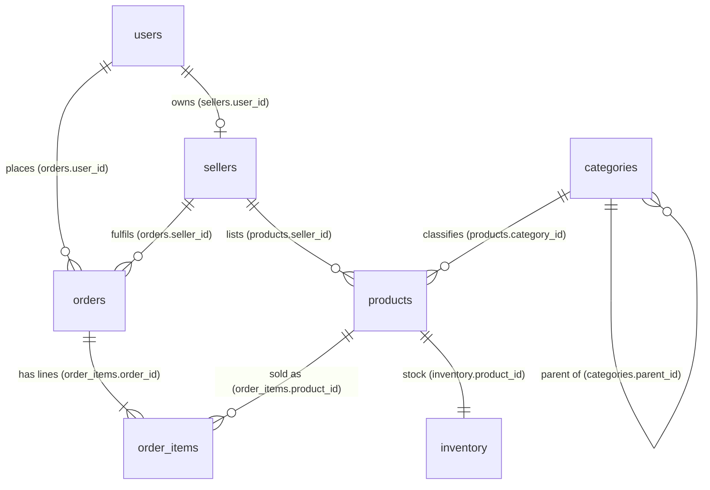

# Module 04: Joins and Subqueries

The Bazaar support team gets a phone call: "I ordered a laptop in May, from TechTrove I think, and it never arrived." To answer, somebody has to find the caller in `users`, their orders in `orders`, the lines of those orders in `order_items`, the product titles in `products` and the shop name in `sellers`. Five tables, one question. Until now every query in this course has read a single table. Real questions almost never live in one table, because a well-designed database deliberately spreads facts across many of them. This module teaches you how to put them back together: joins, which combine tables side by side, and subqueries, which let one query ask questions of another. By the end you'll be able to answer questions like "which customers bought from every European shop?" or "which products have never sold?" in one statement, and you'll know the traps that make such queries quietly return wrong numbers.

**What you'll learn**

- Why data is split across tables, and how a foreign key is a pointer that a join follows.
- The mental model behind every join: the Cartesian product (`CROSS JOIN`), and `INNER JOIN` as a filtered product.
- `ON` versus `USING` versus `NATURAL JOIN`, and why `NATURAL` is a time bomb.
- `LEFT`, `RIGHT` and `FULL OUTER JOIN`; the classic mistake of filtering the outer table in `WHERE` instead of `ON`; how one inner join can silently undo an outer join.
- Self joins (the category tree, users who are also sellers) and long join chains (orders → items → products → sellers → categories).
- Join fan-out: why joining a one-to-many relationship multiplies rows and inflates sums.
- Semi-joins and anti-joins with `EXISTS`, `NOT EXISTS`, `IN` and `NOT IN`, and the `NOT IN` + `NULL` trap on real data.
- Scalar, correlated and derived-table subqueries; `ANY` and `ALL`.
- `LATERAL` joins for "top N per group" and "latest row per parent".
- Set operations: `UNION`, `UNION ALL`, `INTERSECT`, `EXCEPT`, and their rules.
- Join-based modifications: `UPDATE ... FROM` and `DELETE ... USING`.
- A step-by-step method for building and debugging a multi-join query.

**Before you start**

```bash
./project/bin/reset.sh 04
./project/bin/psql.sh
```

This gives you the Bazaar core schema from module 02 with the small dataset from module 03: 30 users, 6 sellers, 23 categories, 62 products, 120 orders and 235 order lines. The data is deterministic, so every number in this module will match what you see. [`project/db/NOTES.md`](../../project/db/NOTES.md) lists the notable rows ("user 7 never ordered", "seller 6 has no products"), and the exercises lean on them.

You should be comfortable with `SELECT`, `WHERE`, `ORDER BY`, `LIMIT`, `CASE` and three-valued logic from [module 03](../03-crud/), and with the core tables from [module 02](../02-types-and-ddl/). The outputs below show `NULL` as `∅`, like the `.psqlrc` from [module 01](../01-psql/) does. If you don't use that file, run `\pset null '∅'` first. Otherwise a `NULL` and an empty string look the same, and in this module you'll be staring at a lot of `NULL`s.

A handful of examples use `count(*)` or `sum(...)` to measure a result. `count(*)` counts the rows a query produces, and `sum(x)` adds up a column. That's all you need for now. [Module 05](../05-aggregation/) covers aggregates properly.

---

## 1. Why the data is split across tables

Look at one order on its own:

```sql
SELECT id, user_id, seller_id, status, total, created_at
FROM orders
WHERE id = 2;
```

```text
 id | user_id | seller_id |  status   |  total  |       created_at       
----+---------+-----------+-----------+---------+------------------------
  2 |       3 |         1 | delivered | 2198.00 | 2024-01-13 05:07:14+00
(1 row)
```

Who bought it? `user_id = 3`. From which shop? `seller_id = 1`. What was in it? This row doesn't even say. The order row stores *references* to other rows, not copies of their data. Module 02 set it up this way on purpose, and module 07 will give the theory (normalization) a full treatment. The short version of the argument:

- **Each fact is stored once.** Giulia Rossi's email lives in exactly one row of `users`. If she changes it, one `UPDATE` fixes it everywhere. If every order carried a copy of her email, changing it would mean updating dozens of rows, and missing one would leave the database contradicting itself.
- **Different things have different lifetimes and cardinalities.** A user exists before ordering anything. An order has any number of lines. A product exists whether or not anybody buys it. Each kind of thing gets its own table, with one row per instance.
- **The foreign key is the pointer.** `orders.user_id REFERENCES users (id)` guarantees that the 3 in order 2 points at a real user. A join *follows* that pointer.

The schema, with the pointers drawn in:



Read the crow's feet as "one ... many": one user places many orders, one order has one or more lines. These cardinalities matter more than anything else in this module. Joining along a "one" side never changes the number of rows. Joining along a "many" side multiplies them. Section 8 shows what happens when you forget that.

So splitting data is cheap to store and safe to change, and the price is paid at read time: to answer a human question you have to combine tables again. That's what a join is.

## 2. The Cartesian product: `CROSS JOIN`

Every join is defined in terms of one simple operation, and once you have that operation in your head, all the join types become variations on it.

The **Cartesian product** of two tables pairs every row of the first with every row of the second. If `A` has 3 rows and `B` has 2, `A × B` has 6 rows, each one a row of `A` glued to a row of `B`:

```text
   A           B                 A CROSS JOIN B
 ┌────┐     ┌─────┐          ┌────┬─────┐
 │ a1 │     │ b1  │          │ a1 │ b1  │
 │ a2 │  ×  │ b2  │    =     │ a1 │ b2  │
 │ a3 │     └─────┘          │ a2 │ b1  │
 └────┘                      │ a2 │ b2  │
                             │ a3 │ b1  │
                             │ a3 │ b2  │
                             └────┴─────┘
```

In SQL that is `CROSS JOIN`. A tiny example: every seller combined with two shipping speeds.

```sql
SELECT s.shop_name, speed.name AS shipping
FROM sellers AS s
CROSS JOIN (VALUES ('standard'), ('express')) AS speed (name)
ORDER BY s.id, speed.name DESC;
```

```text
    shop_name    | shipping 
-----------------+----------
 TechTrove       | standard
 TechTrove       | express
 Bookworm Corner | standard
 Bookworm Corner | express
 Casa Cucina     | standard
 Casa Cucina     | express
 Threadbare Co.  | standard
 Threadbare Co.  | express
 Maple & Pine    | standard
 Maple & Pine    | express
 Sakura Gadgets  | standard
 Sakura Gadgets  | express
(12 rows)
```

Six sellers times two speeds gives 12 rows. There's no condition: every combination appears. Two new pieces of syntax:

- **Table aliases.** `sellers AS s` gives the table a short name for this query. Once you have more than one table in `FROM`, you'll qualify column names with it (`s.shop_name`), both for readability and because two tables often have columns with the same name (`id`, `created_at`). The `AS` is optional (`sellers s`), and most people drop it for tables.
- **A `VALUES` list as a table.** `(VALUES (...), (...)) AS speed (name)` is a two-row, one-column table you made up on the spot, with the column list after the alias naming its columns. Handy for small lookup lists, and you'll see it again.

The product grows fast. `sellers` has 6 rows and `users` has 30, so:

```sql
SELECT count(*) FROM sellers CROSS JOIN users;
```

```text
 count 
-------
   180
(1 row)
```

`orders × order_items` would be 120 × 235 = 28,200 rows, and on the large dataset of module 11 (500,000 orders and 1.27 million lines) it would be over 600 billion. A cross join is rarely what you want between two real tables. It is genuinely useful when one side is a small, deliberate list: every seller × every month for a report that must show months with zero sales (module 05 does exactly this), every product × every warehouse for a stock-count sheet, every size × every colour to generate product variants.

There's an older way to write a cross join, and you'll see it in legacy code: just list the tables with commas.

```sql
SELECT count(*) FROM sellers, users;    -- same 180 rows as CROSS JOIN
```

## 3. `INNER JOIN`: a filtered product

Now the key idea. Of the 180 seller × user pairs, which ones are meaningful? The ones where the user *owns* the seller: `sellers.user_id = users.id`. Keep only those pairs:

```sql
SELECT s.id AS seller_id, s.shop_name, u.id AS user_id, u.full_name
FROM sellers AS s
CROSS JOIN users AS u
WHERE s.user_id = u.id
ORDER BY s.id;
```

```text
 seller_id |    shop_name    | user_id |    full_name    
-----------+-----------------+---------+-----------------
         1 | TechTrove       |       1 | Alice Johnson
         2 | Bookworm Corner |       2 | Benjamin Clarke
         3 | Casa Cucina     |       3 | Giulia Rossi
         4 | Threadbare Co.  |       4 | Lukas Becker
         5 | Maple & Pine    |       5 | Chloé Tremblay
         6 | Sakura Gadgets  |       6 | Haruto Sato
(6 rows)
```

That *is* a join. Conceptually: build every combination, then keep the ones that satisfy a condition. SQL has dedicated syntax for it, `INNER JOIN ... ON`, which puts the condition next to the table it connects:

```sql
SELECT s.id AS seller_id, s.shop_name, u.full_name AS owner
FROM sellers AS s
INNER JOIN users AS u ON u.id = s.user_id
ORDER BY s.id;
```

```text
 seller_id |    shop_name    |      owner      
-----------+-----------------+-----------------
         1 | TechTrove       | Alice Johnson
         2 | Bookworm Corner | Benjamin Clarke
         3 | Casa Cucina     | Giulia Rossi
         4 | Threadbare Co.  | Lukas Becker
         5 | Maple & Pine    | Chloé Tremblay
         6 | Sakura Gadgets  | Haruto Sato
(6 rows)
```

`INNER` is the default, so `JOIN` alone means `INNER JOIN`, and that's how you'll usually write it. The condition after `ON` is the **join condition** (or join predicate). It can be any boolean expression. Following a foreign key with `=` is by far the most common, and it has a name: an **equi-join**.

> **Under the hood:** "Build the product, then filter" is the *meaning* of a join, not how PostgreSQL executes it. The planner never materializes 28,200 rows to find 235. It picks a physical join algorithm instead: a **nested loop** (for each outer row, look up matches, ideally through an index), a **hash join** (build a hash table on one side, probe it with the other) or a **merge join** (walk two sorted inputs in step). Any of them produces exactly the rows the product-and-filter definition says. Module 12 teaches you to read which one was chosen and why. For writing correct queries, the mental model is all you need.

### 3.1 Why the explicit `JOIN` syntax wins

The `CROSS JOIN ... WHERE` and `JOIN ... ON` versions return identical results, and PostgreSQL plans them identically. You'll also meet the comma form, `FROM sellers s, users u WHERE s.user_id = u.id`, in older code and in some textbooks. Prefer `JOIN ... ON` anyway:

- **The condition sits next to the table it belongs to.** In a five-table query, a `WHERE` clause that mixes join conditions with business filters (`status = 'delivered'`) is hard to audit. With `ON`, each join states its own link.
- **Forgetting the condition becomes a syntax error.** `FROM orders o JOIN order_items i` with no `ON` doesn't parse. With the comma style, a forgotten condition in `WHERE` silently produces a Cartesian product: your query "works" and returns 28,200 rows.
- **Outer joins need it.** There is no comma syntax for `LEFT JOIN` (section 5), so you'd end up mixing two styles anyway.

### 3.2 Ambiguous columns and qualified names

Both `orders` and `users` have `id` and `created_at`. Mention one without saying which table you mean, and PostgreSQL refuses to guess:

```sql
SELECT id, full_name, status
FROM orders AS o
JOIN users AS u ON u.id = o.user_id
WHERE o.id = 2;
```

```text
ERROR:  column reference "id" is ambiguous
LINE 1: SELECT id, full_name, status
               ^
```

The fix is to qualify: `o.id`. A good habit is to qualify *every* column in a multi-table query, even unambiguous ones like `full_name`. Six months later, when someone adds a `full_name` column to `sellers`, unqualified references in queries that join `sellers` break. More importantly, the qualified version tells the reader where each value comes from without making them memorize the schema.

### 3.3 Joining along the "many" side

Joining `orders` to `order_items` follows the pointer the other way: each order has one or more lines, so each order appears once *per line*.

```sql
SELECT o.id AS order_id, o.status, i.product_id, i.quantity, i.unit_price
FROM orders AS o
JOIN order_items AS i ON i.order_id = o.id
WHERE o.id IN (1, 2, 3)
ORDER BY o.id, i.product_id;
```

```text
 order_id |  status   | product_id | quantity | unit_price 
----------+-----------+------------+----------+------------
        1 | delivered |         20 |        1 |      12.50
        1 | delivered |         21 |        1 |      18.00
        1 | delivered |         22 |        2 |       9.99
        2 | delivered |          1 |        2 |    1099.00
        3 | delivered |          7 |        1 |     399.00
(5 rows)
```

Order 1 has three lines and so appears three times, with its `status` repeated on each. That's correct and expected: the result's **grain** (what one row represents) is now "one order line", not "one order". Always know the grain of your result. Most join bugs are grain bugs.

### 3.4 Join conditions that aren't foreign keys

`ON` takes any boolean expression. A **non-equi join** uses something other than equality. Suppose marketing defines price bands, and you want each product labelled with its band:

```sql
SELECT p.id, p.title, p.price, b.band
FROM products AS p
JOIN (VALUES
        ('budget',   0.00,    50.00),
        ('mid',     50.00,   500.00),
        ('premium', 500.00, 99999.99)
     ) AS b (band, low, high)
  ON p.price >= b.low AND p.price < b.high
WHERE p.seller_id = 1
ORDER BY p.price DESC
LIMIT 6;
```

```text
 id |              title              |  price  |  band   
----+---------------------------------+---------+---------
  3 | Titan G17 Gaming Laptop         | 2199.99 | premium
 15 | Titan G15 Gaming Laptop         | 1799.00 | premium
  2 | AeroBook 15 Pro Laptop          | 1499.00 | premium
  1 | AeroBook 13 Laptop              |  999.00 | premium
  5 | AeroBook 13 Laptop (2023 model) |  799.00 | premium
  8 | UltraWide 34" Curved Monitor    |  549.00 | premium
(6 rows)
```

Each product matches exactly one band because the ranges are half-open (`>= low AND < high`) and don't overlap. If they overlapped, a product would match two bands and appear twice. If there were a gap, a product in the gap would disappear from the result, because an inner join keeps only rows that found a partner. Section 5 is about the joins that keep such rows.

## 4. `ON` versus `USING` versus `NATURAL`

There are three ways to state an equi-join condition.

**`ON`** is fully explicit: `JOIN order_items i ON i.order_id = o.id`. It works whatever the columns are called and for any condition.

**`USING (col, ...)`** is a shorthand for when *both* tables have a column with the same name and you want them equal. In Bazaar the foreign keys are named after the table they point to (`order_id`, `product_id`) while primary keys are called `id`, so `USING` fits a link between two child tables that share a key name. For example, `order_items` and `inventory` both have `product_id`:

```sql
SELECT product_id, i.order_id, i.quantity, inv.quantity AS in_stock
FROM order_items AS i
JOIN inventory AS inv USING (product_id)
WHERE i.order_id = 40;
```

```text
 product_id | order_id | quantity | in_stock 
------------+----------+----------+----------
          1 |       40 |        3 |       25
          2 |       40 |        3 |       12
          7 |       40 |        1 |       15
         10 |       40 |        3 |       18
(4 rows)
```

Two things differ from `ON`:

- The joined column appears **once** in the output, and you refer to it unqualified (`product_id`, not `i.product_id`). `SELECT *` shows it once, first. With `ON` you get both `i.product_id` and `inv.product_id`.
- For outer joins (next section), the merged `USING` column is `COALESCE(left.col, right.col)`, so it is never `NULL` just because one side is missing. That's convenient in `FULL JOIN`s.

`USING` is fine when it fits. Its weakness is that it depends on column *names* agreeing, which is a property of naming conventions, not of the data model. It doesn't fit the most common Bazaar join at all (`orders.user_id = users.id`).

**`NATURAL JOIN`** goes one step further: it joins on *every* pair of columns with the same name, without you listing them. That sounds convenient. Look at what it does on Bazaar:

```sql
SELECT count(*) FROM orders NATURAL JOIN order_items;
```

```text
 count 
-------
 28200
(1 row)
```

28,200 rows: the full Cartesian product. `orders` and `order_items` have no column name in common (`orders.id` vs `order_items.order_id`), and a natural join with no common columns quietly degrades into a `CROSS JOIN`. No error, no warning. Now the opposite failure:

```sql
SELECT count(*) FROM products NATURAL JOIN sellers;
```

```text
 count 
-------
     0
(1 row)
```

Zero rows. `products` and `sellers` share **two** names, `id` and `created_at`, so this means `products.id = sellers.id AND products.created_at = sellers.created_at`. Joining a product's id to a seller's id is nonsense, and no product was created at the same instant as its seller.

That's why experienced people treat `NATURAL JOIN` as a bug waiting to happen:

> **Pitfall:** A `NATURAL JOIN` means something different every time somebody adds a column. Add `updated_at` to two tables (module 09 does exactly that for `products` and `orders`), and every natural join between them suddenly also requires equal `updated_at` values, returning far fewer rows. Nothing in the query text changed. Never use `NATURAL JOIN` in code that lives longer than one interactive session. Use `ON`, and `USING` only when the shared name is a deliberate convention.

## 5. Outer joins: keeping the rows that found no partner

An inner join only keeps pairs that satisfy the condition. A row with no partner simply vanishes. Most of the time that's what you want ("show order lines with their product titles": every line has a product). But consider: "list every seller with their products". Seller 6, Sakura Gadgets, has no products:

```sql
SELECT s.id, s.shop_name, p.id AS product_id, p.title
FROM sellers AS s
JOIN products AS p ON p.seller_id = s.id
WHERE s.id IN (5, 6)
ORDER BY s.id, p.id;
```

```text
 id |  shop_name   | product_id |          title          
----+--------------+------------+-------------------------
  5 | Maple & Pine |         57 | Terracotta Planter 20cm
  5 | Maple & Pine |         58 | Self-Watering Planter
  5 | Maple & Pine |         59 | Hanging Macramé Planter
  5 | Maple & Pine |         60 | Cedar Raised Garden Bed
  5 | Maple & Pine |         61 | Ceramic Herb Pot Trio
(5 rows)
```

Sakura Gadgets is gone, as if it didn't exist. For a "seller overview" page that's a bug. An **outer join** keeps the unmatched rows of one or both sides, filling the missing side's columns with `NULL`.

### 5.1 `LEFT JOIN`

`A LEFT [OUTER] JOIN B ON cond` returns every row an inner join would return, *plus* every row of `A` (the left table) that matched nothing in `B`, padded with `NULL`s for `B`'s columns.

```sql
SELECT s.id, s.shop_name, p.id AS product_id, p.title
FROM sellers AS s
LEFT JOIN products AS p ON p.seller_id = s.id
WHERE s.id IN (5, 6)
ORDER BY s.id, p.id;
```

```text
 id |   shop_name    | product_id |          title          
----+----------------+------------+-------------------------
  5 | Maple & Pine   |         57 | Terracotta Planter 20cm
  5 | Maple & Pine   |         58 | Self-Watering Planter
  5 | Maple & Pine   |         59 | Hanging Macramé Planter
  5 | Maple & Pine   |         60 | Cedar Raised Garden Bed
  5 | Maple & Pine   |         61 | Ceramic Herb Pot Trio
  6 | Sakura Gadgets |          ∅ | ∅
(6 rows)
```

Sakura Gadgets is back, with `∅` where product columns would be. A picture of the three joins on two small tables (this is the logic, not real Bazaar rows):

```text
  sellers (left)          products (right)
  ┌────┬────────┐         ┌────┬───────────┐
  │ id │ shop   │         │ id │ seller_id │
  ├────┼────────┤         ├────┼───────────┤
  │  5 │ Maple  │         │ 57 │     5     │
  │  6 │ Sakura │         │ 58 │     5     │
  └────┴────────┘         │ 99 │     9     │   ← points at a seller not in the left list
                          └────┴───────────┘

  INNER JOIN               LEFT JOIN                RIGHT JOIN              FULL JOIN
  s.id  p.id               s.id  p.id               s.id  p.id              s.id  p.id
   5     57                 5     57                 5     57                5     57
   5     58                 5     58                 5     58                5     58
                            6     ∅                  ∅     99                6     ∅
                                                                             ∅     99
```

- `LEFT JOIN` = inner join + unmatched **left** rows.
- `RIGHT JOIN` = inner join + unmatched **right** rows.
- `FULL JOIN` = inner join + unmatched rows from **both** sides.

The word `OUTER` is optional and almost always omitted.

### 5.2 Finding rows with no partner

The `NULL` padding gives you a classic technique: an outer join followed by `WHERE <right side key> IS NULL` keeps *only* the unmatched rows. "Which users have never ordered?":

```sql
SELECT u.id, u.full_name
FROM users AS u
LEFT JOIN orders AS o ON o.user_id = u.id
WHERE o.id IS NULL
ORDER BY u.id;
```

```text
 id |   full_name    
----+----------------
  6 | Haruto Sato
  7 | Priya Patel
 15 | Ava Nguyen
 16 | Lucas Martin
 21 | Isabella Silva
 24 | Henry Wilson
 28 | Leo Jensen
 29 | Nora Berg
 30 | Samuel Okafor
(9 rows)
```

Nine users, exactly as `NOTES.md` says. Test a column that can't be `NULL` in a real match: the right table's primary key (`o.id`) or a `NOT NULL` column used in the join. If you tested a nullable column (say, `o.paid_at`), you'd also get users whose orders simply hadn't been paid. Section 9 shows a clearer way to write the same question (`NOT EXISTS`), and when to prefer which.

### 5.3 The classic pitfall: filtering the outer table in `WHERE`

Here's the mistake that every SQL developer makes at least once. Request: "list every seller with the number of orders they received in 2025, including sellers with none". First attempt:

```sql
SELECT s.id, s.shop_name, o.id AS order_id, o.created_at::date AS ordered
FROM sellers AS s
LEFT JOIN orders AS o ON o.seller_id = s.id
WHERE o.created_at >= '2025-01-01'
ORDER BY s.id DESC, o.id DESC;
```

```text
 id |    shop_name    | order_id |  ordered   
----+-----------------+----------+------------
  4 | Threadbare Co.  |      119 | 2025-06-29
  4 | Threadbare Co.  |      115 | 2025-06-28
  4 | Threadbare Co.  |      111 | 2025-06-25
  4 | Threadbare Co.  |      110 | 2025-06-25
...
(54 rows)
```

The output is sorted by seller id, highest first, and it starts at seller 4. Maple & Pine (5) and Sakura Gadgets (6) are missing, although we wrote `LEFT JOIN` precisely to keep them. Walk through the logical order of evaluation:

1. `FROM ... LEFT JOIN ... ON o.seller_id = s.id` produces all order rows plus one `NULL`-padded row each for sellers 5 and 6.
2. `WHERE o.created_at >= '2025-01-01'` runs *after* the join, on that result. For the padded rows `o.created_at` is `NULL`, `NULL >= '2025-01-01'` is `NULL`, and `WHERE` keeps only rows where the condition is `TRUE` (module 03). The padded rows are thrown away.

The `WHERE` clause turned the `LEFT JOIN` back into an inner join. The fix is to make the date condition part of the **join condition**, so it decides *which orders match*, not *which result rows survive*:

```sql
SELECT s.id, s.shop_name, o.id AS order_id, o.created_at::date AS ordered
FROM sellers AS s
LEFT JOIN orders AS o
       ON o.seller_id = s.id
      AND o.created_at >= '2025-01-01'
ORDER BY s.id DESC, o.id DESC;
```

```text
 id |    shop_name    | order_id |  ordered   
----+-----------------+----------+------------
  6 | Sakura Gadgets  |        ∅ | ∅
  5 | Maple & Pine    |        ∅ | ∅
  4 | Threadbare Co.  |      119 | 2025-06-29
  4 | Threadbare Co.  |      115 | 2025-06-28
...
(56 rows)
```

Now sellers 5 and 6 appear with `NULL`s: they had no 2025 orders, and the left join kept them anyway. Here is the rule:

> **Pitfall:** In a `LEFT JOIN`, conditions on the **right** (optional) table belong in `ON` if you want to keep left rows that have no qualifying match. A condition on the right table in `WHERE` filters out the `NULL`-padded rows and silently turns the outer join into an inner join. (The one deliberate exception is `WHERE right.key IS NULL`, the anti-join from 5.2, which *wants* only the padded rows.)

The mirror image surprises people too. A condition on the **left** table in `ON` does *not* filter left rows:

```sql
SELECT s.id, s.country_code, p.id AS product_id
FROM sellers AS s
LEFT JOIN products AS p
       ON p.seller_id = s.id
      AND s.country_code = 'JP'
ORDER BY s.id;
```

```text
 id | country_code | product_id 
----+--------------+------------
  1 | US           |          ∅
  2 | GB           |          ∅
  3 | IT           |          ∅
  4 | DE           |          ∅
  5 | CA           |          ∅
  6 | JP           |          ∅
(6 rows)
```

All six sellers come back. `ON` only decides which *pairs* match; a left join keeps every left row regardless. Sellers outside Japan simply matched nothing (because the `ON` condition was false for every pair), so they appear padded with `NULL`. To restrict the left table, use `WHERE s.country_code = 'JP'`. In short:

| Condition is on... | ...put it in `ON` to... | ...put it in `WHERE` to... |
|---|---|---|
| the right (optional) table | restrict which right rows match; unmatched left rows survive | drop left rows without a qualifying match (= inner join) |
| the left (preserved) table | nothing useful: left rows survive anyway, just unmatched | restrict which left rows appear |

For inner joins there's no difference: `ON` and `WHERE` conditions are interchangeable, and the planner treats them the same. Put link conditions in `ON` and business filters in `WHERE` for readability.

### 5.4 Chained outer joins: one inner join can undo them all

Outer joins compose left to right, and that creates a second trap. "Every user with the products they ordered, including users who never ordered":

```sql
SELECT count(*) AS result_rows,
       count(*) FILTER (WHERE o.id IS NULL) AS users_without_orders
FROM users AS u
LEFT JOIN orders AS o ON o.user_id = u.id
JOIN order_items AS i ON i.order_id = o.id;
```

```text
 result_rows | users_without_orders 
-------------+----------------------
         235 |                    0
(1 row)
```

(`FILTER (WHERE ...)` counts only the rows that match a condition; module 05 explains it. Here it just tells us how many padded rows survived.) None did. The `LEFT JOIN` produced nine padded rows for the never-ordered users, each with `o.id` `NULL`. Then the *inner* join to `order_items` required `i.order_id = o.id`, which is `NULL` for those rows, so they were dropped. Once a table is outer-joined, every table you join *through* it must be outer-joined too:

```sql
SELECT count(*) AS result_rows,
       count(*) FILTER (WHERE o.id IS NULL) AS users_without_orders
FROM users AS u
LEFT JOIN orders AS o ON o.user_id = u.id
LEFT JOIN order_items AS i ON i.order_id = o.id;
```

```text
 result_rows | users_without_orders 
-------------+----------------------
         244 |                    9
(1 row)
```

235 order lines plus 9 padded users = 244. An alternative that reads well when the inner part is a real unit: put the inner join in parentheses, so it happens first and the outer join applies to its result: `users u LEFT JOIN (orders o JOIN order_items i ON i.order_id = o.id) ON o.user_id = u.id`. Either form is correct. The chained `LEFT JOIN` is more common.

### 5.5 `RIGHT JOIN`

`A RIGHT JOIN B` is exactly `B LEFT JOIN A` with the columns in a different order. It exists for symmetry, and you can always rewrite it as a left join by swapping the tables. Most teams write only `LEFT JOIN`s, so that every query reads the same way: the table whose rows must all appear comes first, and the optional data hangs off it. Mixing left and right joins in one query is legal and almost impossible to read.

### 5.6 `FULL JOIN`: reconciling two lists

A `FULL JOIN` keeps unmatched rows from both sides. Its natural use is **reconciliation**: comparing two lists that should agree and showing every disagreement. Casa Cucina (seller 3) just did a physical stock count in its warehouse. The counts arrive as a list of SKUs and quantities, and the admin wants to compare them with `inventory`:

```sql
SELECT coalesce(c.sku, p.sku) AS sku,
       p.id                   AS product_id,
       inv.quantity           AS system_qty,
       c.counted              AS counted_qty,
       CASE
           WHEN p.id IS NULL        THEN 'unknown SKU in count'
           WHEN c.sku IS NULL       THEN 'not counted'
           WHEN c.counted <> inv.quantity THEN 'mismatch'
           ELSE 'ok'
       END AS verdict
FROM (VALUES ('CC-CW-001', 20), ('CC-CW-002', 17), ('CC-CW-003', 26),
             ('CC-CW-004', 7),  ('CC-CU-001', 15), ('CC-CU-002', 12),
             ('CC-CU-003', 30), ('CC-CU-004', 14), ('CC-CU-005', 40),
             ('CC-CU-006', 22), ('CC-KI-001', 16), ('CC-KI-002', 5)
     ) AS c (sku, counted)
FULL JOIN (SELECT * FROM products WHERE seller_id = 3) AS p ON p.sku = c.sku
LEFT JOIN inventory AS inv ON inv.product_id = p.id
WHERE c.sku IS NULL OR p.id IS NULL OR c.counted <> inv.quantity
ORDER BY sku;
```

```text
    sku    | product_id | system_qty | counted_qty |       verdict        
-----------+------------+------------+-------------+----------------------
 CC-CW-002 |         35 |         18 |          17 | mismatch
 CC-CW-005 |         38 |          0 |           ∅ | not counted
 CC-CW-006 |         39 |         10 |           ∅ | not counted
 CC-KI-002 |          ∅ |          ∅ |           5 | unknown SKU in count
(4 rows)
```

Four problems in one result: a saucepan miscounted (17 counted, 18 in the system), two products (the archived Copper Sauté Pan with 0 stock, and the Pasta Pot) not counted at all, and a counted SKU, `CC-KI-002`, that doesn't exist in the catalog. A `LEFT JOIN` from the count would have missed the uncounted products, and a `LEFT JOIN` from the products would have missed the unknown SKU. Only a full join sees both kinds of gap.

Three details:

- `(SELECT * FROM products WHERE seller_id = 3) AS p` is a **subquery in `FROM`** (a derived table, section 10.3). We need it because filtering `products` in `WHERE` (`p.seller_id = 3`) would, by the rule of 5.3, also drop the unknown-SKU row whose `p` columns are all `NULL`. Restricting a table *before* a full join is easiest done this way.
- `coalesce(c.sku, p.sku)` picks whichever side is present, because either could be `NULL`. (`JOIN ... USING (sku)` would do that automatically, if both sides had a column named `sku`.)
- The `WHERE` here filters on conditions that are true for padded rows (`c.sku IS NULL OR p.id IS NULL`), so it keeps them on purpose. That's the reconciliation pattern: full join, then keep everything that isn't a clean match.

## 6. Self joins

A **self join** joins a table to itself. There's no special syntax: you list the same table twice with two different aliases, and from then on the two copies are as independent as two different tables.

### 6.1 Walking the category tree

`categories.parent_id` points at another row of `categories`. To show each category next to its parent, join `categories` to `categories`:

```sql
SELECT child.id, child.name, parent.name AS parent
FROM categories AS child
LEFT JOIN categories AS parent ON parent.id = child.parent_id
ORDER BY child.id
LIMIT 8;
```

```text
 id |     name      |   parent    
----+---------------+-------------
  1 | Electronics   | ∅
  2 | Computers     | Electronics
  3 | Laptops       | Computers
  4 | Monitors      | Computers
  5 | Audio         | Electronics
  6 | Headphones    | Audio
  7 | Speakers      | Audio
  8 | Home & Garden | ∅
(8 rows)
```

`LEFT JOIN`, because roots (Electronics) have no parent and must not disappear. Since NOTES.md says the tree is exactly three levels deep, one more self join reaches the grandparent, and that's enough to print a full **breadcrumb** for every category:

```sql
SELECT c.id,
       concat_ws(' > ', gp.name, p.name, c.name) AS path
FROM categories AS c
LEFT JOIN categories AS p  ON p.id  = c.parent_id
LEFT JOIN categories AS gp ON gp.id = p.parent_id
ORDER BY path;
```

```text
 id |                path                
----+------------------------------------
 14 | Books
 15 | Books > Fiction
 17 | Books > Fiction > Mystery
 16 | Books > Fiction > Science Fiction
 18 | Books > Non-Fiction
 19 | Books > Non-Fiction > Cooking
 20 | Books > Non-Fiction > History
 21 | Clothing
 23 | Clothing > Hoodies
 22 | Clothing > T-Shirts
  1 | Electronics
  5 | Electronics > Audio
  6 | Electronics > Audio > Headphones
  7 | Electronics > Audio > Speakers
  2 | Electronics > Computers
  3 | Electronics > Computers > Laptops
  4 | Electronics > Computers > Monitors
  8 | Home & Garden
 12 | Home & Garden > Garden
 13 | Home & Garden > Garden > Planters
  9 | Home & Garden > Kitchen
 10 | Home & Garden > Kitchen > Cookware
 11 | Home & Garden > Kitchen > Cutlery
(23 rows)
```

`concat_ws(separator, ...)` (module 03) skips `NULL` arguments, so roots print as `Books` and second-level categories as `Books > Fiction`, with no dangling separators. Notice the second join is `LEFT` too: per 5.4, a table joined through an outer-joined table must also be outer-joined.

This works because the depth is fixed and known. A tree of *unknown* depth needs a query that repeats itself until it runs out of parents: a **recursive CTE**, which is module 06's opening act.

### 6.2 Two roles of one table: buyers and shop owners

`users` plays two roles in Bazaar: some users buy, and six of them also own shops. When a query needs both roles in the same row, `users` appears twice under two aliases. "For each order, the buyer's name and the shop owner's name":

```sql
SELECT o.id AS order_id,
       buyer.full_name AS buyer,
       s.shop_name,
       owner.full_name AS shop_owner
FROM orders AS o
JOIN users   AS buyer ON buyer.id = o.user_id
JOIN sellers AS s     ON s.id     = o.seller_id
JOIN users   AS owner ON owner.id = s.user_id
WHERE o.id BETWEEN 90 AND 94
ORDER BY o.id;
```

```text
 order_id |     buyer      |    shop_name    |   shop_owner    
----------+----------------+-----------------+-----------------
       90 | Oliver Smith   | Casa Cucina     | Giulia Rossi
       91 | Alice Johnson  | Casa Cucina     | Giulia Rossi
       92 | Mateo García   | Threadbare Co.  | Lukas Becker
       93 | Amelia Fischer | Bookworm Corner | Benjamin Clarke
       94 | Lukas Becker   | Casa Cucina     | Giulia Rossi
(5 rows)
```

Order 91 is interesting: Alice Johnson, who owns TechTrove, bought kitchen knives from Casa Cucina. Shop owners are customers too. A compact way to list all such "owner buys from another shop" orders compares the buyer with the owner of *any* shop:

```sql
SELECT o.id AS order_id, buyer_shop.shop_name AS buyer_owns, s.shop_name AS bought_from
FROM orders AS o
JOIN sellers AS buyer_shop ON buyer_shop.user_id = o.user_id
JOIN sellers AS s          ON s.id = o.seller_id
ORDER BY o.id;
```

```text
 order_id |   buyer_owns    |   bought_from   
----------+-----------------+-----------------
        2 | Casa Cucina     | TechTrove
       11 | Casa Cucina     | Bookworm Corner
       12 | Bookworm Corner | TechTrove
       18 | Bookworm Corner | Casa Cucina
       29 | Threadbare Co.  | Bookworm Corner
       31 | Maple & Pine    | Bookworm Corner
       37 | Threadbare Co.  | Casa Cucina
       53 | Threadbare Co.  | Bookworm Corner
       61 | Maple & Pine    | Casa Cucina
       75 | Casa Cucina     | Bookworm Corner
       91 | TechTrove       | Casa Cucina
       94 | Threadbare Co.  | Casa Cucina
      108 | Maple & Pine    | Casa Cucina
      119 | Casa Cucina     | Threadbare Co.
(14 rows)
```

Here `sellers` is the self-joined table: once as "the shop the buyer owns" (matched through `user_id`) and once as "the shop that fulfils the order" (matched through `orders.seller_id`). Fourteen orders, and nobody bought from their own shop (that would show the same name twice; a good data-quality check).

### 6.3 Comparing rows of the same table

Self joins also compare rows with other rows of the same kind. "Pairs of TechTrove laptops where one costs more than twice the other":

```sql
SELECT cheap.title AS cheaper, cheap.price, dear.title AS pricier, dear.price
FROM products AS cheap
JOIN products AS dear
  ON dear.seller_id   = cheap.seller_id
 AND dear.category_id = cheap.category_id
 AND dear.price > 2 * cheap.price
WHERE cheap.category_id = 3
  AND cheap.status = 'active' AND dear.status = 'active'
ORDER BY cheap.price, dear.price;
```

```text
         cheaper         | price  |         pricier         |  price  
-------------------------+--------+-------------------------+---------
 Laptop Sleeve 13"       |  19.99 | StudyMate 11 Chromebook |  249.00
 Laptop Sleeve 13"       |  19.99 | AeroBook 13 Laptop      |  999.00
 Laptop Sleeve 13"       |  19.99 | AeroBook 15 Pro Laptop  | 1499.00
 Laptop Sleeve 13"       |  19.99 | Titan G15 Gaming Laptop | 1799.00
 Laptop Sleeve 13"       |  19.99 | Titan G17 Gaming Laptop | 2199.99
 StudyMate 11 Chromebook | 249.00 | AeroBook 13 Laptop      |  999.00
 StudyMate 11 Chromebook | 249.00 | AeroBook 15 Pro Laptop  | 1499.00
 StudyMate 11 Chromebook | 249.00 | Titan G15 Gaming Laptop | 1799.00
 StudyMate 11 Chromebook | 249.00 | Titan G17 Gaming Laptop | 2199.99
 AeroBook 13 Laptop      | 999.00 | Titan G17 Gaming Laptop | 2199.99
(10 rows)
```

A self join compares *every pair*, so an inequality condition like this produces each qualifying pair once (cheap one on the left), while a symmetric condition such as `a.price = b.price` would produce each pair twice (as `(x, y)` and `(y, x)`) plus every row paired with itself. The usual fix is to add `a.id < b.id`, which keeps exactly one ordering of each pair and excludes self-pairs.

## 7. Multi-table joins

A join of two tables produces a table, so you can join that to a third, and so on. That's all a multi-table join is. Back to the support call from the introduction: here is the full picture of order 40, the largest order in the dataset, across five tables:

```sql
SELECT o.id            AS order_id,
       buyer.full_name AS buyer,
       s.shop_name,
       p.title,
       cat.name        AS category,
       i.quantity,
       i.unit_price,
       i.quantity * i.unit_price AS line_total
FROM orders AS o
JOIN users       AS buyer ON buyer.id = o.user_id
JOIN sellers     AS s     ON s.id     = o.seller_id
JOIN order_items AS i     ON i.order_id = o.id
JOIN products    AS p     ON p.id     = i.product_id
JOIN categories  AS cat   ON cat.id   = p.category_id
WHERE o.id = 40
ORDER BY line_total DESC;
```

```text
 order_id |    buyer     | shop_name |          title           |  category  | quantity | unit_price | line_total 
----------+--------------+-----------+--------------------------+------------+----------+------------+------------
       40 | Olivia Brown | TechTrove | AeroBook 15 Pro Laptop   | Laptops    |        3 |    1499.00 |    4497.00
       40 | Olivia Brown | TechTrove | AeroBook 13 Laptop       | Laptops    |        3 |    1099.00 |    3297.00
       40 | Olivia Brown | TechTrove | QuietWave ANC Headphones | Headphones |        3 |     249.00 |     747.00
       40 | Olivia Brown | TechTrove | ClearView 27" 4K Monitor | Monitors   |        1 |     399.00 |     399.00
(4 rows)
```

It helps to see the query as a **join graph**: each table is a node, each `ON` condition an edge.

```text
                users (buyer)
                     │ o.user_id
                     ▼
   sellers ◀──── orders ────▶ order_items ────▶ products ────▶ categories
        o.seller_id     i.order_id      i.product_id    p.category_id
```

A few properties worth knowing:

- **Every table needs at least one edge.** A table with no `ON` condition linking it to the rest is cross-joined against everything else. In the comma style this is the most common way to accidentally produce millions of rows.
- **Inner joins can be listed in any order.** `FROM orders JOIN order_items ... JOIN users ...` and `FROM users JOIN orders ... JOIN order_items ...` mean the same thing, and the planner reorders them freely to find the cheapest execution. Write them in the order that reads best, usually starting from the table that defines the grain of the result (here, `orders`, then outwards to the lines).
- **Outer joins cannot be freely reordered**, because `A LEFT JOIN (B JOIN C)` and `(A LEFT JOIN B) JOIN C` mean different things (5.4). Put the preserved table first, and keep each outer join's dependencies outer too.
- **Grain changes only along "many" edges.** Joining `users`, `sellers` (from `orders`), `products` (from `order_items`) and `categories` (from `products`) follows "many-to-one" edges, so the row count stays at one row per order line. Only `orders → order_items` multiplied rows. When you read a join chain, mark each edge as many-to-one (safe) or one-to-many (multiplies), and you'll know the grain before you run anything.

There's also a path between `sellers` and `products` that this query doesn't use: `products.seller_id`. Since one order belongs to one seller, `p.seller_id = o.seller_id` for every line, so adding that edge would be harmless here. But a join graph with a cycle is a strong hint to double-check the meaning: two paths between the same tables are two different conditions, and they don't always agree.

## 8. Join fan-out and double counting

Section 3.3 said that joining along a "many" edge repeats the "one" side once per match. That's harmless when you *look* at the rows. It becomes a silent bug the moment you add up a column from the repeated side.

TechTrove's sales manager asks for the total value of all TechTrove orders. Directly from `orders`:

```sql
SELECT sum(o.total) AS total_value
FROM orders AS o
WHERE o.seller_id = 1;
```

```text
 total_value 
-------------
    46916.74
(1 row)
```

Now somebody extends the query to "only orders that contain a laptop", which needs `order_items`, and adds the join first, before adding the laptop filter:

```sql
SELECT sum(o.total) AS total_value
FROM orders AS o
JOIN order_items AS i ON i.order_id = o.id
WHERE o.seller_id = 1;
```

```text
 total_value 
-------------
   111631.50
(1 row)
```

More than double. Nothing errored, and the number looks plausible to anyone who doesn't already know the right answer. Each order's `total` was added once **per line** of that order: order 40 has four lines, so its 8,940.00 was counted four times. This effect is called **fan-out**: a one-to-many join fans each "one" row out into many, and any value stored on the "one" side is duplicated.

```text
 orders                 orders JOIN order_items
 id  total              id  total     product_id
 40  8940.00   ──▶      40  8940.00   1
                        40  8940.00   2           sum(total) counts 8940.00
                        40  8940.00   7           four times
                        40  8940.00   10
```

Fan-out gets worse when one table has **two independent** one-to-many relationships and you join both. A seller has many products and, independently, many orders. Join both to the seller, and every product pairs with every order of that seller:

```sql
SELECT count(*) AS rows_for_techtrove
FROM sellers AS s
JOIN products AS p ON p.seller_id = s.id
JOIN orders   AS o ON o.seller_id = s.id
WHERE s.id = 1;
```

```text
 rows_for_techtrove 
--------------------
                684
(1 row)
```

TechTrove has 18 products and 38 orders, and 18 × 38 = 684. Within each seller this is a Cartesian product: the products and the orders have nothing to do with each other, yet the join pairs every one with every other. Any `sum` or `count` computed over this result is wrong by a factor of 18 or 38, depending on which side the column comes from.

How do you know you're at risk? Use the grain check from section 7: as soon as a query follows a one-to-many edge, the rows of the "one" side are repeated. Summing a column of the "many" side (`i.quantity * i.unit_price`) is fine at the order-line grain. Summing a column of the "one" side (`o.total`) at that grain is not. Two "many" edges from the same table are always suspicious.

Module 05 covers the systematic fix (aggregate each child table separately, *then* join the results) in detail, because that's where these bugs usually live. For this module, two takeaways:

- When you need a filter on a child table but values from the parent ("orders that contain a laptop"), don't join the child: test for its existence with `EXISTS`. That's the next section.
- Before trusting a sum over a join, compare the row count with what the grain should be. "Orders of seller 1" should be 38 rows. If the join produces 85, it fanned out.

## 9. Semi-joins and anti-joins: `EXISTS`, `IN`, `NOT EXISTS`, `NOT IN`

Many questions are about *whether* a related row exists, not about its data:

- "Orders that contain a laptop" (a filter on orders, using order_items).
- "Users who never ordered" (users with **no** related row).
- "Products that were sold at least once."

The relational names for these are **semi-join** (keep rows of A that have at least one match in B, and output each A row once) and **anti-join** (keep rows of A that have no match in B). Neither returns columns from B, and neither ever duplicates A's rows. That's the crucial difference from a join.

### 9.1 `EXISTS`

`EXISTS (subquery)` is true if the subquery returns at least one row. The subquery can refer to columns of the outer query, which makes it a **correlated subquery** (more on those in section 10.2): it's conceptually evaluated once per outer row, with that row's values plugged in.

Back to the TechTrove manager: "total value of orders that contain a laptop" (category 3).

```sql
SELECT sum(o.total) AS laptop_order_value, count(*) AS orders
FROM orders AS o
WHERE o.seller_id = 1
  AND EXISTS (
        SELECT 1
        FROM order_items AS i
        JOIN products    AS p ON p.id = i.product_id
        WHERE i.order_id    = o.id
          AND p.category_id = 3
      );
```

```text
 laptop_order_value | orders 
--------------------+--------
           43370.85 |     22
(1 row)
```

Each order is counted once, however many laptops it contains. Order 40 has two laptop lines and still contributes 8,940.00 exactly once.

What the subquery *selects* doesn't matter. `EXISTS` only checks whether a row comes back, so `SELECT 1`, `SELECT *` and `SELECT i.product_id` behave identically. `SELECT 1` is the common convention because it tells the reader "only existence matters here".

Compare the join version of the same question:

```sql
SELECT count(*) AS rows, count(DISTINCT o.id) AS distinct_orders
FROM orders AS o
JOIN order_items AS i ON i.order_id = o.id
JOIN products    AS p ON p.id = i.product_id
WHERE o.seller_id = 1
  AND p.category_id = 3;
```

```text
 rows | distinct_orders 
------+-----------------
   29 |              22
(1 row)
```

Twenty-nine rows for 22 orders: every order with more than one laptop line (order 40, for one) appears once per laptop line. You *can* repair that with `DISTINCT`, but `DISTINCT` has to sort or hash the whole result to remove duplicates it should never have created, and it can't repair a `sum(o.total)` at all. `EXISTS` states the actual question.

> **Under the hood:** PostgreSQL recognizes `EXISTS` (and `IN (subquery)`) and turns it into a real **semi-join** in the plan, using the same hash, merge and nested-loop algorithms as an ordinary join, and stopping at the first match for each outer row. It doesn't literally re-run the subquery per row. Module 12 shows these `Semi Join` and `Anti Join` nodes in `EXPLAIN` output.

### 9.2 `IN (subquery)`

`x IN (subquery)` is true if `x` equals some value the subquery returns. It's the natural form when the link is a single column and the subquery doesn't need the outer row:

```sql
SELECT id, title
FROM products
WHERE id IN (SELECT product_id FROM order_items WHERE order_id = 40)
ORDER BY id;
```

```text
 id |          title           
----+--------------------------
  1 | AeroBook 13 Laptop
  2 | AeroBook 15 Pro Laptop
  7 | ClearView 27" 4K Monitor
 10 | QuietWave ANC Headphones
(4 rows)
```

For positive tests, `IN` and `EXISTS` are interchangeable in PostgreSQL. Both become semi-joins, and both handle `NULL`s the way you'd expect (a `NULL` in the subquery's output simply never equals anything, so it can't create a false match). Choose whichever reads better: `IN` for a single-column membership test, `EXISTS` when the condition involves several columns or extra filters.

### 9.3 `NOT EXISTS`: the anti-join

"Products that have never been ordered" is the existence test turned around:

```sql
SELECT p.id, p.title, p.status
FROM products AS p
WHERE NOT EXISTS (
        SELECT 1 FROM order_items AS i WHERE i.product_id = p.id
      )
ORDER BY p.id;
```

```text
 id |            title             |  status  
----+------------------------------+----------
 14 | BassBoom Over-Ear Headphones | draft
 15 | Titan G15 Gaming Laptop      | active
 28 | Midnight on the Orient Line  | draft
 55 | Fleece-Lined Winter Hoodie   | draft
 57 | Terracotta Planter 20cm      | active
 58 | Self-Watering Planter        | active
 59 | Hanging Macramé Planter      | draft
 60 | Cedar Raised Garden Bed      | active
 61 | Ceramic Herb Pot Trio        | archived
(9 rows)
```

The nine products listed in NOTES.md. You already saw another way to write an anti-join: `LEFT JOIN ... WHERE right.key IS NULL` (section 5.2). PostgreSQL usually plans both forms as the same `Anti Join`, so performance is rarely a reason to choose. Readability is: `NOT EXISTS` says what it means, can't fan out, and doesn't depend on you picking a non-nullable column to test. Prefer it.

### 9.4 `NOT IN` and the `NULL` trap

`NOT IN (subquery)` looks like the obvious negation of `IN`. It has a trap that has burned nearly everybody who writes SQL, and Bazaar's category tree sets it off.

Question: "which categories are leaves (nobody's parent)?" A category is a leaf if its `id` doesn't appear in anybody's `parent_id`:

```sql
SELECT id, name
FROM categories
WHERE id NOT IN (SELECT parent_id FROM categories);
```

```text
 id | name 
----+------
(0 rows)
```

Zero rows. But Laptops (3) is obviously a leaf: no category has `parent_id = 3`. What happened?

The subquery returns every `parent_id`, and the four roots have `parent_id = NULL`. So the subquery's result contains `NULL`. Expand `x NOT IN (a, b, NULL)` by its definition:

```text
3 NOT IN (1, 2, ..., NULL)
  = 3 <> 1  AND  3 <> 2  AND ...  AND  3 <> NULL
  = TRUE    AND  TRUE    AND ...  AND  NULL
  = NULL
```

`3 <> NULL` is `NULL` (unknown: "is 3 different from a value we don't know?"), and `TRUE AND NULL` is `NULL`. `WHERE` keeps only `TRUE`, so the row is dropped. The same happens for *every* row: a single `NULL` in a `NOT IN` list makes the whole predicate `NULL` or `FALSE`, never `TRUE`. The query can return nothing at all.

Logically, SQL is being consistent: with an unknown value in the list, it can't prove that 3 isn't in it. Practically, it's never what you meant. Two fixes:

```sql
-- Fix 1 (preferred): NOT EXISTS, which asks "is there a row whose parent is me?"
SELECT c.id, c.name
FROM categories AS c
WHERE NOT EXISTS (SELECT 1 FROM categories AS k WHERE k.parent_id = c.id)
ORDER BY c.id;
```

```text
 id |      name       
----+-----------------
  3 | Laptops
  4 | Monitors
  6 | Headphones
  7 | Speakers
 10 | Cookware
 11 | Cutlery
 13 | Planters
 16 | Science Fiction
 17 | Mystery
 19 | Cooking
 20 | History
 22 | T-Shirts
 23 | Hoodies
(13 rows)
```

```sql
-- Fix 2: keep NOT IN, but exclude NULLs from the subquery
SELECT count(*) AS leaves
FROM categories
WHERE id NOT IN (SELECT parent_id FROM categories WHERE parent_id IS NOT NULL);
```

```text
 leaves 
--------
     13
(1 row)
```

Thirteen leaves, by either method.

> **Pitfall:** Never use `NOT IN (subquery)` unless the subquery's column is declared `NOT NULL`, and even then prefer `NOT EXISTS`. A column that can't be `NULL` today may become nullable in a migration next year, and every `NOT IN` against it will silently start returning empty results. `NOT EXISTS` has no such failure mode, and PostgreSQL can plan it as a hashed anti-join, which it usually *can't* do for `NOT IN` (whose `NULL` semantics forbid the transformation). On large tables `NOT IN (subquery)` can be dramatically slower as a result.

A `NOT IN` with a literal list (`status NOT IN ('cancelled', 'refunded')`) is fine, as long as you don't put a `NULL` in the list. The trap is specific to a list that comes from data.

### 9.5 Choosing between them

| Question | Write it as | Why |
|---|---|---|
| Rows of A with at least one match in B | `EXISTS` or `IN (subquery)` | no duplicates, states intent |
| Rows of A with no match in B | `NOT EXISTS` | `NULL`-safe, plannable as anti-join |
| Rows of A with B's columns attached | `JOIN` | you need B's data, and accept B's grain |
| Rows of A, with B's data when it exists | `LEFT JOIN` | keeps A rows without a match |
| A literal list of values | `IN (...)` / `NOT IN (...)` | fine without `NULL`s in the list |

## 10. Subqueries

A **subquery** is a `SELECT` inside another statement, in parentheses. You've already used them in `EXISTS` and `IN`. They can appear almost anywhere an expression or a table can, and they come in three shapes, depending on what they return.

### 10.1 Scalar subqueries

A **scalar subquery** returns at most one row with one column, and can be used wherever a single value can. "Products priced above the average product price":

```sql
SELECT id, title, price
FROM products
WHERE price > (SELECT avg(price) FROM products)
ORDER BY price DESC;
```

```text
 id |                  title                   |  price  
----+------------------------------------------+---------
  3 | Titan G17 Gaming Laptop                  | 2199.99
 15 | Titan G15 Gaming Laptop                  | 1799.00
  2 | AeroBook 15 Pro Laptop                   | 1499.00
  1 | AeroBook 13 Laptop                       |  999.00
  5 | AeroBook 13 Laptop (2023 model)          |  799.00
  8 | UltraWide 34" Curved Monitor             |  549.00
  7 | ClearView 27" 4K Monitor                 |  379.00
  4 | StudyMate 11 Chromebook                  |  249.00
 10 | QuietWave ANC Headphones                 |  229.00
  9 | PortaScreen 15.6" USB-C Portable Monitor |  189.00
 38 | Copper Sauté Pan                         |  189.00
(11 rows)
```

`avg(price)` is about 184.89, and the subquery is computed once and used as a constant. Scalar subqueries can also appear in the `SELECT` list, for example to show that average next to each product (`(SELECT avg(price) FROM products) AS avg_price`).

Two rules make a subquery "scalar", and PostgreSQL enforces them at run time:

- **More than one row is an error.** The subquery below was meant to fetch the order's shop, but it forgot to link to the order, so it returns all six shop names. PostgreSQL refuses:

```sql
SELECT o.id, (SELECT s.shop_name FROM sellers AS s) AS shop
FROM orders AS o
WHERE o.id = 1;
```

```text
ERROR:  more than one row returned by a subquery used as an expression
```

- **Zero rows is `NULL`**, not an error. That's convenient and dangerous: a scalar subquery that finds nothing doesn't complain, so a typo in its `WHERE` clause shows up only as a column of `NULL`s.

### 10.2 Correlated subqueries

A subquery that refers to the outer query's columns is **correlated**. Logically it's re-evaluated for each outer row. In the `SELECT` list, that gives you a per-row lookup. "Each active Casa Cucina product with the date it was last ordered":

```sql
SELECT p.id,
       p.title,
       (SELECT max(o.created_at)::date
          FROM order_items AS i
          JOIN orders AS o ON o.id = i.order_id
         WHERE i.product_id = p.id) AS last_ordered
FROM products AS p
WHERE p.seller_id = 3
  AND p.status = 'active'
ORDER BY last_ordered DESC NULLS LAST, p.id;
```

```text
 id |              title               | last_ordered 
----+----------------------------------+--------------
 34 | Cast Iron Skillet 26cm           | 2025-06-30
 39 | Pasta Pot with Strainer 6L       | 2025-06-22
 43 | Bread Knife 23cm                 | 2025-06-20
 36 | Non-Stick Frying Pan 28cm        | 2025-05-28
 37 | Dutch Oven 5.5L Enamel           | 2025-05-25
 40 | Chef's Knife 20cm                | 2025-05-25
 42 | Paring Knife Set (3 pcs)         | 2025-04-27
 46 | Espresso Moka Pot 6-cup          | 2025-04-27
 41 | Santoku Knife 18cm               | 2025-04-26
 45 | Knife Sharpening Stone 1000/6000 | 2025-03-12
 44 | Bamboo Cutting Board             | 2024-12-10
 35 | Stainless Steel Saucepan 2L      | 2024-02-01
(12 rows)
```

The subquery runs once per product, each time with that product's `p.id`. `max()` (module 05) collapses the matching rows to a single value, which keeps the subquery scalar. If a product had never been ordered, `max()` over zero rows would give `NULL`.

Correlated subqueries in the `SELECT` list are easy to write and easy to read. Their cost is that the planner often executes them literally, once per outer row, as a **SubPlan**. On 13 products that's nothing. On 200,000 products, with a subquery that scans `order_items`, it can be very slow unless an index makes each lookup cheap. Section 12's `LATERAL` and module 05's "aggregate first, then join" are the usual alternatives when it matters.

### 10.3 Derived tables: subqueries in `FROM`

A subquery in `FROM` returns a whole table (any number of rows and columns), which the outer query treats like any other table. It's called a **derived table**. You used one in section 5.6 to restrict `products` before a full join. Another common use is to compute something in one step and filter or join on it in the next:

```sql
SELECT expensive.title, expensive.price, s.shop_name
FROM (
    SELECT id, title, price, seller_id
    FROM products
    WHERE status = 'active'
    ORDER BY price DESC
    LIMIT 5
) AS expensive
JOIN sellers AS s ON s.id = expensive.seller_id
ORDER BY expensive.price DESC;
```

```text
            title             |  price  | shop_name 
------------------------------+---------+-----------
 Titan G17 Gaming Laptop      | 2199.99 | TechTrove
 Titan G15 Gaming Laptop      | 1799.00 | TechTrove
 AeroBook 15 Pro Laptop       | 1499.00 | TechTrove
 AeroBook 13 Laptop           |  999.00 | TechTrove
 UltraWide 34" Curved Monitor |  549.00 | TechTrove
(5 rows)
```

The derived table finds the five most expensive active products, and *then* the outer query joins them to their sellers. Things to know:

- **An alias is customary.** Since PostgreSQL 16 the alias is optional (`FROM (SELECT ...)` works), but older versions and most other databases require one, and you need it anyway to refer to the columns. Always write one.
- **The planner sees through it.** A simple derived table is "pulled up" and merged into the outer query, so wrapping a query in a subquery doesn't by itself make it slower. One with `LIMIT`, like the one above, or with aggregates can't be merged, and is computed first.
- **Derived tables can't see the outer query's tables** (they're not correlated), unless you mark them `LATERAL`: section 12.

Module 06 introduces **common table expressions** (`WITH name AS (...)`), which are named derived tables written at the top of the query. For anything with more than one level of nesting they read better. The semantics you learn here carry over directly.

## 11. `ANY` and `ALL`

`IN` compares a value for *equality* against a set. `ANY` and `ALL` generalize that to any comparison operator:

- `x op ANY (subquery)`: true if the comparison is true for **at least one** row. `x = ANY (...)` is exactly `x IN (...)`.
- `x op ALL (subquery)`: true if the comparison is true for **every** row.

`SOME` is a synonym for `ANY`. "Products more expensive than everything Casa Cucina sells":

```sql
SELECT id, title, price
FROM products
WHERE price > ALL (SELECT price FROM products WHERE seller_id = 3)
ORDER BY price;
```

```text
 id |              title              |  price  
----+---------------------------------+---------
 10 | QuietWave ANC Headphones        |  229.00
  4 | StudyMate 11 Chromebook         |  249.00
  7 | ClearView 27" 4K Monitor        |  379.00
  8 | UltraWide 34" Curved Monitor    |  549.00
  5 | AeroBook 13 Laptop (2023 model) |  799.00
  1 | AeroBook 13 Laptop              |  999.00
  2 | AeroBook 15 Pro Laptop          | 1499.00
 15 | Titan G15 Gaming Laptop         | 1799.00
  3 | Titan G17 Gaming Laptop         | 2199.99
(9 rows)
```

Casa Cucina's dearest item is the Copper Sauté Pan at 189.00, so this is the same as `price > 189.00`, which you could also write as `price > (SELECT max(price) ...)`. With `ALL` and `ANY`, though, watch two edge cases.

**`ALL` over an empty set is true.** "Every element of an empty set satisfies the condition" is vacuously true, so `x > ALL (<nothing>)` is `TRUE` for every `x`. Seller 6 has no products:

```sql
SELECT count(*) AS products_more_expensive_than_all_of_seller_6
FROM products
WHERE price > ALL (SELECT price FROM products WHERE seller_id = 6);
```

```text
 products_more_expensive_than_all_of_seller_6 
----------------------------------------------
                                           62
(1 row)
```

All 62 products are "more expensive than everything Sakura Gadgets sells". That's logically correct and almost never what the business means. The `max()` version gives `NULL` for an empty set, and `price > NULL` filters everything out. Decide which behavior you want, and test the empty case.

**`NULL`s behave like in `NOT IN`.** `x <> ALL (subquery)` is literally the definition of `NOT IN`, and a `NULL` in the set makes it `NULL` for every row. `x > ALL` likewise can never be true if the set contains a `NULL`.

`ANY` with an **array** instead of a subquery is very common in application code, because a driver can pass a whole list as one array parameter:

```sql
SELECT id, title FROM products WHERE id = ANY ('{3, 13, 25}'::bigint[]);
```

```text
 id |               title               
----+-----------------------------------
  3 | Titan G17 Gaming Laptop
 13 | KidSafe Volume-Limited Headphones
 25 | The Lighthouse Keeper's Secret
(3 rows)
```

`WHERE id = ANY ($1)` with `$1` bound to a Python list is the standard way to query "these N ids" without building SQL text. Module 22 uses it, and module 08 covers arrays properly.

## 12. `LATERAL` joins

A derived table in `FROM` can't refer to other tables in the same `FROM` clause: it's computed independently. Sometimes that's exactly the limitation in your way. "For each seller, their three most expensive active products" needs a "top three" (`ORDER BY price DESC LIMIT 3`) computed *separately for each seller*.

`LATERAL` lifts the restriction. A `LATERAL` subquery may reference columns of tables that appear **before it** in `FROM`, and it's evaluated (logically) once per row of those tables, like a correlated subquery that returns a table instead of a single value:

```sql
SELECT s.shop_name, top.title, top.price
FROM sellers AS s
CROSS JOIN LATERAL (
    SELECT p.title, p.price
    FROM products AS p
    WHERE p.seller_id = s.id          -- refers to s: only legal because of LATERAL
      AND p.status = 'active'
    ORDER BY p.price DESC, p.id
    LIMIT 3
) AS top
ORDER BY s.id, top.price DESC;
```

```text
    shop_name    |            title            |  price  
-----------------+-----------------------------+---------
 TechTrove       | Titan G17 Gaming Laptop     | 2199.99
 TechTrove       | Titan G15 Gaming Laptop     | 1799.00
 TechTrove       | AeroBook 15 Pro Laptop      | 1499.00
 Bookworm Corner | The Complete Sci-Fi Box Set |   79.00
 Bookworm Corner | Salt, Fat, Flame            |   29.99
 Bookworm Corner | Ferment Everything          |   24.50
 Casa Cucina     | Dutch Oven 5.5L Enamel      |  119.00
 Casa Cucina     | Chef's Knife 20cm           |   89.00
 Casa Cucina     | Santoku Knife 18cm          |   79.00
 Threadbare Co.  | Merino Wool Hoodie          |  119.00
 Threadbare Co.  | Heavyweight Pullover Hoodie |   59.00
 Threadbare Co.  | Classic Zip Hoodie - Grey   |   49.00
 Maple & Pine    | Cedar Raised Garden Bed     |  149.00
 Maple & Pine    | Self-Watering Planter       |   29.00
 Maple & Pine    | Terracotta Planter 20cm     |   18.00
(15 rows)
```

Five shops with three products each. Sakura Gadgets is missing: its lateral subquery returned zero rows, and `CROSS JOIN` (like `JOIN`) keeps only combinations that exist. To keep sellers whose subquery is empty, use `LEFT JOIN LATERAL (...) AS x ON true`. The `ON true` is needed because `LEFT JOIN` syntax requires a condition, and the real condition is already inside the subquery.

The second classic: **the latest order of every user**, keeping users who never ordered:

```sql
SELECT u.id, u.full_name, last.id AS order_id, last.created_at::date AS ordered, last.status
FROM users AS u
LEFT JOIN LATERAL (
    SELECT o.id, o.created_at, o.status
    FROM orders AS o
    WHERE o.user_id = u.id
    ORDER BY o.created_at DESC
    LIMIT 1
) AS last ON true
WHERE u.id BETWEEN 5 AND 12
ORDER BY u.id;
```

```text
 id |    full_name    | order_id |  ordered   |  status   
----+-----------------+----------+------------+-----------
  5 | Chloé Tremblay  |      108 | 2025-06-22 | delivered
  6 | Haruto Sato     |        ∅ | ∅          | ∅
  7 | Priya Patel     |        ∅ | ∅          | ∅
  8 | Marcus Lee      |      110 | 2025-06-25 | paid
  9 | Sofía Hernández |        6 | 2024-02-01 | delivered
 10 | Noah Williams   |      116 | 2025-06-28 | pending
 11 | Emma Schmidt    |      114 | 2025-06-27 | paid
 12 | Liam O'Connor   |      102 | 2025-06-18 | delivered
(8 rows)
```

A correlated scalar subquery could fetch *one value* of the latest order (`max(created_at)`), but you'd need a separate subquery for each column, and they could disagree on ties. `LATERAL` fetches the whole row, or the whole top N, in one go.

Some details:

- **Order matters in `FROM`.** The lateral subquery can only see tables listed before it.
- **Tie-breaking.** `ORDER BY price DESC LIMIT 3` with two products at the same price picks arbitrarily between them, and the choice can change between runs. Add a unique column as the last sort key (`p.id` above) to make "top N" deterministic. This applies to every `ORDER BY ... LIMIT`.
- **Set-returning functions are implicitly lateral.** `FROM orders o, generate_series(1, o.id)` (or any function in `FROM` that takes another table's column) works without the keyword.
- **Performance.** A lateral subquery with `ORDER BY ... LIMIT` per outer row is fast when an index supports it (here, an index on `products (seller_id, price)`, module 11), because each execution reads only a few index entries. Without an index it scans for every outer row.

Two other tools solve "top N per group" and "latest per group": `DISTINCT ON` in module 05 (only for N = 1) and window functions like `row_number()` in module 06. You'll compare all three there.

## 13. Set operations: `UNION`, `INTERSECT`, `EXCEPT`

Joins combine tables *side by side*, adding columns. **Set operations** combine query results *on top of each other*, treating each result as a set of rows:

```text
  UNION              INTERSECT          EXCEPT
  ┌─────┬─────┐      ┌─────┬─────┐      ┌─────┬─────┐
  │ A ██│██ B │      │ A  ░│░  B │      │ A ██│░  B │
  │ ████│████ │      │    █│█    │      │ ████│░    │
  └─────┴─────┘      └─────┴─────┘      └─────┴─────┘
  rows in A or B     rows in both       rows in A, not in B
```

- `q1 UNION q2`: rows that appear in either result, duplicates removed.
- `q1 UNION ALL q2`: all rows of both, duplicates kept.
- `q1 INTERSECT q2`: rows that appear in both.
- `q1 EXCEPT q2`: rows of `q1` that don't appear in `q2`. (Oracle calls it `MINUS`.)

Users who bought from **both** TechTrove (seller 1) and Bookworm Corner (seller 2):

```sql
SELECT user_id FROM orders WHERE seller_id = 1
INTERSECT
SELECT user_id FROM orders WHERE seller_id = 2
ORDER BY user_id;
```

```text
 user_id 
---------
       3
       8
      11
      12
      13
      14
      17
      19
      20
      22
      23
      25
      26
(13 rows)
```

Users who bought from Bookworm Corner but **never** from TechTrove:

```sql
SELECT user_id FROM orders WHERE seller_id = 2
EXCEPT
SELECT user_id FROM orders WHERE seller_id = 1
ORDER BY user_id;
```

```text
 user_id 
---------
       4
       5
      27
(3 rows)
```

### 13.1 The rules

- **Same number of columns, compatible types.** Columns are matched by *position*, not by name. A mismatch is an error:

```sql
SELECT id, email FROM users
UNION
SELECT id FROM sellers;
```

```text
ERROR:  each UNION query must have the same number of columns
LINE 3: SELECT id FROM sellers;
               ^
```

```sql
SELECT id, email FROM users
UNION
SELECT id, created_at FROM sellers;
```

```text
ERROR:  UNION types text and timestamp with time zone cannot be matched
LINE 3: SELECT id, created_at FROM sellers;
                   ^
```

  PostgreSQL resolves each output column's type from all inputs (an `integer` and a `bigint` become `bigint`; an untyped literal adopts the other side's type). Types with no common type, like `text` and `timestamptz`, are an error rather than a silent conversion. Cast explicitly if you really mean it.
- **Column names come from the first query.** Aliases in the second and later queries are ignored.
- **`ORDER BY` and `LIMIT` apply to the whole result** and go at the very end. They can refer to output column names or positions of the combined result. To sort or limit one branch before combining, wrap it in parentheses: `(SELECT ... ORDER BY ... LIMIT 3) UNION ALL (SELECT ...)`.
- **Precedence.** `INTERSECT` binds tighter than `UNION` and `EXCEPT`, which are evaluated left to right. `a UNION b INTERSECT c` means `a UNION (b INTERSECT c)`. Use parentheses whenever you mix them.
- **Duplicates.** `UNION`, `INTERSECT` and `EXCEPT` remove duplicates from their result (they're set operations). The `ALL` variants keep them, with multiset semantics: `INTERSECT ALL` keeps a row `min(m, n)` times if it appears `m` times on the left and `n` on the right, and `EXCEPT ALL` keeps it `max(m − n, 0)` times.
- **`NULL`s compare as equal.** Unlike `=`, set operations treat two `NULL`s as duplicates of each other (they use "is not distinct from" semantics), so `SELECT NULL UNION SELECT NULL` returns one row.

### 13.2 `UNION` versus `UNION ALL`

Removing duplicates isn't free. PostgreSQL has to sort or hash the entire combined result to find them. When the branches can't overlap, or when you want duplicates, that's wasted work, and on millions of rows it's a lot of wasted work. A typical case: building one activity feed from several tables.

```sql
SELECT 'order'  AS kind, id, created_at FROM orders  WHERE created_at >= '2025-05-15' AND created_at < '2025-05-21'
UNION ALL
SELECT 'signup' AS kind, id, created_at FROM users   WHERE created_at >= '2025-05-15' AND created_at < '2025-05-21'
UNION ALL
SELECT 'shop'   AS kind, id, created_at FROM sellers WHERE created_at >= '2025-05-15' AND created_at < '2025-05-21'
ORDER BY created_at DESC;
```

```text
 kind  | id |       created_at       
-------+----+------------------------
 shop  |  6 | 2025-05-20 03:00:00+00
 order | 96 | 2025-05-17 05:06:58+00
 order | 95 | 2025-05-17 00:12:43+00
 order | 94 | 2025-05-15 21:19:44+00
(4 rows)
```

Nobody signed up that week, so the middle branch contributes nothing, and Sakura Gadgets opened its shop on 20 May, three days after the last of these orders. The `kind` column makes every row unique across branches anyway, so `UNION` would spend effort finding no duplicates. Default to `UNION ALL`, and write `UNION` only when you actually want duplicates removed. Notice also the untyped literals `'order'`, `'signup'` and `'shop'`: they resolve to `text`, and the `bigint` ids and `timestamptz` timestamps line up by position.

> **In production:** A query that uses `UNION` to "merge" two lists that obviously can't overlap is a common source of unexplained sort steps in plans. Conversely, a `UNION ALL` where duplicates are possible (say, users who match two different marketing criteria) sends the same email twice. Decide deliberately, every time.

## 14. Join-based modifications: `UPDATE ... FROM` and `DELETE ... USING`

Module 03's `UPDATE` and `DELETE` decided which rows to change by looking at the target table alone. Often the decision depends on another table. You can always do that with a subquery in `WHERE`, but PostgreSQL also lets you join directly.

**`UPDATE ... FROM`** adds tables to the update. The `WHERE` clause links them to the target, exactly like a join condition. Bazaar wants every active product that is out of stock switched to archived, and the stock level lives in `inventory`:

```sql
BEGIN;

UPDATE products AS p
SET status = 'archived', updated_at = now()
FROM inventory AS inv
WHERE inv.product_id = p.id
  AND inv.quantity = 0
  AND p.status = 'active'
RETURNING p.id, p.title, inv.quantity;

ROLLBACK;
```

```text
BEGIN
 id |             title              | quantity 
----+--------------------------------+----------
 25 | The Lighthouse Keeper's Secret |        0
(1 row)

UPDATE 1
ROLLBACK
```

`RETURNING` can include columns of the joined tables, which is handy for logging what changed and why. (`ROLLBACK` undoes the change, so the dataset stays as NOTES.md describes it. Wrap your own experiments the same way.)

**`DELETE ... USING`** is the same idea for deletes. Remove the order lines of cancelled orders placed before 2025:

```sql
BEGIN;

DELETE FROM order_items AS i
USING orders AS o
WHERE o.id = i.order_id
  AND o.status = 'cancelled'
  AND o.created_at < '2025-01-01'
RETURNING i.order_id, i.product_id;

ROLLBACK;
```

```text
BEGIN
 order_id | product_id 
----------+------------
       31 |         19
       31 |         23
       31 |         33
       32 |          4
       32 |         13
       36 |         27
       36 |         30
       53 |         24
       53 |         29
       53 |         33
       64 |         30
(11 rows)

DELETE 11
ROLLBACK
```

The subquery forms (`WHERE p.id IN (SELECT product_id FROM inventory WHERE quantity = 0)`, `WHERE EXISTS (...)`) are equivalent and standard SQL, while `FROM` and `USING` are PostgreSQL extensions (other databases have similar but different syntax). The join form becomes necessary when the *new value* comes from another table, for instance `UPDATE order_items i SET unit_price = p.price FROM products p WHERE p.id = i.product_id AND ...`.

Two traps:

> **Pitfall:** In `UPDATE ... FROM`, each target row should join to **at most one** row of the `FROM` tables. If it joins to several, PostgreSQL updates the row only once, using an *arbitrary* one of the matches, with no error. For example, `UPDATE products p SET price = i.unit_price FROM order_items i WHERE i.product_id = p.id` "sets each product's price to its order price", but a product sold at three different prices gets one of the three, unpredictably. Make sure the `FROM` side is unique per target row (join on a key, or pre-aggregate it in a subquery).

> **Pitfall:** Don't repeat the target table in `FROM`. `UPDATE products SET ... FROM products p2, inventory inv WHERE ...` makes `products` and `p2` two *independent* copies, and if no condition links `products.id = p2.id`, every row of the target is joined to every row of `p2`: you update every product. The target table is already part of the join; refer to it by its own name or alias.

Module 06 adds `MERGE`, which handles "update if matched, insert if not" against a source table in one statement.

## 15. Reading and debugging a multi-join query

Multi-join queries fail in two ways. The loud way is an error, which tells you where to look. The quiet way is a plausible-looking wrong answer: a few rows missing, or totals a bit too high. This section gives you a routine for the quiet failures.

### 15.1 The logical order of a `SELECT`

You write `SELECT` first, but PostgreSQL *logically* evaluates the clauses in this order:

```text
 1. FROM / JOIN ... ON     build the combined rows (products, then filters in ON)
 2. WHERE                  keep rows where the condition is TRUE
 3. GROUP BY / HAVING      (module 05)
 4. SELECT                 compute the output expressions and aliases
 5. DISTINCT               remove duplicate output rows
 6. ORDER BY               sort (can use SELECT aliases)
 7. LIMIT / OFFSET         cut
```

This order explains several things you've seen: why a `WHERE` condition on an outer-joined table throws away padded rows (2 runs after 1), why you can't use a `SELECT` alias in `WHERE` (4 runs after 2), and why `ORDER BY` *can* use one (6 runs after 4). The planner is free to execute things in a different physical order, but the result is always as if it followed these steps. Module 05 fills in step 3.

### 15.2 Build it one join at a time

The task: "units sold per root category for delivered orders" (Electronics, Home & Garden, Books, Clothing). Don't write the whole query and run it. Grow it, and check the row count at every step against what you *expect* the grain to be.

**Step 1: the starting table and its filter.**

```sql
SELECT count(*) FROM orders AS o WHERE o.status = 'delivered';
```

```text
 count 
-------
    91
(1 row)
```

91 delivered orders, matching NOTES.md.

**Step 2: follow the one-to-many edge to the lines.** The grain becomes "order line", so the count should go *up*:

```sql
SELECT count(*)
FROM orders AS o
JOIN order_items AS i ON i.order_id = o.id
WHERE o.status = 'delivered';
```

```text
 count 
-------
   178
(1 row)
```

**Step 3: add many-to-one joins.** Each line has exactly one product, each product exactly one category. The count must not change:

```sql
SELECT count(*)
FROM orders AS o
JOIN order_items AS i ON i.order_id = o.id
JOIN products    AS p ON p.id = i.product_id
JOIN categories  AS c ON c.id = p.category_id
WHERE o.status = 'delivered';
```

```text
 count 
-------
   178
(1 row)
```

Still 178. If a many-to-one join changes the count, either the join condition is wrong (a missing column in a composite key, a wrong column) or the "one" side isn't unique.

**Step 4: climb to the root.** Products sit at different depths (most in leaves, a few in second-level categories, product 62 directly in the root Clothing). The fixed three-level tree needs two `LEFT JOIN`s, and the root is the last non-`NULL` ancestor:

```sql
SELECT coalesce(gp.name, parent.name, c.name) AS root,
       c.name AS category,
       i.quantity
FROM orders AS o
JOIN order_items AS i ON i.order_id = o.id
JOIN products    AS p ON p.id = i.product_id
JOIN categories  AS c ON c.id = p.category_id
LEFT JOIN categories AS parent ON parent.id = c.parent_id
LEFT JOIN categories AS gp     ON gp.id     = parent.parent_id
WHERE o.status = 'delivered'
  AND p.id IN (3, 17, 62)
ORDER BY root, category;
```

```text
    root     | category  | quantity 
-------------+-----------+----------
 Clothing    | Clothing  |        1
 Clothing    | Clothing  |        1
 Electronics | Computers |        1
 Electronics | Computers |        1
 Electronics | Computers |        1
 Electronics | Computers |        1
 Electronics | Laptops   |        1
 Electronics | Laptops   |        1
 Electronics | Laptops   |        1
(9 rows)
```

Before trusting step 4 on all rows, test it on rows you can verify by hand. Product 3 is a laptop (three levels: Laptops → Computers → Electronics), product 17 is in Computers (two levels) and product 62 is in Clothing (a root). All three resolve correctly. Had we used inner joins for `parent` and `gp`, products 17 and 62 would have vanished (a quieter version of the bug in 5.4), and the totals for Electronics and Clothing would come out low.

**Step 5: the summary.** This needs `GROUP BY`, which module 05 teaches. Here's a preview, so you can see the finished query:

```sql
SELECT coalesce(gp.name, parent.name, c.name) AS root,
       sum(i.quantity) AS units
FROM orders AS o
JOIN order_items AS i ON i.order_id = o.id
JOIN products    AS p ON p.id = i.product_id
JOIN categories  AS c ON c.id = p.category_id
LEFT JOIN categories AS parent ON parent.id = c.parent_id
LEFT JOIN categories AS gp     ON gp.id     = parent.parent_id
WHERE o.status = 'delivered'
GROUP BY 1
ORDER BY units DESC;
```

```text
     root      | units 
---------------+-------
 Books         |    77
 Electronics   |    62
 Home & Garden |    54
 Clothing      |    48
(4 rows)
```

### 15.3 A debugging checklist

When a join query returns something suspicious, go through these in order:

1. **What is the grain?** Say out loud what one output row represents. Then check the row count against an independent count of that thing (`SELECT count(*) FROM orders WHERE ...`).
2. **Which edges fan out?** Mark every join as many-to-one or one-to-many. Are you summing a column from a table above a one-to-many edge? (Section 8.)
3. **Where did rows disappear?** Comment out joins from the bottom up, re-running the count each time. The join after which the count drops is the culprit. Typical causes: an inner join that should be outer, an outer join followed by an inner join (5.4), or a `WHERE` condition on an outer table (5.3).
4. **Where did rows multiply?** Same procedure, looking for the join after which the count jumps. Typical causes: a missing join condition (cross join), a join on a non-unique column, two independent one-to-many edges.
5. **Look at the `NULL`s.** Select the join keys of each outer-joined table. `NULL`s where you expected matches mean the `ON` condition doesn't match what you think, often a wrong column or a type mismatch.
6. **Test on hand-checkable rows.** Add `WHERE o.id IN (...)` for two or three rows whose answer you know, including an edge case (a product in a root category, a user with no orders, an order with one line).

`EXPLAIN` (module 12) shows you the estimated and actual row counts of every join node, which turns steps 3 and 4 into reading one plan. Until then, `count(*)` and patience do the same job.

---

## Summary

- Data is split across tables so that each fact is stored once. Foreign keys are pointers, and joins follow them back. Know each edge's cardinality: many-to-one keeps the row count, one-to-many multiplies it.
- A join is a Cartesian product (`CROSS JOIN`) filtered by a condition. `INNER JOIN ... ON` is that, written readably. The planner never actually builds the product.
- Prefer `ON`. Use `USING` for deliberately shared column names. Never use `NATURAL JOIN`: it silently becomes a cross join or a nonsense join as columns change.
- `LEFT`/`RIGHT`/`FULL JOIN` keep unmatched rows, padded with `NULL`s. Conditions on the optional side belong in `ON`; in `WHERE` they turn the outer join into an inner join. Every table joined through an outer-joined table must be outer-joined too.
- Self joins use one table under two aliases: parent/child trees of fixed depth, two roles of the same entity, row-to-row comparisons.
- Fan-out repeats parent rows once per child. Summing a parent's column after a one-to-many join double counts. Two independent one-to-many joins from the same table produce a per-parent Cartesian product.
- Use `EXISTS`/`IN` for "has a match" (semi-join) and `NOT EXISTS` for "has no match" (anti-join). They never duplicate rows. `NOT IN (subquery)` returns nothing if the subquery yields a single `NULL`.
- Scalar subqueries must return at most one row (zero rows means `NULL`). Correlated subqueries run per outer row. Derived tables in `FROM` are computed independently, unless marked `LATERAL`.
- `ANY`/`ALL` generalize `IN` to any operator. `ALL` over an empty set is true.
- `LATERAL` lets a subquery in `FROM` use earlier tables: top N per group, latest row per parent. Use `LEFT JOIN LATERAL ... ON true` to keep parents with no rows, and break ties with a unique sort key.
- Set operations match columns by position, sort with one `ORDER BY` at the end, and treat `NULL`s as equal. `UNION` removes duplicates at a cost, so default to `UNION ALL`.
- `UPDATE ... FROM` and `DELETE ... USING` modify rows based on joins. Make sure each target row matches at most one source row, and don't repeat the target table in `FROM`.
- Build multi-join queries one join at a time, checking the row count against the expected grain at each step.

## What's next

You can now combine any tables you like. [Module 05](../05-aggregation/) collapses the combined rows into summaries: counts, sums, averages per seller, per month, per category. It also returns to the fan-out problem from section 8 and shows how to aggregate without double counting.
