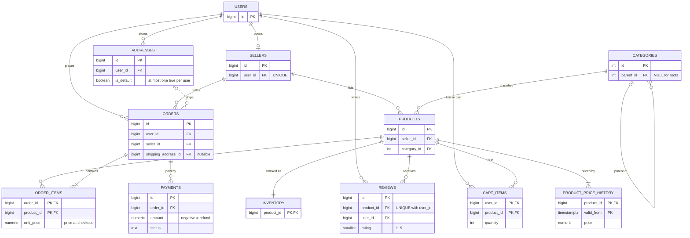

# Module 07: Data Modeling

<!-- nav:start -->
> **Theory** · [Exercises](exercises.md) · [Project](project.md) · [Solutions](solutions/README.md)  
> [← 06 Advanced SQL](../06-advanced-sql/README.md) · [Course home](../../README.md) · [08 Beyond Scalars →](../08-beyond-scalars/README.md)
<!-- nav:end -->

So far you have used Bazaar's schema as it was handed to you: seven tables from module 02. The business has moved on. Customers want to save several delivery addresses. Finance needs to see every payment attempt and every refund. Product pages need reviews. Shoppers expect their cart to survive a browser restart. And when a customer disputes an old order ("I paid 999, not 1,049!"), support needs to know what the price *was* on the day of the order. Each of these is a few `CREATE TABLE` statements, but each also hides decisions that are expensive to change later: what identifies a row, which facts live where, what happens to child rows when a parent goes away, and how to remember the past. This module is about making those decisions on purpose. You'll learn the vocabulary (entities, keys, functional dependencies, normal forms), see the problems that bad designs cause with real data, and then design and build **Bazaar schema v2**.

**What you'll learn**

- How to go from business requirements to a conceptual, logical and physical model, and how to draw entity-relationship diagrams (ERDs) in Mermaid.
- Keys: candidate, primary and alternate keys; natural versus surrogate keys; composite keys; and the `bigint` versus UUID question, measured.
- Functional dependencies, the update/insert/delete anomalies they cause in badly structured tables, and the normal forms (1NF, 2NF, 3NF, BCNF, and a glimpse of 4NF) with concrete broken examples.
- When and how to denormalize deliberately, and why `order_items.unit_price` is not redundancy but a historical fact.
- Relationship patterns: one-to-one, one-to-many, many-to-many with junction tables that carry attributes, self-references and tree representations, polymorphic associations (and what to do instead), lookup tables versus enums versus `CHECK`.
- Temporal modeling: history tables and "the price at time T", soft versus hard deletes, audit trails.
- Why entity-attribute-value (EAV) tables are an anti-pattern, the three multi-tenancy patterns, naming conventions, and documenting a schema with `COMMENT`.

**Before you start**

The state at the start of this module is the v1 schema with the small dataset:

```bash
./project/bin/reset.sh 07
```

The milestone asks you to design schema v2 yourself. The theory, however, uses the reference v2 design as its worked example, and its examples run against the reference v2 tables and data. To run them, load the state *after* this module (which is the start of module 08):

```bash
./project/bin/reset.sh 08      # v1 + project/db/0701_schema_modeling.sql + 0702_seed_modeling.sql
./project/bin/psql.sh
```

If you want to design v2 without being influenced, do the milestone in [`project.md`](project.md) first, and come back to sections 7–9 afterwards. Examples that change data run inside `BEGIN ... ROLLBACK`.

---

<!-- toc:start -->
**Contents**

- [1. From requirements to tables](#1-from-requirements-to-tables)
  - [1.1 Three levels of model](#11-three-levels-of-model)
  - [1.2 Bazaar v2: the requirements](#12-bazaar-v2-the-requirements)
  - [1.3 From words to entities](#13-from-words-to-entities)
- [2. Entities, relationships and ER diagrams](#2-entities-relationships-and-er-diagrams)
  - [2.1 Vocabulary](#21-vocabulary)
  - [2.2 Crow's foot notation in Mermaid](#22-crows-foot-notation-in-mermaid)
  - [2.3 Mapping relationships to tables](#23-mapping-relationships-to-tables)
- [3. Keys](#3-keys)
  - [3.1 Candidate, primary and alternate keys](#31-candidate-primary-and-alternate-keys)
  - [3.2 Natural versus surrogate keys](#32-natural-versus-surrogate-keys)
  - [3.3 Composite keys](#33-composite-keys)
  - [3.4 bigint or UUID?](#34-bigint-or-uuid)
- [4. Functional dependencies and anomalies](#4-functional-dependencies-and-anomalies)
  - [4.1 A spreadsheet in a table](#41-a-spreadsheet-in-a-table)
  - [4.2 Functional dependencies](#42-functional-dependencies)
  - [4.3 The three anomalies](#43-the-three-anomalies)
- [5. Normal forms](#5-normal-forms)
  - [5.1 First normal form (1NF): one value per cell, no repeating groups](#51-first-normal-form-1nf-one-value-per-cell-no-repeating-groups)
  - [5.2 Second normal form (2NF): no partial dependencies](#52-second-normal-form-2nf-no-partial-dependencies)
  - [5.3 Third normal form (3NF): no transitive dependencies](#53-third-normal-form-3nf-no-transitive-dependencies)
  - [5.4 Boyce-Codd normal form (BCNF): every determinant is a key](#54-boyce-codd-normal-form-bcnf-every-determinant-is-a-key)
  - [5.5 Fourth normal form (4NF), briefly](#55-fourth-normal-form-4nf-briefly)
  - [5.6 How far to normalize](#56-how-far-to-normalize)
- [6. Deliberate denormalization](#6-deliberate-denormalization)
  - [6.1 Derived data: orders.total](#61-derived-data-orderstotal)
  - [6.2 Snapshots: order_items.unit_price is a historical fact](#62-snapshots-order_itemsunit_price-is-a-historical-fact)
- [7. Relationship patterns](#7-relationship-patterns)
  - [7.1 One-to-one](#71-one-to-one)
  - [7.2 One-to-many](#72-one-to-many)
  - [7.3 Many-to-many: junction tables that carry attributes](#73-many-to-many-junction-tables-that-carry-attributes)
  - [7.4 Self-references and trees](#74-self-references-and-trees)
  - [7.5 Polymorphic associations, and what to do instead](#75-polymorphic-associations-and-what-to-do-instead)
  - [7.6 Lookup tables, enums or CHECK?](#76-lookup-tables-enums-or-check)
- [8. Business rules as constraints](#8-business-rules-as-constraints)
  - [8.1 "At most one default address": a partial unique index](#81-at-most-one-default-address-a-partial-unique-index)
  - [8.2 The other v2 rules](#82-the-other-v2-rules)
  - [8.3 Choosing ON DELETE](#83-choosing-on-delete)
- [9. Temporal modeling](#9-temporal-modeling)
  - [9.1 History tables](#91-history-tables)
  - [9.2 "The price at time T"](#92-the-price-at-time-t)
  - [9.3 Soft delete versus hard delete](#93-soft-delete-versus-hard-delete)
  - [9.4 Audit trails](#94-audit-trails)
- [10. The EAV anti-pattern versus JSONB](#10-the-eav-anti-pattern-versus-jsonb)
- [11. Multi-tenancy](#11-multi-tenancy)
- [12. Naming conventions](#12-naming-conventions)
- [13. Documenting the schema with COMMENT](#13-documenting-the-schema-with-comment)
- [Summary](#summary)
- [What's next](#whats-next)

<!-- toc:end -->

## 1. From requirements to tables

### 1.1 Three levels of model

Data modeling usually moves through three levels. Each answers a different question, and mixing them up is the source of many bad schemas.

| Level | Question | Vocabulary | Output |
|---|---|---|---|
| **Conceptual** | What things does the business talk about, and how are they related? | entities, relationships, cardinality | a high-level ER diagram, no columns or types |
| **Logical** | What exactly do we store about each thing, and what identifies it? | attributes, keys, functional dependencies, normal forms | relations (tables) with columns, keys and constraints, still independent of any database product |
| **Physical** | How do we implement it on *this* database, for *this* workload? | data types, indexes, partitioning, storage | `CREATE TABLE` statements, migrations |

The conceptual level is where you talk with the business. "Can an order be shipped to two addresses?" is a conceptual question, and the answer comes from people, not from SQL. The logical level is where normalization happens. The physical level is where PostgreSQL-specific choices come in: `numeric(12,2)` for money, `timestamptz`, a partial unique index, an index on a foreign key (module 11), a partitioned table (module 14).

### 1.2 Bazaar v2: the requirements

Here is what the business asked for, in their words. These are the requirements of this module's milestone.

1. **Addresses.** A user can store any number of postal addresses (recipient, two address lines, city, postal code, country, an optional label such as "Home"). At most one of them is the user's *default* address. A user may have no addresses at all.
2. **Shipping.** An order is shipped to one of the buyer's addresses. Orders placed before addresses existed have none.
3. **Payments.** An order can have several payment attempts (some fail) through a provider such as Stripe or PayPal, each with the provider's transaction reference and a status (pending, succeeded, failed). Refunds are recorded as payments with a **negative** amount. Payment records are financial records: they are never deleted, and an order with payments can't be deleted either.
4. **Reviews.** A user can review a product with a rating from 1 to 5 stars and an optional title and text. A user reviews a given product at most once.
5. **Carts.** A user's cart holds products with a quantity. Adding a product that is already in the cart increases its quantity.
6. **Price history.** When a seller changes a price, we must be able to tell, for any past moment, what the product cost then.
7. **Lifecycle.** When a user account is deleted, their addresses and cart go with it. (Users with orders can't be deleted at all, because orders are business records.)

### 1.3 From words to entities

A useful first pass is grammatical: **nouns** are candidate entities or attributes, **verbs** are candidate relationships.

- *User, address, order, payment, provider, product, review, cart, price* are nouns.
- *Stores* (user–address), *is shipped to* (order–address), *has* (order–payment), *reviews* (user–product), *holds* (cart–product) are verbs.

Then you ask, for every noun: **is it a thing with its own identity and its own facts, or is it a fact about something else?**

- An **address** has its own facts (city, postal code...), several per user, and it is referenced by orders. It's an entity.
- A **provider** ("stripe") is, for now, just a word on a payment. It could become an entity later, if providers get their own facts (a display name, fees, an "enabled" flag). Section 7.6 discusses exactly this choice.
- A **cart** is interesting. Every user has at most one cart, and the cart has no facts of its own except its contents. So we don't need a `carts` table: the cart *is* the set of `cart_items` rows of a user.
- A **price** is a fact about a product at a moment in time. The *current* price is already `products.price`; the *history* needs a new entity whose identity is "product + moment".

---

## 2. Entities, relationships and ER diagrams

### 2.1 Vocabulary

- An **entity type** is a kind of thing: User, Order, Product. An **entity** is one instance (user 12). In the physical model an entity type usually becomes a table, and an entity a row.
- An **attribute** is a fact about an entity: a user's email, an order's status.
- A **relationship** connects entities: a user *places* orders.
- **Cardinality** says how many: one-to-one (1:1), one-to-many (1:N), many-to-many (M:N).
- **Optionality** (participation) says whether the relationship is required: must every order have a shipping address? (No: old orders don't.) Must every address belong to a user? (Yes.)

### 2.2 Crow's foot notation in Mermaid

ER diagrams are usually drawn in **crow's foot** notation, which Mermaid supports. Each end of a line carries two symbols: the inner one is the *minimum*, the outer one the *maximum*.

| Mermaid | Symbol | Meaning |
|---|---|---|
| `\|\|` | ─┼┼ | exactly one |
| `o\|` | ─○┼ | zero or one |
| `}\|` | ─<┼ | one or more |
| `}o` | ─<○ | zero or more |

`USERS ||--o{ ADDRESSES : stores` reads: "one user stores zero or more addresses; each address belongs to exactly one user." A solid line (`--`) marks an *identifying* relationship (the child's key includes the parent's key, like `order_items` including `order_id`); a dashed line (`..`) a non-identifying one.

Here is Bazaar v2. The v1 tables are included so the new relationships make sense, with only their key columns shown:



Some details worth reading off the diagram:

- `USERS ||--o| SELLERS`: a user opens zero or one shop; a shop belongs to exactly one user. That's a 1:1 relationship with optionality on one side.
- `CATEGORIES |o--o{ CATEGORIES`: a self-reference. A category has zero or one parent and zero or more children.
- `PRODUCTS ||--|{ PRODUCT_PRICE_HISTORY`: *one or more*, because every product has at least its initial price. Note that the database can't enforce "at least one child row" with a simple constraint; it's a rule your code (or a trigger, module 09) must keep.
- `ADDRESSES |o..o{ ORDERS`: an order ships to zero or one address (nullable FK); an address can be used by any number of orders.

### 2.3 Mapping relationships to tables

The mapping from the diagram to tables is mechanical:

| Relationship | Implementation | Bazaar example |
|---|---|---|
| 1:N, child must have a parent | `NOT NULL` foreign key in the child | `addresses.user_id` |
| 1:N, parent optional | nullable foreign key in the child | `orders.shipping_address_id` |
| 1:1 | foreign key with `UNIQUE` (or the FK *is* the primary key) | `sellers.user_id UNIQUE`, `inventory.product_id` PK |
| M:N | a **junction table** with two foreign keys; its key is the pair, or a surrogate plus `UNIQUE` on the pair | `cart_items`, `reviews`, `order_items` |
| self-reference | a foreign key to the same table | `categories.parent_id` |

You can check what the database knows about relationships from the catalog. Every foreign key in schema v2, with its delete rule:

```sql
SELECT conrelid::regclass AS child,
       confrelid::regclass AS parent,
       conname,
       CASE confdeltype WHEN 'a' THEN 'NO ACTION' WHEN 'r' THEN 'RESTRICT'
                        WHEN 'c' THEN 'CASCADE' WHEN 'n' THEN 'SET NULL' END AS on_delete
FROM pg_constraint
WHERE contype = 'f' AND connamespace = 'bazaar'::regnamespace
ORDER BY confrelid::regclass::text, conrelid::regclass::text;
```

```text
         child         |   parent   |                conname                | on_delete 
-----------------------+------------+---------------------------------------+-----------
 orders                | addresses  | orders_shipping_address_id_fkey       | NO ACTION
 categories            | categories | categories_parent_id_fkey             | NO ACTION
 products              | categories | products_category_id_fkey             | NO ACTION
 order_items           | orders     | order_items_order_id_fkey             | CASCADE
 payments              | orders     | payments_order_id_fkey                | NO ACTION
 cart_items            | products   | cart_items_product_id_fkey            | CASCADE
 inventory             | products   | inventory_product_id_fkey             | CASCADE
 order_items           | products   | order_items_product_id_fkey           | NO ACTION
 product_price_history | products   | product_price_history_product_id_fkey | CASCADE
 reviews               | products   | reviews_product_id_fkey               | CASCADE
 orders                | sellers    | orders_seller_id_fkey                 | NO ACTION
 products              | sellers    | products_seller_id_fkey               | NO ACTION
 addresses             | users      | addresses_user_id_fkey                | CASCADE
 cart_items            | users      | cart_items_user_id_fkey               | CASCADE
 orders                | users      | orders_user_id_fkey                   | NO ACTION
 reviews               | users      | reviews_user_id_fkey                  | NO ACTION
 sellers               | users      | sellers_user_id_fkey                  | NO ACTION
(17 rows)
```

Section 8.3 explains how each `on_delete` was chosen.

---

## 3. Keys

### 3.1 Candidate, primary and alternate keys

A **key** is a set of columns whose values identify a row: no two rows can have the same values in them.

- A **superkey** is any set of columns that is unique. `(id, email)` in `users` is a superkey, but a wasteful one.
- A **candidate key** is a *minimal* superkey: remove any column and it stops being unique. `users` has two: `id` and `email`.
- The **primary key** is the candidate key you choose as the main identifier, the one other tables reference. PostgreSQL enforces it with a unique index plus `NOT NULL`.
- The other candidate keys are **alternate keys**. Declare them with `UNIQUE` so the database enforces them too. `users.email`, `sellers.shop_name` and `products (seller_id, sku)` are Bazaar's alternate keys.

The point of identifying *all* candidate keys is that every one of them is a business rule ("two shops can't have the same name"), and an undeclared rule is a rule that will be broken.

You can list every key Bazaar declares, primary and alternate, from the catalog:

```sql
SELECT conrelid::regclass AS table_name,
       CASE contype WHEN 'p' THEN 'primary' ELSE 'alternate' END AS kind,
       pg_get_constraintdef(oid) AS definition
FROM pg_constraint
WHERE contype IN ('p', 'u') AND connamespace = 'bazaar'::regnamespace
ORDER BY conrelid::regclass::text, contype;
```

```text
      table_name       |   kind    |              definition              
-----------------------+-----------+--------------------------------------
 addresses             | primary   | PRIMARY KEY (id)
 cart_items            | primary   | PRIMARY KEY (user_id, product_id)
 categories            | primary   | PRIMARY KEY (id)
 categories            | alternate | UNIQUE (slug)
 inventory             | primary   | PRIMARY KEY (product_id)
 order_items           | primary   | PRIMARY KEY (order_id, product_id)
 orders                | primary   | PRIMARY KEY (id)
 payments              | primary   | PRIMARY KEY (id)
 product_price_history | primary   | PRIMARY KEY (product_id, valid_from)
 products              | primary   | PRIMARY KEY (id)
 products              | alternate | UNIQUE (seller_id, sku)
 reviews               | primary   | PRIMARY KEY (id)
 reviews               | alternate | UNIQUE (product_id, user_id)
 sellers               | primary   | PRIMARY KEY (id)
 sellers               | alternate | UNIQUE (shop_name)
 sellers               | alternate | UNIQUE (user_id)
 users                 | primary   | PRIMARY KEY (id)
 users                 | alternate | UNIQUE (email)
(18 rows)
```

`addresses_one_default_per_user` doesn't appear: it's a unique *index* with a `WHERE` clause, not a constraint (section 8.1).

### 3.2 Natural versus surrogate keys

A **natural key** consists of data that has a meaning in the real world: an email, an ISO country code, a SKU, an ISBN. A **surrogate key** is a meaningless value generated by the database (`bigint GENERATED ALWAYS AS IDENTITY`) or the application (a UUID).

Natural keys are attractive because they're "already there". The problem is that real-world data **changes**, and is **less unique than people think**:

- Emails change (people marry, change jobs, change providers), and module 08 will show that `Zoe.Martin@Example.COM` and `zoe.martin@example.com` should count as the same address. If `email` were the primary key of `users`, every order, review and address would store it, and an email change would have to update all of them.
- Shop names change when sellers rebrand.
- SKUs are unique *per seller*, not globally. Seller 1's `TT-LAP-001` and some other seller's `TT-LAP-001` can coexist.

A surrogate key never changes because it means nothing. Foreign keys point at it, and the natural key becomes an alternate key (`UNIQUE`), so the business rule is still enforced. That's Bazaar's default: `id bigint GENERATED ALWAYS AS IDENTITY` everywhere, plus `UNIQUE` on the natural keys.

Natural keys are still the right choice when the value is **stable, compact and truly unique**, typically codes defined by a standard or by your own system:

- `char(2)` ISO country codes (`'DE'`) don't change, and a lookup table keyed by them makes queries readable without joins.
- Currency codes (`'EUR'`), language tags (`'en-GB'`).
- **Composite keys of junction and history tables**, where the "natural" key is a pair of surrogate keys (next section).

### 3.3 Composite keys

A **composite key** consists of several columns. Bazaar uses three:

- `order_items (order_id, product_id)`: an order contains a product at most once (with a quantity).
- `cart_items (user_id, product_id)`: a user's cart contains a product at most once. The composite key turns "add to cart" into an upsert with `ON CONFLICT (user_id, product_id)`.
- `product_price_history (product_id, valid_from)`: a product can't have two prices starting at the same moment.

Why not give these tables an `id` too? You can, and it's not wrong. But then you **must** still declare `UNIQUE (order_id, product_id)`, or nothing stops duplicate lines, and you've paid for an extra column and an extra index. For tables whose rows are pure "facts about a pair", the pair is the natural identity.

`reviews` is the counter-example: its natural key is `(product_id, user_id)`, but it has a surrogate `id` *plus* `UNIQUE (product_id, user_id)`. Reviews are things that other things will point at (helpful votes, seller replies, moderation flags), and a single-column key is more convenient as a foreign key target. That's the usual rule: give a junction table a surrogate key when it becomes an entity in its own right.

> **Pitfall:** the column order of a composite key matters for its index (module 11). The index on `(product_id, valid_from)` serves "all prices of product 37, by date" perfectly, and "all prices valid from a given date, for every product" not at all. Put the column you always filter by first.

### 3.4 bigint or UUID?

The most common surrogate-key debate. Let's measure first. The sizes of the values themselves:

```sql
SELECT pg_column_size(1::bigint)                AS bigint_bytes,
       pg_column_size(gen_random_uuid())        AS uuid_bytes,
       pg_column_size(gen_random_uuid()::text)  AS uuid_as_text_bytes;
```

```text
 bigint_bytes | uuid_bytes | uuid_as_text_bytes 
--------------+------------+--------------------
            8 |         16 |                 40
(1 row)
```

And the size of the primary-key index after inserting one million rows, in three variants: an identity `bigint`; a random version-4 UUID from `gen_random_uuid()`; and a *time-ordered* UUID, simulated here by putting a millisecond timestamp in the first 48 bits (this is the layout of the new UUID version 7):

```sql
CREATE TEMP TABLE k_bigint (id bigint GENERATED ALWAYS AS IDENTITY PRIMARY KEY);
CREATE TEMP TABLE k_uuid4  (id uuid DEFAULT gen_random_uuid() PRIMARY KEY);
CREATE TEMP TABLE k_uuid7  (id uuid PRIMARY KEY);

INSERT INTO k_bigint SELECT FROM generate_series(1, 1000000);
INSERT INTO k_uuid4  SELECT FROM generate_series(1, 1000000);
INSERT INTO k_uuid7
SELECT (lpad(to_hex(1750000000000 + g), 12, '0') || substr(md5(g::text), 1, 20))::uuid
FROM generate_series(1, 1000000) AS g;

SELECT relname, pg_size_pretty(pg_relation_size(oid)) AS index_size
FROM pg_class
WHERE relname IN ('k_bigint_pkey', 'k_uuid4_pkey', 'k_uuid7_pkey')
ORDER BY relname;
```

```text
    relname    | index_size 
---------------+------------
 k_bigint_pkey | 21 MB
 k_uuid4_pkey  | 38 MB
 k_uuid7_pkey  | 30 MB
(3 rows)
```

(`INSERT ... SELECT FROM generate_series(...)` with an empty select list inserts rows with only default values, a handy trick for test data.)

What the numbers mean:

- **Width.** A UUID is twice as wide as a `bigint`, so a minimal index is about 40% bigger (each index entry also has an 8-byte header and a 4-byte pointer, so it's not quite double). Every foreign key that references it, and every index on those foreign keys, pays the same price. Storing UUIDs as `text` is the worst of all worlds: 40 bytes, slow comparisons, and no validation.
- **Locality.** Identity values and time-ordered UUIDs arrive in increasing order, so each new entry goes at the right edge of the B-tree, which stays densely packed and "hot" in memory. Random v4 UUIDs land on a random page each time. Pages get split half-full (the index ends up another 25% bigger), and on a large table every insert touches a different page, which may need to be read from disk. On the authors' machine, inserting the million random UUIDs took about 4.5 times as long as the `bigint`s. Module 11 explains B-tree page splits.

So why does anyone use UUIDs? Because they have real advantages:

- **Generate anywhere.** A client, a mobile app working offline, or another service can create an id without asking the database. That's useful for idempotent APIs ("create order with id X" can be retried safely) and for merging data from several databases or shards (module 21).
- **No information leak.** `/orders/121` tells a competitor roughly how many orders you have, and invites people to try `/orders/120`. A UUID reveals nothing (a v7 UUID does reveal its creation time).
- **Global uniqueness.** Ids from different tables or systems never collide, which helps with event streams and logs.

A pragmatic rule:

- Internal tables with high write volume and lots of foreign keys: `bigint GENERATED ALWAYS AS IDENTITY`. That's Bazaar.
- Ids that are exposed publicly, generated outside the database, or merged across systems: a UUID, preferably **time-ordered (v7)**. A common hybrid keeps a `bigint` primary key for joins and adds a `public_id uuid UNIQUE` column for URLs and APIs.
- Never `float`, never `text` UUIDs, and never random v4 UUIDs on a huge, insert-heavy table if you can avoid it.

> **PG 18:** PostgreSQL 18 adds a built-in `uuidv7()` function (and `uuidv4()` as an alias of `gen_random_uuid()`), so time-ordered UUIDs no longer need an extension or application code. On PostgreSQL 17, generate v7 UUIDs in the application, or with an extension such as `pg_uuidv7`.

```sql
DROP TABLE k_bigint, k_uuid4, k_uuid7;
```

---

## 4. Functional dependencies and anomalies

### 4.1 A spreadsheet in a table

Imagine Bazaar had started the way many businesses do: with one big sheet of order lines, imported into a single table. Let's build it from the real data, so we can see what goes wrong:

```sql
BEGIN;
CREATE TABLE order_lines_flat AS
SELECT o.id AS order_id, o.created_at::date AS order_date,
       u.email AS customer_email, u.full_name AS customer_name,
       s.shop_name, s.country_code AS shop_country,
       p.sku, p.title AS product_title, c.name AS category,
       oi.quantity, oi.unit_price
FROM order_items AS oi
JOIN orders     AS o ON o.id = oi.order_id
JOIN users      AS u ON u.id = o.user_id
JOIN sellers    AS s ON s.id = o.seller_id
JOIN products   AS p ON p.id = oi.product_id
JOIN categories AS c ON c.id = p.category_id;

SELECT order_id, order_date, customer_name, shop_name, sku,
       left(product_title, 20) AS product_title, quantity, unit_price
FROM order_lines_flat
WHERE customer_email = 'liam.oconnor@example.ie'
ORDER BY order_id, sku;
```

```text
 order_id | order_date | customer_name |    shop_name    |    sku     |    product_title     | quantity | unit_price 
----------+------------+---------------+-----------------+------------+----------------------+----------+------------
       17 | 2024-03-31 | Liam O'Connor | Bookworm Corner | BW-SF-004  | Echoes of Andromeda  |        1 |       9.99
       17 | 2024-03-31 | Liam O'Connor | Bookworm Corner | BW-SF-005  | The Clockwork Nebula |        1 |      16.00
       23 | 2024-04-26 | Liam O'Connor | Bookworm Corner | BW-CK-001  | Salt, Fat, Flame     |        1 |      32.99
       23 | 2024-04-26 | Liam O'Connor | Bookworm Corner | BW-MY-001  | Murder at Willow Lan |        1 |      11.99
       23 | 2024-04-26 | Liam O'Connor | Bookworm Corner | BW-SF-004  | Echoes of Andromeda  |        1 |       9.99
       26 | 2024-05-07 | Liam O'Connor | TechTrove       | TT-AUD-001 | QuietWave ANC Headph |        1 |     249.00
       26 | 2024-05-07 | Liam O'Connor | TechTrove       | TT-AUD-002 | QuietWave Buds       |        1 |     129.00
       26 | 2024-05-07 | Liam O'Connor | TechTrove       | TT-AUD-004 | KidSafe Volume-Limit |        2 |      29.99
       26 | 2024-05-07 | Liam O'Connor | TechTrove       | TT-CMP-001 | USB-C Docking Statio |        1 |     129.00
       42 | 2024-08-17 | Liam O'Connor | Threadbare Co.  | TB-TS-004  | Linen Summer Shirt   |        2 |      39.00
       98 | 2025-05-28 | Liam O'Connor | Casa Cucina     | CC-CW-003  | Non-Stick Frying Pan |        1 |      34.99
       98 | 2025-05-28 | Liam O'Connor | Casa Cucina     | CC-CW-006  | Pasta Pot with Strai |        1 |      54.00
      102 | 2025-06-18 | Liam O'Connor | TechTrove       | TT-LAP-003 | Titan G17 Gaming Lap |        1 |    2199.99
      102 | 2025-06-18 | Liam O'Connor | TechTrove       | TT-LAP-004 | StudyMate 11 Chromeb |        1 |     249.00
      102 | 2025-06-18 | Liam O'Connor | TechTrove       | TT-LAP-007 | Laptop Sleeve 13"    |        1 |      19.99
      102 | 2025-06-18 | Liam O'Connor | TechTrove       | TT-MON-004 | PortaScreen 15.6" US |        1 |     189.00
(16 rows)
```

It looks convenient: everything about an order line in one row, no joins. Now look at what the table *repeats*. Liam's name appears on every one of his lines, the shop's name and country on every line it sold, the product's title and category on every line that contains it.

### 4.2 Functional dependencies

The precise way to describe "repeats" is the **functional dependency** (FD). Column set X **functionally determines** column set Y, written **X → Y**, if any two rows that agree on X must agree on Y. In other words, X's value determines Y's value. In `order_lines_flat`, as the business defines things:

- `customer_email → customer_name` (an email belongs to one customer, who has one name)
- `order_id → order_date, customer_email, shop_name` (an order has one date, one buyer, one seller)
- `shop_name → shop_country`
- `sku, shop_name → product_title, category` (SKUs are unique per seller)
- `order_id, sku → quantity, unit_price` (an order line)

Two things to note about FDs:

1. **FDs come from the business, not from the data.** A table can satisfy an FD by coincidence. The data can only *disprove* one. You can test whether data violates an FD with a query: group by X and look for groups with more than one distinct Y. For example `SELECT customer_email FROM order_lines_flat GROUP BY customer_email HAVING count(DISTINCT customer_name) > 1` must return nothing.
2. **FDs determine the keys.** A key is a set of columns that functionally determines *all* the other columns. Here, `(order_id, sku)` determines everything, so it's the candidate key of this table. (Strictly, `(order_id, sku, shop_name)`, but `order_id → shop_name`, so `shop_name` is redundant in the key.)

**Normalization is the process of making every functional dependency a key constraint.** When the left side of every FD is a key of its table, each fact is stored exactly once, and the database can enforce it.

### 4.3 The three anomalies

When a table contains an FD whose left side is *not* a key, the dependent fact is stored many times, and three kinds of bugs follow.

**Update anomaly.** A fact stored in several rows must be updated in all of them. Liam changes his name, and a careless update touches only one order:

```sql
SELECT count(*) AS rows_with_liams_name
FROM order_lines_flat
WHERE customer_email = 'liam.oconnor@example.ie';

UPDATE order_lines_flat
SET customer_name = 'Liam O''Connor-Walsh'
WHERE order_id = 102;

SELECT customer_email, customer_name, count(*) AS rows
FROM order_lines_flat
WHERE customer_email = 'liam.oconnor@example.ie'
GROUP BY customer_email, customer_name;
```

```text
 rows_with_liams_name 
----------------------
                   16
(1 row)

     customer_email      |    customer_name    | rows 
-------------------------+---------------------+------
 liam.oconnor@example.ie | Liam O'Connor       |   12
 liam.oconnor@example.ie | Liam O'Connor-Walsh |    4
(2 rows)
```

The table now contradicts itself: the same customer has two names. Which one is true? The database can't tell you, because it never knew that the name depends on the email. The FD test from above now finds the violation:

```sql
SELECT customer_email, count(DISTINCT customer_name) AS names
FROM order_lines_flat
GROUP BY customer_email
HAVING count(DISTINCT customer_name) > 1;
```

```text
     customer_email      | names 
-------------------------+-------
 liam.oconnor@example.ie |     2
(1 row)
```

**Insertion anomaly.** You can't record a fact without an unrelated fact. A new seller has listed a product but nothing has been sold yet. There's no order line, so there's nowhere to store the product's title and category, or even that the shop exists. You'd have to invent a fake order line with NULLs in the key columns.

**Deletion anomaly.** Deleting one fact destroys another. Some products appear in exactly one order line:

```sql
SELECT sku, product_title
FROM order_lines_flat
GROUP BY sku, product_title
HAVING count(*) = 1
ORDER BY sku;
ROLLBACK;
```

```text
    sku     |          product_title          
------------+---------------------------------
 TT-LAP-005 | AeroBook 13 Laptop (2023 model)
 TT-MON-003 | UltraWide 34" Curved Monitor
(2 rows)
```

If those orders are deleted (say, as part of a data-retention policy), the *products* disappear from the system too, along with their titles and categories.

The cure for all three is the same: split the table so that each fact lives in exactly one place. That's what Bazaar's v1 schema does: `users`, `sellers`, `products`, `categories`, `orders` and `order_items`. Normal forms give you the step-by-step rules.

---

## 5. Normal forms

Normal forms are a ladder: each one includes the previous one and removes one more kind of redundancy. The `..._bad` tables in this section illustrate what *not* to do; there's no need to create them. In practice "normalized" means **third normal form (3NF)** or **Boyce-Codd normal form (BCNF)**. Two more terms first:

- A **prime attribute** is a column that is part of *some* candidate key.
- A dependency X → Y is **trivial** when Y is part of X (`(a, b) → a` is always true).

### 5.1 First normal form (1NF): one value per cell, no repeating groups

A table is in 1NF when every column holds a single value of its type, and there are no repeating groups of columns. Violations look like this:

```sql
-- NOT 1NF: a list inside a string, and a repeating group of columns
CREATE TABLE sellers_bad (
    id           bigint PRIMARY KEY,
    shop_name    text,
    categories   text,          -- 'Laptops, Monitors, Headphones'
    phone1       text,
    phone2       text,
    phone3       text
);
```

The problems are practical:

- "Which sellers sell Monitors?" needs `categories LIKE '%Monitors%'`, which also matches a hypothetical "Monitors & Mounts", can't use a normal index, and can't be a foreign key to `categories`.
- Renaming "Headphones" means editing strings in every row.
- A fourth phone number needs a schema change. "Find the seller with phone X" must search three columns.

The 1NF fix is a separate table with one row per value: `seller_phones (seller_id, phone)`, and a junction table `seller_categories (seller_id, category_id)` with real foreign keys.

What about PostgreSQL's arrays and JSONB? A `text[]` column technically holds one value: an array. The question is not "is this an array" but "**do I ever need to treat the elements as individual facts**": join on them, constrain them with foreign keys, update one of them, count them across rows. If yes, use rows. If the list is an opaque attribute of its owner that you read and write as a whole, such as product `tags` used for search, an array is fine and often faster. Module 08 adds exactly that (`products.tags text[]`) and shows how to index it.

### 5.2 Second normal form (2NF): no partial dependencies

A table is in 2NF when it is in 1NF and **no non-prime column depends on only part of a candidate key**. 2NF can only be violated when a key has more than one column.

Suppose `order_items` had been designed to "save a join" by storing the product's title:

```sql
-- NOT 2NF: key is (order_id, product_id), but product_title depends on product_id alone
CREATE TABLE order_items_bad (
    order_id       bigint,
    product_id     bigint,
    product_title  text,          -- product_id → product_title
    quantity       int,
    unit_price     numeric(12,2),
    PRIMARY KEY (order_id, product_id)
);
```

`product_id → product_title` is a **partial dependency**: the title depends on part of the key. The title is repeated on every line that sells the product, with all three anomalies. The 2NF fix moves the column to the table where `product_id` is the whole key: `products`.

(Hold on to `unit_price`. It *looks* like it depends on `product_id` alone, too. Section 6.2 explains why it doesn't.)

### 5.3 Third normal form (3NF): no transitive dependencies

A table is in 3NF when it is in 2NF and **no non-prime column depends on another non-prime column**. Such a chain, key → A → B, is a **transitive dependency**.

```sql
-- NOT 3NF: id → user_email → user_name (a transitive dependency)
CREATE TABLE orders_bad (
    id          bigint PRIMARY KEY,
    user_email  text,
    user_name   text,        -- depends on user_email, not on the order
    seller_id   bigint,
    seller_country char(2),  -- depends on seller_id, not on the order
    total       numeric(12,2)
);
```

`user_name` depends on the order only *through* `user_email`. A customer with 19 orders has their name stored 19 times. The 3NF fix moves each transitive dependency to its own table (`users`, `sellers`) and keeps only the foreign key in `orders`.

A compact way to remember 2NF and 3NF together is the traditional oath: every non-key column must depend on **the key** (1NF), **the whole key** (2NF), **and nothing but the key** (3NF).

### 5.4 Boyce-Codd normal form (BCNF): every determinant is a key

3NF has a loophole: it only constrains *non-prime* columns. BCNF closes it with a simpler rule: **for every non-trivial FD X → Y, X must be a superkey**. The loophole only matters when a table has several overlapping candidate keys, which is rare, but here's a Bazaar-flavoured example.

Bazaar wants to record which carrier each seller uses for each destination country, with two business rules:

- for each (seller, destination country) there is exactly one carrier;
- each carrier operates in exactly one country (a national postal service).

```sql
-- 3NF but NOT BCNF
CREATE TABLE seller_carriers_bad (
    seller_id     bigint,
    country_code  char(2),
    carrier       text,
    PRIMARY KEY (seller_id, country_code)
);
```

FDs: `(seller_id, country_code) → carrier` (the key) and `carrier → country_code`. Candidate keys are `(seller_id, country_code)` and `(seller_id, carrier)`, so every column is prime, and 3NF is satisfied trivially. But `carrier → country_code` has a left side that is not a key, so the table is not in BCNF, and the anomaly is real: "Royal Mail operates in GB" is stored once per seller that uses Royal Mail. Update one row to say `'IE'` and the database contradicts itself.

The BCNF decomposition is:

```sql
CREATE TABLE carriers (
    carrier       text PRIMARY KEY,
    country_code  char(2) NOT NULL
);
CREATE TABLE seller_carriers (
    seller_id  bigint,
    carrier    text REFERENCES carriers,
    PRIMARY KEY (seller_id, carrier)
);
```

Now each carrier's country is stored once. But look at what was lost: the rule "one carrier per seller **and country**" spanned `seller_id` and `country_code`, which now live in different tables. A seller can now pick two carriers that serve the same country, and no simple constraint prevents it. This is the classic BCNF trade-off: **a BCNF decomposition is always lossless, but it doesn't always preserve every dependency as a constraint.** You choose between storing a redundant fact (3NF) and enforcing a cross-table rule another way (a trigger, module 09; or carrying `country_code` into `seller_carriers` with a composite foreign key `(carrier, country_code) REFERENCES carriers (carrier, country_code)` plus `UNIQUE (seller_id, country_code)`, a neat trick that keeps both rules declarative).

### 5.5 Fourth normal form (4NF), briefly

4NF deals with **multivalued dependencies**: two *independent* lists stored in one table. If a product comes in colours {black, white} and sizes {S, M, L}, and colour and size are independent, then the table

```sql
CREATE TABLE product_options_bad (
    product_id  bigint,
    colour      text,
    size        text,
    PRIMARY KEY (product_id, colour, size)
);
```

must store all 2 × 3 = 6 combinations, and adding a colour means adding three rows. It is in BCNF (the only key is all three columns), yet redundant. The 4NF fix is two tables, `product_colours (product_id, colour)` and `product_sizes (product_id, size)`. But if *combinations* are real things (a black M has its own stock and SKU), then the table is not redundant at all: it's a list of variants, and probably deserves its own surrogate key. As with all normal forms, the question is what the business facts are.

### 5.6 How far to normalize

- **Aim for 3NF/BCNF for your core, transactional data.** Every fact in one place, enforced by keys and foreign keys. Bazaar's schema is in BCNF, with the two deliberate exceptions in the next section.
- **Normalization is about facts, not about values that happen to be equal.** Two products with the price 19.00 are not redundancy. Two rows saying "Royal Mail is in GB" are.
- **Denormalize deliberately, with a reason, a mechanism, and a check** (next section). Never by accident.

---

## 6. Deliberate denormalization

### 6.1 Derived data: orders.total

`orders.total` is **derived**: it is always `sum(quantity * unit_price)` over the order's items. Storing it is redundant, and the same anomalies apply: change an item and forget the total, and the order contradicts itself. Why keep it?

- It's read constantly (order lists, invoices, revenue reports), and computing it needs a join and an aggregate over `order_items` every time.
- On the large dataset (module 11), "revenue per seller per month" over 500,000 orders is a scan of `orders` with the column, versus a join with 1.27 million order items without it.

Deliberate denormalization comes with three obligations:

1. **One writer.** Exactly one mechanism keeps the copy in sync. In Bazaar, from module 09, a trigger on `order_items` maintains `orders.total`. Until then, the code that writes orders (the seed, `place_order()` in module 10) computes it.
2. **A check.** A query that finds violations, run regularly or in tests. Bazaar's is part of `project/db/tools/check.sql`:

   ```sql
   SELECT count(*) AS orders_with_wrong_total
   FROM orders AS o
   LEFT JOIN (
       SELECT order_id, sum(quantity * unit_price) AS items_total
       FROM order_items
       GROUP BY order_id
   ) AS i ON i.order_id = o.id
   WHERE o.total <> coalesce(i.items_total, 0);
   ```

   ```text
    orders_with_wrong_total 
   -------------------------
                          0
   (1 row)
   ```

3. **Documentation.** Say it in the schema, so the next developer knows: `COMMENT ON COLUMN orders.total IS 'Denormalised: sum(quantity * unit_price) of the order''s items.'` (section 13).

Other legitimate denormalizations follow the same pattern: counters (`products.review_count`), cached aggregates (module 09's `seller_sales_daily` materialized view), search documents (module 13's generated `search_vector`).

### 6.2 Snapshots: order_items.unit_price is a historical fact

`order_items.unit_price` looks like a copy of `products.price`, a 2NF violation like `product_title` in section 5.2. It is not, because it's a **different fact**: "the price this customer agreed to pay in this order", as opposed to "the price the product costs today". The first never changes once the order is placed; the second changes whenever the seller wants. The FD `product_id → unit_price` does **not** hold: the same product sold at different prices in different orders.

The data proves it. These order lines were sold at a price different from today's:

```sql
SELECT oi.product_id, left(p.title, 26) AS title,
       count(*) AS lines, min(oi.unit_price) AS min_paid, max(oi.unit_price) AS max_paid,
       p.price AS price_today
FROM order_items AS oi
JOIN products AS p ON p.id = oi.product_id
WHERE oi.unit_price <> p.price
GROUP BY oi.product_id, p.title, p.price
ORDER BY oi.product_id;
```

```text
 product_id |           title           | lines | min_paid | max_paid | price_today 
------------+---------------------------+-------+----------+----------+-------------
          1 | AeroBook 13 Laptop        |     2 |  1099.00 |  1099.00 |      999.00
          7 | ClearView 27" 4K Monitor  |     3 |   399.00 |   399.00 |      379.00
         10 | QuietWave ANC Headphones  |     3 |   249.00 |   249.00 |      229.00
         19 | The Long Orbit            |     4 |    12.99 |    12.99 |       14.99
         29 | Salt, Fat, Flame          |     4 |    32.99 |    32.99 |       29.99
         34 | Cast Iron Skillet 26cm    |     2 |    39.00 |    39.00 |       45.00
         37 | Dutch Oven 5.5L Enamel    |     4 |    99.00 |   109.00 |      119.00
         52 | Classic Zip Hoodie - Grey |     3 |    45.00 |    45.00 |       49.00
(8 rows)
```

25 order lines, in 20 orders, across 8 products. If `order_items` had no `unit_price` and invoices computed `quantity * products.price`, every past invoice for these products would have silently changed when the seller changed the price. Accounting, taxes and refunds all depend on what was *actually charged*.

The general rule: **when a value must be remembered as it was at the time of an event, copy it into the event's row.** That's a snapshot, not redundancy. The same reasoning applies to:

- the **shipping address** of an order. Bazaar stores `orders.shipping_address_id`, a reference. If the user later edits that address row, the order's history silently changes. The reference schema accepts this and treats addresses as append-only ("edit" = insert a new address); many real systems instead copy the address fields into the order at checkout. The comment in `0701_schema_modeling.sql` records this trade-off.
- the product **title** on an invoice (sellers rename products);
- **exchange rates** and **tax rates** at the time of the sale.

---

## 7. Relationship patterns

### 7.1 One-to-one

Two Bazaar tables are 1:1 with another table:

- `sellers` ↔ `users`: `sellers.user_id` is `NOT NULL UNIQUE REFERENCES users`. A user has at most one shop, a shop exactly one owner.
- `inventory` ↔ `products`: `inventory.product_id` is both the primary key and a foreign key. A product has at most one stock record.

Why not just put the columns into the parent table? 1:1 splits are worth it when:

- **the relationship is optional**: most users are not sellers. Seller columns in `users` would be NULL for 80% of rows, and "is a seller" would be a convention rather than a fact the database knows;
- **the data changes at different rates**: inventory is updated on every order, product descriptions rarely. Module 16 shows that every `UPDATE` writes a new version of the whole row, so a hot counter next to a long description makes every stock change copy the description;
- **access differs**: a table with payout bank details can be locked down separately (module 15);
- **lifecycles differ**: `ON DELETE CASCADE` from `products` to `inventory` makes the stock record disappear with the product.

The `UNIQUE` (or primary key) on the foreign key is what makes it 1:1. Without it, it's 1:N.

### 7.2 One-to-many

The workhorse: a `NOT NULL` foreign key in the "many" table. `addresses.user_id`, `payments.order_id`, `products.seller_id`. Two decisions remain for each one: is the parent optional (nullable FK), and what happens when the parent is deleted (section 8.3)?

A pattern worth recognising is the **ledger**: `payments` is a 1:N child of `orders` where rows are only ever *added*. A refund is not an update of the payment's amount; it's a new row with a negative amount. The balance of an order is a sum:

```sql
SELECT o.id, o.status, o.total,
       sum(p.amount) FILTER (WHERE p.status = 'succeeded') AS net_paid,
       count(*) AS payment_rows,
       string_agg(p.status || ' ' || p.amount, ', ' ORDER BY p.id) AS history
FROM orders AS o
JOIN payments AS p ON p.order_id = o.id
WHERE o.id IN (18, 28, 40)
GROUP BY o.id
ORDER BY o.id;
```

```text
 id |  status   |  total  | net_paid | payment_rows |               history               
----+-----------+---------+----------+--------------+-------------------------------------
 18 | refunded  |  232.99 |     0.00 |            2 | succeeded 232.99, succeeded -232.99
 28 | refunded  |   77.98 |     0.00 |            2 | succeeded 77.98, succeeded -77.98
 40 | delivered | 8940.00 |  8940.00 |            1 | succeeded 8940.00
(3 rows)
```

An append-only ledger keeps the full history (who paid what, when, and what was refunded), never loses information to an `UPDATE`, and is easy to audit: the sum must reconcile with the order's status (exercise 10).

### 7.3 Many-to-many: junction tables that carry attributes

A many-to-many relationship needs a **junction table** (also called a join, link, bridge or associative table) with a foreign key to each side. The interesting part is that real junction tables almost always carry **attributes of the relationship itself**:

| Junction table | Relates | Attributes of the relationship |
|---|---|---|
| `order_items` | orders × products | `quantity`, `unit_price` |
| `cart_items` | users × products | `quantity`, `added_at` |
| `reviews` | users × products | `rating`, `title`, `body`, `created_at` |

`quantity` is not a fact about the user or the product; it's a fact about "this product in this user's cart". It can only live in the junction table.

Bazaar's open carts:

```sql
SELECT ci.user_id, u.full_name, ci.product_id, left(p.title, 26) AS product,
       ci.quantity, ci.added_at::date
FROM cart_items AS ci
JOIN users    AS u ON u.id = ci.user_id
JOIN products AS p ON p.id = ci.product_id
ORDER BY ci.user_id, ci.added_at;
```

```text
 user_id |   full_name    | product_id |          product           | quantity |  added_at  
---------+----------------+------------+----------------------------+----------+------------
       8 | Marcus Lee     |         47 | Organic Cotton Tee - White |        3 | 2025-06-21
       8 | Marcus Lee     |         24 | Murder at Willow Lane      |        2 | 2025-06-25
       8 | Marcus Lee     |          1 | AeroBook 13 Laptop         |        1 | 2025-06-29
      11 | Emma Schmidt   |         36 | Non-Stick Frying Pan 28cm  |        1 | 2025-06-29
      13 | Olivia Brown   |         44 | Bamboo Cutting Board       |        1 | 2025-06-22
      13 | Olivia Brown   |         41 | Santoku Knife 18cm         |        1 | 2025-06-25
      15 | Ava Nguyen     |          3 | Titan G17 Gaming Laptop    |        1 | 2025-06-23
      17 | Zoë Martin     |         62 | Bazaar Sticker Pack        |        1 | 2025-06-24
      17 | Zoë Martin     |         52 | Classic Zip Hoodie - Grey  |        1 | 2025-06-27
      21 | Isabella Silva |          7 | ClearView 27" 4K Monitor   |        1 | 2025-06-22
      25 | Amelia Fischer |         21 | Starlight Protocol         |        1 | 2025-06-20
      25 | Amelia Fischer |         20 | Children of the Red Dust   |        1 | 2025-06-24
      25 | Amelia Fischer |         19 | The Long Orbit             |        1 | 2025-06-28
      30 | Samuel Okafor  |         57 | Terracotta Planter 20cm    |        2 | 2025-06-24
(14 rows)
```

The composite primary key `(user_id, product_id)` makes "add to cart" a single upsert. User 8 adds one more copy of product 47:

```sql
BEGIN;
INSERT INTO cart_items (user_id, product_id, quantity)
VALUES (8, 47, 1)
ON CONFLICT (user_id, product_id)
DO UPDATE SET quantity = cart_items.quantity + excluded.quantity
RETURNING *;
ROLLBACK;
```

```text
 user_id | product_id | quantity |        added_at        
---------+------------+----------+------------------------
       8 |         47 |        4 | 2025-06-21 01:00:00+00
(1 row)
```

`excluded` is the row that was proposed for insertion (module 03).

### 7.4 Self-references and trees

`categories.parent_id REFERENCES categories (id)` is a **self-reference**, the simplest way to store a tree, called an **adjacency list**. Module 06 showed how to query it with recursive CTEs. It's not the only way. The main alternatives, and their trade-offs:

| Representation | Stores | Subtree query | Move a subtree | Integrity |
|---|---|---|---|---|
| **Adjacency list** | `parent_id` | recursive CTE | update one row | FK guarantees the parent exists; cycles need a check (module 06, exercise 11) |
| **Materialized path** | `path text` like `'1/2/3'` (or the `ltree` extension) | `path LIKE '1/2/%'`, indexable | update the path of every descendant | no FK on path elements; easy to corrupt |
| **Nested sets** | `lft`, `rgt` numbers | `lft BETWEEN x AND y`, very fast | renumber a large part of the tree | fragile; every insert shifts numbers |
| **Closure table** | a separate table of all (ancestor, descendant, depth) pairs | a plain join | delete and re-insert the pairs of the moved subtree | FKs on both columns; size grows with depth × nodes |

For Bazaar's 23 (or, in the large dataset, 69) categories, the adjacency list plus recursive CTEs is ideal: simple writes, real foreign keys, and queries that are fast because the tree is tiny. A **closure table** is the usual upgrade when trees are big and read far more than written. It's the permanent version of the `closure` CTE in module 06's milestone (exercise 12 builds one).

### 7.5 Polymorphic associations, and what to do instead

Suppose Bazaar wants users to flag abusive content, and the content can be a product, a review or a seller. A tempting design, popular in some ORMs, is the **polymorphic association**:

```sql
-- ANTI-PATTERN
CREATE TABLE content_flags (
    id           bigint GENERATED ALWAYS AS IDENTITY PRIMARY KEY,
    target_type  text NOT NULL,     -- 'product', 'review', 'seller'
    target_id    bigint NOT NULL,   -- an id in the table named by target_type
    reason       text NOT NULL
);
```

The problem is that `target_id` can't have a foreign key: a foreign key points at exactly one table. So:

- nothing stops `('product', 999999)`, a flag on a product that doesn't exist;
- deleting a product leaves its flags behind, pointing at nothing (no `ON DELETE CASCADE` possible);
- every query has to join conditionally (`CASE target_type ...` or three `LEFT JOIN`s with `target_type` conditions), and the planner can't use FK knowledge.

Alternatives, from simplest to most general:

**1. Exclusive arc:** one nullable foreign key per target table, and a `CHECK` that exactly one is set. `num_nonnulls()` counts the non-NULL arguments:

```sql
BEGIN;
CREATE TABLE content_flags (
    id          bigint GENERATED ALWAYS AS IDENTITY PRIMARY KEY,
    product_id  bigint REFERENCES products (id) ON DELETE CASCADE,
    review_id   bigint REFERENCES reviews (id) ON DELETE CASCADE,
    seller_id   bigint REFERENCES sellers (id) ON DELETE CASCADE,
    reason      text   NOT NULL,
    CONSTRAINT content_flags_exactly_one_target
        CHECK (num_nonnulls(product_id, review_id, seller_id) = 1)
);
INSERT INTO content_flags (product_id, reason) VALUES (51, 'offensive design');
INSERT INTO content_flags (review_id, reason)  VALUES (1, 'spam');
SAVEPOINT flags_ok;
INSERT INTO content_flags (product_id, review_id, reason) VALUES (51, 1, 'both?');
```

```text
ERROR:  new row for relation "content_flags" violates check constraint "content_flags_exactly_one_target"
DETAIL:  Failing row contains (3, 51, 1, null, both?).
```

```sql
ROLLBACK TO flags_ok;
INSERT INTO content_flags (product_id, reason) VALUES (999999, 'ghost');
```

```text
ERROR:  insert or update on table "content_flags" violates foreign key constraint "content_flags_product_id_fkey"
DETAIL:  Key (product_id)=(999999) is not present in table "products".
```

```sql
ROLLBACK;
```

Every target is real, cascades work, and queries are plain `LEFT JOIN`s. The cost is one column per target type and a schema change when a new type is added. For a handful of target types, this is usually the best choice.

**2. Separate tables per target:** `product_flags`, `review_flags`, `seller_flags`. Each has an ordinary NOT NULL foreign key. Querying "all flags" needs a `UNION ALL`, often wrapped in a view (module 09).

**3. A common supertype:** create a parent table `flaggable_items (id)` and give products, reviews and sellers each a `flaggable_id` referencing it. Flags reference `flaggable_items`. It's the most general (a new target type needs no change to `content_flags`), and the most work.

### 7.6 Lookup tables, enums or CHECK?

A column with a fixed set of values, such as `payments.status` or `payments.provider`, can be constrained three ways:

```sql
-- 1. CHECK (Bazaar v1/v2 statuses)
status text NOT NULL CHECK (status IN ('pending', 'succeeded', 'failed'))

-- 2. Enum type (Bazaar from module 08)
CREATE TYPE payment_status AS ENUM ('pending', 'succeeded', 'failed');
status payment_status NOT NULL

-- 3. Lookup table
CREATE TABLE payment_providers (code text PRIMARY KEY, display_name text NOT NULL, is_enabled boolean NOT NULL);
provider text NOT NULL REFERENCES payment_providers (code)
```

| | `CHECK` | Enum | Lookup table |
|---|---|---|---|
| Storage per row | the text | 4 bytes | the key (text or a small int) |
| Add a value | `ALTER TABLE` to replace the constraint (validates all rows) | `ALTER TYPE ... ADD VALUE` (cheap) | `INSERT` (no DDL) |
| Remove or rename a value | easy | rename yes; remove no | `UPDATE`/`DELETE` |
| Extra facts per value (label, sort order, enabled) | no | no (only order) | yes |
| Who manages the values | developers, via migrations | developers | can be admins, at runtime |
| Natural sort order | alphabetical | declaration order | whatever column you add |

Rules of thumb:

- Values that are **part of the code's logic** (a status machine that code switches on) and rarely change: an **enum** or a `CHECK`. Module 08 converts Bazaar's statuses to enums and discusses the details.
- Values that **carry their own facts or are managed as data** (payment providers with display names and an enabled flag, countries with names and currencies, shipping methods with prices): a **lookup table** with a foreign key.
- `CHECK` is the simplest and most portable choice, and perfectly good when the list is short and stable.

Bazaar v2 stores `payments.provider` as plain text with no constraint at all. That's a deliberate simplification, and exercise 3 asks you to criticise it.

---

## 8. Business rules as constraints

The best place to enforce a business rule is the database, because it's the only place every code path, script and future service must pass through. v2 encodes its rules as follows.

### 8.1 "At most one default address": a partial unique index

A plain `UNIQUE (user_id, is_default)` would allow only one *non*-default address per user too. What we want is uniqueness among the rows **where `is_default` is true**, and that's exactly what a **partial unique index** does: it only contains the rows that satisfy its `WHERE` clause.

```sql
SELECT indexdef FROM pg_indexes WHERE indexname = 'addresses_one_default_per_user';
```

```text
                                                   indexdef                                                    
---------------------------------------------------------------------------------------------------------------
 CREATE UNIQUE INDEX addresses_one_default_per_user ON bazaar.addresses USING btree (user_id) WHERE is_default
(1 row)
```

User 1 already has a default (Home) and a non-default (Work) address. Another non-default address is fine; a second default is not:

```sql
BEGIN;
INSERT INTO addresses (user_id, label, recipient, line1, city, postal_code, country_code)
VALUES (1, 'Holiday', 'Alice Johnson', '1 Beach Rd', 'Miami', '33139', 'US');
SAVEPOINT before_second_default;
INSERT INTO addresses (user_id, label, recipient, line1, city, postal_code, country_code, is_default)
VALUES (1, 'Cabin', 'Alice Johnson', '9 Lake Rd', 'Bend', '97701', 'US', true);
```

```text
ERROR:  duplicate key value violates unique constraint "addresses_one_default_per_user"
DETAIL:  Key (user_id)=(1) already exists.
```

```sql
ROLLBACK TO before_second_default;
SELECT user_id, count(*) AS addresses, count(*) FILTER (WHERE is_default) AS defaults
FROM addresses WHERE user_id = 1 GROUP BY user_id;
ROLLBACK;
```

```text
 user_id | addresses | defaults 
---------+-----------+----------
       1 |         3 |        1
(1 row)
```

The error names the index and the duplicate key. To switch a user's default, unset the old one first, then set the new one, in two statements of one transaction. A single `UPDATE ... SET is_default = (id = 42)` over all of a user's addresses *can* fail: unique indexes are checked row by row as the update proceeds, and if the new default is updated before the old one is cleared, two defaults exist for a moment. Unique *indexes* can't be deferred to the end of the transaction. If you need that, an exclusion constraint can express the same rule and *is* deferrable: `EXCLUDE (user_id WITH =) WHERE (is_default) DEFERRABLE INITIALLY DEFERRED` (module 08 explains exclusion constraints).

Note what the design does **not** require: that every user has a default address. User 7 has one address and no default (NOTES.md). "Exactly one default, if the user has any addresses" can't be expressed as a simple constraint; code (or a trigger) has to keep it.

### 8.2 The other v2 rules

| Rule | Constraint |
|---|---|
| A review's rating is 1 to 5 | `CHECK (rating BETWEEN 1 AND 5)` on a `smallint` |
| One review per user per product | `UNIQUE (product_id, user_id)` |
| A payment is never zero; refunds are negative | `CHECK (amount <> 0)` |
| Payment status is pending, succeeded or failed | `CHECK (status IN (...))` (an enum from module 08) |
| Cart quantities are positive | `CHECK (quantity > 0)` |
| One cart line per product | `PRIMARY KEY (user_id, product_id)` |
| One price per product per moment | `PRIMARY KEY (product_id, valid_from)` |
| Prices are not negative | `CHECK (price >= 0)` |

Two rules the reference schema **doesn't** enforce, because they span tables:

- "Only buyers who received the product may review it." NOTES.md documents one deliberate violation: user 7 reviewed product 1 without buying it. `project/db/tools/check.sql` reports it as "(info)". Enforcing it needs a trigger (module 09) or an application check, and the business might prefer to allow it but flag "unverified" reviews in the UI.
- "An order's shipping address belongs to the order's buyer." A composite foreign key could enforce it: `FOREIGN KEY (shipping_address_id, user_id) REFERENCES addresses (id, user_id)`, which requires `UNIQUE (id, user_id)` on `addresses` (redundant as a key, since `id` alone is unique, but necessary as an FK target). Module 10's `place_order()` checks it in code instead (error `BZ004`).

### 8.3 Choosing ON DELETE

Every foreign key answers the question "what happens to me when my parent is deleted?". The options:

| Action | Effect | Use when |
|---|---|---|
| `NO ACTION` (default) / `RESTRICT` | the delete fails while children exist | children are business records that must survive: orders, payments |
| `CASCADE` | children are deleted too | children are meaningless without the parent: a user's addresses and cart, a product's reviews and price history |
| `SET NULL` / `SET DEFAULT` | the FK column is cleared | the relationship is optional and the child survives on its own |

(`NO ACTION` and `RESTRICT` differ only in timing: `NO ACTION` checks at the end of the statement, or at commit if the constraint is deferred, while `RESTRICT` checks immediately.)

The catalog query in section 2.3 shows v2's choices. They follow from requirement 7: deleting a user takes their addresses and cart along (`CASCADE`), but a user with orders can't be deleted, because `orders.user_id` is `NO ACTION`. Payments are financial records, so `payments.order_id` is `NO ACTION`. Let's watch both rules:

```sql
BEGIN;
DELETE FROM users WHERE id = 7;      -- has an address and a review, but no orders
```

```text
ERROR:  update or delete on table "users" violates foreign key constraint "reviews_user_id_fkey" on table "reviews"
DETAIL:  Key (id)=(7) is still referenced from table "reviews".
```

User 7's review blocks the delete: `reviews.user_id` is `NO ACTION`. Is that right? Requirement 7 only talks about addresses and carts, so the reference keeps reviews (a deleted account's reviews might be kept and shown as "former customer"). This is exactly the kind of question to settle with the business, and then write down.

```sql
ROLLBACK;
BEGIN;
DELETE FROM orders WHERE id = 40;
```

```text
ERROR:  update or delete on table "orders" violates foreign key constraint "payments_order_id_fkey" on table "payments"
DETAIL:  Key (id)=(40) is still referenced from table "payments".
```

```sql
ROLLBACK;
```

> **In production:** `CASCADE` is powerful and dangerous. One `DELETE FROM users WHERE id = 42` can remove thousands of rows in a dozen tables, silently. Use it only where the children are truly owned by the parent, and prefer soft deletes (section 9.3) for anything users might want back.

---

## 9. Temporal modeling

Most tables store the **current** state of the world. Many questions are about the **past**: what did this cost in March, what did this order look like before the support agent edited it, who deleted this product?

### 9.1 History tables

`products.price` is the current price. `product_price_history` stores every price a product has had, with the moment it became valid:

```sql
SELECT product_id, price, valid_from
FROM product_price_history
WHERE product_id IN (37, 52)
ORDER BY product_id, valid_from;
```

```text
 product_id | price  |       valid_from       
------------+--------+------------------------
         37 |  99.00 | 2023-05-01 12:00:00+00
         37 | 109.00 | 2024-06-01 00:00:00+00
         37 | 119.00 | 2025-03-01 00:00:00+00
         52 |  45.00 | 2023-05-05 12:00:00+00
         52 |  49.00 | 2025-01-01 00:00:00+00
(5 rows)
```

The design stores only `valid_from`. A price is valid **until the next price's `valid_from`**, so a `valid_to` column would be derived data that has to be kept consistent (the next row's start must equal this row's end, with no gaps and no overlaps). When you need the interval, compute it with `lead()` (module 06):

```sql
SELECT product_id, price, valid_from,
       lead(valid_from) OVER (PARTITION BY product_id ORDER BY valid_from) AS valid_to
FROM product_price_history
WHERE product_id = 37
ORDER BY valid_from;
```

```text
 product_id | price  |       valid_from       |        valid_to        
------------+--------+------------------------+------------------------
         37 |  99.00 | 2023-05-01 12:00:00+00 | 2024-06-01 00:00:00+00
         37 | 109.00 | 2024-06-01 00:00:00+00 | 2025-03-01 00:00:00+00
         37 | 119.00 | 2025-03-01 00:00:00+00 | 
(3 rows)
```

A NULL `valid_to` means "still valid". Intervals are **half-open**, `[valid_from, valid_to)`: the start is included, the end is not, so a moment belongs to exactly one interval.

The alternative design stores both ends, often as a single `tstzrange` column, and uses an **exclusion constraint** to forbid overlapping ranges for the same product. That's more powerful (it can represent gaps, such as "not for sale in January") and module 08 builds exactly this for promotions. For a value that always has exactly one current version, `valid_from` alone is simpler and can't be inconsistent.

> **Under the hood:** this pattern is known in data warehousing as a *slowly changing dimension, type 2*: instead of overwriting a value, add a row with its validity period. Type 1 overwrites (no history), type 2 adds rows, and type 3 keeps a "previous value" column.

### 9.2 "The price at time T"

The price valid at moment T is the row with the **greatest `valid_from <= T`**. For one product:

```sql
SELECT price
FROM product_price_history
WHERE product_id = 37
  AND valid_from <= timestamptz '2024-12-31 23:59:59+00'
ORDER BY valid_from DESC
LIMIT 1;
```

```text
 price  
--------
 109.00
(1 row)
```

The primary key `(product_id, valid_from)` is exactly the index this query needs: find the product, walk backwards from T, take the first entry.

For many rows at once, for example "the list price at the moment of each order", use `LATERAL` (module 04), which runs that small query once per outer row:

```sql
SELECT oi.order_id, o.created_at::date AS ordered_on, oi.product_id,
       oi.unit_price, hist.price AS list_price_then, p.price AS price_today
FROM order_items AS oi
JOIN orders AS o ON o.id = oi.order_id
JOIN products AS p ON p.id = oi.product_id
CROSS JOIN LATERAL (
    SELECT h.price
    FROM product_price_history AS h
    WHERE h.product_id = oi.product_id
      AND h.valid_from <= o.created_at
    ORDER BY h.valid_from DESC
    LIMIT 1
) AS hist
WHERE oi.product_id = 37
ORDER BY o.created_at;
```

```text
 order_id | ordered_on | product_id | unit_price | list_price_then | price_today 
----------+------------+------------+------------+-----------------+-------------
        6 | 2024-02-01 |         37 |      99.00 |           99.00 |      119.00
       18 | 2024-04-04 |         37 |      99.00 |           99.00 |      119.00
       22 | 2024-04-26 |         37 |      99.00 |           99.00 |      119.00
       37 | 2024-07-11 |         37 |     109.00 |          109.00 |      119.00
       78 | 2025-03-02 |         37 |     119.00 |          119.00 |      119.00
       97 | 2025-05-25 |         37 |     119.00 |          119.00 |      119.00
(6 rows)
```

The Dutch oven cost 99.00 until June 2024, 109.00 until March 2025, and 119.00 since. Each order line's `unit_price` matches the list price at the time, which is exactly what checkout should do. A useful integrity check is that this holds for *all* order lines. Use `LEFT JOIN LATERAL ... ON true` so a missing history row shows up as a mismatch instead of silently dropping the line:

```sql
SELECT count(*) AS lines,
       count(*) FILTER (WHERE hist.price IS DISTINCT FROM oi.unit_price) AS mismatches
FROM order_items AS oi
JOIN orders AS o ON o.id = oi.order_id
LEFT JOIN LATERAL (
    SELECT h.price
    FROM product_price_history AS h
    WHERE h.product_id = oi.product_id
      AND h.valid_from <= o.created_at
    ORDER BY h.valid_from DESC
    LIMIT 1
) AS hist ON true;
```

```text
 lines | mismatches 
-------+------------
   235 |          0
(1 row)
```

(In a real marketplace, promotions and coupons would make some differences legitimate. Bazaar's promotions arrive in module 08 and are deliberately not applied to past orders.)

Who writes the history rows? Every price change must insert one, in the same transaction as the `UPDATE` of `products.price`. Forgetting that in one code path breaks the history forever. Module 09 makes it automatic with a trigger.

### 9.3 Soft delete versus hard delete

A **hard delete** removes the row (`DELETE`). A **soft delete** marks it as deleted and keeps it: `deleted_at timestamptz` (NULL = alive) or a status such as Bazaar's `products.status = 'archived'` and `users.is_active = false`.

| | Hard delete | Soft delete |
|---|---|---|
| Undo | only from backups | clear the flag |
| History and references | children must go (`CASCADE`) or block the delete | old orders still point at the archived product |
| Every query | just works | must filter out deleted rows; forgetting it is a bug |
| Unique constraints | just work | a deleted user's email still "uses" the email unless the index excludes deleted rows |
| Privacy (GDPR "right to erasure") | data is gone | data is still there: you need real deletion or anonymisation anyway |
| Table size | shrinks | grows forever, unless you archive |

Bazaar uses soft deletes where history matters (products that were sold, users who ordered) and hard deletes for owned data (addresses, cart items). The two soft-delete pitfalls have standard fixes:

- **Uniqueness among live rows** is a partial unique index, the same tool as in section 8.1: `CREATE UNIQUE INDEX users_email_live_key ON users (email) WHERE deleted_at IS NULL;` lets a new account reuse the email of a deleted one (exercise 8).
- **Forgotten filters** are prevented with a view that only shows live rows (module 09 builds `active_products`), or with row-level security (module 15).

A third approach moves deleted rows to an **archive table** (module 06's data-modifying CTE did exactly that). The main table stays small and needs no filters; the archive keeps the history.

### 9.4 Audit trails

History tables record the history of *one attribute* you planned for. An **audit trail** records *every* change to a table: who changed what, when, old and new values. Bazaar adds a generic `audit_log` table filled by triggers in module 09, so the question "who set this order to refunded, and what did it look like before?" always has an answer. Plan for auditing during modeling: decide which tables need it, and make sure each change can be attributed to someone (a user id, a session, a service name).

---

## 10. The EAV anti-pattern versus JSONB

Products in different categories have different attributes: laptops have RAM and a CPU, T-shirts have a size and a fabric, books have an author and a page count. Creating a column for every attribute of every category gives a very wide, mostly-NULL table. The classic "flexible" alternative is **entity-attribute-value (EAV)**:

```sql
-- ANTI-PATTERN
CREATE TABLE product_attribute_values (
    product_id  bigint REFERENCES products (id),
    attribute   text,       -- 'ram_gb', 'cpu', 'size', 'author'
    value       text,       -- everything as text
    PRIMARY KEY (product_id, attribute)
);
```

It looks elegant: any attribute, no schema changes. In practice it throws away most of what a relational database does for you:

- **No types.** `ram_gb = '16'` and `ram_gb = 'sixteen'` are both accepted. Comparisons are text comparisons: `'8' > '16'`.
- **No constraints.** You can't say "laptops must have `ram_gb`", "`size` is S, M or L", or "`author` is NOT NULL". Typos in attribute names (`ram_GB`) create new attributes silently.
- **Painful queries.** "Laptops with at least 16 GB RAM and an Intel CPU" needs one self-join (or a `FILTER` pivot) per attribute, with casts. Displaying one product means pivoting rows into columns.
- **Poor performance.** Each attribute is a row, so one product is many rows, statistics are meaningless (the `value` column mixes every attribute), and indexes on `value` mix types.

Better options, in order of preference:

1. **Real columns** for attributes that most rows have and that you query or constrain (price, title, weight).
2. **Subtype tables** for a few well-known kinds of product with stable attributes: `laptop_details (product_id PK FK, ram_gb int NOT NULL, cpu text NOT NULL)`, a 1:1 extension per kind.
3. **A `jsonb` column** for genuinely variable attributes: `products.attributes jsonb`, holding `{"ram_gb": 16, "cpu": "M3"}`. One row per product, real JSON types (numbers stay numbers), GIN indexes for containment queries, and `CHECK` constraints when you need them (`CHECK (jsonb_typeof(attributes) = 'object')`). Module 08 adds exactly this column to Bazaar, and shows how to query and index it.

EAV is occasionally justified, for example when end users define their own attributes at runtime and you need to query attribute metadata separately. Even then, store values in `jsonb` or typed value columns, not in one `text` column.

---

## 11. Multi-tenancy

Bazaar's sellers are, in a sense, **tenants**: each sees its own products and orders, and shouldn't see the others'. SaaS products face this question for every customer company. There are three standard patterns:

| Pattern | Structure | Isolation | Operations | Fits |
|---|---|---|---|---|
| **Shared tables + `tenant_id`** | every tenant-owned table has a `tenant_id` (Bazaar: `seller_id`) | logical: every query must filter by tenant; enforce with row-level security (module 15) | one schema to migrate; cross-tenant reports are easy | many small tenants; Bazaar |
| **Schema per tenant** | `CREATE SCHEMA tenant_42`, same tables in each, `search_path` per connection | namespaces separate the data; privileges per schema | every migration runs N times; thousands of schemas strain the catalog and tools | tens to a few hundred medium tenants |
| **Database per tenant** | one database (or cluster) per tenant | strongest: separate connections, backups, even servers | N databases to migrate, monitor, back up; connection pools per database | few large tenants, strict compliance or data-residency rules |

With shared tables, the tenant key should be part of the model from day one: put it on every tenant-owned table, include it in unique constraints (`UNIQUE (seller_id, sku)`, as Bazaar does), and make sure every access path filters on it. A forgotten `WHERE seller_id = ...` is a data leak, which is why module 15 enforces the filter in the database with row-level security. And because all of a tenant's rows share a key, `seller_id` is also the natural **shard key** when one database is no longer enough: module 21 distributes Bazaar's tables by `seller_id` (the opt-in `2101_schema_shard_prep.sql` adds `seller_id` to child tables such as `order_items` for exactly this reason).

---

## 12. Naming conventions

Names are the user interface of a schema. Bazaar's conventions, which you should follow in the milestone:

| Thing | Convention | Examples |
|---|---|---|
| Tables | plural, `snake_case` | `users`, `order_items`, `product_price_history` |
| Primary key | `id` (surrogate), or the natural/composite key | `orders.id`, `cart_items (user_id, product_id)` |
| Foreign keys | `<referenced entity, singular>_id`, or a role name + `_id` | `user_id`, `seller_id`, `shipping_address_id`, `parent_id` |
| Timestamps | `<event>_at`, type `timestamptz` | `created_at`, `paid_at`, `added_at` |
| Dates | `<event>_on` or a descriptive name, type `date` | `ordered_on` |
| Validity | `valid_from` / `valid_to` | `product_price_history.valid_from` |
| Booleans | `is_` / `has_` prefix, `NOT NULL` with a default | `is_active`, `is_default` |
| Money | the plain noun, `numeric(12,2)` | `price`, `total`, `amount` |
| Constraints | `<table>_<columns>_<suffix>` with suffixes `pkey`, `key` (unique), `fkey`, `check`, `excl` (PostgreSQL's own default pattern), or a name that states the rule | `products_seller_id_sku_key`, `reviews_rating_range`, `payments_amount_nonzero` |
| Indexes | `<table>_<columns>_idx`, or a name that states the rule | `addresses_one_default_per_user` |

And three rules that save real pain:

- **Never use reserved words as names.** `user` and `order` are reserved in SQL. `CREATE TABLE user (...)` fails, and `CREATE TABLE "user"` works but forces quoting forever. Plural table names (`users`, `orders`) sidestep the problem.
- **Never use quoted, mixed-case identifiers.** PostgreSQL folds unquoted names to lower case, so a table created as `"OrderItems"` must be written `"OrderItems"`, with quotes, in every query, forever. Some ORMs and GUI tools do this by default; turn it off.
- **Use the same name for the same thing everywhere.** If it's `user_id` in `orders`, it's `user_id` in `reviews`, not `customer_id` or `uid`. Then joins read naturally, and `JOIN ... USING (user_id)` works.

Name constraints explicitly, as Bazaar does for its `CHECK`s. An error message that says `violates check constraint "payments_amount_nonzero"` tells the application developer what went wrong; `"payments_amount_check1"` doesn't.

---

## 13. Documenting the schema with COMMENT

Every PostgreSQL object can carry a comment, stored in the catalog and shown by psql and GUI tools. It's the right place for the things a column name can't say: units, meaning, invariants, and the reasons behind deliberate denormalizations.

```sql
COMMENT ON TABLE payments IS 'Payment attempts and refunds (negative amounts) per order.';
COMMENT ON COLUMN payments.amount IS 'Positive = charge, negative = refund. Never 0.';
COMMENT ON COLUMN payments.provider_ref IS 'Transaction id at the provider; NULL until the provider confirms.';
```

`\d+ payments` shows the column comments in its "Description" column, and `\dt+` shows table comments. To produce a data dictionary from SQL, use `obj_description()` and `col_description()`:

```sql
SELECT c.relname AS table_name, obj_description(c.oid, 'pg_class') AS description
FROM pg_class AS c
WHERE c.relnamespace = 'bazaar'::regnamespace AND c.relkind = 'r'
ORDER BY c.relname;
```

```text
      table_name       |                        description                         
-----------------------+------------------------------------------------------------
 addresses             | Postal addresses of users; at most one default per user.
 cart_items            | Open shopping carts: products a user intends to buy.
 categories            | Product category tree (adjacency list).
 inventory             | Stock per product; available = quantity - reserved.
 order_items           | Order lines; unit_price frozen at checkout.
 orders                | One order per (buyer, seller) checkout split.
 payments              | Payment attempts and refunds (negative amounts) per order.
 product_price_history | Every price a product has had, from valid_from on.
 products              | Listings; each belongs to one seller and one category.
 reviews               | Product reviews; one per (product, user).
 sellers               | Shops; each is owned by exactly one user.
 users                 | Bazaar accounts (shoppers and sellers).
(12 rows)
```

```sql
SELECT a.attname AS column_name, format_type(a.atttypid, a.atttypmod) AS type,
       a.attnotnull AS not_null, col_description(a.attrelid, a.attnum) AS description
FROM pg_attribute AS a
WHERE a.attrelid = 'payments'::regclass AND a.attnum > 0 AND NOT a.attisdropped
ORDER BY a.attnum;
```

```text
 column_name  |           type           | not_null |                            description                            
--------------+--------------------------+----------+-------------------------------------------------------------------
 id           | bigint                   | t        | 
 order_id     | bigint                   | t        | 
 amount       | numeric(12,2)            | t        | Positive = charge, negative = refund. Never 0.
 provider     | text                     | t        | 
 provider_ref | text                     | f        | Transaction id at the provider; NULL until the provider confirms.
 status       | text                     | t        | 
 created_at   | timestamp with time zone | t        | 
(7 rows)
```

Comments are part of the schema, so they belong in migrations, next to the `CREATE TABLE`. They travel with `pg_dump` (module 18). A comment that explains *why* (`'Denormalised: ...'`) is worth more than one that repeats the name (`'The amount'`).

---

## Summary

- Model at three levels: **conceptual** (entities and relationships, agreed with the business), **logical** (attributes, keys, normalization) and **physical** (PostgreSQL types, constraints, indexes). Draw the ERD; crow's foot notation shows cardinality and optionality.
- Relationships map mechanically: 1:N is a foreign key in the child, 1:1 is a foreign key with `UNIQUE`, M:N is a junction table, which usually carries attributes of the relationship (`quantity`, `rating`).
- Identify **all candidate keys** and enforce each one: the primary key, plus `UNIQUE` for alternate keys. Prefer **surrogate keys** (`bigint` identity) for entities, natural keys for stable codes, and composite keys for pure junction and history tables. UUIDs cost space and locality; if you need them, use time-ordered ones.
- A **functional dependency** X → Y whose X is not a key means a fact is stored repeatedly, causing **update, insertion and deletion anomalies**. 1NF: atomic values; 2NF: no dependency on part of a key; 3NF: no dependency on a non-key; BCNF: every determinant is a key; 4NF: no independent multi-valued facts in one table.
- **Denormalize deliberately**: one writer, a check query, documentation. A **snapshot** of a value at the time of an event (`order_items.unit_price`) is not redundancy but a different fact.
- Avoid **polymorphic associations** (no foreign keys possible); use exclusive arcs with `num_nonnulls()`, separate tables, or a supertype. Choose `CHECK`, enums or lookup tables by how often values change and whether they carry their own facts.
- Encode rules as constraints: a **partial unique index** for "at most one default", `UNIQUE` pairs for "one per user", `CHECK` for ranges. Choose `ON DELETE` per relationship: `CASCADE` for owned data, `NO ACTION` for business records.
- **History tables** with `valid_from` answer "the value at time T" with `ORDER BY valid_from DESC LIMIT 1`, per row via `LATERAL`. Soft deletes need partial unique indexes and filtered access. Audit trails come in module 09.
- **EAV** throws away types, constraints and simple queries; use columns, subtype tables or `jsonb` (module 08). Multi-tenancy: shared tables with a tenant key (Bazaar, with RLS in module 15 and sharding in module 21), schema per tenant, or database per tenant.
- Name things consistently (plural tables, `_id`, `_at`, `is_`, no reserved words, no quoted identifiers), name constraints after the rule, and document the schema with `COMMENT`.

## What's next

Schema v2 is relational to the core. Module 08 adds PostgreSQL's richer types to it: enums for the status columns, `jsonb` product attributes (the right answer to EAV), arrays for tags, domains, and range types with exclusion constraints for promotions that must never overlap.
