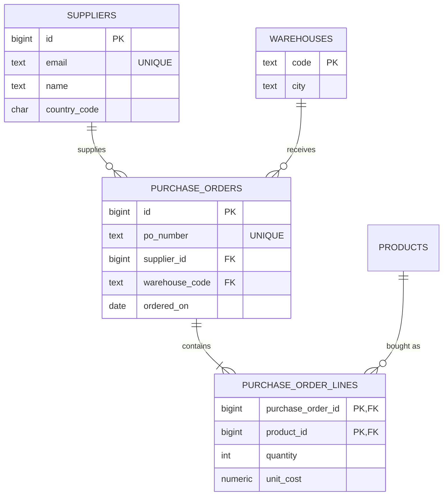

# Module 07: Solutions

<!-- nav:start -->
> [Theory](../README.md) · [Exercises](../exercises.md) · [Project](../project.md) · **Solutions**  
> [← 06 Advanced SQL](../../06-advanced-sql/README.md) · [Course home](../../../README.md) · [08 Beyond Scalars →](../../08-beyond-scalars/README.md)
<!-- nav:end -->

Every solution was run on PostgreSQL 17 against `./project/bin/reset.sh 08` (the reference schema v2 with its data), with [`purchase_sheet.sql`](purchase_sheet.sql) loaded for exercises 4 and 11. Solutions that change the schema or data run inside `BEGIN ... ROLLBACK`, except the exercise 11 migration, which is meant to be committed.

Files in this directory:

| File | What |
|---|---|
| [`acceptance_v2.sql`](acceptance_v2.sql) | Project milestone: behavioural acceptance tests for your schema v2. |
| [`purchase_sheet.sql`](purchase_sheet.sql) | Exercises 4 and 11: the spreadsheet table and its data (no solution inside). |
| [`normalize_purchases.sql`](normalize_purchases.sql) | Exercise 11: the normalizing migration. |
| [`category_closure.sql`](category_closure.sql) | Exercise 12: the closure table, populated, queried, maintained and checked. |

The reference solution of the milestone itself is [`project/db/0701_schema_modeling.sql`](../../../project/db/0701_schema_modeling.sql) (schema) and [`project/db/0702_seed_modeling.sql`](../../../project/db/0702_seed_modeling.sql) (data).

---

<!-- toc:start -->
**Contents**

- [Exercise 1 ★: Keys the data can't prove](#exercise-1--keys-the-data-cant-prove)
- [Exercise 2 ★: What happened to prices?](#exercise-2--what-happened-to-prices)
- [Exercise 3 ★: Review this design](#exercise-3--review-this-design)
- [Exercise 4 ★★: Dissect a spreadsheet](#exercise-4--dissect-a-spreadsheet)
- [Exercise 5 ★★: The catalogue on New Year's Eve](#exercise-5--the-catalogue-on-new-years-eve)
- [Exercise 6 ★★: Did the price change hurt sales?](#exercise-6--did-the-price-change-hurt-sales)
- [Exercise 7 ★★: Four tables, many problems](#exercise-7--four-tables-many-problems)
- [Exercise 8 ★★: Soft-delete users, keep emails reusable](#exercise-8--soft-delete-users-keep-emails-reusable)
- [Exercise 9 ★★: The address must belong to the buyer](#exercise-9--the-address-must-belong-to-the-buyer)
- [Exercise 10 ★★: Reconcile the payments ledger](#exercise-10--reconcile-the-payments-ledger)
- [Exercise 11 ★★★: Normalize the spreadsheet](#exercise-11--normalize-the-spreadsheet)
- [Exercise 12 ★★★: A closure table for the category tree](#exercise-12--a-closure-table-for-the-category-tree)

<!-- toc:end -->

## Exercise 1 ★: Keys the data can't prove

The duplicate checks:

```sql
SELECT 'payments (provider, provider_ref)' AS candidate, count(*) AS duplicate_groups
FROM (SELECT provider, provider_ref FROM payments
      WHERE provider_ref IS NOT NULL
      GROUP BY provider, provider_ref HAVING count(*) > 1) AS d
UNION ALL
SELECT 'categories (parent_id, name)', count(*)
FROM (SELECT parent_id, name FROM categories
      GROUP BY parent_id, name HAVING count(*) > 1) AS d
UNION ALL
SELECT 'categories (name)', count(*)
FROM (SELECT name FROM categories GROUP BY name HAVING count(*) > 1) AS d;
```

```text
             candidate             | duplicate_groups 
-----------------------------------+------------------
 payments (provider, provider_ref) |                0
 categories (parent_id, name)      |                0
 categories (name)                 |                0
(3 rows)
```

All three are unique **in today's data**. That proves nothing about the rules: data can only disprove a key.

**`payments (provider, provider_ref)`** should be a key. A provider's transaction id identifies exactly one transaction at that provider, and recording the same transaction twice (a webhook delivered twice, a retried request) would double-count money. It's the classic **idempotency key**: with the constraint, the second insert fails (or becomes `ON CONFLICT DO NOTHING`). The key is the *pair*, because two providers could use the same reference format. `provider_ref` is nullable (unknown until the provider confirms), and NULLs don't collide in a unique constraint, which is exactly right here.

```sql
BEGIN;
ALTER TABLE payments
    ADD CONSTRAINT payments_provider_provider_ref_key UNIQUE (provider, provider_ref);
INSERT INTO payments (order_id, amount, provider, provider_ref, status)
VALUES (40, 8940.00, 'stripe', 'st_2698a6c494', 'succeeded');
```

```text
ERROR:  duplicate key value violates unique constraint "payments_provider_provider_ref_key"
DETAIL:  Key (provider, provider_ref)=(stripe, st_2698a6c494) already exists.
```

```sql
ROLLBACK;
```

**`categories (parent_id, name)`** should also be a key: two sibling categories called "Cooking" would make menus and breadcrumbs ambiguous. But a plain `UNIQUE (parent_id, name)` doesn't stop two *roots* named "Books": roots have `parent_id` NULL, and NULLs are distinct by default, so `(NULL, 'Books')` never collides with `(NULL, 'Books')`. PostgreSQL 15+ fixes this with `UNIQUE NULLS NOT DISTINCT`:

```sql
BEGIN;
ALTER TABLE categories
    ADD CONSTRAINT categories_parent_id_name_key UNIQUE NULLS NOT DISTINCT (parent_id, name);
INSERT INTO categories (parent_id, name, slug) VALUES (NULL, 'Books', 'books-2');
```

```text
ERROR:  duplicate key value violates unique constraint "categories_parent_id_name_key"
DETAIL:  Key (parent_id, name)=(null, Books) already exists.
```

```sql
ROLLBACK;
```

**`categories.name` alone** must not be a key: "Cooking" is a perfectly reasonable name under both Books › Non-Fiction and Home & Garden › Kitchen. It's unique today by coincidence. Declaring it would turn a coincidence into a rule the business never made, and the first legitimate duplicate would be rejected. The category's global identifier is `slug`, already `UNIQUE` (it's used in URLs, so it must be globally unique, which is why the test above needed `'books-2'`).

---

## Exercise 2 ★: What happened to prices?

```sql
SELECT h.product_id, left(p.title, 26) AS title,
       count(*) - 1 AS changes,
       (array_agg(h.price ORDER BY h.valid_from))[1]      AS first_price,
       (array_agg(h.price ORDER BY h.valid_from DESC))[1] AS latest_price,
       round(100 * ((array_agg(h.price ORDER BY h.valid_from DESC))[1]
                    / (array_agg(h.price ORDER BY h.valid_from))[1] - 1), 1) AS pct_change
FROM product_price_history AS h
JOIN products AS p ON p.id = h.product_id
GROUP BY h.product_id, p.title
HAVING count(*) > 1
ORDER BY pct_change DESC;
```

```text
 product_id |           title           | changes | first_price | latest_price | pct_change 
------------+---------------------------+---------+-------------+--------------+------------
         37 | Dutch Oven 5.5L Enamel    |       2 |       99.00 |       119.00 |       20.2
         19 | The Long Orbit            |       1 |       12.99 |        14.99 |       15.4
         34 | Cast Iron Skillet 26cm    |       1 |       39.00 |        45.00 |       15.4
         52 | Classic Zip Hoodie - Grey |       1 |       45.00 |        49.00 |        8.9
          7 | ClearView 27" 4K Monitor  |       1 |      399.00 |       379.00 |       -5.0
         10 | QuietWave ANC Headphones  |       1 |      249.00 |       229.00 |       -8.0
         29 | Salt, Fat, Flame          |       1 |       32.99 |        29.99 |       -9.1
          1 | AeroBook 13 Laptop        |       1 |     1099.00 |       999.00 |       -9.1
(8 rows)
```

The consistency check:

```sql
SELECT count(*) AS products,
       count(*) FILTER (WHERE latest.price IS DISTINCT FROM p.price) AS mismatches
FROM products AS p
LEFT JOIN LATERAL (
    SELECT h.price
    FROM product_price_history AS h
    WHERE h.product_id = p.id
    ORDER BY h.valid_from DESC
    LIMIT 1
) AS latest ON true;
```

```text
 products | mismatches 
----------+------------
       62 |          0
(1 row)
```

**Reasoning.** "Changes" is the number of history rows minus one, the initial price. Ordered aggregates pick the first and last price per group without a self-join. (Module 06's `first_value`/`last_value` windows work too, with the frame caveat.)

The check matters because `products.price` and the latest history row store the **same fact twice**: a deliberate denormalization (the current price is read constantly; the history rarely). Section 6.1's rules apply: one writer (module 09's trigger), and this check. The `LEFT JOIN LATERAL ... ON true` plus `IS DISTINCT FROM` makes a product *without* history count as a mismatch rather than vanishing from the result, which is the subtle part.

**Alternative.** `DISTINCT ON (product_id) ... ORDER BY product_id, valid_from DESC` gives the latest row per product in one pass, which is faster than one lateral lookup per product when you need all products.

---

## Exercise 3 ★: Review this design

**(a) The flaws:**

| # | Flaw | Principle |
|---|---|---|
| 1 | `product_ids` is a comma-separated list | 1NF; no foreign keys to `products`; can't add/remove one product safely or query "who wishes for product 47" efficiently |
| 2 | `product_titles` copies product titles | redundancy (and inconsistent as soon as a product is renamed); 3NF |
| 3 | `user_email` identifies the owner | a natural key that changes; no foreign key to `users`; Bazaar's FK convention is `user_id` |
| 4 | `owner_name` depends on the user, not the wishlist | transitive dependency, 3NF; update anomaly |
| 5 | no per-item data | when was a product added? There's nowhere to put it: the M:N relationship needs a junction table |
| 6 | `isPublic int` | a boolean stored as an integer (2 and -1 are accepted); naming should be `is_public`; should be `NOT NULL DEFAULT false` |
| 7 | `share_count float` | a counter is an integer; floats are inexact; missing `NOT NULL DEFAULT 0` and `CHECK (>= 0)` |
| 8 | `created date` | timestamps are `timestamptz`, named `created_at`, `NOT NULL DEFAULT now()` |
| 9 | `WishlistID serial`, table `Wishlist` | course conventions: `id bigint GENERATED ALWAYS AS IDENTITY`, plural snake_case table name. (Unquoted, `Wishlist` and `WishlistID` are folded to lower case, so they work, but `\d` shows `wishlistid`, which nobody will recognise.) |
| 10 | no `NOT NULL` anywhere | a wishlist without an owner or name is accepted |
| 11 | no uniqueness | user 8 can have two wishlists called "Birthday"; a product can appear twice in one list |
| 12 | `varchar(n)` limits | arbitrary limits cause errors in production; in PostgreSQL `text` with a `CHECK (length(...) <= n)` only where a real limit exists |

**(b) The corrected design:**

```sql
BEGIN;
CREATE TABLE wishlists (
    id           bigint      GENERATED ALWAYS AS IDENTITY PRIMARY KEY,
    user_id      bigint      NOT NULL REFERENCES users (id) ON DELETE CASCADE,
    name         text        NOT NULL,
    is_public    boolean     NOT NULL DEFAULT false,
    share_count  int         NOT NULL DEFAULT 0,
    created_at   timestamptz NOT NULL DEFAULT now(),
    CONSTRAINT wishlists_user_id_name_key UNIQUE (user_id, name),
    CONSTRAINT wishlists_share_count_nonnegative CHECK (share_count >= 0)
);
CREATE TABLE wishlist_items (
    wishlist_id  bigint      NOT NULL REFERENCES wishlists (id) ON DELETE CASCADE,
    product_id   bigint      NOT NULL REFERENCES products (id) ON DELETE CASCADE,
    added_at     timestamptz NOT NULL DEFAULT now(),
    PRIMARY KEY (wishlist_id, product_id)
);

WITH w AS (
    INSERT INTO wishlists (user_id, name, is_public)
    VALUES (8, 'Birthday', true)
    RETURNING id
)
INSERT INTO wishlist_items (wishlist_id, product_id)
SELECT w.id, item.product_id
FROM w
CROSS JOIN unnest(ARRAY[12, 47, 51]) AS item (product_id);

SELECT w.name, u.full_name, p.id, p.title
FROM wishlists AS w
JOIN users AS u ON u.id = w.user_id
JOIN wishlist_items AS wi ON wi.wishlist_id = w.id
JOIN products AS p ON p.id = wi.product_id
ORDER BY p.id;
```

```text
   name   | full_name  | id |            title             
----------+------------+----+------------------------------
 Birthday | Marcus Lee | 12 | StudioPro Monitor Headphones
 Birthday | Marcus Lee | 47 | Organic Cotton Tee - White
 Birthday | Marcus Lee | 51 | Graphic Tee 'Ctrl+Alt+Del'
(3 rows)
```

```sql
SAVEPOINT one_list;
INSERT INTO wishlists (user_id, name) VALUES (8, 'Birthday');
```

```text
ERROR:  duplicate key value violates unique constraint "wishlists_user_id_name_key"
DETAIL:  Key (user_id, name)=(8, Birthday) already exists.
```

```sql
ROLLBACK;
```

The titles come from `products` through the join, so a renamed product shows its new title everywhere. `wishlist_items` is the junction table that carries the relationship's own attribute (`added_at`). `ON DELETE CASCADE` on both sides follows requirement 7's logic: a wishlist is owned by its user, and an item is meaningless without the product.

**(c) Weaknesses of the reference v2** (all deliberate simplifications, but worth knowing):

1. **`payments.provider` is free text** with no constraint: `'Stripe'`, `'stripe '` and `'strpie'` are all accepted. Fix: a lookup table `payment_providers (code PK, display_name, is_enabled)` with a foreign key, or at least a `CHECK`. (Theory 7.6.)
2. **An order's shipping address isn't guaranteed to belong to the buyer.** Fix: the composite foreign key of exercise 9. (Theory 8.2.)
3. **Addresses are editable, but orders reference them**, so editing an address rewrites where old orders "were shipped". Fix: treat addresses as append-only (enforce with a trigger or privileges), or snapshot the address into the order. (Theory 6.2.)
4. **No `UNIQUE (provider, provider_ref)`** on payments: duplicate webhook deliveries could record a payment twice (exercise 1).
5. **`addresses.country_code` has no format check**, although `sellers.country_code` does (`'^[A-Z]{2}$'`). Inconsistent rules for the same kind of value are a smell; module 08's domains solve it once.
6. **Reviews by non-buyers are allowed** (user 7's review of product 1). That's a business decision more than a flaw, but it should be written down, and probably surfaced as "unverified" in the UI.
7. **"Every product has at least one price history row" and "the latest history price equals `products.price`"** are not enforced (exercise 2's check). Module 09 adds the trigger.

---

## Exercise 4 ★★: Dissect a spreadsheet

**(a)** From the business rules:

- `po_number → po_date, supplier_email, warehouse_code`
- `supplier_email → supplier_name, supplier_country`
- `warehouse_code → warehouse_city`
- `sku → product_title`
- `po_number, sku → quantity, unit_cost`

The candidate key is `(po_number, sku)`: it determines every other column (through the chains above), and neither column alone does. Normal forms:

- **2NF is violated** by the partial dependencies `po_number → po_date, supplier_*, warehouse_*` and `sku → product_title`: they depend on part of the key.
- **3NF is violated** by the transitive dependencies `po_number → supplier_email → supplier_name, supplier_country` and `po_number → warehouse_code → warehouse_city`.
- 1NF holds (every cell holds a single value).

**(b)** The FD test query:

```sql
SELECT fd, violating_groups
FROM (
    SELECT 1 AS n, 'po_number -> po_date, supplier_email, warehouse_code' AS fd, count(*) AS violating_groups
    FROM (SELECT po_number FROM purchase_sheet GROUP BY po_number
          HAVING count(DISTINCT (po_date, supplier_email, warehouse_code)) > 1) AS v
    UNION ALL
    SELECT 2, 'supplier_email -> supplier_name', count(*)
    FROM (SELECT supplier_email FROM purchase_sheet GROUP BY supplier_email
          HAVING count(DISTINCT supplier_name) > 1) AS v
    UNION ALL
    SELECT 3, 'supplier_email -> supplier_country', count(*)
    FROM (SELECT supplier_email FROM purchase_sheet GROUP BY supplier_email
          HAVING count(DISTINCT supplier_country) > 1) AS v
    UNION ALL
    SELECT 4, 'warehouse_code -> warehouse_city', count(*)
    FROM (SELECT warehouse_code FROM purchase_sheet GROUP BY warehouse_code
          HAVING count(DISTINCT warehouse_city) > 1) AS v
    UNION ALL
    SELECT 5, 'sku -> product_title', count(*)
    FROM (SELECT sku FROM purchase_sheet GROUP BY sku
          HAVING count(DISTINCT product_title) > 1) AS v
    UNION ALL
    SELECT 6, 'sku -> unit_cost', count(*)
    FROM (SELECT sku FROM purchase_sheet GROUP BY sku
          HAVING count(DISTINCT unit_cost) > 1) AS v
    UNION ALL
    SELECT 7, '(po_number, sku) -> quantity, unit_cost', count(*)
    FROM (SELECT po_number, sku FROM purchase_sheet GROUP BY po_number, sku
          HAVING count(*) > 1) AS v
) AS checks
ORDER BY n;
```

```text
                          fd                          | violating_groups 
------------------------------------------------------+------------------
 po_number -> po_date, supplier_email, warehouse_code |                0
 supplier_email -> supplier_name                      |                1
 supplier_email -> supplier_country                   |                0
 warehouse_code -> warehouse_city                     |                0
 sku -> product_title                                 |                0
 sku -> unit_cost                                     |                2
 (po_number, sku) -> quantity, unit_cost              |                0
(7 rows)
```

For the key (check 7), "violating" means a duplicate key: two rows for the same `(po_number, sku)`. `count(DISTINCT (a, b, c))` counts distinct *row values*, so check 1 tests three columns at once.

**(c)** The two violations, looked at closely:

```sql
SELECT supplier_email, supplier_name, count(*) AS rows, min(po_number), max(po_number)
FROM purchase_sheet
GROUP BY supplier_email, supplier_name
ORDER BY supplier_email, supplier_name;
```

```text
     supplier_email     |    supplier_name    | rows |   min   |   max   
------------------------+---------------------+------+---------+---------
 info@bambuco.de        | Bambù & Co          |    2 | PO-1003 | PO-1003
 orders@ferroitalia.it  | Ferro Italia        |    2 | PO-1005 | PO-1005
 orders@ferroitalia.it  | Ferro Italia S.r.l. |    5 | PO-1001 | PO-1004
 vendite@lamemaniago.it | Lame di Maniago     |    5 | PO-1002 | PO-1006
(4 rows)
```

```sql
SELECT sku, po_number, unit_cost
FROM purchase_sheet
WHERE sku IN (SELECT sku FROM purchase_sheet GROUP BY sku HAVING count(DISTINCT unit_cost) > 1)
ORDER BY sku, po_number;
```

```text
    sku    | po_number | unit_cost 
-----------+-----------+-----------
 CC-CW-001 | PO-1001   |     18.50
 CC-CW-001 | PO-1004   |     19.00
 CC-CW-004 | PO-1001   |     52.00
 CC-CW-004 | PO-1005   |     54.00
(4 rows)
```

- `supplier_email → supplier_name` **is** a business rule, and the data breaks it: PO-1005 spells the supplier "Ferro Italia" instead of "Ferro Italia S.r.l.". That's exactly the update anomaly in action: somebody typed the name again instead of referencing the supplier. Normalization must resolve it (exercise 11).
- `sku → unit_cost` is **not** a rule: the skillet cost 18.50 in January and 19.00 in March. Like `order_items.unit_price` (theory 6.2), `unit_cost` is a fact about the PO line, a historical snapshot. It stays on the line.

**(d)** Anomalies:

- *Update:* if Lame di Maniago moves to a new email, every row of POs 1002 and 1006 must be changed; miss one and the supplier is split into two.
- *Insertion:* a new supplier or a new warehouse can't be recorded until a PO uses it (there is no row to put it in without inventing a PO).
- *Deletion:* deleting PO-1003 (the only PO from Bambù & Co) loses the supplier's email and country, and the fact that warehouse MI2 is in Milano would vanish if all its POs were deleted.

---

## Exercise 5 ★★: The catalogue on New Year's Eve

```sql
SELECT p.id, left(p.title, 28) AS title,
       then_.price AS price_on_2024_12_31,
       p.price     AS price_today
FROM products AS p
LEFT JOIN LATERAL (
    SELECT h.price
    FROM product_price_history AS h
    WHERE h.product_id = p.id
      AND h.valid_from < timestamptz '2025-01-01 00:00+00'
    ORDER BY h.valid_from DESC
    LIMIT 1
) AS then_ ON true
WHERE p.status = 'active'
  AND then_.price IS DISTINCT FROM p.price
ORDER BY p.id;
```

```text
 id |           title           | price_on_2024_12_31 | price_today 
----+---------------------------+---------------------+-------------
 10 | QuietWave ANC Headphones  |              249.00 |      229.00
 19 | The Long Orbit            |               12.99 |       14.99
 37 | Dutch Oven 5.5L Enamel    |              109.00 |      119.00
 52 | Classic Zip Hoodie - Grey |               45.00 |       49.00
(4 rows)
```

**Reasoning.** The lateral subquery is the "price at time T" pattern, with T just before midnight. Using `< '2025-01-01 00:00'` instead of `<= '2024-12-31 23:59:59'` is the half-open-interval habit: it doesn't miss a price change at 23:59:59.5. Product 52's new price became valid at exactly `2025-01-01 00:00:00`, so the strict `<` correctly excludes it and reports the old price, 45.00.

`LEFT JOIN LATERAL ... ON true` keeps products that had no price yet (the subquery returns no row, so `then_.price` is NULL), and `IS DISTINCT FROM` counts NULL vs a price as "different". With `CROSS JOIN LATERAL` and `<>`, such products would silently disappear. None of the active products is that young, but the draft product 55 (listed in June 2025) shows the case: remove the status filter and it appears with NULL.

Product 29 changed price on 2024-12-01, *before* the cut-off, so on New Year's Eve it already had today's price.

---

## Exercise 6 ★★: Did the price change hurt sales?

```sql
WITH periods AS (
    SELECT product_id, price, valid_from,
           lead(valid_from) OVER (PARTITION BY product_id ORDER BY valid_from) AS valid_to
    FROM product_price_history
    WHERE product_id IN (SELECT product_id FROM product_price_history
                         GROUP BY product_id HAVING count(*) > 1)
)
SELECT pr.product_id, pr.price, pr.valid_from::date, pr.valid_to::date,
       count(DISTINCT o.id)                         AS orders,
       coalesce(sum(oi.quantity), 0)                AS units,
       coalesce(sum(oi.quantity * oi.unit_price), 0) AS revenue
FROM periods AS pr
LEFT JOIN (order_items AS oi
           JOIN orders AS o
             ON o.id = oi.order_id
            AND o.status IN ('paid', 'shipped', 'delivered'))
       ON oi.product_id = pr.product_id
      AND o.created_at >= pr.valid_from
      AND (pr.valid_to IS NULL OR o.created_at < pr.valid_to)
GROUP BY pr.product_id, pr.price, pr.valid_from, pr.valid_to
ORDER BY pr.product_id, pr.valid_from;
```

```text
 product_id |  price  | valid_from |  valid_to  | orders | units | revenue 
------------+---------+------------+------------+--------+-------+---------
          1 | 1099.00 | 2023-03-10 | 2024-11-25 |      2 |     5 | 5495.00
          1 |  999.00 | 2024-11-25 |            |      1 |     3 | 2997.00
          7 |  399.00 | 2023-03-12 | 2024-09-01 |      3 |     3 | 1197.00
          7 |  379.00 | 2024-09-01 |            |      0 |     0 |       0
         10 |  249.00 | 2023-03-15 | 2025-01-15 |      3 |     6 | 1494.00
         10 |  229.00 | 2025-01-15 |            |      2 |     3 |  687.00
         19 |   12.99 | 2023-03-25 | 2025-02-01 |      2 |     3 |   38.97
         19 |   14.99 | 2025-02-01 |            |      3 |     3 |   44.97
         29 |   32.99 | 2023-04-05 | 2024-12-01 |      2 |     2 |   65.98
         29 |   29.99 | 2024-12-01 |            |      1 |     1 |   29.99
         34 |   39.00 | 2023-04-15 | 2024-07-01 |      2 |     3 |  117.00
         34 |   45.00 | 2024-07-01 |            |      1 |     2 |   90.00
         37 |   99.00 | 2023-05-01 | 2024-06-01 |      2 |     2 |  198.00
         37 |  109.00 | 2024-06-01 | 2025-03-01 |      1 |     2 |  218.00
         37 |  119.00 | 2025-03-01 |            |      2 |     2 |  238.00
         52 |   45.00 | 2023-05-05 | 2025-01-01 |      3 |     3 |  135.00
         52 |   49.00 | 2025-01-01 |            |      0 |     0 |       0
(17 rows)
```

**Reasoning.**

- The **periods** come from `lead()`: each history row's end is the next row's start, and the last period is open (NULL).
- The parenthesised join `(order_items JOIN orders ON ... AND o.status IN (...))` is joined *as a unit* to the periods with a `LEFT JOIN`. That way the status filter applies before the outer join, and a period without sales keeps its row (with zeros). Putting the status condition in `WHERE` would turn the outer join into an inner one and drop the empty periods. It's the same trap as module 04's.
- `count(DISTINCT o.id)` counts orders, not order lines.

The consistency property: revenue / units equals the period's price for every period with sales, because checkout copied the list price into `unit_price` and the history agrees with it (theory 9.2). If promotions applied discounts, this would no longer hold, and the difference would measure the discount.

With so little data, "did the price change hurt sales?" can't be answered statistically, but the shape of the query is what an analyst would use on the large dataset.

---

## Exercise 7 ★★: Four tables, many problems

**The flaws:**

- `attachments (owner_type, owner_id)` is a **polymorphic association**: no foreign key is possible, so attachments of deleted products linger and `owner_id` can point at nothing. Products' images and reviews' photos also have different attributes (position in a gallery vs none).
- `user_settings` is **EAV**: every value is `text` (`'yes'`, `'true'`, `'1'`?), there's no key (two `language` rows for a user are accepted), no `NOT NULL`, no foreign key, and reading one user's settings needs a pivot.
- `coupons.seller_name` is a **changing natural key used as a reference**, without a foreign key; the coupon belongs to a seller, so `seller_id`.
- `coupons.code` as primary key plus a `deleted` flag: a withdrawn coupon still occupies its code forever, so **soft delete blocks reuse**; and `'SUMMER10'` vs `'summer10'` are different keys although customers type codes in any case.
- `percent_off numeric` has no range check (150% off, or −5%).
- `valid_until text` is the **wrong type for time**: `'2025-8-31'`, `'31/08/2025'` and `'soon'` are all accepted, and comparisons are alphabetical.
- `coupon_redemptions.user_id` is a **transitive dependency** (`order_id → user_id` via `orders`) that can contradict the order's buyer.
- `discount float` is the **wrong type for money**.
- `coupon_code text`, `order_id bigint` have **no foreign keys**, and nothing enforces "at most one coupon per order".
- Everywhere: `bigserial` instead of identity, missing `NOT NULL`s, missing timestamps.

**The corrected schema and the tests:**

```sql
BEGIN;
CREATE TABLE product_images (
    id          bigint  GENERATED ALWAYS AS IDENTITY PRIMARY KEY,
    product_id  bigint  NOT NULL REFERENCES products (id) ON DELETE CASCADE,
    url         text    NOT NULL,
    position    int     NOT NULL DEFAULT 1,
    CONSTRAINT product_images_product_id_position_key UNIQUE (product_id, position)
);
CREATE TABLE review_photos (
    id          bigint  GENERATED ALWAYS AS IDENTITY PRIMARY KEY,
    review_id   bigint  NOT NULL REFERENCES reviews (id) ON DELETE CASCADE,
    url         text    NOT NULL
);
CREATE TABLE user_settings (
    user_id            bigint      PRIMARY KEY REFERENCES users (id) ON DELETE CASCADE,
    language           text        NOT NULL DEFAULT 'en',
    currency_code      char(3)     NOT NULL DEFAULT 'USD',
    newsletter_opt_in  boolean     NOT NULL DEFAULT false,
    updated_at         timestamptz NOT NULL DEFAULT now(),
    CONSTRAINT user_settings_currency_code_upper CHECK (currency_code ~ '^[A-Z]{3}$')
);
CREATE TABLE coupons (
    id           bigint        GENERATED ALWAYS AS IDENTITY PRIMARY KEY,
    seller_id    bigint        NOT NULL REFERENCES sellers (id),
    code         text          NOT NULL,
    percent_off  numeric(5,2)  NOT NULL,
    valid_until  timestamptz,                         -- NULL = no expiry
    deleted_at   timestamptz,                         -- set when the seller withdraws it
    created_at   timestamptz   NOT NULL DEFAULT now(),
    CONSTRAINT coupons_percent_off_range CHECK (percent_off > 0 AND percent_off <= 100)
);
CREATE UNIQUE INDEX coupons_code_live_key ON coupons (upper(code)) WHERE deleted_at IS NULL;
CREATE TABLE coupon_redemptions (
    order_id     bigint        PRIMARY KEY REFERENCES orders (id),   -- at most one coupon per order
    coupon_id    bigint        NOT NULL REFERENCES coupons (id),
    discount     numeric(12,2) NOT NULL,
    redeemed_at  timestamptz   NOT NULL DEFAULT now(),
    CONSTRAINT coupon_redemptions_discount_positive CHECK (discount > 0)
);

INSERT INTO coupons (seller_id, code, percent_off, valid_until)
VALUES (2, 'SUMMER10', 10, '2025-08-31 23:59:59+00');
INSERT INTO coupon_redemptions (order_id, coupon_id, discount)
VALUES (117, (SELECT id FROM coupons WHERE code = 'SUMMER10'), 3.00);

SAVEPOINT t1;
INSERT INTO coupons (seller_id, code, percent_off) VALUES (3, 'summer10', 15);
```

```text
ERROR:  duplicate key value violates unique constraint "coupons_code_live_key"
DETAIL:  Key (upper(code))=(SUMMER10) already exists.
```

```sql
ROLLBACK TO t1;
INSERT INTO coupons (seller_id, code, percent_off, created_at)
VALUES (3, 'HALF', 150, '2025-06-30 12:00+00');
```

```text
ERROR:  new row for relation "coupons" violates check constraint "coupons_percent_off_range"
DETAIL:  Failing row contains (3, 3, HALF, 150.00, null, null, 2025-06-30 12:00:00+00).
```

```sql
ROLLBACK TO t1;
INSERT INTO coupon_redemptions (order_id, coupon_id, discount)
VALUES (117, (SELECT id FROM coupons WHERE code = 'SUMMER10'), 1.00);
```

```text
ERROR:  duplicate key value violates unique constraint "coupon_redemptions_pkey"
DETAIL:  Key (order_id)=(117) already exists.
```

```sql
ROLLBACK TO t1;
UPDATE coupons SET deleted_at = '2025-06-30 12:00+00' WHERE code = 'SUMMER10';
INSERT INTO coupons (seller_id, code, percent_off) VALUES (3, 'summer10', 15)
RETURNING seller_id, code, percent_off, deleted_at;
ROLLBACK;
```

```text
 seller_id |   code   | percent_off | deleted_at 
-----------+----------+-------------+------------
         3 | summer10 |       15.00 | 
(1 row)
```

**Reasoning, decision by decision:**

- **Attachments → two tables** (`product_images`, `review_photos`), the "separate tables per target" alternative from theory 7.5. They have different attributes, and each gets a real foreign key with `CASCADE`. An exclusive arc would also be correct.
- **Settings → a 1:1 table with typed columns**. The settings are known in advance, so they're ordinary attributes: types, defaults and `CHECK`s come for free. Genuinely open-ended preferences would go into a `jsonb` column (module 08).
- **Coupons → surrogate key plus a partial unique *expression* index**: uniqueness of `upper(code)` among live coupons. Case-insensitive, and a withdrawn code becomes reusable. The global uniqueness reflects how codes are used: a customer types only the code, so it must identify one live coupon.
- **Redemptions → `order_id` as primary key** encodes "at most one coupon per order" directly. `user_id` is gone (join through `orders`), `discount` is money.

---

## Exercise 8 ★★: Soft-delete users, keep emails reusable

```sql
BEGIN;
ALTER TABLE users ADD COLUMN deleted_at timestamptz;
COMMENT ON COLUMN users.deleted_at IS 'Soft delete: set when the account is closed; NULL = live account.';
ALTER TABLE users DROP CONSTRAINT users_email_key;
CREATE UNIQUE INDEX users_email_live_key ON users (email) WHERE deleted_at IS NULL;

UPDATE users SET deleted_at = '2025-06-30 10:00+00', is_active = false WHERE id = 29;
INSERT INTO users (email, full_name) VALUES ('nora.berg@example.no', 'Nora Berg (new account)');

SELECT id, email, full_name, deleted_at
FROM users
WHERE email = 'nora.berg@example.no'
ORDER BY id;
```

```text
 id |        email         |        full_name        |       deleted_at       
----+----------------------+-------------------------+------------------------
 29 | nora.berg@example.no | Nora Berg               | 2025-06-30 10:00:00+00
 31 | nora.berg@example.no | Nora Berg (new account) | 
(2 rows)
```

```sql
SAVEPOINT live_duplicate;
INSERT INTO users (email, full_name)
SELECT email, 'Copycat' FROM users WHERE id = 30;
```

```text
ERROR:  duplicate key value violates unique constraint "users_email_live_key"
DETAIL:  Key (email)=(samuel.okafor@example.ng) already exists.
```

```sql
ROLLBACK TO live_duplicate;
UPDATE users SET deleted_at = NULL WHERE id = 29;
```

```text
ERROR:  duplicate key value violates unique constraint "users_email_live_key"
DETAIL:  Key (email)=(nora.berg@example.no) already exists.
```

```sql
ROLLBACK;
```

**Reasoning.** The rule "unique among live accounts" is uniqueness over a *subset* of rows, so it's a partial unique index (theory 8.1 and 9.3). It replaces the plain `UNIQUE` constraint; keeping both would still block the reuse.

Undeleting user 29 fails because it would create two live accounts with the same email. That's the desired behaviour: the email now belongs to someone else, and restoring the old account requires a decision (merge the accounts, or give the old one a new email). The database forces that decision instead of silently creating a duplicate.

What the index can't do: make every query skip closed accounts. Login must now look up `WHERE email = $1 AND deleted_at IS NULL`, reports must decide whether closed accounts count, and so on. A view (module 09) or RLS (module 15) protects against forgotten filters. Also note that `is_active` and `deleted_at` now overlap; in a real migration you'd define what each means (suspended vs closed) or merge them. And from module 08 on, Bazaar's email uniqueness is on `lower(email)`, so the partial index would be `ON users (lower(email)) WHERE deleted_at IS NULL`.

---

## Exercise 9 ★★: The address must belong to the buyer

```sql
SELECT count(*) AS orders_shipping_to_someone_elses_address
FROM orders AS o
JOIN addresses AS a ON a.id = o.shipping_address_id
WHERE a.user_id <> o.user_id;
```

```text
 orders_shipping_to_someone_elses_address 
------------------------------------------
                                        0
(1 row)
```

```sql
BEGIN;
ALTER TABLE addresses
    ADD CONSTRAINT addresses_id_user_id_key UNIQUE (id, user_id);
ALTER TABLE orders
    ADD CONSTRAINT orders_shipping_address_belongs_to_buyer
    FOREIGN KEY (shipping_address_id, user_id) REFERENCES addresses (id, user_id);

SAVEPOINT before_test;
UPDATE orders SET shipping_address_id = 1 WHERE id = 2;
```

```text
ERROR:  insert or update on table "orders" violates foreign key constraint "orders_shipping_address_belongs_to_buyer"
DETAIL:  Key (shipping_address_id, user_id)=(1, 3) is not present in table "addresses".
```

```sql
ROLLBACK TO before_test;
UPDATE orders SET shipping_address_id = NULL WHERE id = 2
RETURNING id, user_id, shipping_address_id;
ROLLBACK;
```

```text
 id | user_id | shipping_address_id 
----+---------+---------------------
  2 |       3 |                    
(1 row)
```

**Reasoning.** The composite foreign key says: the pair (address, buyer) must exist as a pair in `addresses`. Order 2 belongs to user 3, and `(1, 3)` doesn't exist because address 1 belongs to user 1.

A foreign key must reference columns covered by a unique constraint on *exactly* those columns, hence `UNIQUE (id, user_id)`. As a key it's redundant (`id` alone is already unique, so `(id, user_id)` is a superkey, not a candidate key), and it costs an extra index. But it's the price of expressing a cross-table rule declaratively, with no trigger and no race condition. `ALTER TABLE ... ADD FOREIGN KEY` validates all existing rows, which is why (a) had to return 0 first. On a big table, `ADD ... NOT VALID` followed by `VALIDATE CONSTRAINT` avoids a long lock (module 26).

A NULL `shipping_address_id` passes because composite foreign keys default to `MATCH SIMPLE`: if *any* referencing column is NULL, the constraint isn't checked. That's what requirement 2 needs (old orders have no address). `MATCH FULL` would require all or none of the columns to be NULL.

---

## Exercise 10 ★★: Reconcile the payments ledger

```sql
WITH ledger AS (
    SELECT o.id, o.status, o.total,
           coalesce(sum(p.amount) FILTER (WHERE p.status = 'succeeded'), 0)                  AS net_paid,
           coalesce(sum(p.amount) FILTER (WHERE p.status = 'succeeded' AND p.amount > 0), 0)  AS charged,
           coalesce(-sum(p.amount) FILTER (WHERE p.status = 'succeeded' AND p.amount < 0), 0) AS refunded,
           count(p.id) FILTER (WHERE p.status = 'failed')  AS failed_attempts,
           count(p.id) FILTER (WHERE p.status = 'pending') AS pending_attempts
    FROM orders AS o
    LEFT JOIN payments AS p ON p.order_id = o.id
    GROUP BY o.id
)
SELECT status,
       count(*)              AS orders,
       sum(failed_attempts)  AS failed,
       sum(pending_attempts) AS pending,
       count(*) FILTER (WHERE CASE
                                  WHEN status IN ('paid', 'shipped', 'delivered') THEN net_paid <> total
                                  WHEN status = 'refunded' THEN NOT (charged = total AND refunded = total)
                                  ELSE net_paid <> 0
                              END) AS anomalies
FROM ledger
GROUP BY status
ORDER BY status;
```

```text
  status   | orders | failed | pending | anomalies 
-----------+--------+--------+---------+-----------
 cancelled |     10 |      4 |       0 |         0
 delivered |     91 |     24 |       0 |         0
 paid      |      6 |      1 |       0 |         0
 pending   |      5 |      0 |       1 |         0
 refunded  |      4 |      1 |       0 |         0
 shipped   |      4 |      0 |       0 |         0
(6 rows)
```

And with a duplicated payment on order 40 (same query, inside a transaction):

```sql
BEGIN;
INSERT INTO payments (order_id, amount, provider, provider_ref, status)
VALUES (40, 10.00, 'stripe', 'st_duplicate', 'succeeded');

WITH ledger AS (
    SELECT o.id, o.status, o.total,
           coalesce(sum(p.amount) FILTER (WHERE p.status = 'succeeded'), 0) AS net_paid
    FROM orders AS o
    LEFT JOIN payments AS p ON p.order_id = o.id
    GROUP BY o.id
)
SELECT id, status, total, net_paid
FROM ledger
WHERE status IN ('paid', 'shipped', 'delivered') AND net_paid <> total;
ROLLBACK;
```

```text
 id |  status   |  total  | net_paid 
----+-----------+---------+----------
 40 | delivered | 8940.00 |  8950.00
(1 row)
```

**Reasoning.** The `LEFT JOIN` keeps orders without payments (all the pending orders but one); `count(p.id)` counts only real payment rows, and `coalesce(..., 0)` turns "no succeeded payments" into 0 instead of NULL. A NULL would make the anomaly test NULL, and `FILTER` would silently not count it.

Charges and refunds are separated for refunded orders, because "net 0" alone would also be satisfied by an order that was never charged. The rule says it was charged *and* refunded in full.

This kind of reconciliation query is the payoff of the ledger design: because no payment row is ever updated, the history can always be re-added and compared. With an `amount` that's updated in place on refund, there would be nothing to reconcile against.

---

## Exercise 11 ★★★: Normalize the spreadsheet

The migration is in [`normalize_purchases.sql`](normalize_purchases.sql). Its design:



Each FD from exercise 4 became a key: `email` (alternate key of `suppliers`), `code` (`warehouses`), `po_number` (alternate key of `purchase_orders`), `(purchase_order_id, product_id)` (`purchase_order_lines`). `sku → product_title` is already represented by Bazaar's `products`, so the title isn't stored. Every determinant is a key, so the schema is in BCNF.

Key choices: suppliers get a surrogate key, because emails change (the sheet only used the email because it had nothing better); warehouses keep their short code as a natural key, because it's stable, compact and meaningful to the people who use it; purchase orders get a surrogate key and keep `po_number` as an alternate key, because PO numbers are printed on paper and might one day be re-formatted.

Run it (after `purchase_sheet.sql`):

```bash
docker exec -i course-pg psql -X -U postgres -d bazaar < modules/07-data-modeling/solutions/normalize_purchases.sql
```

The supplier-name rule is in the `INSERT INTO suppliers`: `mode() WITHIN GROUP (ORDER BY supplier_name)` takes the most frequent spelling per email ("Ferro Italia S.r.l.", 5 rows against 2). Another defensible rule is "the most recent spelling wins" (that would be "Ferro Italia"). What matters is that the rule is chosen consciously and documented.

The result:

```sql
SELECT id, name, email, country_code FROM suppliers ORDER BY id;
SELECT id, po_number, supplier_id, warehouse_code, ordered_on FROM purchase_orders ORDER BY id;
SELECT count(*) AS lines FROM purchase_order_lines;
```

```text
 id |        name         |         email          | country_code 
----+---------------------+------------------------+--------------
  1 | Ferro Italia S.r.l. | orders@ferroitalia.it  | IT
  2 | Lame di Maniago     | vendite@lamemaniago.it | IT
  3 | Bambù & Co          | info@bambuco.de        | DE
(3 rows)

 id | po_number | supplier_id | warehouse_code | ordered_on 
----+-----------+-------------+----------------+------------
  1 | PO-1001   |           1 | BO1            | 2025-01-15
  2 | PO-1002   |           2 | BO1            | 2025-01-20
  3 | PO-1003   |           3 | MI2            | 2025-02-03
  4 | PO-1004   |           1 | MI2            | 2025-03-10
  5 | PO-1005   |           1 | BO1            | 2025-04-02
  6 | PO-1006   |           2 | MI2            | 2025-05-12
(6 rows)

 lines 
-------
    14
(1 row)
```

The round trip:

```sql
WITH rebuilt AS (
    SELECT po.po_number, po.ordered_on AS po_date,
           s.name AS supplier_name, s.email AS supplier_email, s.country_code::text AS supplier_country,
           w.code AS warehouse_code, w.city AS warehouse_city,
           p.sku, p.title AS product_title, l.quantity, l.unit_cost
    FROM purchase_order_lines AS l
    JOIN purchase_orders AS po ON po.id = l.purchase_order_id
    JOIN suppliers       AS s  ON s.id = po.supplier_id
    JOIN warehouses      AS w  ON w.code = po.warehouse_code
    JOIN products        AS p  ON p.id = l.product_id
)
SELECT 'only in sheet' AS side, po_number, supplier_name, sku
FROM (SELECT * FROM purchase_sheet EXCEPT SELECT * FROM rebuilt) AS a
UNION ALL
SELECT 'only in rebuilt', po_number, supplier_name, sku
FROM (SELECT * FROM rebuilt EXCEPT SELECT * FROM purchase_sheet) AS b
ORDER BY po_number, sku, side;
```

```text
      side       | po_number |    supplier_name    |    sku    
-----------------+-----------+---------------------+-----------
 only in rebuilt | PO-1005   | Ferro Italia S.r.l. | CC-CW-004
 only in sheet   | PO-1005   | Ferro Italia        | CC-CW-004
 only in rebuilt | PO-1005   | Ferro Italia S.r.l. | CC-KI-001
 only in sheet   | PO-1005   | Ferro Italia        | CC-KI-001
(4 rows)
```

Exactly the two lines of PO-1005 differ, and only in the supplier name we deliberately normalised. Every other value survived the trip. The `EXCEPT` in *both* directions matters: one direction finds lost rows, the other finds invented ones. Note the cast `country_code::text`: `EXCEPT` compares row types, and `char(2)` vs `text` would otherwise mismatch.

The constraints at work:

```sql
BEGIN;
INSERT INTO purchase_order_lines (purchase_order_id, product_id, quantity, unit_cost)
VALUES (1, 34, 5, 18.50);
```

```text
ERROR:  duplicate key value violates unique constraint "purchase_order_lines_pkey"
DETAIL:  Key (purchase_order_id, product_id)=(1, 34) already exists.
```

```sql
ROLLBACK;
BEGIN;
INSERT INTO purchase_order_lines (purchase_order_id, product_id, quantity, unit_cost)
VALUES (1, 35, 0, 14.75);
```

```text
ERROR:  new row for relation "purchase_order_lines" violates check constraint "purchase_order_lines_quantity_positive"
DETAIL:  Failing row contains (1, 35, 0, 14.75).
```

```sql
ROLLBACK;
```

**Pitfall in the migration.** The lines are inserted with an inner join to `products`: a SKU that doesn't exist for seller 3 would silently drop its line. That's why the line count (14 = rows in the sheet) and the round trip are part of the solution. In a production migration, check first (`SELECT sku FROM purchase_sheet EXCEPT SELECT sku FROM products WHERE seller_id = 3` must be empty) and abort if it isn't.

When you're done, drop the exercise tables: `DROP TABLE purchase_order_lines, purchase_orders, warehouses, suppliers, purchase_sheet;`

---

## Exercise 12 ★★★: A closure table for the category tree

The complete solution is [`category_closure.sql`](category_closure.sql); run it with:

```bash
docker exec -i course-pg psql -X -U postgres -d bazaar < modules/07-data-modeling/solutions/category_closure.sql
```

Its output:

```text
SET
BEGIN
CREATE TABLE
CREATE INDEX
COMMENT
INSERT 0 53
 closure_rows 
--------------
           53
(1 row)

 id |        category         | depth 
----+-------------------------+-------
 14 | Books                   |     0
 15 |     Fiction             |     1
 18 |     Non-Fiction         |     1
 19 |         Cooking         |     2
 20 |         History         |     2
 17 |         Mystery         |     2
 16 |         Science Fiction |     2
(7 rows)

        breadcrumb         
---------------------------
 Books › Fiction › Mystery
(1 row)

 ancestor_id | descendant_id | depth 
-------------+---------------+-------
          15 |            24 |     1
          14 |            24 |     2
          24 |            24 |     0
(3 rows)

INSERT 0 3
 missing | extra 
---------+-------
       0 |     0
(1 row)

ROLLBACK
```

**Reasoning, step by step.**

1. **Design.** The key `(ancestor_id, descendant_id)` says a pair appears once. Both columns reference `categories` with `ON DELETE CASCADE`, because closure rows are derived data owned by the categories. The `CHECK ((ancestor_id = descendant_id) = (depth = 0))` compares two booleans: the self-pair has depth 0, and only the self-pair. The primary key's index serves "descendants of X" (`WHERE ancestor_id = X`); the extra index on `(descendant_id, depth)` serves "ancestors of Y", sorted by distance.
2. **Population** is module 06's `closure` CTE, made permanent: 23 self-pairs, plus one row per (ancestor, descendant) at distance 1 and 2. 53 rows for 23 categories; in general, the closure has about *nodes × average depth* rows.
3. **Queries** become plain joins: the subtree is `WHERE ancestor_id = 14`, the breadcrumb joins the product's category to its ancestors and orders by depth. Sorting the subtree into proper depth-first order would still need a path; the closure table answers *membership* and *distance* questions, not *ordering* ones.
4. **Maintenance on insert** is one statement: the new node inherits all its parent's ancestor rows with `depth + 1`, plus its self-pair. The data-modifying CTE gives the new category's id to the closure `INSERT`. Moving a subtree is harder: delete the pairs that connect the subtree to its old ancestors, then insert the cross product of the new ancestors and the subtree's nodes. That's why closure tables suit trees that are read often and changed rarely.
5. **The check** compares the derived table with its source of truth in both directions. Like `orders.total`, a closure table is a deliberate denormalization: one writer (here, the statement in step 4; in production, a trigger on `categories`, module 09) and a check.
