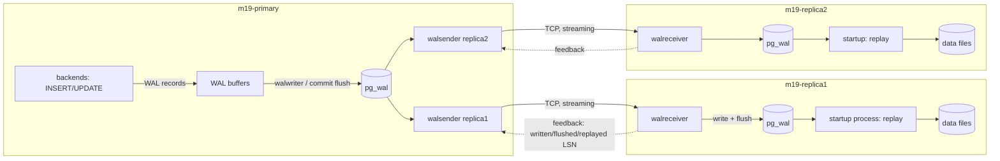
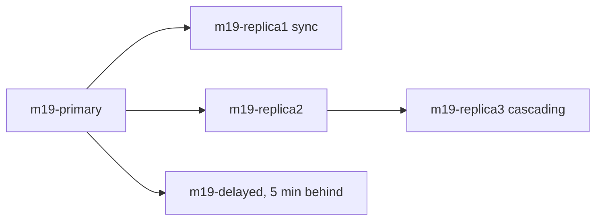
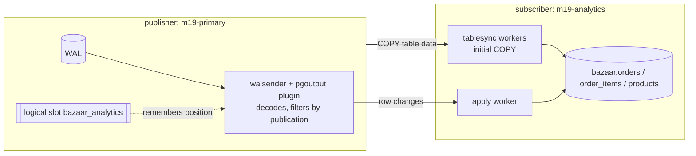

# Module 19: Replication

Bazaar is growing up. The seller dashboard runs heavy aggregate queries all day, and they compete with checkout for CPU and I/O on the one database server. The finance team wants to run its own reporting tool directly against order data without being able to touch production. The CTO keeps asking what happens if the database server dies at 3 a.m., and next year you will have to upgrade from PostgreSQL 17 to 18 without taking the shop offline for hours. All four problems have the same root answer: **keep more than one copy of the database, and keep the copies continuously up to date.** That is replication, and PostgreSQL has two very different kinds built in. This module builds both, on a four-server lab, and teaches you how each one works, how to monitor it, and how it fails.

## What you'll learn

- Why you replicate (high availability, read scaling, analytics isolation, upgrades) and why a replica is still not a backup.
- How **physical streaming replication** works: the WAL sender, WAL receiver and startup processes; the four LSNs (sent, written, flushed, replayed); `primary_conninfo` and `standby.signal`; building a standby with `pg_basebackup -R`.
- **Replication slots**: why they exist, how a forgotten slot fills the primary's disk, and how `max_slot_wal_keep_size` caps the damage.
- **Hot standby**: read-only queries on replicas, query conflicts, `max_standby_streaming_delay` and `hot_standby_feedback`.
- Monitoring with `pg_stat_replication` and `pg_stat_wal_receiver`, and measuring lag in bytes and in time.
- **Synchronous replication**: every `synchronous_commit` level, `synchronous_standby_names` with `FIRST` and `ANY` quorums, and what it costs.
- Cascading replication, **delayed standbys** as a safety net, manual promotion with `pg_promote()`, and re-attaching an old primary with **`pg_rewind`**.
- Read/write splitting from applications, and the **read-your-writes** problem.
- **Logical replication**: publications (with row filters and column lists), subscriptions, initial synchronization, replica identity, what is not replicated, conflicts and how to resolve them, and PostgreSQL 17's `pg_createsubscriber` and failover slots.
- Zero-downtime major-version upgrades with logical replication.
- **Logical decoding and change data capture (CDC)**: `test_decoding`, `pgoutput`, and how tools like wal2json and Debezium fit in.

## Before you start

This module uses its own lab: four PostgreSQL 17 servers in Docker, separate from the course database.

```bash
cd modules/19-replication/lab
docker compose up -d                      # m19-primary, m19-replica1, m19-replica2, m19-analytics
COURSE_PG_CONTAINER=m19-primary ../../../project/bin/reset.sh 11
```

`reset.sh 11` loads Bazaar as of the start of Module 11 into the primary: the full schema up to the concurrency module with the small, hand-readable dataset. That is plenty for replication, and it loads in seconds. (You can use `reset.sh 16` for the large dataset if you want bigger numbers; nothing in the module depends on it.) Because the replicas copy the primary at the physical level, **they receive the reset too**: you never load data into a standby.

| Container | Role |
|---|---|
| `m19-primary` | The read/write primary. `wal_level = logical`, so it can feed both kinds of replication. |
| `m19-replica1` | Physical streaming standby, **synchronous**. |
| `m19-replica2` | Physical streaming standby, asynchronous. |
| `m19-analytics` | An independent PostgreSQL server that will receive `orders`, `order_items` and `products` through **logical** replication (section 10 and the milestone). |
| `m19-replica3`, `m19-delayed` | Optional, started with `docker compose --profile extras up -d`: a cascading standby fed by `m19-replica2`, and a standby that applies changes five minutes late. |

Open psql on any node with `docker exec -it m19-primary psql -U postgres -d bazaar` (replace the container name). A useful habit is to keep two terminals side by side, one on the primary and one on a replica.

The lab files:

| Path | What it is |
|---|---|
| `lab/docker-compose.yml` | The servers and their volumes (names start with `m19-`). |
| `lab/conf/primary-init.sh` | Runs once when the primary is created: the `replicator` role, the `pg_hba.conf` line for replication, and `ALTER SYSTEM` settings. |
| `lab/scripts/standby-entrypoint.sh` | Turns an empty container into a standby with `pg_basebackup -R`. |
| `lab/scripts/setup-analytics.sql`, `lab/scripts/analytics-schema.sql` | The publication (primary side) and the tables plus subscription (analytics side) for the milestone. |
| `lab/scripts/lag.sql` | The replication lag monitoring query. |

This module builds on Module 16 (WAL, LSNs, checkpoints, crash recovery) and Module 18 (base backups, `restore_command`, recovery, timelines). A physical standby is, quite literally, a server that restored a base backup and **never stops recovering**.

## 1. Why replicate, and which kind

### 1.1 Four reasons

1. **High availability (HA).** If the primary's hardware fails, a standby that already has (almost) all the data can take over in seconds instead of you restoring a backup for an hour. Module 20 automates this with Patroni; this module teaches the mechanics underneath.
2. **Read scaling.** Most web workloads read far more than they write. Product pages, search and seller dashboards can be served by replicas, leaving the primary's resources for checkout.
3. **Workload isolation for analytics.** A finance report that scans every order for three years should not run on the server taking payments. A dedicated replica, or a separate database fed with just the tables analysts need, isolates it.
4. **Migrations and upgrades.** Replicating into a server running a newer major version, a different OS, or a different hardware platform lets you switch over in seconds instead of taking a long outage.

And one reason that is **not** valid: *"replicas are our backup."* A replica faithfully replays `DELETE FROM orders` within milliseconds. Module 18 is still required; the delayed standby in section 8 narrows the gap but does not close it.

### 1.2 Physical versus logical replication

PostgreSQL has two built-in replication mechanisms, and they work at completely different levels.

```text
Physical (streaming) replication                 Logical replication
────────────────────────────────                 ───────────────────
primary ── WAL records (page-level changes) ──▶   publisher ── row changes (INSERT/UPDATE/DELETE
           "in block 4711 of file 16385,                        of table X: id=42, status='paid') ──▶
            put these bytes at offset 112"                     subscriber
standby: a byte-for-byte copy of the WHOLE       subscriber: an ordinary, writable database that
         cluster, read-only, same major version           receives SOME tables; may run another
                                                           major version, have extra tables and indexes
```

| | Physical (streaming) | Logical |
|---|---|---|
| Unit of replication | The whole cluster: every database, every table, every index | Chosen tables (a *publication*), optionally filtered by row and column |
| What travels | WAL records, exactly as written | Decoded row changes |
| Replica is | Read-only, an exact copy | A normal read/write server |
| Major versions | Must be identical (and same architecture) | May differ (this is how you upgrade) |
| DDL, sequences | Replicated (everything is) | **Not** replicated |
| Typical use | HA, read replicas, disaster recovery | Analytics feeds, partial copies, upgrades, CDC |

Sections 2 to 9 cover physical replication, sections 10, 11, 13 and 14 cover logical replication and logical decoding, and section 12 puts both through a hands-on failover.

## 2. How streaming replication works

### 2.1 A standby is a server in permanent recovery

In Module 18 you restored a base backup and replayed archived WAL until a recovery target, then promoted. A **standby** does exactly the same, except it never reaches a target: it keeps replaying WAL forever, as the primary produces it. Three pieces make that work:

- On the standby, the **startup process** replays WAL records into the data files, exactly as in crash recovery and PITR.
- On the standby, a **WAL receiver** process connects to the primary over a normal PostgreSQL connection (in *replication mode*), receives WAL, writes it to the standby's own `pg_wal`, and flushes it to disk.
- On the primary, a **WAL sender** process serves each connected standby: it reads WAL from `pg_wal` (from memory if it is recent) and streams it out as soon as it is written.



You can see these processes in the lab. On the primary there is one `walsender` per standby; on a standby there is a `walreceiver` and a `startup` process that says what it is doing:

```bash
docker exec m19-primary  bash -c 'ps -eo pid,args | grep "postgres: "'
docker exec m19-replica1 bash -c 'ps -eo pid,args | grep "postgres: "'
```

```text
     62 postgres: primary: checkpointer
     63 postgres: primary: background writer
     65 postgres: primary: walwriter
     66 postgres: primary: autovacuum launcher
     67 postgres: primary: logical replication launcher
     84 postgres: primary: walsender replicator 172.20.0.4(55956) streaming 0/462D1E8
     85 postgres: primary: walsender replicator 172.20.0.5(38970) streaming 0/462D1E8

     39 postgres: replica1: checkpointer
     40 postgres: replica1: background writer
     41 postgres: replica1: startup recovering 000000010000000000000004
     42 postgres: replica1: walreceiver streaming 0/462D1E8
```

The process title even shows the LSN each walsender has sent and the WAL file the startup process is replaying. The `primary:` and `replica1:` prefixes come from the `cluster_name` setting, which the lab sets per container.

### 2.2 The four positions of a change

A committed change passes four positions on its way to a standby, and PostgreSQL tracks each one as an LSN:

```text
 primary                      network          standby
 ──────────────────────────   ───────   ─────────────────────────────────────────────
 commit written to pg_wal  →   sent   →  written to standby's pg_wal (OS cache)  →
                                         flushed to standby's disk (fsync)        →
                                         replayed into the data files (visible to queries)
          sent_lsn                           write_lsn       flush_lsn        replay_lsn
```

- **sent**: the walsender has handed the bytes to the network.
- **write**: the standby has written them to its `pg_wal` (but they may still be in the OS page cache).
- **flush**: the standby has fsynced them. They now survive a standby crash.
- **replay**: the startup process has applied them. Queries on the standby can now see the change.

The gap between the primary's current WAL position and each of these is a kind of *lag*. Which one matters depends on your question: "would this commit survive if the primary died now?" is about **flush**; "will a user reading from the replica see their order?" is about **replay**. Section 6 turns this into monitoring queries, and section 7 shows how synchronous replication makes the primary *wait* for one of these positions.

### 2.3 Where the standby gets WAL from

A standby can obtain WAL in two ways, and it switches between them automatically:

1. **Streaming** from the primary through the WAL receiver (configured by `primary_conninfo`). This is the normal state.
2. **From a WAL archive** with `restore_command`, exactly like PITR in Module 18. This is the fallback when the standby has fallen so far behind that the primary no longer has the WAL it needs.

The startup process loops: it tries to replay from `pg_wal`, then from the archive (if `restore_command` is set), then by streaming, and around again. A standby with both configured can survive being disconnected for days, as long as the archive keeps the WAL. A standby with streaming only depends on the primary keeping the WAL, which is what **replication slots** (section 4) guarantee.

## 3. Building a standby

### 3.1 What the primary needs

A primary must be configured to *allow* standbys. The relevant settings, all set in the lab by `conf/primary-init.sh` with `ALTER SYSTEM`:

| Setting | Lab value | Why |
|---|---|---|
| `wal_level` | `logical` | `replica` (the default) is enough for physical standbys; `logical` adds the extra information logical decoding needs (section 10). Restart required. |
| `max_wal_senders` | `10` | Upper bound on concurrent walsender processes: one per standby, per `pg_basebackup` in progress, per logical subscription. Restart required. |
| `max_replication_slots` | `10` | Upper bound on slots (section 4). Restart required. |
| `hot_standby` | `on` | Read only on the *standby*: allows queries during recovery. It is the default; it is listed here because `pg_basebackup` copies the primary's configuration to the standby. |
| `wal_log_hints` | `on` | Needed by `pg_rewind` (section 12) when data checksums are off. |
| `synchronous_standby_names` | `'FIRST 1 (replica1)'` | Section 7. |

And it must let the standby **authenticate**. Replication connections are special in `pg_hba.conf`: the database column must say `replication`, because the keyword `all` deliberately does **not** match replication connections. The lab adds:

```text
host replication replicator all scram-sha-256
```

and a dedicated role:

```sql
CREATE ROLE replicator WITH LOGIN REPLICATION PASSWORD 'replicator';
```

The `REPLICATION` attribute allows the role to open a walsender connection and stream *all* WAL, which means it can read every row of every table in the cluster. It is as sensitive as a superuser password; in production use a long random password (or certificates), restrict the address in `pg_hba.conf` to the standby's IP, and require TLS (`hostssl`).

### 3.2 Cloning: `pg_basebackup -R`

A standby starts life as a **base backup** of the primary, exactly the kind you took in Module 18. Look at what `lab/scripts/standby-entrypoint.sh` does when a standby container starts with an empty data directory:

```bash
# 1. create a physical replication slot on the upstream (section 4)
psql -h "$UPSTREAM_HOST" -U replicator -d postgres -c \
    "SELECT pg_create_physical_replication_slot('$SLOT_NAME') WHERE NOT EXISTS (...)"

# 2. clone the upstream
pg_basebackup -h "$UPSTREAM_HOST" -U replicator -D "$PGDATA" \
    -X stream -R -S "$SLOT_NAME" -c fast
```

You know `-X stream` (copy the WAL generated during the backup, so the copy can be made consistent) and `-c fast` (immediate checkpoint) from Module 18. The two new options are:

- **`-R` / `--write-recovery-conf`**: after copying, write the files that turn the copy into a standby:
  - an empty file **`standby.signal`** in the data directory. Its presence tells the server at startup: "you are a standby; enter recovery and *stay* in recovery". (Compare `recovery.signal` from Module 18, which means "recover, then finish and promote".)
  - a **`primary_conninfo`** line in `postgresql.auto.conf`, with the connection parameters `pg_basebackup` itself used.
- **`-S replica1`**: record `primary_slot_name = 'replica1'` too, and stream through that slot during the backup.

Here is what the lab's `m19-replica1` ended up with (the last lines of its `postgresql.auto.conf`):

```text
primary_conninfo = 'user=replicator password=replicator channel_binding=prefer host=''m19-primary'' port=5432 sslmode=prefer sslnegotiation=postgres sslcompression=0 sslcertmode=allow sslsni=1 ssl_min_protocol_version=TLSv1.2 gssencmode=prefer krbsrvname=postgres gssdelegation=0 target_session_attrs=any load_balance_hosts=disable'
primary_slot_name = 'replica1'
```

`pg_basebackup` wrote out every libpq parameter, including the **password** (it came from the `PGPASSWORD` environment variable). The file is readable only by the `postgres` OS user, but in production prefer a `.pgpass` file or certificate authentication so that passwords are not sprinkled through configuration files and backups.

Notice also what `pg_basebackup` **copied**: the primary's own `postgresql.auto.conf`, so every `ALTER SYSTEM` setting of the primary (including `synchronous_standby_names`) now sits in the standby's configuration as well. Mostly that is what you want (a standby should be configured like the primary it may replace) but it has one sharp edge you will meet in section 12.

### 3.3 Starting up and connecting

When the server starts and finds `standby.signal`, it:

1. reads `backup_label` (written by the base backup) to find the checkpoint to start replay from;
2. replays the WAL that came with the backup until the copy is **consistent**; at that point, because `hot_standby = on`, it starts accepting read-only connections ("database system is ready to accept read-only connections");
3. starts the WAL receiver, which connects using `primary_conninfo` and asks the primary to stream from the position where local WAL ends.

The primary's view of its standbys is `pg_stat_replication`, one row per walsender:

```sql
SELECT application_name, client_addr, state, sync_state
FROM pg_stat_replication
ORDER BY 1;
```

```text
 application_name | client_addr |   state   | sync_state
------------------+-------------+-----------+------------
 replica1         | 172.20.0.5  | streaming | sync
 replica2         | 172.20.0.4  | streaming | async
```

Where does `application_name` come from? The WAL receiver uses the `application_name` in `primary_conninfo` if there is one; otherwise it uses the standby's **`cluster_name`** setting. The lab sets `cluster_name` per container (`-c cluster_name=replica1` in the compose file), which is why the standbys identify themselves as `replica1` and `replica2`. This matters because `synchronous_standby_names` on the primary refers to standbys **by this name**.

`state` goes through `startup` → `catchup` (the standby is behind and is being fed old WAL as fast as possible) → `streaming` (it is following in real time). A `backup` state shows a running `pg_basebackup`.

> **Under the hood:** the files of a standby's data directory are those of any PostgreSQL cluster, plus `standby.signal`. A standby cannot write anything except what WAL replay writes. If you delete `standby.signal` and restart, the server finishes recovery, picks a new timeline and becomes an independent primary: that is promotion, done the hard way (section 12 shows the proper way).

### 3.4 What the standby can and cannot do

Connect to `m19-replica2` and try a few things:

```sql
SELECT pg_is_in_recovery(), pg_last_wal_receive_lsn(), pg_last_wal_replay_lsn(),
       pg_last_xact_replay_timestamp();
UPDATE products SET price = price WHERE id = 1;
CREATE TEMP TABLE t (x int);
SELECT nextval('orders_id_seq');
SELECT pg_current_wal_lsn();
LISTEN orders_changed;
```

```text
 pg_is_in_recovery | pg_last_wal_receive_lsn | pg_last_wal_replay_lsn | pg_last_xact_replay_timestamp
-------------------+-------------------------+------------------------+-------------------------------
 t                 | 0/462D1E8               | 0/462D1E8              | 2026-10-14 08:38:55.069921+00
(1 row)

ERROR:  cannot execute UPDATE in a read-only transaction
ERROR:  cannot execute CREATE TABLE in a read-only transaction
ERROR:  cannot execute nextval() in a read-only transaction
ERROR:  recovery is in progress
HINT:  WAL control functions cannot be executed during recovery.
ERROR:  cannot execute LISTEN during recovery
```

Every session on a hot standby is read-only: no writes to tables, no temporary tables, no `nextval()` (sequences are written), no `CREATE INDEX`, no `VACUUM`, no `ANALYZE` (statistics come from the primary through WAL). `SELECT ... FOR UPDATE` fails too, because row locks are writes. `LISTEN` and `NOTIFY` fail too: notifications are not part of WAL, so a standby can never deliver them. What *does* work is every plain `SELECT`, `EXPLAIN`, `COPY ... TO`, `SET`, cursors and prepared statements. In practice: reporting queries and read-only API endpoints.

The functions `pg_last_wal_receive_lsn()` and `pg_last_wal_replay_lsn()` are the standby-side counterparts of the primary's `pg_current_wal_lsn()`; section 6 uses them for monitoring.

## 4. Replication slots

### 4.1 The problem slots solve

The primary recycles WAL segments once they are no longer needed **by the primary itself** (after a checkpoint, as Module 16 explained). A standby that disconnects for a while (network blip, maintenance, a slow restart) comes back and asks for WAL from where it stopped. If the primary has already recycled those segments, the standby cannot continue:

```text
FATAL:  could not receive data from WAL stream: ERROR:  requested WAL segment 000000010000000000000005 has already been removed
```

The only fix is to rebuild the standby from a new base backup. Before slots existed, people set `wal_keep_size` (keep at least N MB of extra WAL) and hoped it was enough, or relied on a WAL archive plus `restore_command`.

A **replication slot** is a named, persistent record on the primary that says "consumer X has received WAL up to position L; do not remove anything after L". The primary keeps every segment the slowest slot still needs, no matter how long the consumer is away. Slots survive restarts and crashes (they are stored in `pg_replslot/`).

```sql
SELECT slot_name, slot_type, active, restart_lsn, wal_status
FROM pg_replication_slots;
```

### 4.2 The danger: a forgotten slot fills the disk

The guarantee cuts both ways. If a consumer goes away **forever** (the standby was decommissioned but nobody dropped its slot, or the analytics server was switched off), the slot holds WAL forever, `pg_wal` grows without limit, and eventually the primary's disk fills up and it **stops accepting writes** (a PANIC when WAL cannot be written). An abandoned slot is one of the most common ways teams take down their own production database.

Watch it happen in the lab. Stop `replica2`, then write about 250 MB of WAL on the primary:

```bash
docker stop m19-replica2
```

```sql
-- on m19-primary
CREATE TABLE wal_burner AS
SELECT g, repeat('x', 200) AS filler FROM generate_series(1, 1000000) AS g;
CHECKPOINT;

SELECT slot_name, active, wal_status,
       pg_size_pretty(safe_wal_size) AS safe_wal_size,
       pg_size_pretty(pg_wal_lsn_diff(pg_current_wal_lsn(), restart_lsn)) AS retained
FROM pg_replication_slots
WHERE slot_name = 'replica2';

SELECT pg_size_pretty(sum(size)) AS pg_wal_size, count(*) AS segments FROM pg_ls_waldir();
```

```text
 slot_name | active | wal_status | safe_wal_size | retained
-----------+--------+------------+---------------+----------
 replica2  | f      | reserved   | 1805 MB       | 253 MB

 pg_wal_size | segments
-------------+----------
 304 MB      |       19
```

The slot is inactive, yet the checkpoint could not recycle anything after its `restart_lsn`: 253 MB are retained for a server that is not there. (`safe_wal_size` says how much more WAL can be written before the slot is in danger; it comes from the cap explained next, which the lab sets to 2 GB.) In production, at a few hundred MB of WAL per minute, a weekend is enough to fill a terabyte.

### 4.3 Capping the damage: `max_slot_wal_keep_size`

`max_slot_wal_keep_size` (default `-1`, unlimited; the lab sets 2 GB) caps how much WAL slots may retain. When a slot falls further behind than that, the next checkpoint **invalidates** the slot and removes the WAL anyway: the primary's disk is saved and the consumer is sacrificed (it will need re-cloning). `wal_status` tells you where each slot stands:

| `wal_status` | Meaning |
|---|---|
| `reserved` | Everything the slot needs is within `max_wal_size`. Healthy. |
| `extended` | The slot needs more than `max_wal_size`, but it is still being kept (within `max_slot_wal_keep_size`, or because it is unlimited). Watch it. |
| `unreserved` | The slot needs WAL beyond `max_slot_wal_keep_size`; the next checkpoint may remove it. Act now. |
| `lost` | The WAL is gone. The slot is useless; the consumer must be rebuilt. |

`safe_wal_size` is how many more bytes can be written before the slot becomes `lost` (NULL when unlimited). Lower the cap to 64 MB and checkpoint:

```sql
ALTER SYSTEM SET max_slot_wal_keep_size = '64MB';
SELECT pg_reload_conf();
CHECKPOINT;
SELECT slot_name, slot_type, active, wal_status, invalidation_reason
FROM pg_replication_slots;
```

```text
 slot_name | slot_type | active | wal_status | invalidation_reason
-----------+-----------+--------+------------+---------------------
 replica2  | physical  | f      | lost       | wal_removed
 replica1  | physical  | t      | reserved   |
```

The primary log says `LOG:  invalidating obsolete replication slot "replica2"`, and when `replica2` comes back, it cannot continue:

```text
FATAL:  could not receive data from WAL stream: ERROR:  requested WAL segment 000000010000000000000004 has already been removed
```

(On another run of the same steps the slot first showed `unreserved` after the `CHECKPOINT`, because that checkpoint had not yet removed the segments; the next checkpoint invalidated it. `unreserved` really does mean "about to be lost".)

> **Pitfall:** `max_slot_wal_keep_size` applies to **every** slot, physical and logical, and a logical slot can fall behind even while its subscriber is connected and healthy: its `restart_lsn` cannot move past the start of the oldest transaction that might still need decoding. When this experiment was first run with the analytics subscription of section 10 already in place, the 250 MB `CREATE TABLE ... AS` kept the logical slot 250 MB behind, and the same checkpoint invalidated it too:
>
> ```text
> LOG:  invalidating obsolete replication slot "bazaar_analytics"
> ERROR:  can no longer get changes from replication slot "bazaar_analytics"
> DETAIL:  This slot has been invalidated because it exceeded the maximum reserved size.
> ```
>
> Size the cap for the worst legitimate case (the longest standby maintenance window you will tolerate, *and* the largest single transaction you run, both in WAL bytes), keep it well below the free space on the WAL volume, and alert on `wal_status` long before the cap is reached (section 6). A 64 MB cap is far too small for a server that runs bulk loads.

Cleaning up after an invalidation is always the same: drop the slot, rebuild the consumer. For the lab:

```bash
docker exec m19-primary psql -U postgres -c "SELECT pg_drop_replication_slot('replica2')"
docker compose rm -sf replica2 && docker volume rm m19-lab_replica2
docker compose up -d replica2            # the entrypoint re-clones it
```

(For a logical subscription, you drop and recreate the subscription instead; section 11.4 explains why that also re-copies the data.) Then restore the cap and drop the test table:

```sql
ALTER SYSTEM SET max_slot_wal_keep_size = '2GB';
SELECT pg_reload_conf();
DROP TABLE wal_burner;
```

> **In production:** every slot must have an owner. When you decommission a standby or a CDC consumer, dropping its slot is part of the procedure. A monitoring rule "inactive slot for more than N minutes" catches the rest.

## 5. Hot standby: queries on replicas

### 5.1 Why standby queries conflict with replay

On the primary, `VACUUM` only removes a dead row version when no running transaction could still see it (Module 16's *xmin horizon*). But the primary does not know about queries running on a standby. So the primary vacuums a row away, writes the cleanup to WAL, the standby replays it, and a long-running query on the standby that still needed the old row version would see data vanish under its snapshot.

The startup process must choose between two bad options: **wait** (stop replaying WAL until the query finishes, so the standby falls behind) or **cancel the query**. Which other WAL records conflict?

| Conflict | Caused by (on the primary) |
|---|---|
| **snapshot** | `VACUUM`/HOT pruning removing row versions a standby query may need (by far the most common) |
| **lock** | `ACCESS EXCLUSIVE` locks: `DROP TABLE`, `TRUNCATE`, most `ALTER TABLE`, and `VACUUM` truncating empty pages off the end of a table |
| **tablespace** | Dropping a tablespace a standby query uses for temp files |
| **database** | `DROP DATABASE` |
| **bufferpin** | Replay needs exclusive access to a page a standby query has pinned |

PostgreSQL waits up to **`max_standby_streaming_delay`** (default **30 s**; `max_standby_archive_delay` for WAL from the archive), then cancels the conflicting queries. "30 s" is a budget for the whole replay, not per query: once replay is 30 s behind, any conflicting query is cancelled immediately.

### 5.2 Watching a conflict

In the lab, create a 100,000-row table on the primary. On `m19-replica2`, start a long transaction that reads it (a stand-in for a 10-minute report):

```sql
-- on m19-replica2
\timing on
BEGIN ISOLATION LEVEL REPEATABLE READ;
SELECT count(*) FROM conflict_demo;
SELECT pg_sleep(60);               -- the "report" keeps running
SELECT count(*) FROM conflict_demo;
COMMIT;
```

While it sleeps, delete half the rows on the primary and vacuum:

```sql
-- on m19-primary
DELETE FROM conflict_demo WHERE id % 2 = 0;
VACUUM conflict_demo;
```

About 30 seconds later the standby session gets:

```text
 count
--------
 100000
(1 row)

ERROR:  canceling statement due to conflict with recovery
DETAIL:  User query might have needed to see row versions that must be removed.
Time: 33460.495 ms (00:33.460)
```

The standby counts cancellations per database:

```sql
SELECT datname, confl_snapshot, confl_lock, confl_bufferpin
FROM pg_stat_database_conflicts
WHERE datname = 'bazaar';
```

```text
 datname | confl_snapshot | confl_lock | confl_bufferpin
---------+----------------+------------+-----------------
 bazaar  |              1 |          0 |               0
```

### 5.3 The knobs, and their price

You have three ways to reduce cancellations, and each moves the cost somewhere else:

1. **Raise `max_standby_streaming_delay`** (on the standby), even to `-1` (wait forever). Queries are not cancelled, but **replication lag** grows while they run: a standby used for failover or for "fresh" reads must not do this. A dedicated *reporting* standby can.

2. **`hot_standby_feedback = on`** (on the standby). The WAL receiver reports the standby's oldest snapshot (its xmin) to the primary, and the primary's `VACUUM` treats it as if the query ran on the primary. With a slot, the xmin is stored in the slot:

   ```sql
   -- on the primary, while a REPEATABLE READ transaction is open on replica2
   SELECT slot_name, xmin, active FROM pg_replication_slots WHERE slot_type = 'physical';
   ```

   ```text
    slot_name | xmin | active
   -----------+------+--------
    replica2  |  808 | t
    replica1  |      | t
   ```

   Repeat the experiment with feedback on and the standby query survives its 40-second sleep, while the primary's `VACUUM (VERBOSE)` reports:

   ```text
   tuples: 0 removed, 50000 remain, 16667 are dead but not yet removable
   ```

   The price: **the standby's long queries now cause bloat on the primary**, exactly as if they ran there. A forgotten transaction on a reporting replica can hold back vacuum on the primary for hours. Feedback does not prevent *lock* conflicts either.

3. **Move the long queries elsewhere**: to a logically replicated analytics server (section 10), where they conflict with nothing.

> **In production:** a common split is: HA standbys keep the default 30 s delay and `hot_standby_feedback = off` (they must stay current and must not bloat the primary); read-scaling replicas for short API queries turn feedback on (their queries are short, so the vacuum holdback is small); long reports go to a separate analytics copy. Whatever you choose, set `idle_in_transaction_session_timeout` and `statement_timeout` on replicas too.

## 6. Monitoring replication

### 6.1 On the primary: `pg_stat_replication`

One row per walsender, physical or logical. The columns that matter:

```sql
SELECT pid, usename, application_name, client_addr, state,
       sent_lsn, write_lsn, flush_lsn, replay_lsn,
       write_lag, flush_lag, replay_lag,
       sync_priority, sync_state, reply_time
FROM pg_stat_replication
WHERE application_name = 'replica2' \gx
```

```text
-[ RECORD 1 ]----+------------------------------
pid              | 329
usename          | replicator
application_name | replica2
client_addr      | 172.20.0.4
state            | streaming
sent_lsn         | 0/16E3D970
write_lsn        | 0/16E3D970
flush_lsn        | 0/16E3D970
replay_lsn       | 0/16E3D970
write_lag        | 00:00:00.000098
flush_lag        | 00:00:00.000947
replay_lag       | 00:00:00.015198
sync_priority    | 0
sync_state       | async
reply_time       | 2026-10-14 08:40:54.853435+00
```

- `sent_lsn` / `write_lsn` / `flush_lsn` / `replay_lsn` are the four positions from section 2.2, as last reported by the standby.
- `write_lag` / `flush_lag` / `replay_lag` are **time** measurements: how long it took between the primary flushing some WAL locally and the standby reporting that it had written / flushed / replayed it (here a fraction of a millisecond for write and flush, 15 ms for replay). They become NULL a little while after the standby has caught up and the primary is idle.
- `reply_time` is when the standby last sent a status message. Standbys report at least every `wal_receiver_status_interval` (10 s); a `reply_time` much older than that means the connection is wedged.
- `sync_state`: `async`, `sync`, `potential` (would become sync if the current sync standby went away), or `quorum` (section 7).

**Lag in bytes** is the difference between two LSNs, which `pg_wal_lsn_diff()` computes:

```sql
SELECT application_name,
       pg_size_pretty(pg_wal_lsn_diff(pg_current_wal_lsn(), replay_lsn)) AS replay_lag_bytes,
       write_lag, flush_lag, replay_lag
FROM pg_stat_replication
ORDER BY 1;
```

To see a non-zero value, pause replay on `replica2` (a handy function that also lets you freeze a standby to inspect it), then make some changes on the primary:

```sql
-- on m19-replica2
SELECT pg_wal_replay_pause();
SELECT pg_get_wal_replay_pause_state();      -- 'paused'

-- on m19-primary
UPDATE products SET price = price + 1 WHERE id = 1;
UPDATE inventory SET quantity = quantity + 5;
```

```text
 application_name | replay_lag_bytes |    write_lag    |    flush_lag    |   replay_lag
------------------+------------------+-----------------+-----------------+-----------------
 replica1         | 0 bytes          | 00:00:00.000223 | 00:00:00.000557 | 00:00:00.000721
 replica2         | 38 kB            | 00:00:00.00045  | 00:00:00.000629 | 00:00:00.003774
```

`replica2` received and flushed everything (its write and flush lags are sub-millisecond), but it is 38 kB behind in **replay**. Meanwhile the replica still shows the old price, and from its own point of view:

```sql
-- on m19-replica2
SELECT price FROM products WHERE id = 1;
SELECT pg_last_wal_receive_lsn(), pg_last_wal_replay_lsn(),
       pg_size_pretty(pg_wal_lsn_diff(pg_last_wal_receive_lsn(), pg_last_wal_replay_lsn())) AS not_yet_replayed,
       now() - pg_last_xact_replay_timestamp() AS time_since_last_replayed_commit;
```

```text
 price
--------
 999.00

 pg_last_wal_receive_lsn | pg_last_wal_replay_lsn | not_yet_replayed | time_since_last_replayed_commit
-------------------------+------------------------+------------------+---------------------------------
 0/16E47300              | 0/16E3D9A8             | 38 kB            | 00:00:03.717572
```

Resume with `SELECT pg_wal_replay_resume();` and the price catches up instantly.

### 6.2 Lag in bytes versus lag in time

Neither measure is perfect, and you should understand why before you put either on a dashboard.

- **Bytes** are exact and cheap, but they do not tell you how stale the data is. 11 kB behind might be one second of a quiet night or a millisecond of a busy day.
- **`replay_lag`** is a time, but it is a *measurement of past positions*: it is computed when the standby reports progress. While replay is completely stuck, the value does not grow smoothly; in the lab, five seconds into a pause it read `00:00:05.13`, and ten seconds later it was still stuck at `00:00:06.53`. And when the primary is idle it becomes NULL even if the standby is broken.
- **`now() - pg_last_xact_replay_timestamp()`** on the standby is the time since the last *replayed commit* was committed on the primary. It is exactly "how stale is this replica" while the primary is busy, but on an idle primary it grows forever although the standby is perfectly current. Above it says 3.7 s: the time since the last commit *before* the pause, not how long replay has been stuck.

The robust solution, used by most monitoring setups, is a **heartbeat**: a tiny table on the primary that a cron job updates every few seconds (`UPDATE heartbeat SET ts = now()`). On each standby, `now() - (SELECT ts FROM heartbeat)` is the real staleness, independent of load. Exercise 4 builds one.

### 6.3 On the standby: `pg_stat_wal_receiver`

```sql
SELECT status, receive_start_lsn, written_lsn, flushed_lsn, received_tli,
       last_msg_send_time, last_msg_receipt_time, latest_end_lsn, slot_name, sender_host
FROM pg_stat_wal_receiver \gx
```

```text
-[ RECORD 1 ]---------+------------------------------
status                | streaming
receive_start_lsn     | 0/16000000
written_lsn           | 0/16E47300
flushed_lsn           | 0/16E47300
received_tli          | 1
last_msg_send_time    | 2026-10-14 08:40:55.281826+00
last_msg_receipt_time | 2026-10-14 08:40:55.28195+00
latest_end_lsn        | 0/16E47300
slot_name             | replica2
sender_host           | m19-primary
```

**An empty result is the alarm:** it means there is no WAL receiver at all (the standby cannot connect, or the receiver keeps crashing). `received_tli` shows the timeline being streamed, which changes after a failover (section 12). `last_msg_receipt_time` far in the past means the connection is dead even though it may look open.

### 6.4 Slots

`pg_replication_slots` (section 4) completes the picture: `active`, `wal_status`, `safe_wal_size`, and for logical slots `confirmed_flush_lsn`. The lab's `scripts/lag.sql` joins slots and walsenders into one row per consumer with an `OK`/`WARN`/`CRIT` verdict; it is part of the milestone and is shown in section 10.6.

> **In production:** alert on (1) a missing walsender for a standby you expect, (2) byte lag above a threshold, (3) heartbeat staleness on each standby, (4) any slot that is inactive or not `reserved`, and (5) the free space of the WAL volume. Tools like the Prometheus `postgres_exporter` expose all of these views.

## 7. Synchronous replication

### 7.1 What "committed" means

With the default **asynchronous** replication, `COMMIT` returns as soon as the commit record is flushed to the **primary's** disk. The standby receives it a millisecond later, usually. If the primary dies in that millisecond and you fail over, that transaction is gone, although the client was told it succeeded. For most data, a sub-second loss window during a rare failover is acceptable. For Bazaar's payments, maybe not.

With **synchronous** replication, `COMMIT` additionally waits until one or more standbys confirm the commit record. Exactly what they confirm is controlled by **`synchronous_commit`**, which can be set per transaction:

| `synchronous_commit` | COMMIT returns after the commit record is... | Survives |
|---|---|---|
| `off` | ...in the primary's WAL buffers (flushed within `3 × wal_writer_delay`) | Nothing guaranteed: a primary crash can lose the last ~600 ms of commits (but never corrupts data) |
| `local` | ...flushed to the primary's disk | Primary crash; not a failover |
| `remote_write` | ...flushed locally **and written** (not fsynced) by the sync standbys | Primary loss, unless the standby's OS crashes at the same moment |
| `on` (default) | ...flushed locally **and flushed** by the sync standbys | Primary loss: a failover to a sync standby loses no confirmed commit |
| `remote_apply` | ...flushed locally and **replayed** by the sync standbys | As `on`, plus a read on the sync standby right after COMMIT sees the change (read-your-writes, section 9) |

Without any synchronous standby configured, `on`, `remote_write` and `remote_apply` all behave like `local`. That is why the default `on` means "durable on the primary" on a single server.

### 7.2 `synchronous_standby_names`

The primary decides *which* standbys are synchronous with `synchronous_standby_names`, matched against each standby's `application_name`:

```text
synchronous_standby_names = 'FIRST 1 (replica1, replica2)'
```

**`FIRST n (list)`**: priority-based. The first `n` *connected* standbys in the list are synchronous, the rest are `potential` and take over if one disappears. Commits wait for the `n` sync standbys.

```text
synchronous_standby_names = 'ANY 1 (replica1, replica2)'
```

**`ANY n (list)`**: quorum-based. Commits wait for **any** `n` of the listed standbys, whichever answer first. `sync_state` shows `quorum` for all of them. `ANY 2 (a, b, c)` means "two out of three", which tolerates one slow or dead standby without delaying commits.

`'*'` matches any standby; an empty string disables synchronous replication. The lab uses `'FIRST 1 (replica1)'`:

```sql
SELECT application_name, sync_priority, sync_state
FROM pg_stat_replication
WHERE application_name LIKE 'replica%'
ORDER BY 1;
```

```text
 application_name | sync_priority | sync_state
------------------+---------------+------------
 replica1         |             1 | sync
 replica2         |             0 | async
```

### 7.3 The cost

Every synchronous commit pays at least one network round trip plus, for `on`, a disk flush on the standby. The lab measures it with `pgbench`: four clients each inserting one row per transaction into a small table for 10 seconds, for each `synchronous_commit` level:

```bash
docker exec m19-primary bash -c 'echo "INSERT INTO commits DEFAULT VALUES;" > /tmp/commit.sql'
for lvl in off local remote_write on remote_apply; do
  docker exec -e PGOPTIONS="-c synchronous_commit=$lvl" m19-primary \
      pgbench -U postgres -n -c 4 -T 10 -f /tmp/commit.sql bench | grep -E "^tps|latency average"
done
```

| `synchronous_commit` | Average latency | Transactions/s |
|---|---:|---:|
| `off` | 0.097 ms | 41,448 |
| `local` | 0.835 ms | 4,789 |
| `remote_write` | 1.239 ms | 3,230 |
| `on` | 1.598 ms | 2,502 |
| `remote_apply` | 1.469 ms | 2,724 |

(The `bench` database and its `commits (id bigint GENERATED ALWAYS AS IDENTITY, at timestamptz DEFAULT now())` table are created first; numbers are from the lab's Docker network, where a "network round trip" is a few microseconds, and they vary by ±10% between runs, which is why `remote_apply` happened to beat `on` here.) Three lessons:

1. `off` is ten times faster than `local` because it skips the per-commit fsync. It is a perfectly valid choice for data you can afford to lose a fraction of a second of (click events, session data), set **per transaction**: `SET LOCAL synchronous_commit = off`.
2. Even on a zero-latency network, waiting for a sync standby cost roughly half the throughput of `local` for these tiny transactions. Across availability zones (1–2 ms round trip) or regions (30–100 ms), the cost is the round-trip time added to every commit.
3. Concurrency hides latency: with more clients, throughput recovers while each commit is still slower. Measure with your real workload.

### 7.4 When the synchronous standby disappears

This is the part that surprises people. Stop `replica1` and commit something on the primary:

```bash
docker stop m19-replica1
```

```sql
-- on m19-primary
\timing on
SET statement_timeout = '5s';
INSERT INTO commits DEFAULT VALUES RETURNING id;
```

The `INSERT` never returns. `statement_timeout` does not help, because the statement itself finished: the backend is waiting *during commit*, and the timeout no longer applies. From another session:

```sql
SELECT pid, wait_event_type, wait_event, state, left(query, 40) AS query
FROM pg_stat_activity
WHERE wait_event = 'SyncRep';
```

```text
 pid  | wait_event_type | wait_event | state  |                  query
------+-----------------+------------+--------+------------------------------------------
 2118 | IPC             | SyncRep    | active | INSERT INTO commits DEFAULT VALUES RETUR
```

**With synchronous replication, losing the sync standby stops all writes on the primary.** That is not a bug; it is the guarantee. "No confirmed commit is ever lost" implies "if nobody can confirm, nothing commits". Cancelling the waiting session (`pg_cancel_backend(2118)`, or Ctrl+C) produces a revealing message:

```text
WARNING:  canceling wait for synchronous replication due to user request
DETAIL:  The transaction has already committed locally, but might not have been replicated to the standby.
   id
--------
 546244
(1 row)

INSERT 0 1
Time: 68957.895 ms (01:08.958)
```

The row was already in the primary's WAL; cancelling only stops the *wait*. The transaction is committed and visible, but without the replication guarantee. Applications that cancel or time out a sync commit must treat the outcome as **unknown**, not as failed.

The usual remedy is redundancy in the standby set. Switch to a quorum while `replica1` is still down:

```sql
ALTER SYSTEM SET synchronous_standby_names = 'ANY 1 (replica1, replica2)';
SELECT pg_reload_conf();
```

Waiting commits are released as soon as `replica2` next confirms (a second or so), and with `replica1` back:

```text
 application_name | sync_priority | sync_state
------------------+---------------+------------
 replica1         |             1 | quorum
 replica2         |             1 | quorum
```

> **In production:** synchronous replication needs **at least two** standbys that can confirm (`ANY 1 (a, b)` or `FIRST 1 (a, b)`), so that one standby's maintenance or failure does not stop the business. HA managers such as Patroni (Module 20) also adjust `synchronous_standby_names` automatically when standbys come and go. Reset the lab with `ALTER SYSTEM SET synchronous_standby_names = 'FIRST 1 (replica1)'` and a reload.

## 8. Cascading and delayed standbys

### 8.1 Cascading replication

A standby can itself feed other standbys. Its walsenders send WAL as it is received, so the upstream sees only one connection however many standbys hang below:



Uses: save bandwidth across a WAN (one stream to the remote data center, which fans out locally), take load off the primary, or prepare a whole replica tree for a migration. Start the optional nodes:

```bash
docker compose --profile extras up -d
```

`m19-replica3` was cloned from `m19-replica2` (`UPSTREAM_HOST: m19-replica2` in the compose file); nothing else is different. The primary does not see it at all; `replica2` does:

```sql
-- on m19-primary
SELECT application_name, state, sync_state FROM pg_stat_replication ORDER BY 1;
-- on m19-replica2
SELECT application_name, state, sent_lsn, replay_lsn FROM pg_stat_replication;
-- on m19-replica3
SELECT sender_host, status, slot_name FROM pg_stat_wal_receiver;
```

```text
 application_name |   state   | sync_state
------------------+-----------+------------
 delayed          | streaming | async
 replica1         | streaming | sync
 replica2         | streaming | async

 application_name |   state   |  sent_lsn  | replay_lsn
------------------+-----------+------------+------------
 replica3         | streaming | 0/18033708 | 0/18033708

 sender_host  |  status   | slot_name
--------------+-----------+-----------
 m19-replica2 | streaming | replica3
```

Things to know: a cascaded standby is at least as far behind as its upstream; it cannot be a synchronous standby of the primary (`synchronous_standby_names` only sees direct standbys); and if its upstream is promoted (or fails), the cascaded standby follows the new timeline automatically, because `recovery_target_timeline = 'latest'` is the default.

### 8.2 Delayed standbys: a time machine for mistakes

A standby replays every mistake within milliseconds. A **delayed standby** waits: with `recovery_min_apply_delay = '5min'` it receives and flushes WAL immediately but *applies* each commit only once it is 5 minutes old (the delay is measured against the commit timestamp, so the clocks of both servers must be in sync). The lab's `m19-delayed` has it.

Now make a mistake on the primary: delete all reviews.

```sql
-- on m19-primary
SELECT count(*) FROM reviews;                  -- 78
DELETE FROM reviews;                           -- DELETE 78
```

The delayed standby has already *received* the deletion (flush lag 0), but has not *applied* it (replay lag 21 kB):

```sql
-- on m19-primary
SELECT application_name,
       pg_size_pretty(pg_wal_lsn_diff(pg_current_wal_lsn(), flush_lsn))  AS flush_behind,
       pg_size_pretty(pg_wal_lsn_diff(pg_current_wal_lsn(), replay_lsn)) AS replay_behind
FROM pg_stat_replication
WHERE application_name IN ('delayed', 'replica2');
```

```text
 application_name | flush_behind | replay_behind
------------------+--------------+---------------
 replica2         | 0 bytes      | 0 bytes
 delayed          | 0 bytes      | 21 kB
```

You have five minutes. On the delayed standby, **pause replay first** so the clock stops, then rescue the rows:

```sql
-- on m19-delayed
SELECT pg_wal_replay_pause();
SELECT count(*) FROM reviews;                  -- 78: still there
```

```bash
docker exec m19-delayed psql -U postgres -d bazaar -c "\copy (SELECT * FROM bazaar.reviews) TO STDOUT" |
  docker exec -i m19-primary psql -U postgres -d bazaar -c "\copy bazaar.reviews FROM STDIN"
```

```text
COPY 78
```

(`COPY` may write explicit values into a `GENERATED ALWAYS` identity column; an `INSERT` would need `OVERRIDING SYSTEM VALUE`.) Then `SELECT pg_wal_replay_resume();` on the delayed standby. It will replay the deletion and then the re-insertion five minutes later.

Compared with point-in-time recovery from Module 18, the delayed standby turns "restore a base backup and replay hours of WAL" (an hour of RTO) into "copy the rows from a server that is already running" (minutes), for mistakes noticed within the delay window. It also has costs: another full server, and you can only use it if someone notices the mistake in time.

> **Pitfall:** a delayed standby with a replication slot makes the primary keep WAL for the delay period (fine), and with `hot_standby_feedback = on` it would hold back vacuum on the primary by the same period (not fine). Also never use a delayed standby as a failover target or a synchronous standby.

## 9. Read/write splitting and the read-your-writes problem

### 9.1 Routing queries

Standbys only help with read scaling if the application sends reads to them. There are three common approaches:

1. **Two connection pools in the application**: one to the primary for writes and transactional reads, one to the replicas for "can be slightly stale" reads (product pages, search). This is the most explicit and the most common (Module 27 does it in Python).
2. **A proxy** that routes by port: HAProxy with one port for the primary and one load-balanced port for replicas (Module 20), or a query-routing proxy such as Pgpool-II (which parses SQL to decide; powerful but complex).
3. **libpq's multi-host connection strings**, which every libpq-based driver (psql, psycopg) supports:

```bash
# the lab servers, tried in order; keep only the first one that is read-write
psql "host=m19-replica1,m19-primary,m19-replica2 user=postgres dbname=bazaar target_session_attrs=read-write"
```

`target_session_attrs` can be `any` (default), `read-write`, `read-only`, `primary`, `standby` or `prefer-standby`, and since PostgreSQL 16 `load_balance_hosts=random` shuffles the host list on every connection. Running four connections with each setting from inside the lab network:

```text
== target_session_attrs=read-write
primary in_recovery=false
primary in_recovery=false
primary in_recovery=false
primary in_recovery=false
== target_session_attrs=standby
replica1 in_recovery=true
replica1 in_recovery=true
replica1 in_recovery=true
replica1 in_recovery=true
== target_session_attrs=prefer-standby load_balance_hosts=random
replica2 in_recovery=true
replica1 in_recovery=true
replica2 in_recovery=true
replica2 in_recovery=true
```

(each line is `SELECT current_setting('cluster_name') || ' in_recovery=' || pg_is_in_recovery()`). The `read-write` string keeps working after a failover, because the client simply finds whichever host is now writable. Module 20 relies on this.

### 9.2 Read-your-writes

Asynchronous replicas are slightly behind. Usually that does not matter, but there is one pattern where it always does: a user **writes something and immediately reads it back**. A shopper places an order, the confirmation page loads from a replica, and the order is not there. To make the race visible, pause replay on `replica2` and place an order on the primary:

```sql
-- on m19-primary
SELECT place_order(2, '[{"product_id": 1, "quantity": 1}]') AS order_id;   -- 121
SELECT pg_current_wal_lsn() AS commit_lsn;                                    -- 0/1805F4F0

-- on m19-replica2 (replay paused)
SELECT id, status FROM orders WHERE id = 121;                                 -- (0 rows)
SELECT pg_last_wal_replay_lsn() >= '0/1805F4F0'::pg_lsn AS caught_up;        -- f
```

After `pg_wal_replay_resume()`:

```text
 caught_up
-----------
 t

 id  | status
-----+---------
 121 | pending
```

The standard solutions, from simplest to most precise:

1. **Read from the primary after a write**: for N seconds after a user's last write (store a timestamp in their session), or for the pages that immediately follow a write. Simple and very common.
2. **Wait for the LSN**: after the write, remember `pg_current_wal_lsn()` (as above); before reading on a replica, check `pg_last_wal_replay_lsn() >= that_lsn` and either wait briefly, poll, or fall back to the primary. This is exact, and it is what the demo did by hand.
3. **`synchronous_commit = remote_apply`** for the transactions whose results must be readable immediately (with the replica in `synchronous_standby_names`): COMMIT returns only once the sync standbys have *replayed* it. It is exact, but it only covers the synchronous standbys and makes those commits slower.

## 10. Logical replication

### 10.1 From WAL records to row changes

Physical replication ships *bytes of pages*. That is why it is simple and fast, and also why a physical standby must be an identical copy: a WAL record that says "write these bytes at offset 112 of block 4711 of file 16385" is meaningless anywhere else.

**Logical decoding** reads the same WAL on the primary and reconstructs **row-level changes** from it: "in table `bazaar.orders`, the row with `id = 121` was updated; here are the new column values". To do that, WAL needs a little more information than physical replication requires (for example, which columns identify an updated or deleted row), which is what `wal_level = logical` adds. Decoding also has to know which transactions committed and in what order, so changes are buffered per transaction and emitted **at commit, in commit order**; a rolled-back transaction is never sent.

**Logical replication** is the built-in system that ships those decoded changes from a **publisher** to a **subscriber**:



- A **publication** (on the publisher) is a named set of tables, and optionally which operations (`insert`, `update`, `delete`, `truncate`), rows and columns of them, to publish.
- A **subscription** (on the subscriber) connects to the publisher, names one or more publications, and applies the changes. Each subscription uses one **logical replication slot** on the publisher, so the publisher keeps the WAL the subscriber still needs (with all of section 4's dangers).
- The `pgoutput` **output plugin**, built into the server, turns decoded changes into the logical replication protocol.
- On the subscriber, an **apply worker** per subscription applies changes as ordinary `INSERT`/`UPDATE`/`DELETE` operations, and **tablesync workers** perform the initial copy of each table.

Because the subscriber applies changes through the normal SQL machinery, it is an ordinary read/write database. It can run a different major version, have different indexes, extra columns, extra tables, its own users and even its own writes. That flexibility is what makes logical replication the tool for analytics feeds, partial copies, consolidation, and upgrades, and it is also the source of every conflict in section 11.

### 10.2 Publications

The publisher needs `wal_level = logical` (the lab primary has it), and then:

```sql
CREATE PUBLICATION bazaar_all FOR ALL TABLES;                     -- every table, including future ones
CREATE PUBLICATION bazaar_core FOR TABLES IN SCHEMA bazaar;       -- every table in a schema (PG 15+)
CREATE PUBLICATION orders_only FOR TABLE orders, order_items;     -- an explicit list
CREATE PUBLICATION inserts_only FOR TABLE events WITH (publish = 'insert');
```

(These are examples; the milestone below creates the one the lab uses.) Since PostgreSQL 15 a publication can also restrict **rows** and **columns**:

- A **row filter** `WHERE (expression)` per table: only rows for which the expression is true are published.
- A **column list** `table (col1, col2, ...)`: only those columns are published.

Both are evaluated on the publisher, so filtered-out data never leaves it. Both come with rules that are easy to trip over, and the lab shows each of them.

**Rule 1: row filters may only use simple expressions.** Built-in types, built-in operators and immutable built-in functions only. Bazaar's `orders.status` is a user-defined enum, so the obvious filter fails:

```sql
CREATE PUBLICATION test_pub FOR TABLE orders
    WHERE (status IN ('paid', 'shipped', 'delivered', 'refunded'));
```

```text
ERROR:  invalid publication WHERE expression
LINE 1: ...EATE PUBLICATION test_pub FOR TABLE orders WHERE (status IN ...
                                                             ^
DETAIL:  User-defined types are not allowed.
```

and casting does not sneak past it either (`status::text` uses the enum's output function, which is not built-in):

```text
DETAIL:  Only columns, constants, built-in operators, built-in data types, built-in collations, and immutable built-in functions are allowed.
```

A filter on `paid_at IS NOT NULL` ("orders that have been paid") expresses the same business rule with a built-in type, and it is accepted.

**Rule 2: for UPDATE and DELETE, the filter columns must be part of the replica identity.** This one bites *after* the publication was created successfully, and on the *production* writes:

```sql
CREATE PUBLICATION test_pub2 FOR TABLE orders WHERE (paid_at IS NOT NULL);   -- CREATE PUBLICATION
UPDATE orders SET status = 'paid' WHERE id = 2;
```

```text
ERROR:  cannot update table "orders"
DETAIL:  Column used in the publication WHERE expression is not part of the replica identity.
```

Every `UPDATE` and `DELETE` on `orders` now **fails on the primary**. Merely creating a publication broke checkout! The reason is in the next subsection. (`DROP PUBLICATION test_pub2;` fixes it.)

### 10.3 Replica identity

When the publisher sends an `UPDATE` or `DELETE`, the subscriber must find the row to change. The **replica identity** of a table decides which old values are written to WAL to identify the row:

| `REPLICA IDENTITY` | Old values logged for UPDATE/DELETE | Notes |
|---|---|---|
| `DEFAULT` | The primary key columns | The normal case. Tables **without** a primary key cannot publish UPDATE/DELETE at all ("cannot update table ... because it does not have a replica identity and publishes updates"). |
| `USING INDEX idx` | The columns of a unique, non-partial, non-deferrable index on NOT NULL columns | For tables whose natural key is not the PK. |
| `FULL` | The **entire old row** | Works for any table; costs WAL volume on every UPDATE/DELETE, and the subscriber must find the row by comparing all columns (it can use any suitable B-tree index on the subscriber since PG 16, otherwise a sequential scan per row!). |
| `NOTHING` | Nothing | UPDATE/DELETE cannot be published. |

A row filter is evaluated on the **old** row as well as the new one (section 10.4 explains why), and the old row's values are only known for replica-identity columns. Hence rule 2. For the analytics feed, Bazaar uses `REPLICA IDENTITY FULL` on `orders`: rows are small (a dozen columns), so the extra WAL is modest, and the analytics side has a primary key on `id` to find rows quickly.

> **Pitfall:** "add a table to a publication" is a production change, not a harmless metadata change. It can make writes fail (rule 2), it makes the publisher retain WAL for the slot, and with `REPLICA IDENTITY FULL` it increases WAL volume. Test it on a staging copy first.

### 10.4 How row filters transform changes

With a row filter, an `UPDATE` can move a row *into* or *out of* the published set. PostgreSQL handles it by transforming the operation:

| Old row matches? | New row matches? | Sent to the subscriber |
|---|---|---|
| no | no | nothing |
| no | **yes** | `INSERT` of the new row |
| **yes** | no | `DELETE` of the old row |
| yes | yes | `UPDATE` |

For the analytics feed: a pending order (`paid_at IS NULL`) is never replicated; the `UPDATE` that pays it arrives at the subscriber as an `INSERT`; later updates (shipped, delivered, even cancelled, since `paid_at` stays set) arrive as `UPDATE`s. You will watch this happen in 10.6.

### 10.5 Subscriptions and the initial sync

On the subscriber, the tables must **already exist**: logical replication does not create them, and it matches tables by schema-qualified name and columns by **name** (not position). The subscriber's table may have extra columns (filled by their defaults), fewer indexes or more, and even different types, as long as the published text form of each value can be read by the subscriber's type input function. The milestone uses `text` on the subscriber for the publisher's enums.

```sql
CREATE SUBSCRIPTION bazaar_analytics
    CONNECTION 'host=m19-primary dbname=bazaar user=analytics_repl password=analytics_repl application_name=analytics'
    PUBLICATION bazaar_analytics;
```

```text
NOTICE:  created replication slot "bazaar_analytics" on publisher
CREATE SUBSCRIPTION
```

`CREATE SUBSCRIPTION` does three things:

1. It creates the **logical slot** on the publisher (named after the subscription by default). From this moment, the publisher retains WAL for it.
2. For each table, a **tablesync worker** runs `COPY` of the current, filtered contents from the publisher, using a snapshot that matches the slot's starting point exactly, so no change is lost or applied twice. Each table's state in `pg_subscription_rel.srsubstate` goes `i` (init) → `d` (data being copied) → `s`/`f` (synchronized, catching up) → `r` (ready, now handled by the apply worker).
3. The **apply worker** streams changes from the slot from then on.

Useful options: `WITH (copy_data = false)` when the subscriber already has the data (for example, it was restored from a dump taken at the right point); `WITH (enabled = false)` to create now and start later; `WITH (binary = true)` to transfer values in binary (faster, requires identical types); `WITH (streaming = parallel)` to apply large in-progress transactions in parallel (PG 16+); `WITH (disable_on_error = true)` (section 11.3); `WITH (failover = true)` (section 11.5).

The subscription owner (or the role in the connection string) must be allowed to read the tables on the publisher, so the milestone creates a minimal role `analytics_repl` with `REPLICATION` and `SELECT` on the three tables.

> **Pitfall:** row-level security on the publisher (Module 15) also applies to the initial `COPY`: if the connecting role is subject to RLS policies on the table, the copy fails with an error rather than silently copying a subset. Use a role that bypasses RLS (`BYPASSRLS`) or owns the table for replication connections, and grant it nothing else.

### 10.6 The Bazaar analytics replica

This is the module's milestone (see `project.md`); here is the walkthrough. The publisher side, `lab/scripts/setup-analytics.sql`:

```sql
SET search_path = bazaar, public;

CREATE ROLE analytics_repl WITH LOGIN REPLICATION PASSWORD 'analytics_repl';
GRANT USAGE ON SCHEMA bazaar TO analytics_repl;
GRANT SELECT ON products, orders, order_items TO analytics_repl;

ALTER TABLE orders REPLICA IDENTITY FULL;          -- the row filter uses paid_at (10.3)

CREATE PUBLICATION bazaar_analytics FOR TABLE
    products (id, seller_id, category_id, sku, title, price, status, created_at, updated_at),
    orders WHERE (paid_at IS NOT NULL),
    order_items;
```

`products` is published with a **column list**: the analytics team does not need `description`, `attributes` or `tags`, which are also the largest columns. A column list must include the replica identity columns (`id` here) if updates and deletes are published.

```bash
docker exec -i m19-primary   psql -U postgres -d bazaar -v ON_ERROR_STOP=1 < scripts/setup-analytics.sql
docker exec -i m19-analytics psql -U postgres -v ON_ERROR_STOP=1 < scripts/analytics-schema.sql
```

`scripts/analytics-schema.sql` creates the `analytics` database, the three tables (without foreign keys, since `users` and `sellers` are not replicated; with `text` instead of enums; with an extra `replicated_at timestamptz DEFAULT now()` column on `orders`), analyst-friendly indexes, a `daily_revenue` view, and finally the subscription. A few seconds later:

```sql
-- on m19-analytics, database analytics
SELECT (SELECT count(*) FROM bazaar.orders)      AS orders,
       (SELECT count(*) FROM bazaar.order_items) AS order_items,
       (SELECT count(*) FROM bazaar.products)    AS products;
SELECT srrelid::regclass, srsubstate FROM pg_subscription_rel;
```

```text
 orders | order_items | products
--------+-------------+----------
    105 |         236 |       62

      srrelid       | srsubstate
--------------------+------------
 bazaar.order_items | r
 bazaar.products    | r
 bazaar.orders      | r
```

105 of the primary's 121 orders: the 16 orders that were never paid (6 pending, including order 121 that you placed in section 9.2, and 10 cancelled before payment) are filtered out on the publisher; `SELECT count(*) FROM orders WHERE paid_at IS NOT NULL` on the primary returns the same 105. `order_items` has no filter, so all 236 items arrived, including the one of order 121.

Now watch the row filter transform changes. Order 121 is `pending` with `paid_at` NULL, so it is not on the analytics server. Pay it, and it appears on the subscriber as an INSERT; cancel it, and the UPDATE follows:

```sql
-- on m19-analytics: SELECT id FROM bazaar.orders WHERE id = 121;   -> (0 rows)

-- on m19-primary
UPDATE orders SET status = 'paid', paid_at = now() WHERE id = 121;
-- on m19-analytics:
SELECT id, status, total, paid_at::time(0), replicated_at::time(0) FROM bazaar.orders WHERE id = 121;
```

```text
 id  | status | total  | paid_at  | replicated_at
-----+--------+--------+----------+---------------
 121 | paid   | 1000.00 | 08:55:45 | 08:55:45
```

```sql
-- on m19-primary
UPDATE orders SET status = 'cancelled' WHERE id = 121;
-- on m19-analytics:
SELECT id, status, replicated_at::time(0) FROM bazaar.orders WHERE id = 121;
```

```text
 id  |  status   | replicated_at
-----+-----------+---------------
 121 | cancelled | 08:55:45
```

`replicated_at` kept its value: it is a subscriber-only column, filled by its default on INSERT and untouched by replicated UPDATEs (which only set the published columns). Two more details to notice: the trigger-maintained `orders.total` arrived as plain data (1000.00, the product's price after section 6's experiment) because triggers on the subscriber **do not fire** for replicated changes by default (the apply worker runs with `session_replication_role = replica`); and the cancelled order stays in the analytics copy (it was paid once, so it still matches the filter), and it is the `daily_revenue` view that leaves cancelled and refunded orders out of the revenue figures.

The milestone's lag query, `scripts/lag.sql`, run on the primary, shows every consumer in one place:

```text
       name       |   kind   |   state   | sync_state |   lag   |   replay_lag    | retained_wal | wal_status | alert
------------------+----------+-----------+------------+---------+-----------------+--------------+------------+-------
 bazaar_analytics | logical  | streaming | async      | 0 bytes | 00:00:00.000481 | 2360 bytes   | reserved   | OK
 delayed          | physical | streaming | async      | 273 kB  | 00:00:15.151166 | 0 bytes      | reserved   | OK
 replica1         | physical | streaming | sync       | 0 bytes | 00:00:00.000624 | 0 bytes      | reserved   | OK
 replica2         | physical | streaming | async      | 0 bytes | 00:00:00.000837 | 0 bytes      | reserved   | OK
```

(`delayed` appears because the extras profile from section 8 is still running. Its replay is always minutes behind, by design; in production you would give known-delayed standbys their own thresholds, for example by matching on the name in the `CASE`.)

For a logical consumer, "lag" is measured from `confirmed_flush_lsn` (what the subscriber has confirmed applying). On the subscriber, `pg_stat_subscription` shows the apply worker's `received_lsn`, `last_msg_receipt_time` and `latest_end_time`, and `pg_stat_subscription_stats` counts errors.

## 11. Logical replication in operation

### 11.1 What is not replicated

Logical replication replicates `INSERT`, `UPDATE`, `DELETE` and (if published) `TRUNCATE` of rows in published tables. Everything else stays behind:

- **DDL.** `CREATE`, `ALTER`, `DROP` are not replicated. Schema changes must be applied on both sides, in the right order (next subsection).
- **Sequences.** The subscriber's sequences (and identity columns) do not advance. If you ever switch writes to the subscriber (an upgrade, section 13), you must set them first or the next `INSERT` collides with replicated ids.
- **Large objects** (`lo_*`), and changes to views and materialized views (refresh them on the subscriber).
- **Roles, privileges, and anything else cluster-wide.**

### 11.2 DDL: the order matters

Add a column on the publisher to a table published *without* a column list, and update a row:

```sql
-- on m19-primary
ALTER TABLE orders ADD COLUMN coupon_code text;
ALTER TABLE products ADD COLUMN weight_grams int;
UPDATE products SET weight_grams = 500 WHERE id = 1;
UPDATE orders SET coupon_code = 'WELCOME10' WHERE id = 120;
```

The subscriber's log:

```text
ERROR:  logical replication target relation "bazaar.orders" is missing replicated column: "coupon_code"
CONTEXT:  processing remote data for replication origin "pg_16417" during message type "UPDATE" in transaction 829, finished at 0/1805A250
LOG:  background worker "logical replication apply worker" (PID 765) exited with exit code 1
```

The apply worker exits and is restarted every few seconds (`wal_retrieve_retry_interval`), failing on the same change each time, while the publisher accumulates WAL for the slot. Replication of **everything** in the subscription is stuck behind that one change. The lag query shows it:

```text
       name       |   kind   |    state     | sync_state |    lag     | ... | wal_status | alert
------------------+----------+--------------+------------+------------+-----+------------+-------
 bazaar_analytics | logical  | DISCONNECTED |            | 1208 bytes | ... | reserved   | CRIT
```

The `products` change did **not** break anything: `products` is published with a column list, so the new `weight_grams` column is simply not published. Column lists protect subscribers from publisher-side schema additions.

The fix is to add the column on the subscriber; the apply worker's next retry succeeds and catches up by itself:

```sql
-- on m19-analytics
ALTER TABLE bazaar.orders ADD COLUMN coupon_code text;
SELECT id, coupon_code FROM bazaar.orders WHERE id = 120;
```

```text
 id  | coupon_code
-----+-------------
 120 | WELCOME10
```

The rule of thumb: **additive changes go to the subscriber first** (add the column there, then on the publisher), **removals go to the publisher first** (stop sending a column, then drop it on the subscriber). It is the same expand/contract thinking that Module 26 applies to application deployments.

### 11.3 Conflicts

The subscriber is writable, so local data can conflict with incoming changes. The common case is a **unique violation**: someone (or some job) inserted a row on the subscriber with a key that the publisher later uses. Simulate it:

```sql
-- on m19-analytics: an "analyst" inserts a test row
INSERT INTO bazaar.orders (id, user_id, seller_id, status, total, created_at, paid_at, updated_at)
VALUES (122, 1, 1, 'paid', 1.00, now(), now(), now());

-- on m19-primary: real order 122 is placed and paid; order 120 ships
SELECT place_order(3, '[{"product_id": 1, "quantity": 1}]');      -- 122
UPDATE orders SET status = 'paid', paid_at = now() WHERE id = 122;
UPDATE orders SET status = 'shipped', shipped_at = now() WHERE id = 120;
```

```text
ERROR:  duplicate key value violates unique constraint "orders_pkey"
DETAIL:  Key (id)=(122) already exists.
CONTEXT:  processing remote data for replication origin "pg_16417" during message type "INSERT" for replication target relation "bazaar.orders" in transaction 833, finished at 0/1807D0E0
```

Replication stops at that transaction, and order 120 stays `paid` on the subscriber although it shipped. Conflicts are never resolved automatically in PostgreSQL 17 for constraint violations: you must fix them. The options:

1. **Fix the data on the subscriber** so that the change can apply. Here the local row is junk:

   ```sql
   DELETE FROM bazaar.orders WHERE id = 122;           -- on m19-analytics
   ```

   Within seconds the apply worker retries, succeeds and catches up:

   ```text
    id  | status  | total
   -----+---------+--------
    120 | shipped |  90.00
    122 | paid    | 1000.00
   ```

2. **Skip the failing transaction**: `ALTER SUBSCRIPTION bazaar_analytics SKIP (lsn = '0/1807D0E0');` using the `finished at` LSN from the error context. The *whole* remote transaction is skipped, so the subscriber permanently misses its changes (here, order 122 would never arrive, and neither would anything else in that transaction). Use it only when you understand exactly what you are throwing away, and then repair the data by hand.

3. **Stop the retry loop** with `ALTER SUBSCRIPTION ... DISABLE` while you investigate, or create subscriptions with `WITH (disable_on_error = true)` so the first error disables the subscription instead of looping. Either way the slot keeps retaining WAL on the publisher, so do not leave it disabled for long.

`pg_stat_subscription_stats.apply_error_count` counts these failures (it reached 4 during this demo); alert on it increasing.

Other conflict types behave differently: an `UPDATE` or `DELETE` whose target row is **missing** on the subscriber is silently skipped (the subscriber just has nothing to change), which is why the subscriber can drift from the publisher without any error. Keep subscriber tables effectively read-only (`REVOKE INSERT, UPDATE, DELETE` from everyone except the subscription owner) unless you have a reason to write to them.

> **PG 18:** PostgreSQL 18 logs every detected conflict with a type (`insert_exists`, `update_missing`, `delete_missing`, ...) and adds per-type conflict counters to `pg_stat_subscription_stats`, which makes silent drift visible. It still does not resolve conflicts for you.

### 11.4 Monitoring, and the slot again

A logical slot is still a slot: a subscriber that stops (or a subscription that is stuck on an error) makes the publisher retain WAL, and `max_slot_wal_keep_size` invalidates logical slots like physical ones, as you saw in section 4.3. An invalidated logical slot cannot be repaired; the subscription must be dropped and recreated, which **copies all the data again** (`TRUNCATE` the subscriber tables first, or the initial copy collides with existing rows).

Two operational notes:

- `DROP SUBSCRIPTION` also drops the slot on the publisher (it connects to do so). If the publisher is unreachable, first `ALTER SUBSCRIPTION ... DISABLE` and `ALTER SUBSCRIPTION ... SET (slot_name = NONE)`, then drop, and drop the orphaned slot on the publisher later by hand.
- Dropping the *publication* does not drop slots. Orphaned logical slots on a publisher are as dangerous as orphaned physical ones.

### 11.5 Failover slots (PostgreSQL 17)

A logical slot exists only on the server where it was created. Until PostgreSQL 17, if the publisher failed over to a physical standby, the standby had no copy of the slot; the subscription could not continue from where it was and had to be recreated with a full re-copy (or worse, changes made between the last confirmed position and the failover were silently missed).

PostgreSQL 17 can **synchronize logical slots to physical standbys**. Four pieces are required:

1. The slot is created as a failover slot: `CREATE SUBSCRIPTION ... WITH (failover = true)`, or for an existing subscription `ALTER SUBSCRIPTION ... SET (failover = true)` (the subscription must be disabled while you change it).
2. On the standby: `sync_replication_slots = on`, `hot_standby_feedback = on`, a `primary_slot_name`, and a `primary_conninfo` that includes a **`dbname`** (the slot sync worker needs to connect to a database, which a plain replication connection does not).
3. On the primary: `synchronized_standby_slots = 'replica1'`. The primary then refuses to send logical changes to subscribers *before* `replica1` has received the corresponding WAL, so the subscriber can never get ahead of the standby that would replace the primary.

In the lab, on `m19-replica1`:

```sql
ALTER SYSTEM SET primary_conninfo = 'host=m19-primary port=5432 user=replicator password=replicator dbname=bazaar';
ALTER SYSTEM SET hot_standby_feedback = on;
ALTER SYSTEM SET sync_replication_slots = on;
SELECT pg_reload_conf();
```

(`ALTER SYSTEM` works on a standby; it only writes a file.) On the primary:

```sql
ALTER SYSTEM SET synchronized_standby_slots = 'replica1';
SELECT pg_reload_conf();
```

On the subscriber:

```sql
ALTER SUBSCRIPTION bazaar_analytics DISABLE;
ALTER SUBSCRIPTION bazaar_analytics SET (failover = true);
ALTER SUBSCRIPTION bazaar_analytics ENABLE;
```

The standby's log reports `slot sync worker started` and `newly created replication slot "bazaar_analytics" is sync-ready now`, and the standby now has its own copy of the slot:

```sql
-- on m19-replica1
SELECT slot_name, slot_type, failover, synced, confirmed_flush_lsn
FROM pg_replication_slots;
```

```text
    slot_name     | slot_type | failover | synced | confirmed_flush_lsn
------------------+-----------+----------+--------+---------------------
 bazaar_analytics | logical   | t        | t      | 0/18081720
```

`synced = t` marks a slot maintained by the sync worker; it cannot be used on the standby, but after a promotion it becomes a normal slot. Section 12 uses it.

## 12. Failover by hand: promotion and `pg_rewind`

Module 20 automates failover with Patroni. Doing it once by hand shows you every step the automation performs, and every trap it protects you from. This section breaks the lab topology; section 12.6 shows how to rebuild it.

### 12.1 Promotion

The primary "dies":

```bash
docker stop m19-primary
```

`replica1` is the synchronous standby, so it has every confirmed commit: it is the right one to promote. Promotion ends recovery: the standby stops the WAL receiver, replays whatever WAL it has, picks a **new timeline**, and starts accepting writes.

```sql
-- on m19-replica1
SELECT pg_promote();           -- waits (60 s by default) until promotion completes
SELECT pg_is_in_recovery();    -- f
```

The equivalents are `pg_ctl promote -D $PGDATA` on the command line, or (in old setups) a trigger file. The log:

```text
LOG:  received promote request
LOG:  selected new timeline ID: 2
LOG:  archive recovery complete
LOG:  database system is ready to accept connections
```

and the new timeline's history file, `pg_wal/00000002.history`, says where timeline 2 branched off timeline 1 (Module 18 explains timelines and history files in detail):

```text
1	0/18081798	no recovery target specified
```

### 12.2 The trap: inherited `synchronous_standby_names`

Now write something on the new primary:

```sql
-- on m19-replica1
UPDATE products SET price = 949.00 WHERE id = 1;
```

It hangs. `pg_stat_activity` shows the backend in `wait_event = 'SyncRep'`:

```text
 pid | wait_event |                      left
-----+------------+-------------------------------------------------
 961 | SyncRep    | UPDATE products SET price = 949.00 WHERE id = 1
```

and the configuration explains why:

```sql
SHOW synchronous_standby_names;     -- FIRST 1 (replica1)
```

`pg_basebackup` copied the old primary's `postgresql.auto.conf` into the standby (section 3.2). The setting was harmless while `replica1` was a standby, but now the new primary waits for a synchronous standby called `replica1`, which is itself, and which will never connect. **The failover has caused a total write outage.** Fix it as part of the promotion runbook:

```sql
ALTER SYSTEM SET synchronous_standby_names = '';     -- or 'FIRST 1 (replica2)' once replica2 follows
ALTER SYSTEM RESET synchronized_standby_slots;
SELECT pg_reload_conf();
```

The waiting `UPDATE` completes immediately, and new WAL is written on timeline 2 (`pg_walfile_name(pg_current_wal_lsn())` returns `000000020000000000000018`).

### 12.3 Re-pointing the other standby

`replica2` is still trying to stream from the dead primary. Point it at the new one. `primary_conninfo` can be changed with a reload since PostgreSQL 13; it also needs a slot on the new primary:

```sql
-- on m19-replica1 (new primary)
SELECT pg_create_physical_replication_slot('replica2');

-- on m19-replica2
ALTER SYSTEM SET primary_conninfo = 'host=m19-replica1 user=replicator password=replicator application_name=replica2';
SELECT pg_reload_conf();
SELECT sender_host, status, received_tli FROM pg_stat_wal_receiver;
```

```text
 sender_host  |  status   | received_tli
--------------+-----------+--------------
 m19-replica1 | streaming |            2
```

`replica2` followed the switch to timeline 2 by itself, because it had not received any WAL beyond the branch point (it could not have: `replica1` was synchronous and had at least as much). A standby that *did* receive WAL past the branch point from the old primary cannot follow; it has to be rewound or re-cloned, like the old primary below.

### 12.4 The logical subscriber follows (failover slots)

Because section 11.5 made `bazaar_analytics` a failover slot, `replica1` already has an up-to-date copy of it. Point the subscription at the new primary:

```sql
-- on m19-analytics
ALTER SUBSCRIPTION bazaar_analytics
    CONNECTION 'host=m19-replica1 dbname=bazaar user=analytics_repl password=analytics_repl application_name=analytics';
```

Changes made on the new primary arrive at the analytics server without a re-copy (`UPDATE orders SET status = 'delivered' ...` on `replica1` shows up as `delivered` on `m19-analytics`), and on `replica1` the slot is now active:

```text
    slot_name     | active | failover | synced
------------------+--------+----------+--------
 bazaar_analytics | t      | t        | t
```

Without failover slots, you would have had to drop and recreate the subscription and copy every table again, and any change between the last confirmed position and the failover would have been at risk.

### 12.5 The old primary: split brain and `pg_rewind`

Suppose the old primary comes back, for example after a reboot, and nobody stops it. It starts as a **primary** (it has no `standby.signal`), and applications that still have its address happily write to it:

```bash
docker start m19-primary
```

```sql
-- on m19-primary (the OLD primary)
SELECT pg_is_in_recovery();         -- f: it thinks it is the primary
SET synchronous_commit = local;     -- its own sync setting would hang it too
INSERT INTO reviews (product_id, user_id, rating, title)
VALUES (3, 4, 1, 'written on the OLD primary')
RETURNING id;                        -- 79
```

That is **split brain**: two servers accepting writes for the same database, each with changes the other does not have. It is the single most dangerous failure in replicated systems, and the main problem Module 20's HA tooling (fencing, consensus through etcd) exists to prevent.

The old primary's timeline 1 has now diverged from the new primary's timeline 2. It cannot simply become a standby of `replica1`: its data files contain changes that never happened on timeline 2. The options are to re-clone it from scratch (a full copy) or to **rewind** it. `pg_rewind` compares the two data directories and copies only what differs:

1. It finds the point where the timelines diverged, from the history files.
2. It reads the target's WAL from the last common checkpoint up to its end, to collect every data block the target changed after the divergence.
3. It copies those blocks from the source, plus all non-relation files (configuration files, `pg_xact`, and so on) and the WAL from the source.
4. It writes a `backup_label`, so that on startup the target replays the source's WAL from the divergence point and becomes consistent with it.

Requirements: the target must have been shut down cleanly, and it must have either data checksums or **`wal_log_hints = on`** (so that hint-bit-only page changes are WAL-logged and pg_rewind can see them); the lab primary sets `wal_log_hints`. The source must be running (or be a cleanly stopped data directory), and, if it was **promoted only recently, it needs a `CHECKPOINT` first**.

That last requirement is easy to miss. A promotion does not wait for a checkpoint; it requests one that runs in the background, spread over minutes. Until it completes, the new primary's control file still describes its last *restartpoint* as a standby, which can be far in the past. `pg_rewind` takes the starting point for the target's replay from there. When this lab was first run without the checkpoint, the rewound server asked for WAL from the very beginning of the standby's life:

```text
LOG:  starting backup recovery with redo LSN 0/3000028, checkpoint LSN 0/3000080, on timeline ID 1
FATAL:  could not receive data from WAL stream: ERROR:  requested WAL segment 000000010000000000000003 has already been removed
```

and stayed stuck in "the database system is starting up". With the checkpoint, it works:

```bash
docker stop m19-primary
docker exec m19-replica1 psql -U postgres -c "CHECKPOINT"
docker run --rm --network m19-lab_default -u postgres \
    -v m19-lab_primary:/var/lib/postgresql/data -e PGPASSWORD=postgres postgres:17 \
    pg_rewind --target-pgdata=/var/lib/postgresql/data \
              --source-server="host=m19-replica1 user=postgres dbname=postgres" --progress
```

```text
pg_rewind: connected to server
pg_rewind: servers diverged at WAL location 0/18081798 on timeline 1
pg_rewind: rewinding from last common checkpoint at 0/18081720 on timeline 1
pg_rewind: reading source file list
pg_rewind: reading target file list
pg_rewind: reading WAL in target
pg_rewind: need to copy 389 MB (total source directory size is 415 MB)
...
pg_rewind: creating backup label and updating control file
pg_rewind: syncing target data directory
pg_rewind: Done!
```

(It copied 389 MB here because the source's `pg_wal` still held the 300+ MB written during section 4's experiment, and WAL is always copied in full; on a busy production server the relation blocks are the small part.)

`pg_rewind` also copied the source's configuration files, so the old primary's `postgresql.auto.conf` now contains `replica1`'s settings. Check it and make it a standby of the new primary:

```bash
# inside the old primary's data directory
cat >> postgresql.auto.conf <<'EOF'
primary_conninfo = 'host=m19-replica1 user=replicator password=replicator'
primary_slot_name = 'old_primary'
sync_replication_slots = off
EOF
touch standby.signal
```

(after `SELECT pg_create_physical_replication_slot('old_primary')` on `replica1`). Start it:

```bash
docker start m19-primary
```

```sql
-- on m19-primary (now a standby)
SELECT pg_is_in_recovery();                                      -- t
SELECT id, title FROM reviews WHERE id = 79;                     -- (0 rows)
-- on m19-replica1
SELECT application_name, state, sync_state FROM pg_stat_replication ORDER BY 1;
```

```text
 application_name |   state   | sync_state
------------------+-----------+------------
 analytics        | streaming | async
 primary          | streaming | async
 replica2         | streaming | async
```

The review written during the split brain is **gone**: rewinding discards everything the old primary did after the divergence. If those writes mattered, you would have to extract them before rewinding (for example with `pg_waldump` or by querying the old primary while it still runs) and re-apply them by hand. This is why preventing split brain matters so much more than cleaning it up.

> **In production:** the safe promotion runbook is: (1) make sure the old primary is **really** down and cannot come back on its own (power it off, revoke its network access: "fencing"); (2) promote the most up-to-date standby (the sync one); (3) fix `synchronous_standby_names` and other inherited settings; (4) repoint other standbys and logical subscribers; (5) repoint applications (DNS, proxy, or multi-host connection strings); (6) `CHECKPOINT` the new primary, then rewind or re-clone the old primary as a standby. Module 20 shows Patroni doing all of this.

### 12.6 Rebuilding the lab

After this section the lab no longer matches its compose file. The quickest way back is a full rebuild:

```bash
docker compose --profile extras down -v
docker compose up -d
COURSE_PG_CONTAINER=m19-primary ../../../project/bin/reset.sh 11
```

## 13. Major-version upgrades with logical replication

### 13.1 Why logical

A physical standby must run the same major version as its primary, so streaming replication cannot carry you from PostgreSQL 17 to 18. The standard tools are:

- **`pg_dump` / `pg_restore`** (Module 18): downtime proportional to the database size, hours for large databases.
- **`pg_upgrade`**: rewrites the system catalogs and reuses (or hard-links) the data files. Downtime is minutes, mostly independent of data size, but it is still downtime, and with `--link` there is no going back once the new cluster has started.
- **Logical replication**: build a new cluster on the new version, replicate into it while the old one keeps serving traffic, then switch over. Downtime is the switchover itself: seconds.

### 13.2 The procedure

1. **Create the new cluster** on the new version, and copy the schema: `pg_dump --schema-only` from the old, restore into the new. Roles come from `pg_dumpall --globals-only` (Module 18).
2. **Check every table has a replica identity** (a primary key, or `REPLICA IDENTITY FULL`/`USING INDEX`); otherwise UPDATE/DELETE will start failing as soon as the table is published (section 10.3).
3. **Publish everything** on the old cluster (`CREATE PUBLICATION upgrade FOR ALL TABLES`) and **subscribe** from the new one. The initial copy runs while production continues.
4. **Wait** until every table is in state `r` and the lag is near zero. Run your test suite and read-only traffic against the new cluster.
5. **Freeze schema changes** for the duration (DDL is not replicated).
6. **Switchover**: stop writes to the old cluster (put the application in maintenance mode, or revoke write access); wait until the subscriber's lag is zero; **copy the sequence values** (see below); point the application at the new cluster.
7. Optionally replicate **back** from new to old (a reverse subscription created with `copy_data = false`), so you can roll back for a while without losing writes made after the switchover.

Sequences deserve special attention. Logical replication copies the *rows*, not the sequences that generated their ids. Section 13.3 shows a subscriber whose `orders` table already contains order 154 while its identity sequence still stands at 153: switching writes to it would make the next `INSERT INTO orders` take id 154, which already exists. At switchover, set every sequence on the new cluster past the old values, for example with a generated script of `SELECT setval('orders_id_seq', <value from old cluster> + 1000);` (the margin is harmless; ids only need to be unique, not dense).

In section 13.3 the next order placed after the failover of section 12 gets id 154, although the highest id before was 122. That is not a bug: for speed, a sequence WAL-logs its state only every 32 values, and a promoted standby starts from the logged value. Gaps in identity values after a crash or failover are normal; never rely on ids being gap-free.

### 13.3 `pg_createsubscriber` (PostgreSQL 17)

For a large database, step 3's initial copy can take many hours and puts a heavy read load on the old primary. PostgreSQL 17's **`pg_createsubscriber`** avoids it: it converts an existing **physical standby** (which already has all the data) into a logical subscriber in place. It:

1. creates a publication and a logical slot for each database on the primary;
2. sets the standby's recovery target to exactly the slot's starting LSN and lets it replay until there;
3. promotes it;
4. creates a subscription with `copy_data = false` that continues from that LSN;
5. changes the converted server's system identifier, since it is now an independent cluster.

The standby must be stopped while the tool runs (it starts and stops the server itself). In the lab, convert `replica2` (at this point streaming from `replica1`, the new primary of section 12). Three preparations, each learned the hard way in this lab:

```bash
# 1. The -P user must be allowed to make replication connections to the publisher:
docker exec m19-replica1 bash -c 'echo "host replication postgres all scram-sha-256" >> $PGDATA/pg_hba.conf'
docker exec m19-replica1 psql -U postgres -c "SELECT pg_reload_conf()"
# 2. The standby inherited synchronous_standby_names = 'FIRST 1 (replica1)' (section 3.2):
docker exec m19-replica2 psql -U postgres -c "ALTER SYSTEM SET synchronous_standby_names = ''"
# 3. Stop it (and the cascading replica3, which streams from it).
docker stop m19-replica3 m19-replica2
```

Then a dry run, which performs every check without changing anything, and the real run:

```bash
docker run --rm --network m19-lab_default -u postgres -w /tmp \
    -v m19-lab_replica2:/var/lib/postgresql/data -e PGPASSWORD=postgres postgres:17 \
    pg_createsubscriber --dry-run -D /var/lib/postgresql/data \
        -P "host=m19-replica1 user=postgres dbname=bazaar" -d bazaar -U postgres \
        --publication=upgrade_pub --subscription=upgrade_sub
# the same command without --dry-run, and with -v to see what it does:
docker run ... pg_createsubscriber -v -D /var/lib/postgresql/data ...
docker start m19-replica2
```

```text
pg_createsubscriber: getting system identifier from publisher
pg_createsubscriber: system identifier is 7696443810486124581 on publisher
pg_createsubscriber: getting system identifier from subscriber
pg_createsubscriber: system identifier is 7696443810486124581 on subscriber
pg_createsubscriber: starting the standby server with command-line options
...
pg_createsubscriber: creating publication "upgrade_pub" in database "bazaar"
pg_createsubscriber: creating the replication slot "upgrade_sub" in database "bazaar"
pg_createsubscriber: starting the subscriber
pg_createsubscriber: waiting for the target server to reach the consistent state
pg_createsubscriber: target server reached the consistent state
pg_createsubscriber: hint: If pg_createsubscriber fails after this point, you must recreate the physical replica before continuing.
pg_createsubscriber: dropping publication "upgrade_pub" in database "bazaar"
pg_createsubscriber: creating subscription "upgrade_sub" in database "bazaar"
pg_createsubscriber: setting the replication progress (node name "pg_25627", LSN 0/180BFF68) in database "bazaar"
pg_createsubscriber: enabling subscription "upgrade_sub" in database "bazaar"
pg_createsubscriber: dropping the replication slot "replica2" in database "bazaar"
pg_createsubscriber: stopping the subscriber
pg_createsubscriber: server was stopped
pg_createsubscriber: modifying system identifier of subscriber
pg_createsubscriber: system identifier is 7696445056919306241 on subscriber
pg_createsubscriber: running pg_resetwal on the subscriber
pg_createsubscriber: successfully reset WAL on the subscriber
pg_createsubscriber: Done!
```

The log is the procedure above, step by step. Two details: the publication it drops is the *copy* that arrived on the standby through physical replication (the original stays on the publisher), and it also drops the physical slot `replica2` on the publisher, which nobody needs any more.

```sql
-- on m19-replica2
SELECT pg_is_in_recovery();                                          -- f
SELECT subname, subenabled, subslotname, subconninfo FROM pg_subscription;
SELECT count(*), min(srsubstate), max(srsubstate) FROM pg_subscription_rel;
```

```text
   subname   | subenabled | subslotname |                   subconninfo
-------------+------------+-------------+-------------------------------------------------
 upgrade_sub | t          | upgrade_sub | user=postgres host='m19-replica1' dbname=bazaar

 count | min | max
-------+-----+-----
    15 | r   | r
```

All 15 tables are immediately in state `r`: nothing was copied. But the subscription does not work yet, and the log says why:

```text
ERROR:  could not connect to the publisher: connection to server at "m19-replica1" (172.20.0.4), port 5432 failed: FATAL:  password authentication failed for user "postgres"
```

The password came from `PGPASSWORD` in the tool's environment and was not written into `subconninfo`. Fix it with `ALTER SUBSCRIPTION upgrade_sub CONNECTION 'host=m19-replica1 user=postgres dbname=bazaar password=...'` (or a `.pgpass` file for the server's OS user), and changes start flowing.

The other two preparations matter just as much:

- Without the `pg_hba.conf` line, the tool **hangs** with no error on its terminal: it rewrites the standby's `primary_conninfo` to use the `-P` connection (user `postgres`), the standby cannot reconnect, and the server log repeats `no pg_hba.conf entry for replication connection from host "172.23.0.4", user "postgres"`. The `-P` user needs a replication `pg_hba.conf` entry *and* the privileges to create publications and slots.
- Without clearing `synchronous_standby_names`, the tool hangs right after the line `dropping publication "upgrade_pub"`: the freshly promoted server waits for a synchronous standby called `replica1` before it can commit the `DROP PUBLICATION` (`wait_event = 'SyncRep'`), the trap of section 12.2 in a new costume.

Finally, the sequence problem from section 13.2, live. Place an order on the publisher and compare both sides once it has replicated:

```bash
docker exec m19-replica1 psql -U postgres -d bazaar -c "SELECT place_order(4, '[{\"product_id\": 2, \"quantity\": 1}]')"
for n in m19-replica1 m19-replica2; do
  docker exec $n psql -U postgres -d bazaar -Atc "SELECT current_setting('cluster_name'),
      (SELECT max(id) FROM orders), (SELECT last_value FROM orders_id_seq)"
done
```

```text
replica1|154|154
replica2|154|153
```

The subscriber (`replica2`) has order 154, but its sequence was frozen at the moment of conversion. (Why 154 and not 123? See the end of section 13.2.)

For an upgrade, the flow is then: create a physical standby, run `pg_createsubscriber`, `pg_upgrade` the converted server to the new version (PostgreSQL 17's `pg_upgrade` preserves logical slots and subscriptions), let it catch up, and switch over.

## 14. Logical decoding and change data capture

### 14.1 Decoding without a subscriber

Logical replication is one *consumer* of logical decoding. You can create a logical slot with any **output plugin** and read the stream yourself. PostgreSQL ships `test_decoding`, which produces human-readable text and is perfect for seeing what decoding emits:

```sql
-- on the current primary (m19-replica1 if you did section 12)
SELECT * FROM pg_create_logical_replication_slot('cdc_demo', 'test_decoding');

BEGIN;
UPDATE inventory SET quantity = quantity + 10 WHERE product_id = 2;
INSERT INTO reviews (product_id, user_id, rating, title) VALUES (2, 3, 4, 'Solid');
COMMIT;
DELETE FROM reviews WHERE title = 'Solid';

SELECT lsn, xid, data FROM pg_logical_slot_get_changes('cdc_demo', NULL, NULL);
```

```text
    lsn     | xid |                                    data
------------+-----+------------------------------------------------------------------------------
 0/180F3D08 | 839 | BEGIN 839
 0/180F3D40 | 839 | table bazaar.inventory: UPDATE: product_id[bigint]:2 quantity[integer]:27 reserved[integer]:1 updated_at[timestamp with time zone]:'2026-10-14 08:57:58.382691+00'
 0/180F3E08 | 839 | table bazaar.reviews: INSERT: id[bigint]:79 product_id[bigint]:2 user_id[bigint]:3 rating[smallint]:4 title[text]:'Solid' body[text]:null created_at[timestamp with time zone]:'2026-10-14 08:57:58.382691+00'
 0/180F7160 | 839 | COMMIT 839
 0/180F7160 | 840 | BEGIN 840
 0/180F7160 | 840 | table bazaar.reviews: DELETE: id[bigint]:79
 0/180F71D8 | 840 | COMMIT 840
```

Observe: changes are grouped by transaction and emitted in commit order; an `UPDATE` carries the full new row; a `DELETE` carries only the replica identity (`id`); the `inventory` row's `updated_at` came from the trigger, because decoding sees what was actually written. `pg_logical_slot_get_changes()` **consumes** the changes (calling it again returns 0 rows); `pg_logical_slot_peek_changes()` reads without consuming. Real consumers do not poll with SQL; they open a replication connection and stream (`pg_recvlogical` is the command-line client that does this).

Always drop a slot you are done with:

```sql
SELECT pg_drop_replication_slot('cdc_demo');
```

A forgotten `test_decoding` slot from an afternoon's experiment is exactly the kind of slot that fills a disk three weeks later.

### 14.2 Output plugins and CDC tools

- **`pgoutput`**: the built-in binary protocol used by logical replication, and the plugin most CDC tools use today, since it is available on every PostgreSQL (including managed services) and respects publications, so you can choose tables, rows and columns.
- **`wal2json`**: a widely used third-party plugin that emits each transaction (or each change) as JSON. Convenient for custom consumers in any language; it has to be installed on the server.
- **`test_decoding`**: for learning and testing.

**Change data capture (CDC)** means streaming every committed change out of the database into other systems: a search index, a cache, a data warehouse, an event bus. **Debezium** is the best-known CDC platform: its PostgreSQL connector creates a slot (usually with `pgoutput` and a publication), takes an initial snapshot, then streams changes as events into Kafka, one topic per table, each event carrying the before/after row and source metadata (LSN, transaction id, commit time). Consumers then rebuild state from the event stream.

Compared with "the application writes to the database and also publishes an event", CDC cannot forget an event or publish an event for a transaction that rolled back, because it reads what actually committed. The trade-offs are the slot's operational weight (the consumer must keep up, or WAL accumulates) and that events reflect *table rows*, not *business intent*. Module 27's **transactional outbox** combines both ideas: the application writes intent-level events into an `outbox` table in the same transaction as the business change, and CDC (or a poller) ships the outbox rows.

## Summary

- Replicate for availability, read scaling, isolation and upgrades, but never as a substitute for backups: replicas copy mistakes instantly.
- **Physical streaming replication** ships WAL; a standby is a server in permanent recovery (`standby.signal` + `primary_conninfo`), built with `pg_basebackup -R`. It is an exact, read-only copy of the whole cluster on the same major version.
- Track the four positions (sent, write, flush, replay) in `pg_stat_replication` and `pg_stat_wal_receiver`. Byte lag is exact; time lag is subtle; a heartbeat table measures staleness honestly.
- **Replication slots** guarantee WAL retention and therefore can fill the primary's disk. Cap them with `max_slot_wal_keep_size` (sized for your largest transaction too), monitor `wal_status`, and drop slots you no longer need.
- Hot standby queries conflict with replay; choose per standby between waiting (`max_standby_streaming_delay`), feedback (`hot_standby_feedback`, which bloats the primary), or moving long queries elsewhere.
- **Synchronous replication** (`synchronous_commit`, `synchronous_standby_names` with `FIRST`/`ANY`) trades latency for zero data loss on failover, and stops all writes when no sync standby can confirm: always have two candidates.
- Cascading standbys save bandwidth; **delayed standbys** turn recent mistakes into a quick copy job.
- Read/write splitting needs a strategy for **read-your-writes**: read from the primary after writes, wait for an LSN, or use `remote_apply`.
- **Logical replication** ships row changes per **publication** (tables, row filters, column lists) to **subscriptions**. It needs a replica identity, does not replicate DDL or sequences, and stops on conflicts until you fix them. Column lists shield subscribers from schema additions.
- PostgreSQL 17 adds **failover slots** (logical subscribers survive a publisher failover) and **`pg_createsubscriber`** (turn a physical standby into a subscriber without a re-copy).
- Promotion is easy; the traps are inherited settings, repointing everything, and **split brain**. `pg_rewind` reattaches a diverged old primary, discarding its divergent writes.
- Logical decoding powers CDC: `pgoutput`, `wal2json`, Debezium, and the outbox pattern.

## What's next

You can now build replicas, promote them, and repair the aftermath, by hand. Module 20 hands those steps to software: Patroni with etcd for automatic, fenced failover, and HAProxy/PgBouncer so that clients follow the primary without noticing.
