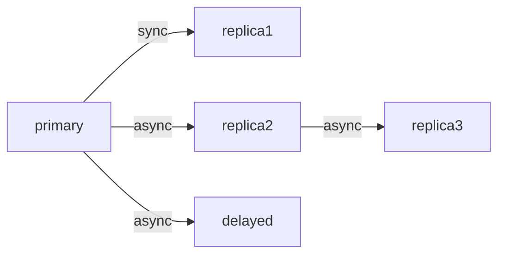

# Module 19 solutions

All results below come from runs on the module's lab (PostgreSQL 17.11, Bazaar state 11). LSNs, PIDs, IP addresses and timings differ on your machine; counts should not.

Runnable files in this directory:

| File | Exercise |
|---|---|
| `ex01_topology.sql` | 1 |
| `ex02_copied_settings.sql` | 2 |
| `ex04_heartbeat.sql` | 4 |
| `ex05_slot_warning.sql` | 5 |
| `ex07_read_your_writes.sql` | 7 |
| `ex08_replica_identity.sql` | 8 |
| `ex11_sequences.sql` | 11 |

The milestone's reference solution is in [`../lab/scripts/`](../lab/scripts/): `setup-analytics.sql`, `analytics-schema.sql` and `lag.sql` (see [`../project.md`](../project.md)).

---

## Exercise 1: Draw the topology from SQL alone

[`ex01_topology.sql`](ex01_topology.sql):

```sql
SELECT current_setting('cluster_name')                          AS node,
       CASE WHEN pg_is_in_recovery() THEN 'standby' ELSE 'primary' END AS role,
       (SELECT sender_host FROM pg_stat_wal_receiver)           AS streams_from,
       (SELECT string_agg(application_name || ' (' || sync_state || ')', ', '
                          ORDER BY application_name)
        FROM pg_stat_replication)                               AS feeds;
```

```bash
for n in m19-primary m19-replica1 m19-replica2 m19-delayed m19-replica3; do
  docker exec -i $n psql -U postgres -X -q -t < ../solutions/ex01_topology.sql; done
```

With the extras running:

```text
 primary  | primary |              | delayed (async), replica1 (sync), replica2 (async)
 replica1 | standby | m19-primary  |
 replica2 | standby | m19-primary  | replica3 (async)
 delayed  | standby | m19-primary  |
 replica3 | standby | m19-replica2 |
```



Notes:

- `pg_stat_wal_receiver` is empty on a primary, so the scalar subquery returns NULL; `pg_stat_replication` is empty on a leaf standby.
- `replica3` shows up as `async` on `replica2`: a cascaded standby can never be synchronous, because `synchronous_standby_names` only applies to a primary's direct standbys.
- `sender_host` comes from the standby's `primary_conninfo`; it is what the standby *tries* to reach. If the WAL receiver is not running (broken connection) the row is missing altogether, which is itself a useful signal.

---

## Exercise 2: What did `pg_basebackup` copy?

[`ex02_copied_settings.sql`](ex02_copied_settings.sql):

```sql
SELECT name, setting, applied
FROM pg_file_settings
WHERE sourcefile LIKE '%postgresql.auto.conf'
ORDER BY seqno;
```

On `m19-replica1` (the `primary_conninfo` value is shortened here):

```text
           name            |              setting               | applied
---------------------------+------------------------------------+---------
 wal_level                 | logical                            | t
 max_wal_senders           | 10                                 | t
 max_replication_slots     | 10                                 | t
 max_slot_wal_keep_size    | 2GB                                | t
 hot_standby               | on                                 | t
 synchronous_standby_names | FIRST 1 (replica1)                 | t
 track_commit_timestamp    | on                                 | t
 wal_log_hints             | on                                 | t
 primary_conninfo          | user=replicator password=replicator channel_binding=prefer host='m19-primary' port=5432 ... | t
 primary_slot_name         | replica1                           | t
(10 rows)
```

On `m19-primary` the same query returns the first 8 rows only. So 8 settings were **copied** from the primary's `postgresql.auto.conf` (everything set there with `ALTER SYSTEM` by `conf/primary-init.sh`), and 2 were **written by `-R`**.

Trouble after promoting `replica1`:

- `synchronous_standby_names = 'FIRST 1 (replica1)'`: the new primary would wait for a synchronous standby named `replica1`, which is itself. Every commit hangs (section 12.2).
- `primary_conninfo` and `primary_slot_name` are harmless after promotion: they are only used in standby mode. They do contain the replication password, though.
- The others are what you *want* on a server that may become primary (`wal_level`, `max_wal_senders`, `max_slot_wal_keep_size`, `wal_log_hints`).

`cluster_name` does not appear: the lab passes it on the command line (`-c cluster_name=replica1`), which is also why it differs per node although `postgresql.auto.conf` was copied. `pg_settings.source` shows `command line` for it.

---

## Exercise 3: Rename a standby

```sql
-- on m19-replica2
ALTER SYSTEM SET primary_conninfo = 'host=m19-primary user=replicator password=replicator application_name=reporting';
SELECT pg_reload_conf();
```

```text
 application_name | sync_state
------------------+------------
 delayed          | async
 replica1         | sync
 reporting        | async
```

`primary_conninfo` is reloadable (PostgreSQL 13+): on reload the WAL receiver restarts with the new connection string, and `application_name` in it takes precedence over `cluster_name`.

Doing the same to `replica1` (`application_name=hot_spare`):

```text
 application_name | sync_state
------------------+------------
 delayed          | async
 hot_spare        | async
 reporting        | async

 wait_event |                            query
------------+--------------------------------------------------------------
 SyncRep    | UPDATE inventory SET quantity = quantity WHERE product_id =
```

No connected standby matches `FIRST 1 (replica1)` any more, so every commit on the primary waits. This is exactly how a harmless-looking rename (or a typo in `synchronous_standby_names`) causes an outage.

**A trap in the undo.** The obvious undo, `ALTER SYSTEM RESET primary_conninfo`, does not restore the original value: it *removes* the line from `postgresql.auto.conf`, and the original line was written there by `pg_basebackup -R`. The standby is left with no `primary_conninfo` at all, stops streaming, and the commit keeps waiting:

```text
 still_waiting
---------------
             1

 application_name | sync_state
------------------+------------
 delayed          | async
 reporting        | async
```

The correct undo sets a full connection string again (without `application_name`, so `cluster_name` is used):

```sql
ALTER SYSTEM SET primary_conninfo = 'host=m19-primary user=replicator password=replicator';
SELECT pg_reload_conf();
```

on both standbys, after which the waiting `UPDATE` completed and `pg_stat_replication` showed `replica1 | sync` and `replica2 | async` again.

---

## Exercise 4: An honest lag measurement

[`ex04_heartbeat.sql`](ex04_heartbeat.sql) creates the table on the primary:

```sql
CREATE TABLE public.heartbeat (id int PRIMARY KEY, ts timestamptz NOT NULL);
INSERT INTO public.heartbeat VALUES (1, now());
```

the writer loop:

```bash
while true; do
  docker exec m19-primary psql -U postgres -d bazaar -qc "UPDATE public.heartbeat SET ts = now() WHERE id = 1"
  sleep 1
done
```

and the standby query:

```sql
SELECT now()::time(0) AS t, extract(epoch FROM now() - ts)::numeric(10,1) AS staleness_s
FROM public.heartbeat WHERE id = 1;
```

A run with a 15-second pause on `replica2` (each line is `time|staleness`, followed by `replay_lag` from the primary at the same moment):

```text
09:04:47|0.6                              <- normal
                                          <- pg_wal_replay_pause() on replica2
09:04:53|5.9
replay_lag=00:00:04.519652
09:04:58|11.3
replay_lag=00:00:10.243571
09:05:03|16.5
replay_lag=00:00:14.864997
                                          <- pg_wal_replay_resume()
09:05:06|0.7                              <- replica2
09:05:06|0.9                              <- replica1
```

Why it works: the staleness is "how old is the newest heartbeat this standby can see". The writer guarantees a fresh row every second whether or not the shop has traffic, so on an idle night it still says 0–1 s instead of growing like `now() - pg_last_xact_replay_timestamp()` does. And it measures exactly what users experience (data visibility), including replay pauses and conflicts.

Note that `replay_lag` also tracked the pause well here, because the heartbeat itself produces continuous WAL and therefore continuous lag samples. The stuck values described in section 6.2 happen when there is no new WAL to measure against. A heartbeat improves the built-in columns as well.

Production notes: put the table in a schema of its own (it must not get into application dumps or logical publications by accident; `FOR ALL TABLES` would include it); write it from something that runs where the primary is (Patroni and pg_cron can both do it); and remember that the staleness also includes clock skew between servers, so keep NTP running.

---

## Exercise 5: Slot early warning

[`ex05_slot_warning.sql`](ex05_slot_warning.sql):

```sql
WITH cap AS (
    SELECT CASE WHEN current_setting('max_slot_wal_keep_size') = '-1' THEN NULL
                ELSE pg_size_bytes(current_setting('max_slot_wal_keep_size')) END AS bytes
)
SELECT s.slot_name,
       s.slot_type,
       s.active,
       s.wal_status,
       pg_size_pretty(pg_wal_lsn_diff(pg_current_wal_lsn(), s.restart_lsn)) AS retained,
       pg_size_pretty(s.safe_wal_size)                                       AS safe_wal_size,
       round(100.0 * pg_wal_lsn_diff(pg_current_wal_lsn(), s.restart_lsn) / cap.bytes, 1)
                                                                             AS pct_of_cap
FROM pg_replication_slots AS s
CROSS JOIN cap
ORDER BY
    CASE s.wal_status WHEN 'lost' THEN 0 WHEN 'unreserved' THEN 1 WHEN 'extended' THEN 2 ELSE 3 END,
    s.active,                                                          -- inactive (false) first
    pg_wal_lsn_diff(pg_current_wal_lsn(), s.restart_lsn) DESC NULLS FIRST;
```

With `replica2` stopped and 800,000 rows of 200 bytes written:

```text
 slot_name | slot_type | active | wal_status | retained | safe_wal_size | pct_of_cap
-----------+-----------+--------+------------+----------+---------------+------------
 replica2  | physical  | f      | reserved   | 202 MB   | 1861 MB       |        9.9
 replica1  | physical  | t      | reserved   | 0 bytes  | 2053 MB       |        0.0
 delayed   | physical  | t      | reserved   | 0 bytes  | 2053 MB       |        0.0
```

After `docker start m19-replica2`:

```text
 slot_name | slot_type | active | wal_status | retained | safe_wal_size | pct_of_cap
-----------+-----------+--------+------------+----------+---------------+------------
 replica1  | physical  | t      | reserved   | 0 bytes  | 2053 MB       |        0.0
 replica2  | physical  | t      | reserved   | 0 bytes  | 2053 MB       |        0.0
 delayed   | physical  | t      | reserved   | 0 bytes  | 2053 MB       |        0.0
```

Reasoning:

- The sort order puts the worst `wal_status` first, then inactive slots (`false` sorts before `true`), then the biggest retention. `NULLS FIRST` puts slots with a NULL `restart_lsn` (an invalidated slot) at the top of their group.
- `pct_of_cap` is NULL when the cap is unlimited (`-1`): the honest answer is "no cap, so the limit is your disk", which you would then monitor with free-space checks.
- `safe_wal_size` is slightly above the 2 GB cap for healthy slots (2053 MB): it is computed from the cap *and* the WAL already kept for other reasons (`max_wal_size`), relative to the current insert position.
- The delayed standby's slot retains nothing, because the delay applies to *replay*, not to receiving and flushing WAL, and the slot follows the flush position.
- A good alert: `active = false` for more than a few minutes, or `wal_status` not `reserved`, or `pct_of_cap > 50`.

---

## Exercise 6: Quorums and the delayed standby

```sql
-- on the primary
ALTER SYSTEM SET synchronous_standby_names = 'ANY 1 (delayed)';
SELECT pg_reload_conf();
```

```text
 application_name | sync_state
------------------+------------
 delayed          | quorum
 replica1         | async
 replica2         | async
```

Measured with `\timing on` and `UPDATE public.heartbeat SET ts = now() WHERE id = 1` (any one-row write works):

```text
on: Time: 5.146 ms
remote_write: Time: 3.682 ms
```

and with `remote_apply`, after cancelling from another session at 10 seconds:

```text
 pid  | wait_event |     waiting
------+------------+-----------------
 1667 | SyncRep    | 00:00:10.086075

WARNING:  canceling wait for synchronous replication due to user request
DETAIL:  The transaction has already committed locally, but might not have been replicated to the standby.
UPDATE 1
Time: 10090.979 ms (00:10.091)
```

The prediction follows from section 2.2: `recovery_min_apply_delay` holds back only the **replay** position. The delayed standby writes and flushes WAL as soon as it arrives, so `remote_write` and `on` (flush) are as fast as with any standby. `remote_apply` waits for **replay**, which the delayed standby performs five minutes after the commit: every commit would take five minutes. Section 8.2's pitfall ("never use a delayed standby as a synchronous standby") in numbers.

A quorum such as `ANY 1 (replica1, delayed)` would hide the problem as long as `replica1` answers first, and turn into a five-minute stall the moment `replica1` goes away. Restore with `ALTER SYSTEM SET synchronous_standby_names = 'FIRST 1 (replica1)'` and a reload.

---

## Exercise 7: Read-your-writes in one psql script

[`ex07_read_your_writes.sql`](ex07_read_your_writes.sql):

```sql
\set ON_ERROR_STOP on

\connect 'host=m19-primary dbname=bazaar user=postgres'
SELECT place_order(2, '[{"product_id": 1, "quantity": 1}]') AS order_id \gset
SELECT pg_current_wal_lsn() AS lsn \gset
\echo placed order :order_id, commit LSN at most :lsn

\connect 'host=m19-replica2 dbname=bazaar user=postgres'
SET my.wait_lsn = :'lsn';
DO $$
DECLARE
    target   pg_lsn      := current_setting('my.wait_lsn')::pg_lsn;
    deadline timestamptz := clock_timestamp() + interval '5 seconds';
BEGIN
    WHILE pg_last_wal_replay_lsn() < target LOOP
        IF clock_timestamp() > deadline THEN
            RAISE EXCEPTION 'replica has not replayed % within 5 s (it is at %)',
                            target, pg_last_wal_replay_lsn();
        END IF;
        PERFORM pg_sleep(0.05);
    END LOOP;
END
$$;

SELECT id, status FROM orders WHERE id = :order_id;
```

```bash
docker exec -i -e PGPASSWORD=postgres m19-analytics psql -U postgres -X -q -f - < ../solutions/ex07_read_your_writes.sql
```

Normally:

```text
placed order 121, commit LSN at most 0/12B619C8
 id  | status
-----+---------
 121 | pending
```

With replay paused on `replica2` (`time` reported 5.19 s, exit status 3):

```text
placed order 122, commit LSN at most 0/12B62298
psql:<stdin>:29: ERROR:  replica has not replayed 0/12B62298 within 5 s (it is at 0/12B619C8)
CONTEXT:  PL/pgSQL function inline_code_block line 8 at RAISE
```

Reasoning:

- `pg_current_wal_lsn()` right after the commit is *at or after* the commit record, so waiting for it is safe (possibly a few bytes more than strictly necessary). An application would read it in the same session right after `COMMIT`.
- psql variables are not visible inside a `DO` body (it is a string literal), hence the detour through a custom setting (`SET my.wait_lsn = :'lsn'`, which is allowed on a standby). Alternatives: build the `DO` text with `format()` and run it with `\gexec`.
- `pg_last_wal_replay_lsn()` reads shared memory each call, so the loop sees progress although it runs in one transaction.
- `ON_ERROR_STOP` makes the script stop (exit status 3) instead of reading a stale replica. In an application the fallback would be "read from the primary instead" rather than an error.

---

## Exercise 8: Which tables are not ready for logical replication?

[`ex08_replica_identity.sql`](ex08_replica_identity.sql):

```sql
SELECT c.oid::regclass AS table_name,
       CASE c.relreplident
           WHEN 'd' THEN 'default (no primary key!)'
           WHEN 'n' THEN 'nothing'
       END AS problem
FROM pg_class AS c
WHERE c.relnamespace = 'bazaar'::regnamespace
  AND c.relkind IN ('r', 'p')
  AND NOT c.relispartition
  AND (c.relreplident = 'n'
       OR (c.relreplident = 'd'
           AND NOT EXISTS (SELECT 1 FROM pg_index AS i
                           WHERE i.indrelid = c.oid AND i.indisprimary)))
UNION ALL
SELECT c.oid::regclass,
       'FULL: every UPDATE/DELETE logs the whole old row; subscriber needs an index to find rows'
FROM pg_class AS c
WHERE c.relnamespace = 'bazaar'::regnamespace
  AND c.relkind IN ('r', 'p')
  AND c.relreplident = 'f'
ORDER BY 1;
```

On the state-11 database: `(0 rows)`. With the test table:

```text
   table_name   |          problem
----------------+---------------------------
 import_staging | default (no primary key!)
```

And once the milestone has been applied (it sets `orders` to `REPLICA IDENTITY FULL`):

```text
 table_name |                                         problem
------------+------------------------------------------------------------------------------------------
 orders     | FULL: every UPDATE/DELETE logs the whole old row; subscriber needs an index to find rows
```

Notes:

- `REPLICA IDENTITY USING INDEX` (`relreplident = 'i'`) is fine and not listed; you could add a check that the index still exists and is valid.
- Partitions are excluded (`relispartition`) because a partitioned table's identity is checked per partition; for a real check, include partitions and report each one.
- Fixes for a flagged table: add a primary key (best), `REPLICA IDENTITY USING INDEX` on a suitable unique index, or `REPLICA IDENTITY FULL` (works for any table, costs WAL and needs care on the subscriber). Or leave the table out of the publication.

---

## Exercise 9: Complaints for the analytics team

The first idea, `REPLICA IDENTITY FULL` (so that `rating` is part of the identity) plus a column list without `body`, fails on the next update, inside a test transaction:

```sql
BEGIN;
ALTER TABLE reviews REPLICA IDENTITY FULL;
ALTER PUBLICATION bazaar_analytics ADD TABLE reviews (id, product_id, user_id, rating, title, created_at) WHERE (rating <= 2);
UPDATE reviews SET rating = rating WHERE id = 1;
ROLLBACK;
```

```text
ERROR:  cannot update table "reviews"
DETAIL:  Column list used by the publication does not cover the replica identity.
```

With `FULL`, the identity is *every* column, so a column list that leaves out `body` cannot cover it. The two rules (the row filter's columns must be in the identity; the identity must be inside the column list) meet in the middle: the identity must contain `rating` but not `body`. A unique index on `(id, rating)` does exactly that (it is trivially unique because `id` is):

```sql
-- on the primary
CREATE UNIQUE INDEX reviews_id_rating_key ON reviews (id, rating);
ALTER TABLE reviews REPLICA IDENTITY USING INDEX reviews_id_rating_key;
GRANT SELECT ON reviews TO analytics_repl;
ALTER PUBLICATION bazaar_analytics
    ADD TABLE reviews (id, product_id, user_id, rating, title, created_at) WHERE (rating <= 2);
SELECT count(*) AS negative_reviews FROM reviews WHERE rating <= 2;    -- 15
```

```sql
-- on m19-analytics, database analytics
CREATE TABLE bazaar.reviews (
    id          bigint      PRIMARY KEY,
    product_id  bigint      NOT NULL,
    user_id     bigint      NOT NULL,
    rating      smallint    NOT NULL,
    title       text,
    created_at  timestamptz NOT NULL
);
ALTER SUBSCRIPTION bazaar_analytics REFRESH PUBLICATION;
```

```text
 count
-------
    15

      srrelid       | srsubstate
--------------------+------------
 bazaar.products    | r
 bazaar.orders      | r
 bazaar.order_items | r
 bazaar.reviews     | r
```

`REFRESH PUBLICATION` adds the new table to the subscription and copies only it (`copy_data` defaults to true for newly added tables); the three existing tables are not touched. Then:

```sql
-- on the primary
INSERT INTO reviews (product_id, user_id, rating, title) VALUES (2, 3, 1, 'Broke after a week') RETURNING id;   -- 79
```

appears on the analytics server within a second, and `UPDATE reviews SET rating = 5 WHERE id = 79` makes it disappear (old row matches the filter, new row does not, so a `DELETE` is sent; section 10.4). In the lab run the update was written with `WHERE title = 'Broke after a week'` and also hit four seeded reviews with that title; the analytics count followed correctly (11 on both sides), which is the real test.

Costs and alternatives: the extra unique index costs write time and space on the primary. `REPLICA IDENTITY FULL` without a column list (and accepting that `body` is copied) is the simpler alternative; publishing with `publish = 'insert'` only would avoid the identity question but would never remove a review whose rating changes.

---

## Exercise 10: Undo a `DROP TABLE` with the delayed standby

```bash
docker exec m19-primary psql -U postgres -d bazaar -c "DROP TABLE promotions"
docker exec m19-delayed psql -U postgres -d bazaar -c "SELECT pg_wal_replay_pause()" -c "SELECT count(*) FROM promotions"
docker exec m19-delayed pg_dump -U postgres -d bazaar -Fc -t bazaar.promotions |
  docker exec -i m19-primary pg_restore -U postgres -d bazaar
docker exec m19-primary psql -U postgres -d bazaar -c "SELECT count(*) FROM promotions" -c "\d promotions"
docker exec m19-delayed psql -U postgres -d bazaar -c "SELECT pg_wal_replay_resume()"
```

```text
 count
-------
     9          <- on the paused delayed standby
...
 count
-------
     9          <- back on the primary
    "promotions_no_overlap" EXCLUDE USING gist (product_id WITH =, active_during WITH &&)
    "promotions_discount_pct_range" CHECK (discount_pct > 0::numeric AND discount_pct < 100::numeric)
    "promotions_product_id_fkey" FOREIGN KEY (product_id) REFERENCES products(id) ON DELETE CASCADE
```

Reasoning:

- Pause first: the five-minute clock keeps running otherwise, and once the `DROP` is replayed the table is gone on the delayed standby too.
- `pg_dump` works on a hot standby: it only needs a `REPEATABLE READ` snapshot and `ACCESS SHARE` locks. (A very long dump of a big table on a standby that is *not* paused could be cancelled by a replication conflict; pausing also avoids that.)
- The dump of one table brings its identity sequence, indexes, constraints, comments, grants and policies; its dependencies (`btree_gist`, `products`) exist on the primary.
- After resuming, the delayed standby replays the `DROP` and then the re-creation five minutes later; nothing needs fixing there.
- Compared with Module 18's point-in-time recovery of a dropped table (exercise 12 there), this needs no base backup restore at all. The cost is a whole extra server, and it only helps if the mistake is noticed within the delay.

---

## Exercise 11: Rehearse a zero-downtime migration

**1. Schema.** Roles first (the schema's owners and the RLS policies of later states refer to them), then the schema, then the database-level setting that `pg_dump` without `--create` does not carry:

```bash
docker exec m19-primary pg_dumpall -U postgres --globals-only |
  docker exec -i m19-analytics psql -U postgres -q          # "role postgres already exists" is expected
docker exec m19-analytics psql -U postgres -c "CREATE DATABASE bazaar_v2" \
  -c "ALTER DATABASE bazaar_v2 SET search_path = bazaar, public"
docker exec m19-primary pg_dump -U postgres -d bazaar --schema-only |
  docker exec -i m19-analytics psql -U postgres -d bazaar_v2 -q -v ON_ERROR_STOP=1
```

```text
WARNING:  "wal_level" is insufficient to publish logical changes
HINT:  Set "wal_level" to "logical" before creating subscriptions.
```

The warning comes from the schema dump re-creating the milestone's publication `bazaar_analytics` on the new database (publications are part of a database's schema). It is useless there; drop it after the switchover.

**2. Publish and subscribe.**

```sql
-- on the old primary
CREATE PUBLICATION upgrade FOR ALL TABLES;
-- on m19-analytics, database bazaar_v2
CREATE SUBSCRIPTION upgrade
    CONNECTION 'host=m19-primary dbname=bazaar user=postgres password=postgres application_name=upgrade'
    PUBLICATION upgrade;
```

A few seconds later all 16 tables (15 Bazaar tables plus `public.heartbeat` from exercise 4, since `FOR ALL TABLES` means *all*) were in state `r`.

**3. Changes flow.** Two orders placed on the old primary (123 and 124) were on `bazaar_v2` within two seconds, with `total` computed by the publisher's trigger.

**4. Switchover.**

```sql
-- on the old primary: stop writes
ALTER DATABASE bazaar SET default_transaction_read_only = on;
SELECT count(pg_terminate_backend(pid)) FROM pg_stat_activity
WHERE datname = 'bazaar' AND backend_type = 'client backend' AND pid <> pg_backend_pid();
-- check: an INSERT now fails with "cannot execute INSERT in a read-only transaction"

-- wait for zero lag
SELECT slot_name, pg_wal_lsn_diff(pg_current_wal_lsn(), confirmed_flush_lsn) AS lag_bytes
FROM pg_replication_slots WHERE slot_name = 'upgrade';          -- 0
```

Then the sequences, with [`ex11_sequences.sql`](ex11_sequences.sql):

```bash
docker exec -i m19-primary psql -U postgres -d bazaar -Atq < ../solutions/ex11_sequences.sql |
  docker exec -i m19-analytics psql -U postgres -d bazaar_v2
```

```text
SELECT setval('bazaar.addresses_id_seq', 33, 'f');
SELECT setval('bazaar.audit_log_id_seq', 8, 't');
SELECT setval('bazaar.categories_id_seq', 24, 'f');
...
SELECT setval('bazaar.orders_id_seq', 124, 't');
...
SELECT setval('bazaar.users_id_seq', 31, 'f');
```

The first version of this script read `pg_sequences.last_value` and only produced three lines (`audit_log`, `orders`, `reviews`). `pg_sequences.last_value` is NULL when `is_called` is false, which is the state the Bazaar seeds leave most sequences in (`setval(seq, max(id) + 1, false)`). The missed sequences stayed at 1 on the new database, and the first new user failed:

```text
ERROR:  duplicate key value violates unique constraint "users_pkey"
DETAIL:  Key (id)=(1) already exists.
```

Reading `last_value, is_called` from each sequence relation (the `\gexec` trick in the script) copies the exact state; afterwards the same insert got id 31. Finally:

```sql
-- on bazaar_v2
DROP SUBSCRIPTION upgrade;                     -- also drops the slot on the old primary
DROP PUBLICATION IF EXISTS bazaar_analytics;   -- the useless copy
SELECT place_order(8, '[{"product_id": 1, "quantity": 1}]') AS new_order_on_v2;   -- 125
```

and a table-by-table count comparison (a shell loop over `pg_class`) reported every one of the 15 tables `same` (for example `orders 124 124`, `order_items 239 239`, `payments 140 140`).

Points to note:

- Triggers on `bazaar_v2` did not fire for replicated rows (`orders.total` came from the publisher), but they fire for new writes on `bazaar_v2`: `place_order()` computed the new order's total there. Exactly what a migration needs.
- In a real upgrade, the switchover order is: stop writes, wait for zero lag, sync sequences, **then** move the application, then drop the subscription. Writes on the new side before the sequence sync produce exactly the duplicate-key error above.
- Keep the old cluster read-only, not dropped, until you are confident; a reverse subscription (`copy_data = false`) from new to old keeps it current as a fallback.
- `ALTER DATABASE ... SET default_transaction_read_only` affects new sessions only; terminating existing sessions is what really stops writes. A connection pooler pause (PgBouncer `PAUSE`, Module 17) is the production-grade way.

---

## Exercise 12: Skip a transaction, then repair

The setup (next order id was 125; order 115 is pending and therefore not on the analytics server):

```sql
-- on m19-analytics
INSERT INTO bazaar.orders (id, user_id, seller_id, status, total, created_at, paid_at, updated_at)
VALUES (125, 1, 1, 'paid', 1.00, now(), now(), now());

-- on the primary, one transaction
BEGIN;
UPDATE orders SET status = 'paid', paid_at = now() WHERE id = 115;
SELECT place_order(13, '[{"product_id": 2, "quantity": 1}]') AS new_order;     -- 125
UPDATE orders SET status = 'paid', paid_at = now() WHERE id = 125;
COMMIT;
```

```text
ERROR:  duplicate key value violates unique constraint "orders_pkey"
DETAIL:  Key (id)=(125) already exists.
CONTEXT:  processing remote data for replication origin "pg_16417" during message type "INSERT" for replication target relation "bazaar.orders" in transaction 886, finished at 0/12C2FF60
```

Skip it:

```sql
ALTER SUBSCRIPTION bazaar_analytics SKIP (lsn = '0/12C2FF60');
```

```text
LOG:  logical replication starts skipping transaction at LSN 0/12C2FF60
LOG:  logical replication completed skipping transaction at LSN 0/12C2FF60
```

`subskiplsn` returns to `0/0` once the skip has happened. The subscription runs again, but the subscriber now lacks **everything** in transaction 886:

```text
 id  | status | total | paid
-----+--------+-------+------
 125 | paid   |  1.00 | t          <- still the junk row; order 115 is missing entirely

 items_of_new_order
--------------------
                  0
```

As seen by the subscriber, transaction 886 contained: an `INSERT` of order 115 (the payment moved it *into* the row filter), an `INSERT` of order 125's `order_items` row (no filter on that table), and an `INSERT` of order 125 (it was paid inside the transaction, so it entered the filter). All three were dropped.

The repair: remove the junk row, then copy the affected rows from the publisher:

```bash
docker exec m19-analytics psql -U postgres -d analytics -c "DELETE FROM bazaar.orders WHERE id = 125"
docker exec m19-primary psql -U postgres -d bazaar -c "\copy (SELECT id, user_id, seller_id, status, total, created_at, paid_at, shipped_at, delivered_at, shipping_address_id, updated_at FROM bazaar.orders WHERE id IN (115, 125)) TO STDOUT" |
  docker exec -i m19-analytics psql -U postgres -d analytics -c "\copy bazaar.orders (id, user_id, seller_id, status, total, created_at, paid_at, shipped_at, delivered_at, shipping_address_id, updated_at) FROM STDIN"
docker exec m19-primary psql -U postgres -d bazaar -c "\copy (SELECT * FROM bazaar.order_items WHERE order_id = 125) TO STDOUT" |
  docker exec -i m19-analytics psql -U postgres -d analytics -c "\copy bazaar.order_items FROM STDIN"
```

```text
COPY 2
COPY 1
```

Both sides then return the same rows:

```text
 id  | status |  total  |            paid_at
-----+--------+---------+-------------------------------
 115 | paid   |   24.00 | 2026-10-14 09:09:06.059832+00
 125 | paid   | 1499.00 | 2026-10-14 09:09:06.059832+00
```

and later changes apply normally (shipping order 125 on the primary showed `shipped` on the analytics server a moment later), with `apply_error_count` no longer increasing.

Reasoning:

- The column list in the `\copy` matters: the subscriber's `orders` has the extra `replicated_at` column, so `SELECT *` from the publisher would not line up.
- **Repair before new changes touch the same rows.** Had the primary updated order 115 again before the repair, that `UPDATE` would have found no row on the subscriber and been silently ignored (section 11.3), and the copy would still fix it, since it copies the current state. Any `DELETE` in between is the dangerous case: copying "current state" cannot tell you that a row should be gone. Keep the window short.
- Finding *what* a skipped transaction contained is the hard part in real life. Here we knew because we wrote it; in production you would decode the WAL around that LSN on the publisher (`pg_waldump`, or a temporary `test_decoding` slot positioned before it) or compare the tables.
- The safe but heavy alternative is to resynchronize the affected tables completely: `TRUNCATE` them on the subscriber and copy again (drop and re-add the table to the publication and `REFRESH PUBLICATION`, or recreate the subscription). It guarantees correctness at the cost of a full copy, which for analytics tables with years of orders may take hours.
