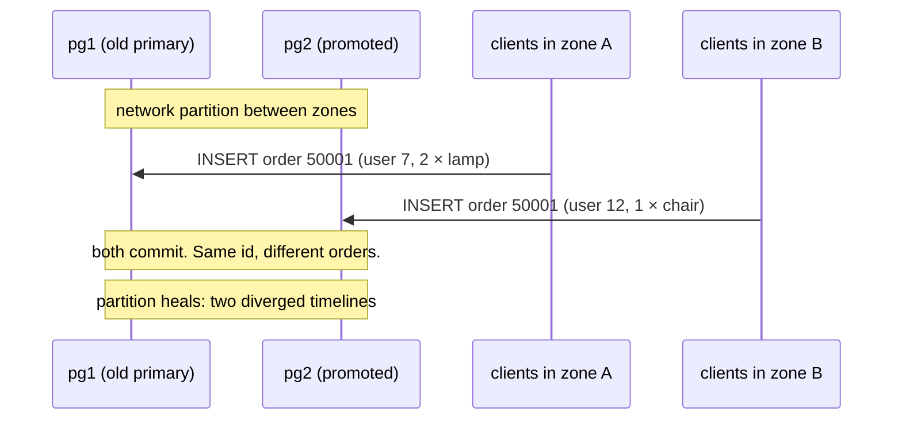
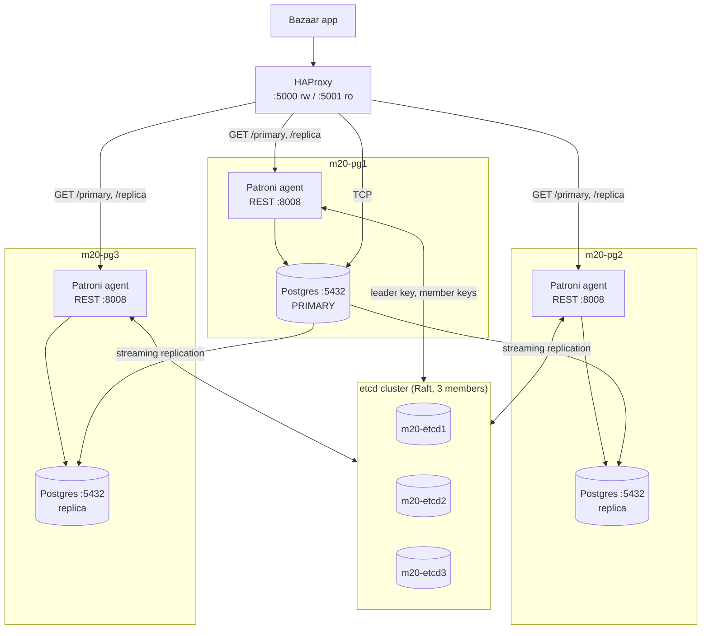

# Module 20: High Availability

<!-- nav:start -->
> **Theory** · [Exercises](exercises.md) · [Project](project.md) · [Solutions](solutions/README.md)  
> [← 19 Replication](../19-replication/README.md) · [Course home](../../README.md) · [21 Sharding →](../21-sharding/README.md)
<!-- nav:end -->

It is 03:12 on the Saturday of Bazaar's biggest sale of the year. The primary database server's NVMe drive stops answering. Thanks to Module 19, two streaming replicas hold an up-to-date copy of every order, and promoting one takes a single `SELECT pg_promote()`. But nobody is awake to run it. The pager fires at 03:15, the on-call engineer opens a laptop at 03:31, spends ten minutes making sure the old primary is *really* dead and not just unreachable, picks the replica with the most WAL, promotes it, edits the application's connection string, and redeploys. Checkout is back at 03:52: forty minutes of lost sales. And this was the *easy* case, because the old primary stayed dead. Had it come back at 03:40 while the replica was being promoted, Bazaar would have had two primaries taking orders at once.

High availability (HA) is the engineering that turns those forty minutes into about thirty seconds, with no human involved, and that makes "two primaries" impossible by construction. This module explains why that is harder than it looks, how Patroni solves it on top of the streaming replication you already know, and how applications have to behave so that a failover is a short blip rather than lost or duplicated orders.

<!-- toc:start -->
**Contents**

- [What you'll learn](#what-youll-learn)
- [Before you start](#before-you-start)
- [1. What "highly available" means](#1-what-highly-available-means)
  - [1.1 Availability in numbers](#11-availability-in-numbers)
  - [1.2 RPO and RTO, revisited](#12-rpo-and-rto-revisited)
  - [1.3 Planned and unplanned downtime](#13-planned-and-unplanned-downtime)
- [2. How a database cluster fails](#2-how-a-database-cluster-fails)
- [3. Why manual failover doesn't scale](#3-why-manual-failover-doesnt-scale)
- [4. The hard problems](#4-the-hard-problems)
  - [4.1 Failure detection](#41-failure-detection)
  - [4.2 Leader election and consensus](#42-leader-election-and-consensus)
  - [4.3 Split-brain](#43-split-brain)
  - [4.4 Fencing and STONITH](#44-fencing-and-stonith)
  - [4.5 The lease: putting it together](#45-the-lease-putting-it-together)
- [5. Patroni architecture](#5-patroni-architecture)
  - [5.1 The components](#51-the-components)
  - [5.2 What lives in the DCS](#52-what-lives-in-the-dcs)
  - [5.3 The HA loop](#53-the-ha-loop)
  - [5.4 The three timing knobs](#54-the-three-timing-knobs)
- [6. Bootstrap: how a Patroni cluster is born](#6-bootstrap-how-a-patroni-cluster-is-born)
- [7. Configuring Patroni](#7-configuring-patroni)
  - [7.1 Three layers of configuration](#71-three-layers-of-configuration)
  - [7.2 The lab's configuration, walked through](#72-the-labs-configuration-walked-through)
  - [7.3 What Patroni writes into the data directory](#73-what-patroni-writes-into-the-data-directory)
  - [7.4 Tags](#74-tags)
- [8. The REST API](#8-the-rest-api)
- [9. `patronictl`: operating the cluster](#9-patronictl-operating-the-cluster)
- [10. Synchronous mode: trading latency for RPO = 0](#10-synchronous-mode-trading-latency-for-rpo--0)
- [11. How Patroni decides: failover rules and edge cases](#11-how-patroni-decides-failover-rules-and-edge-cases)
  - [11.1 Who may become the leader](#111-who-may-become-the-leader)
  - [11.2 Primary process crash: restart in place, not failover](#112-primary-process-crash-restart-in-place-not-failover)
  - [11.3 Network partition: the old primary fences itself](#113-network-partition-the-old-primary-fences-itself)
  - [11.4 When the DCS itself fails](#114-when-the-dcs-itself-fails)
  - [11.5 Rejoining: `pg_rewind`, or clone again](#115-rejoining-pg_rewind-or-clone-again)
  - [11.6 The watchdog](#116-the-watchdog)
- [12. The lab: measuring failover](#12-the-lab-measuring-failover)
- [13. Routing clients to the primary](#13-routing-clients-to-the-primary)
  - [13.1 HAProxy with Patroni health checks](#131-haproxy-with-patroni-health-checks)
  - [13.2 libpq multi-host connection strings](#132-libpq-multi-host-connection-strings)
  - [13.3 PgBouncer: where to put the pooler](#133-pgbouncer-where-to-put-the-pooler)
  - [13.4 DNS and virtual IPs](#134-dns-and-virtual-ips)
- [14. Client behaviour during failover](#14-client-behaviour-during-failover)
  - [14.1 What clients see](#141-what-clients-see)
  - [14.2 In-flight transactions](#142-in-flight-transactions)
  - [14.3 Retries with idempotency keys](#143-retries-with-idempotency-keys)
  - [14.4 Connection pools and timeouts](#144-connection-pools-and-timeouts)
- [15. Alternatives to Patroni](#15-alternatives-to-patroni)
- [16. Operating an HA cluster](#16-operating-an-ha-cluster)
  - [16.1 Failure drills](#161-failure-drills)
  - [16.2 What to monitor](#162-what-to-monitor)
  - [16.3 Upgrades](#163-upgrades)
- [Summary](#summary)
- [What's next](#whats-next)

<!-- toc:end -->

**What you'll learn**

- How to reason about availability in numbers: nines, MTBF/MTTR, serial and parallel components, and RPO/RTO for HA.
- The failure modes of a database cluster (crash, node loss, partition, full disk, slow node) and what automation should and should not do about each.
- The hard problems behind automatic failover: failure detection, leader election, consensus, split-brain, fencing, and STONITH.
- How Patroni works: the agent on each node, the DCS (etcd), the leader key and its TTL, the HA loop, bootstrap, and its configuration model.
- How to operate Patroni: the REST API, `patronictl` (switchover, failover, restart, reinit, edit-config, pause/resume), synchronous mode, failover rules, `pg_rewind`, and the watchdog.
- How clients find the primary: HAProxy with Patroni health checks, libpq multi-host connection strings (`target_session_attrs`, `load_balance_hosts`), PgBouncer placement, DNS and virtual IPs.
- How applications must behave during a failover: which errors they see, what happens to in-flight transactions, and how to retry safely with idempotency keys.
- The alternatives (repmgr, pg_auto_failover, CloudNativePG, managed services) and how to choose.
- Operational practice: failure drills, monitoring, and upgrades of a Patroni cluster.

**Before you start**

- You have finished [Module 19](../19-replication/): streaming replication, replication slots, synchronous replication (`synchronous_standby_names`, `synchronous_commit`), `pg_promote()`, timelines, and `pg_rewind`. This module builds on all of them and does not re-teach them.
- This module does not use the single `course-pg` container. Its lab in [`lab/`](lab/) starts **eight containers**: three etcd members, three Patroni + PostgreSQL 17 nodes, HAProxy, and a client box. Plan for about 2 GB of free RAM, and about 2 GB of disk in total with the small Bazaar dataset (reset state 11), or about 10 GB with the full one (reset state 20: about 3 GB per node, three copies).
- Every container, network, and volume is prefixed with `m20-`, so the lab cannot collide with your course database. `./lab/scripts/down.sh` removes all of it.
- The lab scripts are Bash and assume GNU `date` (Linux, WSL, or macOS with coreutils).

```bash
cd modules/20-high-availability/lab
./scripts/up.sh                 # build the image (first run: a few minutes) and start the cluster
./scripts/load-bazaar.sh        # reset.sh 20 against whichever node is the leader (2-3 minutes)
./scripts/load-bazaar.sh 11     # or: the small dataset (seconds), enough for every exercise
```

If your network blocks the Debian package mirrors (the image installs Python with `apt-get`), build the fallback image instead: `M20_DOCKERFILE=Dockerfile.prebuilt ./scripts/up.sh`. It copies Python from the official `python` image.

The schema is not changed by this module. Like Modules 16 to 19, it works *on* the Bazaar database. The only new objects are in a separate schema, `ha_lab`, which the lab's client scripts create for their bookkeeping.

---

## 1. What "highly available" means

### 1.1 Availability in numbers

**Availability** is the fraction of time a service is usable:

```text
availability = uptime / (uptime + downtime)
```

It is usually quoted in "nines". Each extra nine cuts the allowed downtime by a factor of ten:

| Availability | Downtime per year | Downtime per 30-day month | Typical meaning |
|---|---|---|---|
| 99% ("two nines") | 3.65 days | 7.2 hours | A single server with backups and a good runbook |
| 99.9% | 8.77 hours | 43.2 minutes | One manual failover per month eats the whole budget |
| 99.95% | 4.38 hours | 21.6 minutes | Common cloud database SLA |
| 99.99% | 52.6 minutes | 4.3 minutes | Needs automatic failover, and planned maintenance without downtime |
| 99.999% | 5.26 minutes | 26 seconds | A *single* 30-second failover per month already breaks it |

Look at the last two rows next to Bazaar's 03:12 incident. One forty-minute manual failover per year is about 99.99%. The same incident once a month is about 99.9%. To get past four nines you need two things: failover must be automatic, and planned work (minor upgrades, configuration restarts) must not cause outages either.

A second useful formula relates availability to how often things break and how fast you fix them:

```text
availability = MTBF / (MTBF + MTTR)
```

**MTBF** (mean time between failures) is hard to improve: hardware fails, kernels panic, and cloud VMs get retired. **MTTR** (mean time to recovery) is where HA works. It does not make servers fail less. It makes recovery take seconds instead of tens of minutes. If a node fails every 90 days, a 40-minute MTTR gives 99.97%. A 30-second MTTR gives 99.9996%.

Two rules govern systems made of several parts:

- **Components in series multiply.** A request to Bazaar needs the load balancer (99.99%), an app server (99.95%), *and* the database (99.95%): 0.9999 × 0.9995 × 0.9995 ≈ 99.89%. A chain is weaker than its weakest link.
- **Redundant components in parallel combine** as `1 − (1 − a)ⁿ`: two independent 99% nodes, where either one is enough, give 1 − 0.01² = 99.99%.

The parallel formula assumes **independent** failures, and that assumption is the trap. Two replicas in the same rack share a power feed. Three nodes running the same PostgreSQL build share the same bug. A bad configuration change is replicated to every node in seconds. Real HA designs therefore spread nodes across failure domains (racks, availability zones), and treat software and operator error as failure modes in their own right.

### 1.2 RPO and RTO, revisited

[Module 18](../18-backup-recovery/) introduced the two numbers every recovery plan must state:

- **RPO** (recovery point objective): how much committed data you may lose, measured in time or in transactions.
- **RTO** (recovery time objective): how long the service may be down.

Backups and PITR give an RPO of "since the last archived WAL segment" and an RTO of "however long the restore takes", which is minutes to hours. HA moves both much lower:

| Mechanism | Typical RPO | Typical RTO |
|---|---|---|
| Nightly `pg_dump` | up to 24 h | hours |
| Base backup + WAL archive (PITR) | ~1 WAL segment or `archive_timeout` | minutes to hours |
| Manual failover to an async replica | the replica's lag (usually < 1 s) | 10 to 60 min (human) |
| **Automatic failover, async replicas** | the replica's lag at the moment of failure | ~10 to 40 s |
| **Automatic failover, synchronous replication** | **0** (with caveats, see Section 10) | ~10 to 40 s, plus some extra write latency at all times |

> **Pitfall:** HA is not a backup. A replica faithfully replays `DELETE FROM bazaar.orders;` within milliseconds. HA protects against *infrastructure* failure. Backups and PITR (Module 18) protect against *data* failure, such as bugs, bad migrations, and operator mistakes. You need both.

### 1.3 Planned and unplanned downtime

Downtime comes in two kinds:

- **Unplanned:** crashes, hardware failure, network trouble. HA's job is to detect it and recover automatically.
- **Planned:** minor version upgrades, OS patches, restarts for `shared_buffers`, moving to bigger hardware. HA's job is to make it a *switchover*: a controlled change of primary that takes a couple of seconds and loses nothing.

In practice planned downtime is usually the larger total. One of the most useful things Patroni gives you is the ability to patch every node in a three-node cluster with about two seconds of write unavailability, in the middle of the day.

---

## 2. How a database cluster fails

Every HA decision starts from a failure mode. Here are the ones that matter, and what an automated system should do about each.

| Failure | What you observe | What automation should do |
|---|---|---|
| **Postgres process crash** (OOM killer, segfault in an extension, `kill -9`) | Connections drop. The postmaster runs crash recovery and is back in seconds, *unless* the postmaster itself died. | Restart Postgres **in place** (crash recovery replays WAL). Failing over would be slower and riskier than waiting a few seconds. |
| **Node loss** (kernel panic, hardware failure, VM terminated, power loss) | The node stops answering anything: no Postgres, no SSH, no heartbeat. | Fail over to the best replica. Make sure the old node cannot come back as a primary. |
| **Network partition** | The node is alive and *thinks* it is fine, but some or all peers cannot reach it. Clients on its side of the partition may still reach it. | The most dangerous case. The majority side may elect a new primary; the minority side **must stop accepting writes**. |
| **Disk full** | WAL cannot be written: Postgres hits `PANIC: could not write to file "pg_wal/..."` and stops. A full disk on a replica stops replay. Common cause: an abandoned replication slot retaining WAL (Module 19). | Failing over may help if the cause is local. If the cause is cluster-wide (a runaway bulk load, a stuck slot), the new primary fills up too. Alert *before* it happens. |
| **Slow or "gray" failure** (I/O stalls, swapping, a noisy neighbour, a saturated NIC) | Health checks pass sometimes, queries time out, replication lag grows. | The hardest to automate. Lag-aware routing and `maximum_lag_on_failover` keep a sick replica from becoming primary. A sick *primary* often needs a human to decide. |
| **Coordination store (DCS) failure** | The HA system loses the ability to agree on anything. | Fail *safe*: never create a second primary. Ideally, keep the current primary running (Patroni's failsafe mode, Section 11.4). |
| **Human error** | `DROP TABLE`, wrong `pg_hba.conf`, `rm -rf` on the wrong host | Not an HA problem: restore from backup (Module 18). HA must not make it worse, for example by failing over to a node with the same bad configuration. |

One observation underlies everything in Sections 3 and 4:

> **From the outside, "dead", "slow", and "unreachable from here" look exactly the same.** A monitor that gets no answer cannot tell whether the primary has lost power, is stuck in a 40-second I/O stall, or is perfectly healthy behind a broken switch and still serving clients on the other side.

Any automated failover therefore has to be designed so that it is **safe even when its diagnosis is wrong**.

---

## 3. Why manual failover doesn't scale

[Module 19](../19-replication/) ended with a manual failover. In outline:

1. Notice that the primary is gone (an alert, or angry users).
2. Confirm that it is really gone, and make sure it **stays** gone: stop the service, power off the VM, or at least block its port.
3. Compare the replicas' `pg_last_wal_receive_lsn()` and pick the most advanced one.
4. `SELECT pg_promote();` on it.
5. Re-point the other replicas at the new primary (`primary_conninfo`, reload or restart).
6. Re-point the applications (configuration, DNS, or a load balancer).
7. Later: rebuild the old primary as a replica with `pg_rewind` or a fresh `pg_basebackup`.

Each step is easy, but together they fail in practice for three reasons:

- **Time.** Detection (1–5 min) + paging and waking up (5–20 min) + diagnosis (5–15 min) + execution (5 min) adds up to an MTTR in the tens of minutes. That alone caps you at about three nines.
- **Error-prone steps under stress.** Step 2 is the one people skip at 3 a.m. Promoting a replica while the old primary is merely *unreachable from your laptop* gives you two primaries.
- **It doesn't scale.** A company with 200 Postgres clusters has several node failures a week. Nobody can do all of those by hand, carefully, at night.

The obvious fix is a script, and the obvious script is dangerous:

```bash
# DON'T DO THIS: the naive failover script, running on the replica
while true; do
  if ! pg_isready -h primary -t 3; then
    psql -c "SELECT pg_promote()"      # "the primary is dead, long live the primary"
    break
  fi
  sleep 5
done
```

Now run it on two replicas and imagine a network blip between the replicas and the primary, while clients can still reach the primary. Both replicas promote themselves. You now have *three* primaries, each accepting different orders. That is the problem Section 4 is about.

---

## 4. The hard problems

### 4.1 Failure detection

A node is declared dead when it has been silent for longer than a **timeout**. Every timeout is a trade-off:

- **Short timeouts** detect failures quickly, but also fire on a GC pause, a slow fsync, or a congested link. Each **false positive** causes an unnecessary failover: a few seconds of downtime, a timeline switch, and possibly lost async transactions.
- **Long timeouts** avoid false positives, but every real failure costs at least the timeout in downtime.

Patroni's default leader lease is 30 seconds. You will see in the lab that this is almost exactly how long a hard crash of the primary takes to fail over. The minimum Patroni allows is 20 seconds. Sub-second failover is not a goal for a database: a few seconds of false positive costs more than it saves.

### 4.2 Leader election and consensus

There must be **exactly one primary** at any moment. Choosing it is a **leader election**, and doing it correctly among machines that can crash and lose messages is the **consensus** problem of distributed systems.

The essential idea is a **majority quorum**. Run an odd number of voters (3 or 5). A decision is made only when a majority (2 of 3, 3 of 5) agrees. Two disjoint majorities cannot exist, so two sides of a partition can never both elect a leader. The side with the minority knows it is the minority, because it cannot collect enough votes, and does nothing.

The algorithm used by etcd, Consul, and Kubernetes' datastore is **Raft**. In brief:

- One member is the Raft *leader*. All writes go through it, are appended to a replicated log, and count as **committed** only once a majority of members have the entry on disk.
- Members expect regular heartbeats from the leader. A member that stops hearing them waits a randomized election timeout, increments the **term** (a logical epoch number), and asks for votes. A member votes at most once per term, and only for a candidate whose log is at least as up-to-date as its own. A majority of votes makes it the new leader.
- A stale leader from an older term that reconnects sees the higher term and steps down. Its uncommitted entries are discarded.

You never implement Raft yourself. What matters is what it guarantees: **a linearizable key-value store that stays correct under partitions and keeps working while a majority of its members is up.** With 3 members it survives 1 failure. With 5 it survives 2.

> **Under the hood:** this is also why a 2-node etcd cluster is *worse* than a single node. The majority of 2 is 2, so losing either member stops it, and you have doubled the number of things that can fail. The same applies to 4 members versus 3: both survive only one failure (5 survives 2). Always use an odd number.

### 4.3 Split-brain

**Split-brain** means two nodes both believe they are the primary and both accept writes. It is the worst outcome in HA because it **creates conflicting data** rather than just losing some:



When the partition heals, `orders.id = 50001` refers to two different purchases. Stock has been reserved twice from two different counts, and payments were captured against both. There is no automatic merge. Someone must reconcile by hand from both nodes' data, and one side is usually rewound with `pg_rewind`, which **throws its divergent transactions away**. Every HA design is judged first on whether it can produce split-brain.

### 4.4 Fencing and STONITH

Electing a new primary is half the job. The other half is making sure the **old** primary can no longer accept writes, even if it is alive and does not know it has been replaced. This is **fencing**. The main techniques, from crude to subtle:

- **STONITH** ("shoot the other node in the head"): power the old node off through an out-of-band channel, such as an IPMI/iLO controller, a PDU, or the cloud provider's "stop instance" API, *before* promoting the replacement. It is crude and effective, but needs a working out-of-band path, and that path may be affected by the very failure you are handling.
- **Resource fencing:** cut the old primary off from what it needs. Detach its storage volume, revoke it from a SAN, move the virtual IP away, or remove it from the load balancer.
- **Self-fencing:** the node fences *itself*. It holds the primary role only while it holds a time-limited **lease**, and it demotes itself when it cannot renew the lease. This needs no out-of-band control, but it depends on the node being healthy enough to notice and act. A node frozen by the kernel cannot demote itself.
- **Watchdog:** backs up self-fencing with hardware or a kernel timer. If the HA agent stops "petting" the watchdog before the lease expires, the kernel reboots the machine. A frozen node gets reset instead of waking up later still believing it is primary (Section 11.6).
- **Client-side fencing:** route clients only to the node that *currently* holds the lease, and cut existing connections to a node the moment it loses it. This doesn't stop the old node from accepting writes. It stops anyone from *sending* them.

Production systems layer several of these. Patroni uses self-fencing through a lease, optionally backed by a watchdog, plus client-side fencing through REST health checks.

### 4.5 The lease: putting it together

Leases solve the problems above with one mechanism. Use the consensus store as a referee:

1. There is one key, the **leader key**, with a **time to live (TTL)**. Whoever holds the key is the primary.
2. The holder must **renew** the key well before the TTL runs out. Renewal is a *compare-and-set*: "extend the key *only if* I still own it."
3. If the holder fails to renew in time, it **demotes itself** (self-fencing).
4. Other nodes may try to *create* the key only when it does not exist (it expired or was deleted). The store's atomic create-if-absent guarantees that exactly one of them wins.
5. Only the winner promotes.

Because the old holder stops being primary *before* its lease can expire (it gives up at about `retry_timeout`, well inside `ttl`), and nobody can take the key until it has expired, there is never a moment when two nodes legitimately hold it. A node cut off from the store cannot renew, so it demotes. A node that can reach the store, which requires reaching a majority of its members, is by definition on the majority side.

This pattern is called **DCS-based HA**, after the *distributed configuration store* that holds the lease (etcd, Consul, ZooKeeper, or the Kubernetes API). It is what Patroni implements.

---
## 5. Patroni architecture

[Patroni](https://github.com/patroni/patroni) is an open-source Python daemon, originally from Zalando, and the most widely deployed HA solution for PostgreSQL. It is a *template* for DCS-based HA: it does not replicate data itself (streaming replication does), and it does not route clients (HAProxy or libpq does). It decides **who is primary**, and it makes every node's Postgres match that decision.

### 5.1 The components



- **One Patroni agent per database node.** Patroni is the parent process of the postmaster: it runs `initdb` or `pg_basebackup`, writes `postgresql.conf`, `pg_hba.conf`, and the recovery settings, and starts, stops, promotes, demotes, and rewinds Postgres. In the lab, Patroni is PID 1 of each `m20-pgN` container.
- **The DCS** (distributed configuration store): etcd in the lab, Consul, ZooKeeper, or the Kubernetes API in other setups. It holds the leader key, each member's status, and the cluster-wide configuration. **Patroni nodes never vote among themselves.** All agreement goes through the DCS, and the DCS's own consensus (Raft, in etcd's case) makes it safe.
- **A REST API on every agent** (port 8008). Peers use it during elections, load balancers use it for health checks, and `patronictl` uses it to send commands.
- **`patronictl`**, the command-line tool. It reads the DCS and talks to the REST APIs. It can run on any machine that can reach both.

### 5.2 What lives in the DCS

Everything Patroni stores sits under `/<namespace>/<scope>/`. In the lab that is `/service/bazaar-ha/`. Here is the real content from the lab (`./scripts/etcd.sh`), trimmed:

```text
/service/bazaar-ha/config
{"ttl":30,"loop_wait":10,"retry_timeout":10,"maximum_lag_on_failover":1048576,"primary_start_timeout":300,"synchronous_mode":false, ... ,"postgresql":{"use_pg_rewind":true,"use_slots":true,"parameters":{"max_connections":100, ...}}}
/service/bazaar-ha/history
[[1,67674192,"no recovery target specified","2026-10-14T07:22:45.085417+00:00","pg1"],[2,67771248, ...]]
/service/bazaar-ha/initialize
7696419998835892256
/service/bazaar-ha/leader
pg2
/service/bazaar-ha/members/pg1
{"conn_url":"postgres://m20-pg1:5432/postgres","api_url":"http://m20-pg1:8008/patroni","state":"running","role":"replica","version":"4.1.5","xlog_location":68544600,"replay_lsn":68544600,"receive_lsn":68544600,"replication_state":"streaming","timeline":9}
/service/bazaar-ha/members/pg2
{"conn_url":"postgres://m20-pg2:5432/postgres","api_url":"http://m20-pg2:8008/patroni","state":"running","role":"primary","version":"4.1.5","xlog_location":68544384,"timeline":9}
/service/bazaar-ha/status
{"optime":68544384,"slots":{"pg1":68544384,"pg3":68544384,"pg2":68544384},"retain_slots":["pg1","pg2","pg3"]}
```

| Key | Meaning |
|---|---|
| `initialize` | The **system identifier** of the cluster (the number `initdb` generated, the same one `pg_controldata` shows). Created once by whichever node bootstraps first. A node whose data directory has a different identifier refuses to join. |
| `leader` | **The leader key.** Its value is the name of the current primary. It is attached to an etcd *lease* with the TTL. When the lease is not renewed, etcd deletes the key. |
| `members/<name>` | One per node, also on a TTL. Its connection URLs, role, state, timeline, and WAL positions. A node that dies disappears from this list after the TTL. |
| `config` | The **dynamic configuration** (Section 7), shared by every node. |
| `status` | The leader's last reported WAL position (`optime`) and the positions of the replication slots. Replicas compare themselves to `optime` to judge their own lag. |
| `history` | One entry per timeline switch: the LSN where it happened, when, and which node was the new primary. |
| `sync` | In synchronous mode, which standby is currently synchronous (Section 10). |
| `failover` | A pending switchover or failover request from `patronictl`. |

### 5.3 The HA loop

Each Patroni agent runs the same loop every `loop_wait` seconds (10 by default). It also wakes up early when the leader key changes, because it watches it. The loop, slightly simplified:

```text
read cluster state from the DCS (leader key, members, config, sync, failover request)
check local Postgres (running? primary or replica? WAL position? timeline?)

if I hold the leader key:
    try to RENEW the leader key (compare-and-set: "only if it still says me")
    if renewal succeeded:
        make sure Postgres runs as primary (promote it if it is not)
        manage synchronous_standby_names, replication slots, pending restarts
    else (DCS unreachable or the key is someone else's now):
        DEMOTE: stop accepting writes immediately          <- self-fencing
elif the leader key exists (someone else leads):
    make sure Postgres runs as a replica that streams from that leader
    (rewrite primary_conninfo, pg_rewind or re-clone if my timeline diverged)
else (no leader key: it expired or was released):
    am I a healthy candidate? (Section 11.1)
      - not tagged nofailover, Postgres running
      - not lagging more than maximum_lag_on_failover
      - ask every other member over REST: is anyone a running primary?
        is anyone ahead of me in WAL? -> then not me
      - in synchronous mode: am I the synchronous standby?
    if yes: try to CREATE the leader key (atomic, fails if it exists)
            if I won: promote Postgres
            else:      follow whoever won
update my member key (state, role, WAL position)
sleep until loop_wait has passed, or wake on a DCS change
```

This loop is all of Patroni's HA logic. Everything else (switchover, pause, sync mode, failsafe) adds conditions to it.

### 5.4 The three timing knobs

| Parameter | Default | Meaning |
|---|---|---|
| `ttl` | 30 s | Lifetime of the leader key. If the leader doesn't renew it for this long, it expires and an election can start. **Minimum 20.** |
| `loop_wait` | 10 s | Pause between HA loop iterations, so how often the leader renews. |
| `retry_timeout` | 10 s | How long Patroni retries a DCS or Postgres operation before giving up. In particular, how long a leader keeps trying to renew before it demotes itself. |

Patroni enforces **`loop_wait + 2 × retry_timeout ≤ ttl`** and adjusts the values if you break the rule. The logic: the leader renews at the start of a loop. In the worst case the next renewal attempt starts `loop_wait` later and takes up to `retry_timeout` to fail. The leader must have **given up and demoted itself before its lease can expire and another node can take over.** The factor of 2 is a safety margin for a slow demotion. In the lab, setting `ttl=10` produced exactly this, in Patroni's log:

```text
WARNING: ttl=10 can't be smaller than 20, adjusting...
WARNING: Violated the rule "loop_wait + 2*retry_timeout <= ttl", where ttl=20. Adjusting loop_wait from 10 to 1 and retry_timeout from 10 to 9
```

What the knobs mean in practice:

- After a **hard crash** of the primary (nobody releases the key), failover takes about `ttl` seconds. The key must expire first.
- After a **clean shutdown** or a **switchover**, the old leader *deletes* the key itself, so failover takes a couple of seconds.
- When the primary is **cut off from the DCS**, it demotes itself after roughly `loop_wait` plus `retry_timeout`. That is *before* the others can elect a replacement (`ttl`). The gap between the two is the margin that prevents split-brain.

Section 12 measures all three in the lab.

---

## 6. Bootstrap: how a Patroni cluster is born

When you start three empty nodes at once (`./scripts/up.sh`), they race:

1. Each agent looks for `/service/bazaar-ha/initialize`. It doesn't exist.
2. Each tries to **create** it atomically. Exactly one wins. In the lab run that was `pg2`.
3. The winner runs `initdb` with the `bootstrap.initdb` options, starts Postgres, writes `bootstrap.dcs` into the `config` key, takes the leader key, and stores the new system identifier in `initialize`.
4. The losers wait for a leader. Then each runs `pg_basebackup` from it (the `create_replica_methods`), writes its recovery settings (`primary_conninfo`, `primary_slot_name`), and starts as a streaming replica. On the leader, Patroni creates one **physical replication slot per member** (`use_slots: true`), so a replica that is down for a while doesn't lose the WAL it needs.

From the lab's first start:

```text
m20-pg2  INFO: Lock owner: None; I am pg2
m20-pg2  INFO: trying to bootstrap a new cluster
m20-pg2  ... initdb output: "Data page checksums are enabled." ...
m20-pg2  LOG:  database system is ready to accept connections

m20-pg1  INFO: Lock owner: None; I am pg1
m20-pg1  INFO: waiting for leader to bootstrap
m20-pg1  INFO: Lock owner: pg2; I am pg1
m20-pg1  INFO: trying to bootstrap from leader 'pg2'
m20-pg1  INFO: replica has been created using basebackup
m20-pg1  INFO: bootstrapped from leader 'pg2'
```

The whole cluster was up, with both replicas streaming, **10 seconds** after `docker compose up`.

> **In production:** `bootstrap.*` is read **only once**, when the cluster is first initialized. Editing `bootstrap.dcs` in `patroni.yml` on a running cluster does nothing, which surprises everyone at least once. After bootstrap, the dynamic configuration lives in the DCS and you change it with `patronictl edit-config`.

> **Under the hood:** Patroni can also bootstrap a cluster from an existing backup instead of `initdb` (`bootstrap.method` with a custom script, for example a pgBackRest restore from Module 18). It can also build replicas from a backup repository instead of the primary (`create_replica_methods: [pgbackrest, basebackup]`). For a multi-terabyte database this matters a lot, because a `pg_basebackup` from the primary competes with production traffic.

---

## 7. Configuring Patroni

### 7.1 Three layers of configuration

Patroni's settings come from three places, in increasing precedence:

1. **Dynamic configuration**, stored in the DCS `config` key. It applies to **all** nodes, and you change it with `patronictl edit-config`. It holds the HA timings, `maximum_lag_on_failover`, synchronous mode, and the Postgres parameters that **must be identical on every node** (`max_connections`, `max_wal_senders`, `max_worker_processes`, `wal_level`, and so on). If a replica had a lower `max_connections` than the primary, it would refuse to start, so these belong in one shared place.
2. **Local configuration**: the YAML file(s) on each node. It holds the node's name, addresses, credentials, data directory, `pg_hba`, tags, and parameters that may legitimately differ between nodes.
3. **Environment variables** such as `PATRONI_NAME` or `PATRONI_POSTGRESQL_DATA_DIR`. They override the local file, which is convenient in containers.

For Postgres parameters, a value in the local `postgresql.parameters` overrides the dynamic one, *except* for the few that Patroni insists must be the same everywhere. Patroni also always sets some parameters itself, such as `listen_addresses`, `port`, `cluster_name`, and the recovery settings, regardless of what you write.

> **Pitfall:** don't use `ALTER SYSTEM` on a Patroni cluster for anything you want on every node. It writes to `postgresql.auto.conf` on **one** node only. It isn't replicated, and after a failover the new primary doesn't have your setting. Use `patronictl edit-config` so the setting reaches every node and survives failovers.

### 7.2 The lab's configuration, walked through

The lab splits the local configuration into two files. Patroni is started with a **directory** (`patroni /etc/patroni`), reads every `*.yml` in it in name order, and merges them:

- [`lab/patroni/patroni.yml`](lab/patroni/patroni.yml), mounted as `00-common.yml`, is shared by all three nodes.
- [`lab/patroni/pg1.yml`](lab/patroni/pg1.yml) (and `pg2.yml`, `pg3.yml`), mounted as `10-node.yml`, holds the per-node parts.

The interesting parts of the shared file:

```yaml
scope: bazaar-ha          # the cluster's name: all its keys live under /service/bazaar-ha/

restapi:
  listen: 0.0.0.0:8008

etcd3:
  hosts: [m20-etcd1:2379, m20-etcd2:2379, m20-etcd3:2379]

bootstrap:
  dcs:                              # -> the DYNAMIC configuration (written to etcd once)
    ttl: 30
    loop_wait: 10
    retry_timeout: 10
    maximum_lag_on_failover: 1048576    # 1 MiB
    primary_start_timeout: 300
    synchronous_mode: false
    synchronous_mode_strict: false
    failsafe_mode: false
    postgresql:
      use_pg_rewind: true
      use_slots: true
      parameters:
        max_connections: 100
        max_wal_senders: 10
        wal_level: replica
        hot_standby: 'on'
        wal_log_hints: 'on'
        wal_keep_size: 128MB
        ...
  initdb:
    - encoding: UTF8
    - locale: C.UTF-8
    - data-checksums

postgresql:                         # -> LOCAL configuration of this node
  listen: 0.0.0.0:5432
  data_dir: /var/lib/postgresql/data/pg17
  authentication:
    superuser:   {username: postgres,   password: postgres}
    replication: {username: replicator, password: replicator}
    rewind:      {username: rewinder,   password: rewinder}
  pg_hba:
    - local   all          all                       trust
    - host    all          all        127.0.0.1/32   trust
    - host    replication  replicator all            scram-sha-256
    - host    all          all        all            scram-sha-256
  create_replica_methods: [basebackup]
  basebackup: {checkpoint: fast, max-rate: 100M}

watchdog:
  mode: 'off'          # containers have no /dev/watchdog; production: required
```

And a per-node file:

```yaml
name: pg1
restapi:
  connect_address: m20-pg1:8008    # how OTHER nodes and HAProxy reach this agent
postgresql:
  connect_address: m20-pg1:5432    # how replicas and clients reach this Postgres
tags: {}
```

Some points worth noting:

- **`listen` and `connect_address` are different.** `listen` is the local bind address. `connect_address` is what Patroni *publishes* in the DCS for others to use. In the cloud this is often a private DNS name, while `listen` is `0.0.0.0`.
- **Three database users.** The superuser is used by Patroni itself. `replicator` is used for streaming and `pg_basebackup`. `rewinder` is a non-superuser role (PostgreSQL 11+) with exactly the function grants `pg_rewind` needs. Patroni creates `replicator` and `rewinder` during bootstrap.
- **`wal_log_hints` or data checksums** is required by `pg_rewind` (Module 19). We enabled both. PostgreSQL 17's `initdb` doesn't enable checksums by default.
- **`use_slots: true`** makes Patroni manage one physical slot per member. It creates them, keeps them on every node so they survive failovers (the `status` key above lists their positions), and drops the slot of a member that has been removed.

> **PG 18:** `initdb` enables data checksums by default from PostgreSQL 18, so `--data-checksums` becomes redundant. To keep an 18 cluster without checksums you would pass `--no-data-checksums`.

### 7.3 What Patroni writes into the data directory

Patroni **owns** `postgresql.conf` and `pg_hba.conf`. Here is the real `postgresql.conf` on a lab replica:

```text
# Do not edit this file manually!
# It will be overwritten by Patroni!
include 'postgresql.base.conf'

cluster_name = 'bazaar-ha'
hot_standby = 'on'
listen_addresses = '0.0.0.0'
max_connections = '100'
...
wal_level = 'replica'
wal_log_hints = 'on'
hba_file = '/var/lib/postgresql/data/pg17/pg_hba.conf'
ident_file = '/var/lib/postgresql/data/pg17/pg_ident.conf'

# recovery.conf
primary_conninfo = 'dbname=postgres user=replicator passfile=/tmp/pgpass host=m20-pg1 port=5432 sslmode=prefer application_name=pg3 ...'
primary_slot_name = 'pg3'
recovery_target_timeline = 'latest'
```

The `initdb`-generated file was renamed to `postgresql.base.conf` and is included first, so Patroni's values win. On a replica, Patroni also writes `standby.signal` plus `primary_conninfo` and `primary_slot_name`, pointing at whoever holds the leader key. When the leader changes, Patroni rewrites these two settings and reloads or restarts Postgres. That is how replicas "follow" the new primary without anyone touching them.

### 7.4 Tags

**Tags** are per-node flags that change how the *rest of the cluster* treats the node:

| Tag | Effect |
|---|---|
| `nofailover: true` | Never promote this node. Use it for a reporting replica on weaker hardware, or a node in a far-away region. |
| `failover_priority: N` | Among candidates with **equal** WAL positions, a higher value wins. `0` means the same as `nofailover`. |
| `noloadbalance: true` | `GET /replica` returns 503, so HAProxy keeps the node out of the read pool. Use it for a node reserved for backups or analytics. |
| `clonefrom: true` | New replicas prefer to `pg_basebackup` from this node instead of the primary. |
| `nosync: true` | Never chosen as the synchronous standby. |
| `replicatefrom: pg2` | Stream from `pg2` instead of the primary (cascading replication, Module 19). |

Tags are local configuration. Change them in the node's file and restart that node's Patroni (`docker restart m20-pg3` in the lab). `patronictl list` shows non-default tags in a `Tags` column.

---

## 8. The REST API

Every Patroni agent serves HTTP on port 8008. The **health-check endpoints** answer with a status code (and a JSON body) so that dumb load balancers can make smart decisions. Here is what the three lab nodes answered at one moment, with `pg3` as leader, `pg1` as synchronous standby, and `pg2` as asynchronous replica (try it yourself with `./scripts/rest.sh all /primary`, `./scripts/rest.sh m20-pg2 /patroni`, and so on):

| Endpoint | 200 when... | pg1 (sync standby) | pg2 (async replica) | pg3 (leader) |
|---|---|---|---|---|
| `GET /primary` (also `/`, `/read-write`) | this node is the running primary **and holds the leader key** | 503 | 503 | **200** |
| `GET /replica` | running replica, no `noloadbalance` tag | **200** | **200** | 503 |
| `GET /replica?lag=1MB` | same, and replay lag ≤ 1 MB | **200** | **200** | 503 |
| `GET /read-only` | primary or eligible replica | **200** | **200** | **200** |
| `GET /sync` (`/synchronous`) | the synchronous standby | **200** | 503 | 503 |
| `GET /async` | an asynchronous replica | 503 | **200** | 503 |
| `GET /health` | Postgres is running, whatever its role | **200** | **200** | **200** |
| `GET /liveness` | the Patroni agent's HA loop is alive (for Kubernetes) | **200** | **200** | **200** |
| `GET /readiness` | the node is ready to serve (leader, or a streaming replica) | **200** | **200** | **200** |

`/primary` requires the **leader key**, not just "Postgres is not in recovery". An old primary that is still running but has lost its lease answers 503, so the load balancer stops sending it traffic: that is the client-side fencing from Section 4.4.

The **information endpoints**:

- `GET /patroni`: this node's status. Here it is from the async replica `pg2`:

  ```json
  {
      "state": "running",
      "role": "replica",
      "server_version": 170011,
      "xlog": {"received_location": 1199980920, "replayed_location": 1199980920,
               "replayed_timestamp": "2026-10-14 08:00:47.652200+00:00", "paused": false},
      "timeline": 21,
      "replication_state": "streaming",
      "database_system_identifier": "7696419998835892256",
      "patroni": {"version": "4.1.5", "scope": "bazaar-ha", "name": "pg2"}
  }
  ```

- `GET /cluster`: all members with role, state, timeline, and lag. This is what `patronictl list` displays.
- `GET /history`, `GET /config`: the timeline history and the dynamic configuration.
- `GET /metrics`: Prometheus metrics, for example `patroni_primary 1`, `patroni_postgres_timeline 24`, `patroni_xlog_replayed_location`, `patroni_is_paused 0`, `patroni_pending_restart 0`, `patroni_dcs_last_seen`.

The **action endpoints** are `POST /switchover`, `POST /failover`, `POST /restart`, `POST /reload`, `POST /reinitialize`, and `PATCH /config`. `patronictl` uses them.

> **In production:** the action endpoints can take your database down. Protect them with `restapi.authentication` (username and password), TLS (`restapi.certfile`, optionally client certificates), and `restapi.allowlist`. The lab leaves them open, which is acceptable only on a private Docker network.

---

## 9. `patronictl`: operating the cluster

`patronictl` reads the DCS and calls the REST APIs. In the lab it is installed in every node's image and reads the merged configuration from `/etc/patroni`. All output below is from the lab.

**`list`**: the most-used command. `./scripts/cluster.sh` wraps it.

```text
$ docker exec m20-pg1 patronictl list
+ Cluster: bazaar-ha (7696419998835892256) ---+----+-------------+-----+------------+-----+
| Member | Host    | Role         | State     | TL | Receive LSN | Lag | Replay LSN | Lag |
+--------+---------+--------------+-----------+----+-------------+-----+------------+-----+
| pg1    | m20-pg1 | Sync Standby | streaming | 21 |  0/47864178 |   0 | 0/47864178 |   0 |
| pg2    | m20-pg2 | Replica      | streaming | 21 |  0/47864178 |   0 | 0/47864178 |   0 |
| pg3    | m20-pg3 | Leader       | running   | 21 |             |     |            |     |
+--------+---------+--------------+-----------+----+-------------+-----+------------+-----+
```

`TL` is the timeline (Module 19), which goes up by one with every promotion. `Lag` is in bytes, behind the primary. `-W` refreshes every two seconds, and `-e` adds columns such as pending restarts and tags.

**`topology`** draws the same data as a tree of who streams from whom. **`history`** lists the timeline switches:

```text
$ docker exec m20-pg1 patronictl history | tail -3
| 13 | 68861136 | no recovery target specified | 2026-10-14T07:39:55.601478+00:00 | pg1        |
| 14 | 69469272 | no recovery target specified | 2026-10-14T07:46:16.581501+00:00 | pg1        |
| 15 | 69659856 | no recovery target specified | 2026-10-14T07:48:44.573510+00:00 | pg2        |
```

**`switchover`**: a planned, graceful change of leader. Patroni checks that the candidate is healthy, then the old primary shuts down cleanly (so every committed transaction has been sent to the replicas), the candidate is promoted, and the old primary restarts as a replica. With `--scheduled 2026-10-15T03:00` it runs later. With `--candidate` you choose the target. In synchronous mode, the candidate **must be the synchronous standby**, because no other node is guaranteed to have every commit:

```text
$ docker exec m20-pg1 patronictl switchover --leader pg1 --candidate pg2 --force
Switchover failed, details: 412, candidate name does not match with sync_standby
```

**`failover`**: an unplanned, forced change of leader, for when there is no healthy leader or you must force a specific node. It skips some of switchover's safety checks, and asynchronous commits that the candidate hasn't received are lost. Prefer `switchover` whenever the primary is alive.

**`restart`**: restart Postgres on one or all members, now or `--scheduled`, optionally only those with `--pending` restart. **`reload`**: re-read the configuration (a `pg_ctl reload` plus Patroni's own settings).

**`edit-config`**: change the dynamic configuration. Without options it opens an editor on the YAML. With `-s key=value` (Patroni settings) or `-p name=value` (Postgres parameters) it is scriptable. Patroni applies reloadable parameters on every node within one `loop_wait`, and flags the ones that need a restart:

```text
$ docker exec m20-pg1 patronictl edit-config -p shared_buffers=256MB -p work_mem=8MB --force
...
+    work_mem: 8MB
Configuration changed

$ docker exec m20-pg1 patronictl list -e
| Member | ... | Pending restart | Pending restart reason       |
| pg1    | ... | *               | shared_buffers: 128MB->256MB |
| pg2    | ... | *               | shared_buffers: 128MB->256MB |
| pg3    | ... | *               | shared_buffers: 128MB->256MB |
```

`work_mem` took effect immediately. `shared_buffers` waits for `patronictl restart bazaar-ha --pending`, which restarted all three nodes in **8.9 s** in the lab. Restarting the *leader* restarts the primary, which is a short write outage. The zero-downtime pattern is: restart the replicas, switch over to one of them, then restart the old leader (now a replica).

**`reinit <cluster> <member>`**: throw away a replica's data directory and clone it again from the leader. Use it for a replica that `pg_rewind` couldn't fix, or that you suspect is corrupt. On the small lab dataset it took 4.9 s. On a terabyte it takes hours.

**`pause` / `resume`**: **maintenance mode.** While paused, Patroni keeps reporting status but **takes no automatic action**: no failover, no restarts, no demotion. Use it when you need to do something Patroni would otherwise "fix", such as stopping Postgres for manual surgery or upgrading Patroni itself. A stopped Patroni agent in paused mode leaves Postgres running. The lab shows exactly what pausing means. With the cluster paused, we killed the leader's postmaster with `kill -9`:

```text
INFO: PAUSE: removed leader lock because postgres is not running
WARNING: Postgresql is not running.
INFO: PAUSE: postgres is not running
```

Nothing else happened. There was no restart and no failover, and the cluster had no primary until we ran `patronictl resume`. At that point `pg2` took the free leader key within a second, and the old leader ran crash recovery and rejoined as a replica:

```text
INFO: doing crash recovery in a single user mode
INFO: Demoting primary during doing crash recovery in a single user mode
```

> **Pitfall:** a cluster left in maintenance mode has no automatic failover. `patronictl list` shows ` Maintenance mode: on` under the table, and `/metrics` exports `patroni_is_paused 1`. **Alert on it** if it stays on for longer than your longest maintenance window.

---
## 10. Synchronous mode: trading latency for RPO = 0

With asynchronous replication, a failover loses whatever the primary committed but the chosen replica hadn't received. Usually that's milliseconds of transactions, but for Bazaar's payments even one lost order is a support ticket. Module 19 showed `synchronous_standby_names`. Patroni manages it for you:

```text
$ docker exec m20-pg1 patronictl edit-config -s synchronous_mode=true --force
$ ./scripts/cluster.sh
| pg1    | m20-pg1 | Leader       | running   | 14 |             |     |            |     |
| pg2    | m20-pg2 | Replica      | streaming | 14 |   0/41B9CA0 |   0 |  0/41B9CA0 |   0 |
| pg3    | m20-pg3 | Sync Standby | streaming | 14 |   0/41B9CA0 |   0 |  0/41B9CA0 |   0 |
```

On the leader, Patroni set `synchronous_standby_names = 'pg3'`, and wrote `{"leader":"pg1","sync_standby":"pg3"}` into the `sync` key. Two rules make this give RPO = 0:

1. Every commit on the primary waits until the synchronous standby has flushed its WAL (`synchronous_commit = on`, Module 19).
2. **Only the node named in the `sync` key may be promoted** automatically. It is the only one guaranteed to have every acknowledged commit.

What happens when the synchronous standby fails? Here is what we measured in the lab, with the write loop running:

- **Kill the sync standby (pg3), pg2 still up:** Patroni noticed within one HA loop, chose pg2 as the new sync standby, and rewrote `synchronous_standby_names`. Writes did not fail, but they **stalled for about 6 seconds**: commits waited for pg3, which would never answer, until Patroni swapped it out.
- **Kill both replicas, with `synchronous_mode_strict: false`** (the default): one INSERT took **5.74 s**, then Patroni set `synchronous_standby_names` to `''`, and writes continued **without any synchronous replica**. Availability was preserved, and the RPO guarantee was silently gone until a replica returned.
- **Kill both replicas, with `synchronous_mode_strict: true`:** Patroni set `synchronous_standby_names = '*'` ("any standby"), and **every commit blocked** until a replica came back. Our INSERT hung for 36 s, until we started pg2 again, and finished 1.9 s after that.

So the trade-off is:

| Setting | Survives losing all replicas? | RPO | Cost |
|---|---|---|---|
| async (default) | yes | replica lag | none |
| `synchronous_mode: true` | yes, by dropping to async | 0, except while degraded | +1 network round trip per commit |
| `synchronous_mode_strict: true` | **no**: writes block | 0, always | the same, plus writes are unavailable without a replica |

Each commit pays a round trip to the standby. In one availability zone that is a fraction of a millisecond. Across zones it is usually 1–2 ms. That doesn't matter for a checkout, but it matters a lot for a bulk load of single-row transactions.

Two further knobs: `synchronous_node_count: 2` keeps two synchronous standbys. `synchronous_mode: quorum` (Patroni 4) uses `ANY n (...)` quorum commit: a commit waits for *any* n of the listed standbys, and Patroni's election makes sure the promoted node is among those that confirmed.

> **Pitfall:** "committed" is not "replicated" when a commit's synchronous wait is cancelled. In strict mode with no replicas, we cancelled a hanging INSERT with `pg_cancel_backend()`. The client then received **success**, with only this warning:
>
> ```text
> WARNING: canceling wait for synchronous replication due to user request
> DETAIL: The transaction has already committed locally, but might not have been replicated to the standby.
> ```
>
> The row was committed on the primary only. Had the primary died right then, a correctly promoted sync standby would not have it. Note that `statement_timeout` does **not** cancel this wait (it is switched off before the commit), but a cancel request or a terminated session does. Drivers that log and ignore warnings hide this from you.

---

## 11. How Patroni decides: failover rules and edge cases

### 11.1 Who may become the leader

When the leader key is gone, every replica runs the same eligibility check (Section 5.3) and only eligible nodes race for the key. A replica disqualifies itself if any of these is true:

1. It is tagged `nofailover` (or `failover_priority: 0`), or its Postgres isn't running.
2. Its WAL position is behind the last `optime` the leader published in the DCS by more than **`maximum_lag_on_failover`** (1 MiB by default). A replica that was hours behind would turn a failover into massive data loss, so Patroni prefers no failover at all.
3. Its timeline is behind the cluster's timeline.
4. Asking the other members over their REST APIs shows that **another node is still a running primary**, or that **another eligible node has received more WAL**. Then it defers to that node.
5. Among nodes with **equal** WAL positions, another has a higher `failover_priority`.
6. In synchronous mode, it is not the node recorded in the `sync` key.

If no node is eligible, for example because every replica lags by more than `maximum_lag_on_failover`, **no failover happens** and the cluster has no primary until a human acts (`patronictl failover --candidate ...` accepts the data loss explicitly). That is deliberate: Patroni won't trade an unknown amount of data for availability without being told to.

### 11.2 Primary process crash: restart in place, not failover

If Postgres on the leader dies but the Patroni agent lives, Patroni still holds the leader key, so no other node may take over. On its next loop it restarts Postgres (crash recovery) as primary. Only if Postgres does not come back within `primary_start_timeout` (300 s by default) does Patroni release the key for a failover. In the lab, `kill -9` of the leader's postmaster gave:

```text
WARNING: Postgresql is not running.
INFO: Lock owner: pg2; I am pg2
INFO: starting primary after failure
```

The write loop saw a **4.4 s** gap (in other runs up to 11 s: Patroni notices on its next loop, at most `loop_wait` later). There was no timeline change and no replica had to rewind. That is better than a failover, which is why it is the default.

### 11.3 Network partition: the old primary fences itself

We cut the leader off the network (`docker network disconnect`, `./scripts/failover-drill.sh partition`). Inside the isolated node, Patroni logged:

```text
07:24:46,989 INFO: Lock owner: pg3; I am pg3              <- last successful renewal
   (partition at 07:24:44.9)
07:24:55,945 ERROR: Error communicating with DCS
07:24:55,945 INFO: demoting self because DCS is not accessible and I was a leader
07:24:55,945 INFO: Demoting self (offline)
07:24:55.977 LOG:  received fast shutdown request
```

On the majority side, the leader key expired and `pg2` was promoted 25.3 s after the partition began. The isolated old primary had stopped accepting writes **14 seconds before** the new one started accepting them. That gap is the split-brain margin from Section 5.4 at work. When we reconnected the node, Patroni compared its timeline with the new leader's history (`Local timeline=4 lsn=0/40C8CB0`, `primary_timeline=5`), and the node rejoined as a streaming replica on timeline 5 within 15 seconds.

A detail visible in the logs: the demoted primary's shutdown sat in "shutting down" (refusing new connections with `FATAL: the database system is shutting down`) until the walsenders timed out, because they could not reach the replicas to send the final WAL. That is harmless, since nothing could write to it.

### 11.4 When the DCS itself fails

If the leader cannot reach the DCS, it cannot tell "I am partitioned" apart from "the DCS is down", so by default it demotes itself either way. In the lab we stopped two of the three etcd members (quorum lost) while writing:

- The leader demoted itself **19 s** later. **Every** node was now a read-only replica, and writes failed for **24.6 s** until we restarted etcd, when the same node took the leader key again. A DCS outage became a full write outage, even though every database was healthy.

Patroni 3.0 added **`failsafe_mode: true`** for this case. When the DCS is unreachable, the leader asks **every other member** directly over the REST API (`POST /failsafe`). If *all* of them answer, nobody can be electing a different primary, so it is safe to keep going. We repeated the experiment with failsafe mode on:

```text
ERROR: Error communicating with DCS
INFO: Got response from pg3 http://m20-pg3:8008/failsafe: Accepted
INFO: Got response from pg2 http://m20-pg2:8008/failsafe: Accepted
INFO: continue to run as a leader because failsafe mode is enabled and all members are accessible
```

**Zero** failed writes across a 40-second etcd outage. If even one member doesn't answer, the leader demotes as before, so it is still safe. Failsafe mode is worth enabling in most deployments. The leader also needs an up-to-date member list, which Patroni keeps in the DCS while it is healthy.

### 11.5 Rejoining: `pg_rewind`, or clone again

When an old primary comes back, its timeline may have **diverged**: it wrote WAL that the new primary never received (Module 19). With `use_pg_rewind: true`, Patroni runs `pg_rewind` against the new leader automatically. From the lab, after a `docker kill` of the leader and `./scripts/rejoin.sh m20-pg2`:

```text
INFO: Local timeline=1 lsn=0/5000028
INFO: primary_timeline=2
INFO: running pg_rewind from pg1
INFO: pg_rewind exit code=0
INFO:  stderr=pg_rewind: servers diverged at WAL location 0/408A050 on timeline 1
pg_rewind: rewinding from last common checkpoint at 0/2000150 on timeline 1
pg_rewind: Done!
INFO: starting as a secondary
LOG:  started streaming WAL from primary at 0/4000000 on timeline 2
INFO: no action. I am (pg2), a secondary, and following a leader (pg1)
```

It was streaming again **6.7 s** after `docker start`. After a *clean* stop there is nothing to rewind, and it took 3.3 s. If `pg_rewind` fails (missing WAL, no `wal_log_hints` or checksums), Patroni can remove the data directory and clone a new replica (`remove_data_directory_on_rewind_failure`, `remove_data_directory_on_diverged_timelines`), or leave it for you to run `patronictl reinit`.

> **Pitfall:** the WAL that `pg_rewind` discards on the old primary consists of transactions that **were committed and acknowledged** there but never reached the new primary: the async RPO made concrete. Patroni rewinds automatically, so the loss is silent unless you look. With asynchronous replication, alert on every unplanned failover and compare the `history` LSN with the old primary's last LSN if you need to know what was lost.

### 11.6 The watchdog

Self-fencing assumes the old leader can act: notice that it failed to renew, and demote. A node frozen for 40 seconds (a stuck hypervisor, a kernel hang) can't. When it wakes up, Postgres is still a primary, and clients with open connections may write to it before Patroni's next loop demotes it.

The **watchdog** closes that gap. With `watchdog.mode: required`, Patroni opens `/dev/watchdog` (the Linux `softdog` module, or a hardware watchdog) when it becomes leader, and arms it to fire shortly before the leader key would expire (`ttl` minus `safety_margin`, default 5 s). Every successful renewal resets the timer. If Patroni hangs and cannot renew, **the kernel reboots the machine** before any other node can become leader. A frozen primary is reset instead of returning as a zombie. With `required`, a node whose watchdog cannot be opened refuses to become leader. With `automatic`, it uses one if available.

Containers usually have no `/dev/watchdog`, so the lab uses `mode: 'off'`. On VMs and bare metal, load `softdog` and give the Patroni user access to `/dev/watchdog`.

---

## 12. The lab: measuring failover

The lab's scripts turn everything above into numbers. The write loop ([`lab/client/writeloop.py`](lab/client/writeloop.py)) inserts a row every 100 ms in autocommit mode, reports when writes start and stop failing, and at the end checks which acknowledged rows actually exist. [`./scripts/failover-drill.sh MODE`](lab/scripts/failover-drill.sh) runs the write loop, hurts the leader after 8 seconds, and times how long until Patroni reports a new running leader.

```text
$ ./scripts/failover-drill.sh kill 60
07:22:14.918  docker kill m20-pg2
07:22:45.792  new leader m20-pg1 is running, 30.9s after the event
------------------------------- client output -------------------------------
07:22:07.512  writing to m20-pg2
07:22:15.045  WRITE FAILED seq=74: OperationalError: consuming input failed: server closed the connection unexpectedly
07:22:19.254  t= 11.8s  FAILING (3 errors so far)
...
07:22:45.279  RECOVERED seq=328 on m20-pg1: writes were failing for 30.23s (254 failed attempts); gap between successful commits 30.34s

=== run 3d69eb0c summary ===
attempts: 544   acknowledged: 290   failed: 254
verification on m20-pg1: rows in table 290
  acknowledged but LOST:            0
  error reported but row COMMITTED: 0
```

These are all our measurements on this lab (3 etcd + 3 Patroni nodes on one 4-CPU machine, Bazaar at reset state 11 unless noted), with the write loop going through HAProxy unless noted:

| Event | Settings | New leader running after | Write gap seen by the client |
|---|---|---|---|
| `docker kill` leader (hard crash), 6 runs | ttl 30, loop_wait 10, retry_timeout 10 | 27.3 – 30.9 s | 28.0 – 30.3 s |
| `docker kill` leader, client with multi-host libpq string instead of HAProxy | same | 22.7 s | 22.8 s |
| `docker kill` leader, 3 runs | **ttl 20, loop_wait 2, retry_timeout 5** | 18.8 – 20.1 s | 19.3 – 19.7 s |
| `docker kill` leader, full reset-20 dataset (500k orders) | defaults, synchronous mode | 25.5 s | 25.1 s |
| `docker stop` leader (clean shutdown: key released) | defaults | 3.6 s | 4.4 s |
| `patronictl switchover` | defaults | 4.2 s (incl. the command itself) | 2.3 s |
| Network partition of the leader | defaults | 25.3 s | 25.0 s |
| `kill -9` of the leader's postmaster only | defaults | no failover: restarted in place | 4.4 s |
| Sync standby killed | synchronous mode | no failover | 0 errors, ~6 s stall |
| 2 of 3 etcd members stopped | `failsafe_mode: false` | none (all read-only) | 24.6 s (until etcd returned) |
| 2 of 3 etcd members stopped | `failsafe_mode: true` | no change needed | **0** |

Things to notice:

- **A hard crash costs about `ttl`.** The variation between runs depends on when, within its loop, the leader last renewed the key. Lowering `ttl` to its minimum of 20 cut the gap by a third.
- **Clean events are fast.** Stopping a node through Patroni, or a switchover, releases the key, so the gap was 2–4 s. Planned maintenance is cheap: use switchovers.
- **`acknowledged but LOST: 0` in every run, even asynchronous ones,** because the write loop's commits had reached the replicas within milliseconds. That is luck plus low load, not a guarantee: a busy primary with 50 ms of lag would have lost the last 50 ms of acknowledged writes.
- **The other count can be non-zero.** In the postmaster `kill -9` run, the client got an error for `seq=54`, yet the row was there afterwards: `error reported but row COMMITTED: 1 [54]`. Section 14 explains why, and why it matters.

---

## 13. Routing clients to the primary

After a failover the primary has a new address. There are four ways to get clients there.

### 13.1 HAProxy with Patroni health checks

HAProxy is a TCP proxy. It doesn't speak the Postgres protocol at all. It asks every node's Patroni over HTTP who is primary, and forwards TCP connections only to the node that says yes. The lab's [`haproxy.cfg`](lab/haproxy/haproxy.cfg):

```text
listen primary
    bind *:5000
    option httpchk
    http-check send meth GET uri /primary
    http-check expect status 200
    default-server inter 1s fall 2 rise 1 on-marked-down shutdown-sessions resolvers docker init-addr last,libc,none
    server pg1 m20-pg1:5432 check port 8008
    server pg2 m20-pg2:5432 check port 8008
    server pg3 m20-pg3:5432 check port 8008

listen replicas
    bind *:5001
    balance roundrobin
    option httpchk
    http-check send meth GET uri /replica
    ...same servers...
```

- Port **5000** is read-write: only the node whose `/primary` returns 200. Port **5001** is read-only, round-robin over nodes whose `/replica` returns 200. Use `/replica?lag=10MB` to exclude replicas that are too far behind.
- `inter 1s fall 2 rise 1`: check every second, mark a node down after 2 failures and up after 1 success. Detection takes about 2 s, which is small next to Patroni's own timings.
- **`on-marked-down shutdown-sessions`** matters. When the old primary stops answering 200, HAProxy **kills the existing client connections** to it. Without it, connections opened before the failover would stay attached to the old primary, which is client-side fencing undone.
- HAProxy logs every state change, and they are a useful timeline in a post-mortem (`docker logs m20-haproxy`):

  ```text
  Server primary/pg1 is DOWN, reason: Layer7 wrong status, code: 503, info: "Service Unavailable", check duration: 1ms. 1 active and 0 backup servers left.
  Server primary/pg3 is UP, reason: Layer7 check passed, code: 200, check duration: 8ms. 2 active and 0 backup servers online.
  ```

HAProxy is itself a single point of failure, so run two, either behind a virtual IP (keepalived) or one on each application host, listening on localhost. It is stateless, which makes it easy to duplicate.

### 13.2 libpq multi-host connection strings

libpq, and every driver built on it (psql, psycopg, and most others; asyncpg and the JDBC driver implement the same idea themselves), can be given **several hosts** and told what kind of server it needs:

```text
host=m20-pg1,m20-pg2,m20-pg3 port=5432 dbname=bazaar user=bazaar_app target_session_attrs=read-write connect_timeout=2
postgresql://bazaar_app@m20-pg1:5432,m20-pg2:5432,m20-pg3:5432/bazaar?target_session_attrs=read-write&connect_timeout=2
```

libpq tries the hosts **in order**. After connecting, it checks the server against `target_session_attrs` and moves on to the next host if it doesn't match:

| `target_session_attrs` | Accepts | Lab result with pg3 as primary |
|---|---|---|
| `any` (default) | the first server that accepts the connection | always pg1 (a replica) |
| `read-write` | a server where `default_transaction_read_only` is off and that is not in recovery | always pg3 |
| `primary` | a server not in recovery | always pg3 |
| `read-only` / `standby` | a server in recovery (read-only) | always pg1 |
| `prefer-standby` | a standby if any, else anything | always pg1 |

`load_balance_hosts=random` (PostgreSQL 16+ libpq) shuffles the host list first, which spreads read traffic. Sixty connections with `target_session_attrs=standby load_balance_hosts=random` landed **24 on pg1 and 36 on pg2**, and never on the primary.

Compared with HAProxy, there is no extra hop and nothing extra to run. The downsides: the host list lives in every client's configuration; libpq only checks the role **at connect time**, so a connection opened to a primary that is later demoted stays open (writes fail with `cannot execute INSERT in a read-only transaction`, and your code must reconnect); and a dead host costs up to `connect_timeout` per attempt. In our kill test the multi-host client recovered at the same moment Patroni promoted the new leader, without waiting for any health check.

### 13.3 PgBouncer: where to put the pooler

[Module 17](../17-operations/) introduced PgBouncer. In an HA cluster there are three common placements:

1. **On each database node, in front of the local Postgres.** HAProxy health checks still use Patroni's REST API and route to the PgBouncer port of the primary. The pooling is close to the database, and a failover moves the clients to another node's pooler. This is the most common setup.
2. **A separate PgBouncer tier pointing at HAProxy's port 5000** (or at a VIP). PgBouncer itself doesn't know about roles. After a failover its server connections to the old primary fail, and it opens new ones through HAProxy. Idle clients in transaction mode don't even notice. Lower `server_connect_timeout` from its 15 s default: Exercise 12 shows a 15-second stall when a reconnect races the switchover. Run at least two poolers.
3. **In the application** (psycopg_pool, SQLAlchemy's pool). Combine it with a multi-host string or HAProxy, and make sure the pool discards broken connections (Section 14.4).

A pooler on its own is not HA. Its job here is to absorb the reconnection storm: hundreds of app processes reconnecting at the same second after a failover.

### 13.4 DNS and virtual IPs

- **A virtual IP (VIP)** that always sits on the primary. **vip-manager** watches the leader key in etcd and, on whichever node holds it, adds the VIP to the network interface (announced with gratuitous ARP). Clients use a single IP and need nothing else. It works only within one L2 network or subnet. In the cloud you instead use the provider's API to move a secondary IP or an elastic IP, or you use a load balancer.
- **DNS**: a Patroni callback (`on_role_change`) or a controller updates a record such as `primary.db.bazaar.internal`. It is simple, but clients and resolvers cache answers. Even with a 5-second TTL, some runtimes (the JVM, for one) cache much longer. Treat DNS as a *discovery* mechanism with a short TTL, not as a fencing mechanism.
- **Service discovery**: Consul DNS, or a Kubernetes Service that Patroni or an operator keeps pointed at the leader pod.

**Callbacks** are scripts Patroni runs on events (`on_start`, `on_stop`, `on_role_change`, `on_reload`). They are the hook for "update DNS / notify the pager / move the IP". They run asynchronously and may fail, so never make correctness depend on a callback. The leader key and health checks provide correctness. Callbacks add convenience.

---

## 14. Client behaviour during failover

The database side of failover is now automatic. Whether Bazaar's customers notice depends on the application.

### 14.1 What clients see

During the drills, the write loop recorded these errors, in roughly this order:

| Error | SQLSTATE | When |
|---|---|---|
| `server closed the connection unexpectedly` | `08006` (connection failure) | the primary process or node died under an open connection |
| `terminating connection due to administrator command` | `57P01` (admin_shutdown) | the server shut down under an open connection: a clean stop, or the old primary during a switchover |
| `the database system is shutting down` / `is starting up` | `57P03` (cannot_connect_now) | connecting during a stop or start |
| `cannot execute INSERT in a read-only transaction` | `25006` (read_only_sql_transaction) | the connection is attached to a node that is now a replica (seen after the DCS-loss demotion) |
| `connection timeout expired` / `session is read-only` | (client side) | no primary available yet: HAProxy has no server up, or libpq found only replicas |

All of these mean "try again, on a new connection". None of them means the request was invalid.

### 14.2 In-flight transactions

When the primary goes away:

- **A transaction that hadn't sent `COMMIT` yet** is lost entirely. On a crash, its effects were never committed. On a clean shutdown, it is rolled back. Retrying the **whole transaction** from `BEGIN` is safe.
- **A transaction whose `COMMIT` was sent but whose reply never arrived** has an **unknown outcome**. The commit record may have been flushed, and in synchronous mode also confirmed by the standby, just before the connection died. The client can't tell. That is exactly `error reported but row COMMITTED: 1 [54]` in our postmaster-kill run: the client saw an error for a write that had succeeded.

Retrying an unknown-outcome commit blindly can **double** it: two orders, two payment captures. Not retrying can **lose** it from the user's point of view: "I clicked Pay and got an error, but was I charged?"

### 14.3 Retries with idempotency keys

The standard answer is to make the operation **idempotent**: give each logical request an ID chosen by the client, record that ID **in the same transaction** as the work, and check it first on every attempt:

```sql
BEGIN;
SELECT order_ids FROM ha_lab.checkout_requests WHERE request_id = $1;  -- already done?
-- if a row came back: COMMIT and return the stored result (it was the "unknown outcome")
SELECT * FROM bazaar.place_order($2, $3);                              -- the real work
INSERT INTO ha_lab.checkout_requests (request_id, order_ids) VALUES ($1, $4);
COMMIT;
```

Because the key and the orders commit atomically, the key exists if and only if the orders do. A retry after an unknown outcome finds the key and returns the original result. The `PRIMARY KEY` on `request_id` also protects against two concurrent retries.

The project milestone builds exactly this client. In a test where we `kill -9`'d the leader's postmaster six times in 80 seconds while it placed orders as fast as it could, one retry found its key already present:

```text
08:00:12.518  request 2ff61091: OperationalError (None), retrying
08:00:23.116  request 2ff61091 committed after 11 attempts on m20-pg3 (an earlier attempt had already committed: not placed twice)
...
checkouts acknowledged: 12563  retried: 6  replayed (dedup by request_id): 1
  ... LOST: 0
  orders created / found in orders: 21644 / 21644
```

The rest of a good retry policy:

- **Retry only retryable errors:** the connection and shutdown classes above, plus `40001` (serialization failure) and `40P01` (deadlock) from [Module 10](../10-transactions-concurrency/). Never retry constraint violations or `BZ001` (insufficient stock).
- **Exponential backoff with jitter** (0.1 s, 0.2 s, 0.4 s ... capped at a couple of seconds, each multiplied by a random factor), so a thousand clients don't hammer the new primary in lockstep the moment it appears.
- **An overall deadline** longer than your worst failover (about `ttl` plus a margin: 60–90 s with the defaults) and shorter than the user's patience. Past it, fail clearly.
- **Retry the whole transaction, never one statement** of a transaction that has lost its connection.

### 14.4 Connection pools and timeouts

- **Pools hold stale connections.** After a failover, every pooled connection to the old primary is dead or read-only. Configure the pool to test connections on checkout or discard them on error (psycopg_pool does both), set a maximum connection lifetime, and make sure one connection error doesn't make the pool hand out the next dead connection 50 times in a row.
- **`connect_timeout`** (2 s in the lab) bounds each attempt against a host that silently drops packets. Without it, a connection attempt to a vanished host can hang for the kernel's TCP timeout of over two minutes.
- **TCP keepalives and `tcp_user_timeout`** detect a server that disappeared *without* closing the connection (a partition or a powered-off VM). The milestone client uses `keepalives_idle=5 keepalives_interval=2 keepalives_count=2 tcp_user_timeout=5000`. Otherwise a session idle on a dead primary notices only when it next writes, and then waits for TCP retransmission timeouts.
- **Server-side settings** (`idle_in_transaction_session_timeout`, `statement_timeout`) keep a stuck client from holding locks on the new primary.
- **Session state is lost.** Prepared statements, temporary tables, `SET` values, and advisory locks belong to the connection. Re-establish them on reconnect, or avoid relying on them.

---

## 15. Alternatives to Patroni

| Tool | How it works | Choose it when |
|---|---|---|
| **Patroni** | An agent per node plus an external DCS (etcd, Consul, ZooKeeper, or the Kubernetes API). Lease-based leader election. Manages Postgres configuration, `pg_rewind`, sync mode, REST health checks. | You run Postgres on VMs or bare metal and want the most battle-tested, flexible option. It is the default choice. |
| **repmgr** | Tools and a daemon (`repmgrd`) for setting up replicas and failing over. Nodes monitor each other, and repmgr's metadata lives *in Postgres itself*. A **witness** node can help with quorum. | Mostly legacy setups. It has no external consensus store, so fencing relies on your own scripts and location-based heuristics. Easier to get split-brain wrong. Development has slowed. |
| **pg_auto_failover** | A **monitor** node (itself a Postgres instance) tracks keeper agents on each node and drives a state machine. Synchronous replication is built in. | Small clusters where you want something simple and opinionated with RPO = 0 by default. The monitor is a single point of decision: losing it disables failover (but doesn't stop the primary). |
| **CloudNativePG** (Kubernetes operator) | The operator watches Postgres pods and uses the **Kubernetes API** as its source of truth. It promotes the most advanced replica, updates `-rw`/`-ro` Services, fences pods, and integrates backups and rolling upgrades. | You already run Kubernetes seriously, including its storage, and want Postgres managed the Kubernetes way. (Zalando's Postgres Operator, Crunchy PGO, and StackGres instead run Patroni inside the pods.) |
| **Managed services**: AWS RDS Multi-AZ, Aurora, Google Cloud SQL HA, Azure Flexible Server zone-redundant HA | The provider runs a synchronous or storage-level standby and flips DNS on failure. Aurora replicates at the storage layer across 3 AZs, and its replicas share the volume. | You'd rather pay than operate: no Patroni, no etcd, no drills of your own. Typical failovers are 30–120 s (Aurora often under 30 s). You give up superuser, some extensions, and control over timing. |

A quick decision guide for Bazaar: on VMs with a team that can run etcd, choose Patroni. On a Kubernetes platform team, choose CloudNativePG. For a small team that wants to sleep at night, use a managed service and spend the saved effort on client-side retries, which you need in every option.

---

## 16. Operating an HA cluster

### 16.1 Failure drills

An untested failover is a hypothesis. Run **drills**, ideally regularly and in production during working hours, since that is where you learn something:

1. Announce it, and watch dashboards and error rates.
2. Planned: `patronictl switchover`. This should be routine, weekly or with every patch.
3. Unplanned: kill the leader node (`docker kill`, stop the VM, pull the network). Measure detection, failover, and client recovery times. Check the old node rejoins.
4. Partition: isolate the leader and confirm it demotes itself. Isolate one etcd member and confirm nothing happens.
5. Write down the numbers, compare them with your RTO, and fix whatever surprised you, which is usually a client that doesn't reconnect or a pool that keeps dead connections.

The lab's `failover-drill.sh` is a miniature of this.

### 16.2 What to monitor

- **Exactly one leader:** `patroni_primary` summed across nodes must be 1. Zero means an outage, and two means you have a big problem.
- **Members present and streaming:** count of members, `patroni_postgres_streaming`, replication lag in bytes and seconds.
- **Timeline changes:** `patroni_postgres_timeline` increased, so a failover happened. Page someone, even if it recovered by itself.
- **Maintenance mode left on** (`patroni_is_paused`), **pending restarts** (`patroni_pending_restart`).
- **Synchronous standby present** when you rely on synchronous mode (the `sync` key, or `/sync` returning 200 somewhere). Degraded non-strict sync mode silently means RPO > 0.
- **DCS health:** etcd member health, leader changes, fsync latency (etcd is very sensitive to slow disks), database size.
- **Disk space and slot retention**, the classic cause of a cluster-wide outage that no failover fixes.

### 16.3 Upgrades

- **Minor PostgreSQL upgrades** (17.5 → 17.6): install the new binaries on each node. Restart the replicas one by one (`patronictl restart bazaar-ha pg2`), then `switchover` to an upgraded replica, then restart the old leader. Total write unavailability is one switchover, a couple of seconds.
- **Patroni upgrades:** Patroni can be restarted without restarting Postgres. In maintenance mode (`pause`), stopping the agent leaves Postgres running. Pause, upgrade and restart the agents one by one, then resume.
- **Major PostgreSQL upgrades** (17 → 18): the data files must be converted. Either run `pg_upgrade` on the primary with the cluster paused, and re-clone the replicas or upgrade them with `rsync --hard-links` (minutes of downtime, carefully scripted), or build a new 18 cluster, replicate into it with **logical replication** (Module 19), and switch the application over (seconds of downtime, but more moving parts). Managed services and operators automate variations of both.
- **etcd:** keep it on its own small, fast-disk nodes (or at least its own disk). Use 3 members (5 for large estates), spread across failure domains, with periodic compaction and defragmentation, and back it up. Losing etcd's data is recoverable (Patroni re-creates its keys from the running nodes) but stressful.

> **In production:** the single-etcd shortcut. Running one etcd member (or etcd on the database nodes themselves) saves resources, and the lab could have used one. But a single etcd member is a single point of failure for *automatic failover*. With `failsafe_mode` it isn't for the running primary, but without it, losing that one member demotes your primary. Co-locating etcd members on the Postgres nodes ties their failures together: losing a node takes away a database *and* a vote at the same moment. The lab uses three separate etcd containers to show the real topology. On a laptop, a single `m20-etcd1` would also work, with the trade-off just described.

---

## Summary

- Availability is about MTTR. HA turns a 40-minute manual failover into roughly 30 seconds, and planned maintenance into 2-second switchovers. It does not replace backups.
- The core difficulty is that "dead" and "unreachable" look the same. Safe automation needs **consensus** (a majority quorum), a **lease** with a TTL, and **fencing**, so that an old primary cannot keep accepting writes. Split-brain is the failure that must never happen.
- **Patroni** runs an agent beside each Postgres, keeps the leader key in a DCS such as etcd, renews it every `loop_wait`, demotes itself when it cannot renew within `retry_timeout`, and lets the best replica take over when the key expires after `ttl` (`loop_wait + 2 × retry_timeout ≤ ttl`).
- Configuration is layered: dynamic settings live in the DCS (`patronictl edit-config`), local settings in YAML, and `bootstrap` is read only once. Patroni owns `postgresql.conf` and `pg_hba.conf`. Don't use `ALTER SYSTEM`.
- The REST API (`/primary`, `/replica`, `/health`, ...) lets load balancers route by role. `patronictl` does list, switchover, failover, restart, reinit, edit-config, and pause/resume.
- Measured in the lab: a hard crash failed over in 27–31 s (19–20 s with `ttl: 20`), a clean stop or switchover in 2–4 s, a primary process crash restarted in place in about 4 s, and losing etcd quorum caused a 25 s write outage that `failsafe_mode` reduced to zero.
- **Synchronous mode** gives RPO = 0 by only promoting the sync standby. Non-strict mode drops to async when no standby is left. Strict mode blocks writes instead.
- Clients reach the primary through HAProxy health checks, libpq multi-host strings with `target_session_attrs`, a VIP, or DNS. They must **retry with backoff on a fresh connection**, and protect commits whose outcome is unknown with **idempotency keys**.

## What's next

High availability keeps one primary alive, but every write still lands on that one primary. In [Module 21: Sharding](../21-sharding/) Bazaar outgrows a single writer: you will split data across several Postgres clusters by `seller_id`, each of which you could run as a Patroni cluster like this one.
